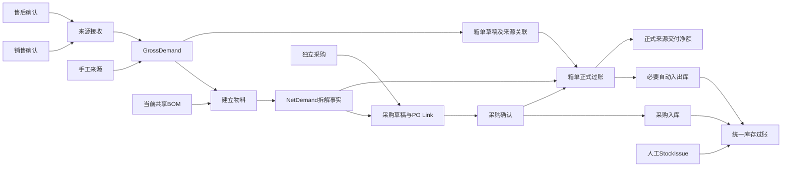

# ERP 业务流程导航图

核对日期：2026-10-06。图示当前调用方向，不表示全部场景已在本轮运行验证。

非标和CR来源当前按交付专用路径处理，不经标准库存动作。采购确认不读取BOM、不创建新确认组成节点。库存由仓库+产品维度维护；人工StockIssue不计客户交付。

## 反向交接

箱单整单反向撤销对应正式交付及自动库存事实；人工采购入库另走入库反向。采购取消确认保留Link，删行/作废释放贡献；物料完成安全回退后，来源退出再组合物料历史和Shipping证明。各域显式操作，不自动级联，不把实际客户退货等同于纠错反过账。

## 可见页面与限制

NavigationRouteRegistry 已注册销售管理/详情/履约、售后管理/详情、成品/物料需求及Trace、采购管理/详情/准备/跟进/关联/Trace、仓库/余额/流水、入出库管理和箱单管理/详情。路由注册不等于所有功能按钮已人工验收；具体读写API和模型见各[能力地图](业务模块能力与页面契约治理规则.md)。

仍有正数量售后单结案核验阻断，销售商业修订/恢复/行终止和生产客供料流程不能按旧图宣称已开放。当前源码入口和数量口径见[业务总纲](业务架构总纲.md)。
