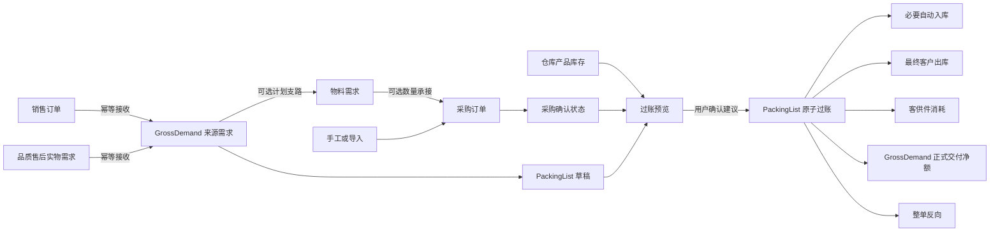

# SwiftExport ERP 业务流程导航图

> **2026-09-16 采购确认职责修正：** 采购确认只校验采购事实并锁定订单、允许入库；不读取完整 BOM、不创建新 BOM 确认节点、不绑定消耗仓，也不要求首次确认存在历史快照。已有确认快照仅作历史查询。草稿建立的未释放 Link 阻断需求回退；取消确认不释放，删行或作废才释放。客供件消耗归 PackingList 正式出货过账，实际仓和数量届时确定；跨供应商用料先调拨，禁止任意仓扣减。该自动消耗、选仓与调拨接线尚未实现。本轮不新增分解快照表。

本文用于导航当前业务目标，不代表全部能力已经落地。各模块的当前事实、目标能力和偏差以对应能力地图为准。

## 1. 业务主链

来源需求解释“允许向客户交付什么”；物料需求解释“计划采购什么”；采购确认状态解释“是否允许收货与供货”；库存记录 WarehouseSiteId + ProductId 的实际收发；PackingList 负责把正式交付和库存动作组织成一个事务。

## 2. 领域职责

| 领域 | 负责 | 不负责 |
|---|---|---|
| 销售/售后 | 本领域商业事实，幂等提交可交付来源 | 向 PackingList 提供另一套选源或额度 |
| 来源需求 | 统一 GrossDemand 身份、客户、产品/非标、允许交付量、状态和版本 | 按 SourceType 决定 PackingList 准入，计算库存 |
| 物料需求 | BOM 拆解、采购建议、需求到采购的数量承接 | PackingList 交付准入，库存事实 |
| 采购 | 采购行、确认批次、确认行/节点快照、剩余可收容量 | 预占 PackingList 草稿数量，维护库存余额 |
| 入库 | 采购收货、PackingList 必要自动入库及反向 | 手工页面处理 PackingList 自动单据 |
| 库存 | WarehouseSiteId + ProductId 余额、流水、锁定、过账和反向 | 增加客户/销售订单维度，计算 GrossDemand 履约 |
| PackingList | 装箱资料、来源履约、供货绑定、自动库存编排 | 采购确认、实际客户退货、任意库存调整 |
| 出库 | 最终客户出库、客供件消耗及反向库存事实 | 重复承担 GrossDemand 履约归属 |

## 3. PackingList 来源

GrossDemand 是唯一交付入口，不按 SourceType 建立白名单。候选来源必须活动、未删除、客户可证明、与 PackingList 头客户一致，并具有正的正式剩余交付量。

标准产品和非标来源都可建立草稿并正式过账：

- 标准产品在过账前必须有 ProductId、单位和 WarehouseSiteId，并进入供货绑定与库存编排。
- 非标来源的 ProductId 和 WarehouseSiteId 为空；过账只形成正式交付净额，不创建入库、出库、库存流水、供货绑定或客供件消耗。

草稿不预占交付额度、采购容量或库存。保存与过账均复核来源；正式过账在事务内锁定并重验。

## 4. 库存和供货依据

库存只按 WarehouseSiteId + ProductId 管理。客户差异由 Product/SKU 主数据表达，不建立客户或销售订单库存池。

每条标准产品 PackingList 数量必须完整绑定到已确认采购依据：

1. 先使用已过账采购收货中尚未分配给其他有效 PackingList 的数量。
2. 库存缺口由一个或多个仍有可收容量的已确认采购行补足。
3. 绑定数量合计等于 PackingList 行数量。
4. 自动入库数量只等于正式过账时的实际缺口。

服务端在 Preview 中提出建议，用户确认或调整；Preview 不预留资源。Post 重新校验采购确认、净收货、已绑定量、剩余可收容量和库存。

## 5. 客供件

客供件在 PackingList 正式过账时扣减。计算读取绑定采购行的 PurchaseConfirmationLine / PurchaseConfirmationNode 快照，不读取当前 BOM。

部分交付按累计应耗减历史有效已耗得到本次增量，使用四位小数并处理最后一批尾差。缺少实际消耗依据、客供件产品、实际扣减仓或可用库存时阻断过账。客供件库存同样只按仓库产品管理，不允许负库存。

## 6. PackingList 命令链

| 阶段 | 动作与边界 |
|---|---|
| 草稿 | Manager/Detail/Picker 查询、选源、创建、更新和删除；不产生正式事实 |
| Post Preview | 建议供货绑定，展示自动入库、最终出库、客供件消耗、库存前后值、警告和阻断；不预留 |
| Post | 提交原版本、Token、确认绑定和 CommandId；服务端全部重验 |
| 原子过账 | 同一事务完成来源额度、供货绑定、必要自动入库、最终出库、客供件消耗、流水、状态和日志 |
| Reverse Preview | 展示本单全部有效生成事实和整单反向影响 |
| Reverse | 先反向最终出库与客供件消耗，再反向本单自动入库，最后更新 PackingList 状态 |

Post 与 Reverse 使用独立权限和幂等命令。任一步失败全部回滚；并发不能超交付、超采购容量或造成负库存。

## 7. 履约与反向

正式交付净额按有效已过账且未反向的 PackingList 行聚合。最终出库只记录库存事实，不重复计算来源履约。

整单反向只纠正本单系统事实，不等于客户实际退货。真实退货属于独立售后/收货能力。首版不支持选行或部分数量反向，也不规划已过账修订、库存纠错、打印、导出或 Trace。

## 8. 当前实现位置

- PackingList 已实现 Manager、Detail、Picker 和六个查询/草稿接口。
- 正式过账、供货绑定、自动库存编排和整单反向尚未实现。
- 目标实施顺序为：通用来源与非标 → 供货绑定和预览 → 原子过账 → 整单反向。

详细规则见 [PackingList 模块能力地图](模块能力地图/PackingList模块能力地图.md) 与 [PackingList 与出库治理](领域治理/04-PackingList与出库治理.md)。
