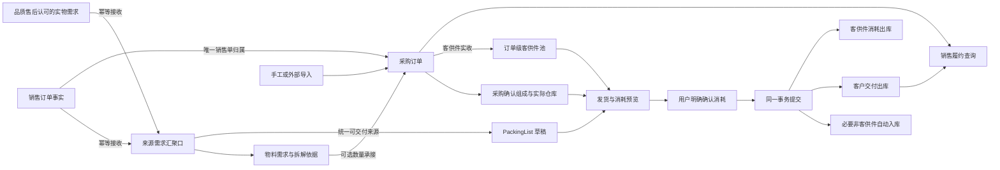

# SwiftExport ERP 业务流程导航图

> 更新：2026-09-06。本文解释当前目标流程，不代表源码已实现。权威规则见[业务架构总纲第 24 节](业务架构总纲.md#24-订单级客供件池与领域解耦2026-09-06)，实体矩阵与执行提示词见[领域治理总计划](领域治理/00-全链路治理总计划.md)。

## 1. 两条链，各自拥有事实



计划链解释“为什么买、需要多少”，库存链解释“实际收发什么”。库存执行不要求经过物料需求和 Allocation；独立采购不用伪造计划，但须明确唯一销售单归属。

## 2. 领域职责

| 领域 | 负责 | 不负责 |
|---|---|---|
| 销售 | 销售事实、商业状态、幂等提交来源需求与履约查询 | 直接向 PL 提供另一套选源/额度 |
| 来源需求 | 汇聚销售/品质售后、统一交付身份/可发量及最终复核 | 编辑上游销售/售后事实，按最新 BOM 判断交付 |
| 物料需求 | 拆解物料、采购建议、数量承接 | 实际供应商、库存池和客户交付额度 |
| 采购 | 一销售单内独立建单、确认组成、实际收货目标 | 要求所有来源先有 Allocation |
| 入库 | 真实采购行收货依据、实收与订单归属 | 查父计划判断送达仓 |
| 库存 | 订单池、总账、并发过账与反向 | 计算 BOM 或销售商业状态 |
| PackingList | 对客户发货与必要库存动作的编排 | 自己另建库存账 |
| 出库 | 客户交付与客供件消耗事实 | 把消耗当销售已发量 |

## 3. 毛需求、物料需求与采购

业务名统一为“来源需求”（原毛需求，GrossDemand）与“物料需求”（原净需求，NetDemand）；代码/表名暂不改。PL 的必需链为来源需求 → 交付贡献 → 客户出库，来源需求 → 物料需求是独立计划支路。销售/品质售后幂等汇聚，PL 不再直接从销售取数，详细幂等、版本和售后订单池边界见总纲第 24.7 节。

毛需求后台记录来源，用户不必逐层操作；拆解仍是明确动作，不自动采购。GrossDemand 到 NetDemand 一对多保留，BOM 父子与路径保留解释能力。

同一销售单内多个物料需求可以贡献给同一采购行，逐项保存数量；不同销售单不能合并一采购单。独立采购直接创建，不需要 Link；有需求承接才记录关联。独立于需求不等于没有销售订单。

Allocation 不再成为入库、出库、PL、销售查询的必经关系。先迁移外部消费者，再决定保留简化建议还是物理收敛，不能直接删旧表/历史。物料需求未做库存净抵扣，不宣称已实现 MRP。

## 4. 客供件是订单池，不是父件专属

```text
销售单 S1 ＋ 供应商仓 W ＋ 客供件 X ＋ 基础单位
                     ↓
          A、B 等多个父产品共享可用量
```

采购确认组成定义每个父产品应耗多少，订单池定义从哪里扣。父关系留在计算明细，不是库存归属。

例如 S1/W 有 X100，A 发30且每件耗X2，B发20且每件耗X1：本次合计耗X80，池余20。相同客户的 S2/W/X 不参与扣减。多个父件汇总时保留各采购组成与发货数量的计算证据。

公司无自营仓库，跟单日常登记客供件入库；余额是发货时结转消耗后的账面量，可能包括供应商已经投产但成品尚未发出的材料。

## 5. PackingList 确认做什么

| 阶段 | 动作与边界 |
|---|---|
| 草稿 | 选择来源需求认可的交付内容，不因尚无采购/货好/Allocation 拒绝计划；不扣库存 |
| 准备执行 | 明确采购行分配、确认批次、销售单与仓库；不能仅按 SKU 猜采购来源 |
| 计算非客供件入库 | 对可证明用于本次交付的库存只补缺口；无历史余额时收本次数量后出库，已有量不重复入库 |
| 计算客供件 | 采购确认组成算累计应耗减已耗增量，再按订单池汇总；不读当前 BOM 改历史 |
| 强制确认 | 展示入库、客户出库、池耗用和前后量，阻断等待用户明确确认；取消无业务写入 |
| 正式提交 | 校验确认所绑定预览及版本，重验来源需求交付额度、采购可收量和订单池；数据变化需重新预览 |
| 原子记账 | 一事务完成正式单据、流水、订单池/总账、交付关联、PL 状态及确认审计；重试不重复 |

自动入库是正常业务编排，不要求人工先登记成品。客供件必须有真实入库，不能通过成品自动入库伪造客供件库存。

普通用户消耗确认不等于库存不足放行。正常不足阻断；旧特殊权限/原因/类型90如果保留，必须独立授权流程，本轮不扩大。缺失销售/采购/组成证据也不能靠确认跳过。

## 6. 销售怎样看到进度

销售查询聚合采购确认、跟进、净收货及正式客户出库，数据由各领域负责。订单级关联只能说明该销售单存在采购，不能在无行级分摊时给每条销售行重复计入整笔采购。

正式已发量直接通过来源需求交付关联计算，不绕 Allocation；不计客供件消耗、PL 草稿或供应商货好。组件数量不直接当成成品采购量；无证据显示未关联/待核实，不伪造零或完成。

## 7. 修改、撤销与真实退回

草稿可改。正式数量、仓库、订单归属、采购依据或客供件用量变化，通过有原因的原事实—反向—替代处理；原池、原组成与历史消耗可追溯。回冲不能读取最新 BOM，需检查下游占用。

销售减少/关闭不自动停止既有合法采购收货，也不抹掉真实已发。真实退回按实际收回记账，不能把原出货改成从未发生。整单反向按已生成客户出库/消耗、自动入库的依赖顺序校验并原子执行。

## 8. 当前代码与目标的距离

Core 已有独立采购字段及采购确认组成；库存余额/流水仍缺订单池维度，PL/出库仍有必填 Allocation，入库来源和销售发货查询仍存在计划链依赖。以上目标不能通过改一张 PL 页面完成。

按[领域治理总计划](领域治理/00-全链路治理总计划.md)执行：来源需求交付契约 → 采购执行依据 → 入库订单池 → PL/出库 → 需求精简 → 全链路联验。未来生产通过合法执行凭证接入，不预建复杂框架。
