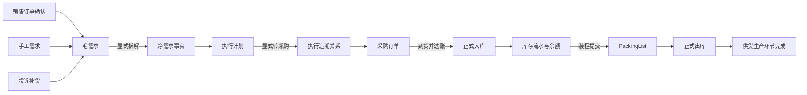
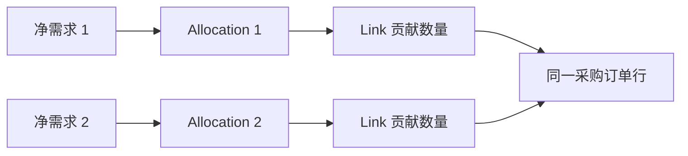
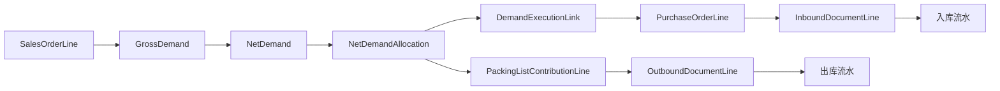

# SwiftExport ERP 业务流程导航图

> 文档状态：当前业务流程快速导航  
> 最近整理：2026-08-25  
> 适用范围：SwiftExport 当前目标业务模型  
> 权威规则：以 [业务架构总纲](业务架构总纲.md) 为准；本文只负责快速解释“业务如何向下流转”。

## 1. 这份文档解决什么问题

本文用于让业务人员和 Codex 快速回答以下问题：

- 一张销售订单确认后，下一步产生什么。
- 毛需求、净需求、执行计划和采购单分别负责什么。
- 哪个动作会真正改变库存。
- 已生成下游或已过账后，错误应如何回退。
- 如何从销售订单追到采购、入库、PackingList 和出库。

本文不展开字段级 ER、SQL、DTO 或当前代码完成度。字段归属和关系约束应继续读取业务架构总纲及数据模型治理资料。

旧文档 [ERP流程与ER图审阅稿](../../docs/ERP流程与ER图审阅稿.md) 使用了 `SalesDemand`、`RequirementPool` 等旧模型，仅作为历史资料，不代表当前业务流程。

## 2. 十秒钟看懂主流程



核心记忆：

```text
来源提出需求
  -> 毛需求记录“为什么需要”
  -> 净需求记录“拆出了什么”
  -> Allocation 记录“准备怎样执行”
  -> Link 记录“实际转给了哪张执行单”
  -> 正式入库/出库和库存流水记录“实际发生了什么”
```

## 3. 每一步何时进入下游

| 当前阶段 | 业务命令 | 允许条件摘要 | 产生的正式结果 | 自动进入更下游吗 | 库存影响 |
|---|---|---|---|---|---|
| 销售订单草稿 | 保存 | 客户、行、数量和版本有效 | 保存销售订单头行快照 | 否 | 无 |
| 销售订单 | 确认 | Open、待确认、来源关系有效 | 每条活动销售行幂等生成一条 GrossDemand | 只生成毛需求，不自动拆解 | 无 |
| 毛需求 | 拆解 | Active、Pending、BOM 可用且数量守恒 | 写入一个 revision 的 NetDemand 和初始 Allocation | 不自动转采购 | 无 |
| 执行计划 | 替代计划 | 尚可安全调整，原因和版本有效 | 旧 Allocation 保留，新 Allocation 成为活动计划 | 否 | 无 |
| Allocation | 转采购 | Purchase 类型、供应商明确、剩余量充足 | 采购草稿和 DemandExecutionLink | 不自动确认采购 | 无 |
| 采购订单 | 确认 | 单据资料和 Link 数量守恒 | 采购单成为可收货来源 | 不自动入库 | 无 |
| 入库单 | 建立草稿/预览 | 来源采购行和 Link 可证明 | 入库草稿或影响预览 | 否 | 无 |
| 入库单 | 过账 | Preview 有效、未超收、仓库有效 | 正式入库、库存流水、余额更新 | 形成可出货库存 | 增加 |
| PackingList | 建立草稿/预览 | 客户、贡献来源、数量和仓库明确 | 装柜草稿及影响预览 | 否 | 无 |
| PackingList | 提交 | Preview 有效、库存和客供件比例可证明 | 必要自动入库、正式出库、流水、余额和日志 | 完成该次供货出货 | 增减均可能 |
| 已过账单据 | 反向 | 无无法解除的后续依赖，原因必填 | 反向单据或反向流水，保留原事实 | 按依赖从下游向上游退 | 与原变化相反 |

### 3.1 确认不是万能自动按钮

- 销售订单确认只负责冻结销售事实并建立毛需求，不自动拆 BOM、转采购或入库。
- 采购订单确认只表示采购单可以履约，不自动产生入库。
- 真正改变库存的动作只有统一库存过账服务执行的入库、出库及其反向。
- PackingList 提交是出货编排命令，可以在同一事务中产生必要自动入库和正式出库。

## 4. 毛需求、净需求为什么不是多余表

| 模型 | 业务问题 | 生命周期 |
|---|---|---|
| GrossDemand | 哪个来源、哪一行、为什么提出这项需求 | 跟随来源需求，可拆解、关闭或作废 |
| NetDemand | 某次 BOM 拆解实际需要哪些物料、数量和历史路径 | 跟随拆解 revision，历史不普通覆盖 |
| NetDemandAllocation | 当前准备采购、生产或外协多少，由谁执行 | 可频繁调整，通过替代记录保留历史 |
| DemandExecutionLink | 某份计划数量实际贡献到了哪张采购或其他执行单行 | 随执行单取消、释放或反向，不物理删除 |

这四类数据在数据库中分开，是为了避免把来源、BOM 历史、当前计划和执行事实混成一个万能需求池。

业务页面不应要求用户理解四张物理表。净需求工作台应把活动 `NetDemandAllocation + NetDemand + GrossDemand + Link/入库/出库聚合` 组合成一个可操作视图，详情和 Trace 才展开历史。

## 5. 净需求与采购如何解耦



- 净需求不直接保存唯一采购单号作为权威关系。
- 一条 Allocation 可以分多次转采购，因此可以有多个 Link。
- 多个来源可以合并到同一采购行，每个来源贡献仍由独立 Link 保存。
- 取消安全采购草稿时取消或释放 Link，Allocation 剩余可执行量随之恢复。
- 采购已产生正式入库后，不删除 Link，也不伪装成从未执行；必须先反向入库，再按边界处理采购。

## 6. 客供件 A/B 流程

```text
父产品 A Allocation -> A 执行供应商虚拟仓
客供件 B Allocation -> B 采购订单 -> 收货至 A 执行供应商虚拟仓
PackingList 提交 -> A 成品出库 + B 按历史 BOM 比例消耗
```

A、B 可以由不同供应商生产或供货。B 是采购型终端子物料，不继续展开 BOM；进入正常可收货池前必须存在活动 Link 和已确认采购订单，不能只凭 Allocation 收货。PackingList 消耗 B 时使用历史拆解比例，不按当前 BOM 重算历史。

## 7. 手工需求与投诉补货

销售订单不是毛需求的唯一来源：

| 来源 | 进入方式 | 后续流程 |
|---|---|---|
| 销售订单 | 销售订单确认后按活动行幂等生成 | 毛需求 -> 拆解 -> Allocation -> 执行 |
| 手工需求 | 计划人员显式建立，生成稳定手工需求号 | 与销售来源进入同一需求链 |
| 投诉补货 | 由投诉或补货单头行建立来源锚点 | 与销售来源进入同一需求链，不形成投诉孤岛 |

不同来源可以有不同的关闭和修改入口，但拆解、计划、转采购、入库和出货应复用同一业务内核。

## 8. 外部导入边界

```text
外部文件/VBA
  -> 导入暂存或正式 API
  -> 校验 DTO
  -> Application Service 业务命令
  -> 正式单据、需求、Link、日志和库存事务
```

| 导入对象 | 正确做法 |
|---|---|
| 销售订单 | 导入销售草稿，再调用正式确认内核生成 GrossDemand；不提前伪造净需求和库存 |
| 需求驱动采购 | 携带 `NetDemandAllocationId` 和稳定外部行键，由 Application 建立 Link |
| 来源不明的历史采购 | 标记为外部独立采购，不伪造 GrossDemand、NetDemand 或 Link |

禁止 VBA 直接修改正式业务表或库存余额，也不能只导入采购头行而遗漏 Link、再假装它属于需求驱动采购。业务编码必须经过 Application Service 解析为有效 Uid。

## 9. 改单、取消与反向边界

| 当前事实 | 允许处理 | 禁止处理 |
|---|---|---|
| 未确认且无下游 | 修改、软删除或作废草稿 | 无需制造反向单据 |
| 已确认但未生成下游 | 取消确认并记录原因 | 静默改写确认历史 |
| 下游是安全采购草稿 | 取消草稿、释放 Link，再回退上游 | 只删采购头而保留孤立 Link |
| 采购已确认但无收货 | 取消确认后处理计划 | 绕过确认状态直接改关键关系 |
| 已有正式入库或库存流水 | 先反向入库，再处理采购和需求 | 删除入库单、删除库存流水、直接改余额 |
| PackingList 已提交 | 整单反向自动入库、出库和客供件消耗 | 只改 PackingList 数量或只删某条出库 |

回退顺序始终从最下游开始：

```text
PackingList/出库
  -> 入库与库存
  -> 采购及 DemandExecutionLink
  -> Allocation
  -> 净需求 revision
  -> 毛需求
  -> 销售订单确认状态
```

## 10. 全链路追溯视图

系统应提供聚合查询，而不是要求用户逐张表查找：



推荐的业务 Trace 入口：

- 从销售单号查看毛需求、当前拆解、执行计划和履约结果。
- 从毛需求查看全部拆解 revision、活动计划和下游 Link。
- 从采购单查看每一行由哪些 Allocation 贡献，以及分别入库多少。
- 从入库或库存流水查看来源采购行、Link、需求和销售来源。
- 从 PackingList 查看每条客户出货贡献、自动入库、成品出库和客供件消耗。

“已转采购、已入库、已发货、剩余量”均为聚合查询结果，不应在毛需求、净需求、采购头行等多个位置重复保存。

## 11. 阅读和设计规则

遇到问题时按以下顺序判断：

1. 先在本文确认业务所处阶段、前一步和后一步。
2. 再到 [业务架构总纲](业务架构总纲.md) 查看该模块的权威规则、数量口径和状态边界。
3. 涉及字段、Uid、业务编码、快照和索引时读取 [数据模型与状态规则](数据模型与状态规则.md) 及数据模型治理 Skill。
4. 最后核对当前 Entity、DTO、Application Service 和 Repository，识别源码与目标模型的差异。

任何新流程都必须回答：

- 来源事实由谁保存。
- 计划和实际是否分离。
- 通过哪个 Uid 或 Link 追溯。
- 哪个显式命令进入下游。
- 是否改变库存，产生哪类正式流水。
- 错误时是删除安全草稿、取消确认、替代计划，还是正式反向。
