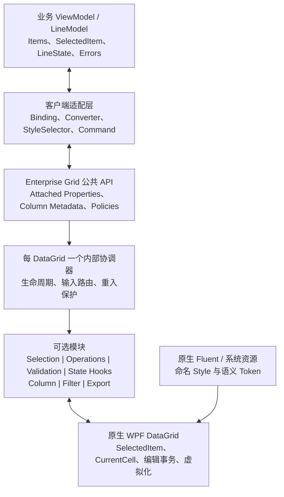
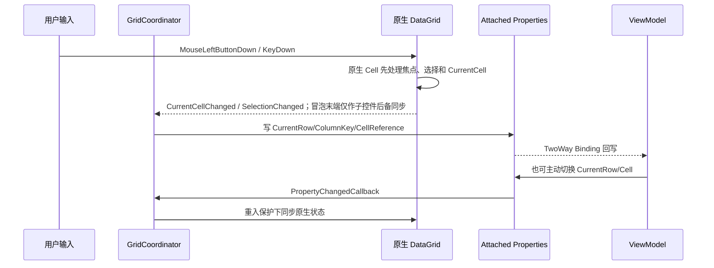

# SwiftExport WPF Enterprise DataGrid Framework 总体架构

## 目录

1. 架构目标与当前事实
2. 整体架构图
3. 项目与源码目录
4. Agent 与 Skill 职责边界
5. 核心 API 草案
6. 继承与组合模式决策
7. MVVM 数据流与输入时序
8. RowState 无侵入结合方案
9. 功能模块设计
10. 后续开发规范
11. 路线图与验收门槛
12. 风险与待决策项

## 1. 架构目标与当前事实

### 1.1 目标

构建一个以原生 `System.Windows.Controls.DataGrid` 为宿主的轻量增强框架，吸收企业级 Grid 在焦点模型、编辑事务、列元数据、验证、状态、筛选和导出方面的设计思想，但不复制商业控件的封闭控件树和庞大对象模型。

框架必须满足：

- 原生兼容：已有 DataGrid 和原生列可以逐项启用能力。
- 可组合：Selection、Operations、Validation 等模块可独立启停；原生 Editing 不由框架接管。
- MVVM 友好：通过 Binding、附加属性、Command 和策略接口连接 ViewModel。
- 业务无关：不引用业务 Model、DTO、Contracts、API 或 RowState 枚举。
- 可测试：纯策略与 WPF 交互分层，关键交互可在 STA 测试中验证。
- 可演进：未来增加 Lookup、Filter、Grouping、ColumnChooser、Export 时不破坏第一阶段 API。

### 1.2 当前源码事实

- 当前客户端是 `.NET 10 WPF + CommunityToolkit.Mvvm`。
- 业务行拖拽重排由客户端 `RowDragReorder` 与页面命令负责；Grid 不提供上下移按钮列，不引入 Gong，不维护 LineNumber / SortNo。表头排序、列顺序和视图行号仍属于各自原生/框架能力。
- `SwiftExport.Client.Wpf/Resources/DataGrid.xaml` 已有命名 DataGrid、Row、Cell、编辑器和验证样式。
- `SwiftExportStateDataGridRow` 直接绑定业务行模型的 `State`，处理 Added/Modified/Deleted。
- `BaseLineModel<TDto>` 保存 `LineState`；这是业务/页面模型状态，不应迁入 Grid 框架。
- `BaseListModel.Remove` 会将 Deleted 行从可见 `Items` 移除，因此当前主 Grid 看不到 Deleted 样式。
- 客户端项目引用 WPF-UI，但 Enterprise Grid 独立项目不得依赖或使用它。
- 当前未引用 `Microsoft.Xaml.Behaviors.Wpf`；第一阶段不需要引入。

## 2. 整体架构图



核心含义：DataGrid 仍是控件、选择、当前单元格和编辑事务的真相源；框架只协调、镜像和扩展，不建立第二套 Grid 状态机。

## 3. 项目与源码目录

### 3.1 推荐项目结构

长期维护建议从第一批实现开始建立独立项目，以编译依赖强制业务隔离，而不是先把所有代码堆进客户端：

```text
SwiftExport.Wpf.EnterpriseGrid/
  SwiftExport.Wpf.EnterpriseGrid.csproj
  Core/
    EnterpriseGrid.cs
    GridFeatureOptions.cs
    Internal/
      GridCoordinator.cs
      GridLifecycle.cs
      GridInputRouter.cs
    Helpers/
  Selection/
    GridSelection.cs
    GridCellReference.cs
    Internal/
  Operations/
    GridOperations.cs
    Internal/
  Columns/
    GridColumn.cs
    Lookup/
    Enum/
    Numeric/
  Validation/
  State/
    Presentation/
  Filtering/
  Exporting/
    Abstractions/
    Csv/
  Themes/
    EnterpriseGrid.xaml
    Tokens.xaml
  Properties/

SwiftExport.Wpf.EnterpriseGrid.Tests/
  Core/
  Selection/
  Editing/
  Validation/
  Columns/
  TestHost/

SwiftExport.Client.Wpf/
  Integrations/
    EnterpriseGrid/
      LineStateToRowStyleSelector.cs
      EnterpriseGridResources.xaml
  Features/
    ... 页面只负责 Binding 和配置
```

### 3.2 依赖方向

```text
SwiftExport.Client.Wpf
        |
        v
SwiftExport.Wpf.EnterpriseGrid
        |
        v
WPF / .NET 10
```

禁止反向引用。Grid 项目不引用 `SwiftExport.Client.Wpf`、`SwiftExport.Contracts`、CommunityToolkit、WPF-UI 或业务项目。CommunityToolkit 只服务宿主 ViewModel；框架公共 API 保持普通 WPF Binding 兼容。宿主仍可使用 WPF-UI 的 `ContentDialog`、Snackbar 和 FluentWindow：Grid 命令通过 ViewModel 调用 `IDialogService/IMessageService`，再由客户端的 `WpfUiDialogService/WpfUiMessageService` 实现，框架本身无需知道弹窗类型。

### 3.3 为什么不先放进 `Controls/DataGrid`

独立项目能在编译期阻止业务依赖和第三方 UI 渗入，也便于建立专门的 STA 测试。代价是多一个项目和资源字典引用；对于长期维护的企业级框架，这个代价合理。

## 4. Agent 与 Skill 职责边界

### 4.1 Agent

`wpf-enterprise-grid-architect` 是唯一主 Agent，负责：

- 整体架构和模块边界。
- 公共 API 与兼容策略。
- 功能路线和技术决策。
- 跨模块输入时序与编辑事务。
- Grid 专项 Code Review。

它不取代通用 `frontend` Agent：普通业务页面仍走 frontend；只有 Grid 框架、Grid 公共能力或专项审查走本 Agent。它也不创建八个并行主 Agent，避免各模块重复订阅同一输入事件和定义冲突 API。

### 4.2 Skills

| Skill | 拥有 | 不拥有 |
|---|---|---|
| `wpf-grid-core` | 框架入口、AttachedProperty、协调器、生命周期、Helper、资源边界 | 具体选择/编辑语义、业务状态 |
| `wpf-grid-selection` | SelectedItem 修复、CurrentRow、CurrentColumn、CurrentCell 镜像 | BeginEdit、业务 IsSelected、多选业务集合 |
| `wpf-grid-editing` | 原生双击/F2/Enter/Tab/Shift+Tab/Esc 兼容与不干预审查 | 自建编辑状态机、业务保存 |
| `wpf-grid-column` | 列元数据、Key、Lookup/Enum/Numeric 便利列 | 平行 Column 基类、API 调用、业务字典缓存 |
| `wpf-grid-validation` | 原生错误聚合、呈现、提交阻断、首错导航 | 业务校验规则、服务端业务判断 |
| `wpf-grid-state` | 状态视觉接入规范、视觉优先级 | RowState 存储、枚举定义、状态推进 |
| `wpf-grid-filter` | 筛选描述、本地 ICollectionView、远程筛选桥接 | 直接调用 API、复制业务集合 |
| `wpf-grid-export` | 导出请求、列值抽取、CSV/Excel Provider 边界 | 文件对话框、Office Interop、视觉树抓取 |

## 5. 核心 API 草案

以下是架构契约。Selection、Operations 与 Validation 已进入真实页面验证；Filter、Export 等接口继续按兼容原则演进。

### 5.1 框架入口

```csharp
public static class EnterpriseGrid
{
    public static readonly DependencyProperty IsEnabledProperty;
}
```

`IsEnabled` 只负责协调器生命周期。各模块另有显式开关，避免启用框架就改变全部原生行为。

### 5.2 Selection API

```csharp
public static class GridSelection
{
    public static readonly DependencyProperty IsCellClickSelectionEnabledProperty;
    public static readonly DependencyProperty CurrentRowProperty;       // object?, TwoWay
    public static readonly DependencyProperty CurrentCellProperty;      // GridCellReference?, TwoWay
    public static readonly DependencyProperty CurrentColumnKeyProperty; // string?, TwoWay
    public static readonly DependencyProperty CurrentColumnProperty;    // DataGridColumn?, ReadOnly/诊断
}

public sealed record GridCellReference(object? Item, string? ColumnKey);
```

设计说明：

- 原生 `DataGrid.CurrentCell` 始终是真相源。
- `CurrentCell` 不保存 `DataGridCell` 控件，只保存数据项与稳定 ColumnKey，兼容虚拟化。
- ViewModel 通常只绑定 `CurrentRow` 和 `CurrentColumnKey`；只有需要恢复精确 Cell 时才绑定 `CurrentCell`。
- `CurrentColumn` 供 View 层诊断/命令使用，不推荐业务 ViewModel 持有 WPF 类型。

### 5.3 Column Metadata

```csharp
public static class GridColumn
{
    public static readonly DependencyProperty KeyProperty; // string
    public static readonly DependencyProperty FieldPathProperty;
    public static readonly DependencyProperty CanNavigateProperty;
    public static readonly DependencyProperty CanFilterProperty;
    public static readonly DependencyProperty CanExportProperty;
    public static readonly DependencyProperty ExportHeaderProperty;
}
```

同一份列元数据被 CurrentCell、Tab 导航、Filter、ColumnChooser 和 Export 复用。公开 `ColumnKey` 固定为非空稳定字符串，在同一 Grid 内必须唯一；重复 Key 输出明确诊断。没有 Key 的列可以使用内部临时标识，但不可用于双向 CurrentCell、远程筛选或跨会话状态恢复。

### 5.4 Operations API

```csharp
public static class GridOperations
{
    public static readonly DependencyProperty IsEnabledProperty;
    public static readonly DependencyProperty CanUndoProperty;
    public static RoutedUICommand FillDownCommand { get; }
}
```

双击/F2/Enter/Tab/Shift+Tab/Esc 始终由原生 DataGrid、Column 和编辑器处理。Operations 在成功提交后记录 Ctrl+Z 历史，并在 Cell/CellOrRowHeader 模式下提供连续矩形 Ctrl+C/Ctrl+V、原子 Ctrl+D，以及可撤销的可编辑文本 Cell Delete 清空；当前编辑器仍拥有自身的文本编辑和剪贴板命令。

### 5.5 内部扩展点

```csharp
internal interface IGridFeatureModule
{
    int InputPriority { get; }
    void Attach(GridContext context);
    void Detach();
}

internal interface IGridNavigationPolicy
{
    GridCellReference? GetNext(GridNavigationContext context);
}
```

第一版保持 internal，待至少两个真实页面证明扩展需求后再决定是否公开。过早公开模块插件接口会锁死生命周期和事件模型。

### 5.6 未来预览接口

```csharp
public interface IGridExportProvider
{
    Task ExportAsync(GridExportRequest request, Stream target, CancellationToken cancellationToken);
}

public interface IGridValueAccessor
{
    object? GetValue(object item, GridColumnDescriptor column);
}
```

Filter descriptor、Lookup provider、Column layout persistence 在对应阶段结合真实页面再冻结，不在第一阶段预设庞大抽象。

## 6. 继承与组合模式决策

| 维度 | `EnterpriseDataGrid : DataGrid` | 原生 DataGrid + 组合 |
|---|---|---|
| 现有页面迁移 | 必须替换控件类型 | 原控件直接启用 |
| 原生列兼容 | 可以兼容，但容易引入专用体系 | 天然兼容 |
| 单项启停 | 容易形成全有或全无 | 每项能力独立 |
| Style/Template | TargetType 与主题耦合更高 | 沿用现有命名 Style |
| 多框架共存 | 容易和已有基类冲突 | AttachedProperty 可叠加 |
| API 约束 | 继承层很快膨胀 | 公共面更小 |
| 测试 | 需实例化专用控件 | 可直接测试原生 DataGrid |

决策：主架构采用组合模式。未来可以提供一个不增加行为语义的薄 `EnterpriseDataGrid` 便利类，用于默认样式或减少 XAML 配置，但任何功能都必须能在普通 DataGrid 上工作；便利类不能成为必需入口。

`Microsoft.Xaml.Behaviors` 也不是第一阶段前提。静态附加属性配合每实例协调器足以可靠订阅/解绑事件；只有出现需要在 XAML 中复用独立 Behavior 实例且原生方案明显失控时再评估依赖。

## 7. MVVM 数据流与输入时序

### 7.1 CurrentRow / CurrentCell 数据流



规则：

- Selection 不得在 `PreviewMouseLeftButtonDown` 阶段写 `DataGrid.CurrentCell` 或聚焦目标 Cell，否则会改变同一次鼠标路由的原生编辑判定。
- 鼠标点击子控件时，Selection 可在冒泡末端使用已处理事件后备同步；原生列始终先由 `DataGridCell` 完成输入处理。
- Selection 模块不标记 MouseEvent 为 Handled，除非确实替代原生行为且有测试证明。
- 附加属性回写和 DataGrid 事件之间必须有重入保护。
- ItemsSource 重置、当前项移除、筛选隐藏当前项时，CurrentRow/Cell 的清空语义一致。

### 7.2 编辑输入顺序

```text
Preview input
  -> 原生 DataGrid/编辑器处理焦点、选择、编辑与导航
  -> Selection 在冒泡末端仅作子控件后备同步
  -> Operations 在提交成功后记录历史
  -> CurrentCell/CurrentRow 回写
```

业务软验证不阻止导航；原生转换提交失败仍由 DataGrid 留在原 Cell。Selection、Operations、Validation 不得分别无序抢占编辑按键。

### 7.3 CommunityToolkit.Mvvm

- ViewModel 的 `SelectedItem/CurrentRow/CurrentColumnKey` 使用 `[ObservableProperty]`。
- 命令使用 `[RelayCommand]`；框架不要求 VM 继承特殊基类。
- Grid 不直接调用 ViewModel 方法；需要业务动作时使用 Command Binding。
- 不在属性 setter 中启动 API 搜索或保存；Lookup/Remote Filter 通过可取消的命令/服务编排。
- Grid 内的 Button、行命令和导出命令可以触发 ViewModel Command，再由宿主 UI Service 打开 WPF-UI ContentDialog；不得从 Grid 模块直接查找 `ContentDialogHost`。

## 8. RowState 无侵入结合方案

### 8.1 边界

业务 Model 拥有 Added/Modified/Deleted/Unchanged；Grid 框架既不定义 `GridRowState`，也不保存一份镜像状态。连接关系是：

```text
业务 LineState / RowState
        |
        v
客户端 Converter / StyleSelector / Binding
        |
        v
命名视觉资源与 DataGridRow 样式
```

### 8.2 推荐落点

- 独立框架只提供可组合的 Row/RowHeader 视觉槽和命名资源约定。
- `SwiftExport.Client.Wpf/Integrations/EnterpriseGrid` 提供 `LineStateToRowStyleSelector` 或 Converter，引用客户端的 `LineState`。
- 业务页面通过 `RowStyleSelector`、DataTrigger 或 Binding 显式接入。
- 普通 POCO 没有 RowState 时仍可完整使用 Selection、Operations、Validation 和原生 Editing。

### 8.3 视觉优先级

推荐不要继续用大面积整行底色表达状态，因为它会和 Selection、Hover、Validation 冲突。采用：

1. RowHeader/左侧色条表示 Added/Modified。
2. 图标或短文本提供非颜色提示。
3. Deleted 使用弱化、删除线或只读视觉，但保留 CurrentCell/Validation 边框。
4. 优先级：Validation > CurrentCell > Selection > Deleted > Added/Modified > Hover。

### 8.4 Deleted 行现实约束

当前 `BaseListModel.Remove` 会把 Deleted 行移出可见 `Items`。框架无法显示不存在于 ItemsSource 的行。后续如果产品要求在主 Grid 显示 Deleted，有三种业务层方案：

- 保留墓碑行在可见集合，保存时按 State 生成删除集；体验最好，但会改变当前列表语义。
- 提供单独 `DeletedItems`/撤销面板；对现有行为影响最小。
- 保持当前即时隐藏；删除样式只用于其他未移除场景。

建议先由产品确认是否需要“删除后可见并撤销”，再修改列表模型；Grid 框架不代替业务层作决定。

## 9. 功能模块设计

### 9.1 Row Selection

- 从 OriginalSource 向上定位 Cell/Row，但只在原生 `DataGridCell` 类处理器之后执行点击后备同步。
- 子控件已处理鼠标事件时，使用冒泡末端的 handled-events-too 后备同步，不在 Preview 阶段预写 CurrentCell。
- 尊重 SelectionUnit 与 Ctrl/Shift；不把单选修复扩展成隐式多选同步。
- 不因单击开始编辑。

### 9.2 CurrentCell

- 原生 `DataGrid.CurrentCell` 保持内部真相。
- 对 VM 暴露 Item + ColumnKey，不暴露虚拟化 Cell 控件。
- ColumnKey 也服务筛选、导出、ColumnChooser 和布局恢复。

### 9.3 Editing 与 Operations

- 不建立 Begin/Commit/Cancel 状态机，不接管原生编辑键盘。
- Operations 监听成功提交生成有界 Undo 历史；Ctrl+C/Ctrl+V 使用 Excel 兼容 TSV，Ctrl+D 和文本 Cell 的 Delete 清空使用 ColumnKey/FieldPath 写入数据项。
- Button/Popup/ComboBox 等编辑器保留按键所有权，未处理按键继续路由给 DataGrid。

### 9.4 Columns

- 第一层是适用于所有原生列的附加元数据。
- 第二层才是 Lookup/Enum/Numeric 薄便利列，分别继承最接近的原生列。
- 不建立 EnterpriseColumn 平行体系。
- Lookup 的候选数据与远程搜索由 VM/Provider 提供，列不调 API。

### 9.5 Validation

- 使用 WPF 原生 ValidationRule、INotifyDataErrorInfo、IDataErrorInfo、BindingGroup。
- 框架处理错误呈现、错误汇总、首错导航和提交阻断。
- 业务规则和异步验证生命周期留在 Model/ViewModel/Application。

### 9.6 Filter / Grouping

- 本地小数据使用 ICollectionView。
- 远程大数据输出 descriptor 并交给 VM 查询。
- Local/Remote 必须显式配置，不能因数据量自动切换语义。
- Grouping 建立在同一 descriptor/ColumnKey 上，不侵入业务集合。

### 9.7 ColumnChooser / Layout

- 使用 ColumnKey 保存显示、DisplayIndex、Width、Sort、Frozen 等 UI 布局。
- “列布局状态”与业务 RowState 完全不同，使用独立命名和存储。
- 版本升级时忽略未知 Key，并为新增列应用默认策略。

### 9.8 Export

- 从数据项和列元数据导出，禁止从视觉树读取单元格。
- 先实现 CSV 管线验证契约，再增加可选 Excel Provider。
- 区分原始值与显示值；Lookup/Template 列需显式 ValueAccessor。
- 文件对话框和通知由宿主 UI 服务完成。

### 9.9 Virtualization

- 不关闭行/列虚拟化来修复功能。
- 不缓存 DataGridRow/DataGridCell 容器。
- 不为每个 Cell 建立全局强引用订阅。
- 性能测试使用大数据、快速滚动、动态列、筛选和编辑混合场景。

## 10. 后续开发规范

### 10.1 API 规范

- 公共 API 必须有 XML 中文注释、默认值、绑定方向、空值和线程语义。
- 新公共类型需经 `wpf-enterprise-grid-architect` 评审；能 internal 就不 public。
- 破坏性变更必须记录迁移说明；ColumnKey 一旦用于持久化就视为稳定契约。
- 不使用字符串事件名、反射扫描 ViewModel 或约定业务属性名作为核心机制。

### 10.2 输入与生命周期

- 同类输入只由协调器统一路由，模块声明优先级。
- Preview 事件只在确实需要先于子控件处理时使用。
- 禁用、Unloaded、ItemsSource 变化时解绑所有订阅。
- 不用静态字典长期持有 DataGrid；协调器存储采用附加只读属性或弱引用方案。

### 10.3 样式与 Fluent

- 只用原生 WPF 和官方 Fluent 主题能力。
- 框架样式全部命名，不隐式覆盖全局 DataGrid/TextBox/Button。
- 颜色、间距、边框和焦点视觉使用 token；支持系统强调色和高对比度。
- WPF-UI 可继续服务宿主其他页面，但不能出现在 Grid 项目引用或 XAML namespace 中。

### 10.4 测试

- 纯单元测试：列排序、下一个 Cell、descriptor、值抽取、状态机。
- WPF STA 测试：点击子控件、CurrentCell、BeginEdit、Tab、Esc、Validation。
- 场景测试：原生四类列、动态列、排序筛选、虚拟化、ItemsSource 重置、多 Grid。
- 回归测试：功能关闭后行为等同原生 DataGrid。
- 每阶段构建 `SwiftExport.Wpf.EnterpriseGrid`、测试项目和 `SwiftExport.Client.Wpf`。

### 10.5 完成定义

一个能力只有在以下条件均满足时才算完成：

- API 与职责边界已评审。
- 原生 DataGrid/Column 兼容矩阵通过。
- 鼠标、键盘、验证和虚拟化场景通过。
- 无业务项目或禁用第三方依赖。
- 启停/卸载无事件泄漏。
- 示例页面只需 Binding/附加属性，不需要 code-behind 修补。

## 11. 路线图与验收门槛

### Phase 0：架构基线（本阶段）

- Agent、工作流、Skill、目录与 API 草案。
- 明确组合模式、业务隔离和依赖红线。
- 不创建框架实现代码。

### Phase 1：Core + Selection + CurrentCell

- 建立独立项目、测试宿主、协调器生命周期。
- 实现 Cell 点击同步 SelectedItem。
- 实现 CurrentRow、CurrentColumnKey、CurrentCell 双向桥接。
- 验收原生四类列和虚拟化。

### Phase 2：原生 Editing 兼容与 Operations

- 验证双击/F2/Enter/Tab/Shift+Tab/Esc 无框架干预。
- 实现 Ctrl+Z、矩形 Ctrl+D、历史清理与只读列降级。
- 覆盖编辑后单击其他 Cell、Popup 编辑器与转换失败测试。

### Phase 3：Validation + RowState 接入

- 原生验证聚合、错误视觉、首错导航。
- 客户端 LineState 适配与视觉优先级。
- 产品决定 Deleted 行是否保持可见。

### Phase 4：Column 扩展

- 稳定 ColumnKey/FieldPath 元数据。
- Numeric、Enum，再实现 Lookup；先本地 Lookup，再远程搜索。
- TemplateColumn 降级和显式 ValueAccessor。

### Phase 5：Filter + Grouping

- 本地 ICollectionView 与远程 descriptor 分离。
- FilterRow/ColumnFilter。
- 基于同一描述模型增加 Grouping。

### Phase 6：ColumnChooser + 布局持久化

- 可见性、顺序、宽度、排序、冻结状态。
- 布局版本与未知列迁移。

### Phase 7：Export

- CSV 基线、导出请求和值访问器。
- 可选 Excel Provider、进度、取消和大数据策略。

### Phase 8：性能与稳定化

- 大数据和虚拟化基准。
- 内存泄漏、频繁 ItemsSource/Columns 变化、主题/高对比度。
- API 1.0 冻结和迁移指南。

## 12. 风险与待决策项

1. Enter 在编辑态是“提交停留”还是“提交并下移”：当前建议提交停留，需在 Phase 2 用真实 ERP 页面确认。
2. Deleted 行是否可见：当前列表模型会移除，必须先确认撤销体验再改业务列表层。
3. CurrentCell 是否需要 VM 主动设置：建议保留 TwoWay，但多数页面只绑定 CurrentRow/ColumnKey。
4. 独立项目资源如何与客户端现有 `DataGrid.xaml` 合并：Phase 1 应先定义 token 覆盖顺序，避免复制样式。
5. Excel Provider 选型：进入 Phase 7 时再根据许可、格式需求和数据量决策，不提前污染核心依赖。
6. Lookup 远程搜索接口：必须基于至少一个 Supplier/Product 真实场景再冻结。
