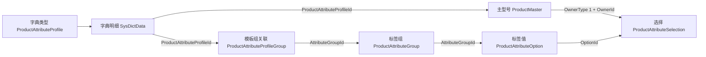

# 产品自定义标签

## 1. 用途和当前范围

产品标签用于从统一选项中描述产品特性，例如“安装方式＝吸顶”“尺寸＝8 寸”。属性模板决定某种产品可以使用哪些标签组；标签组定义单选或多选规则；具体产品决定自己选哪些值。

例如建立“顶喷”模板，为它关联“安装方式”和“尺寸”两个组，再在主型号详情中选择该模板及具体标签。另一个模板可以关联同一个“安装方式”组，组和值只需维护一次。

当前支持主型号（`ProductMaster`）维护模板和标签，以及物料（`Product`）维护自身标签值。客户产品、中性产品的详情标签编辑仍属后续接入，当前不提供任意对象的通用标签写入入口。

产品分类继续用于资料归类、分类树和筛选。标签不再随分类或父分类继承；调整分类不会改变标签。产品系列通过可空的 `ProductSeriesId` 引用内置系列字典明细，`ProductSeriesName` 只用于实时显示，不参与模板和标签关系。

## 2. 如何配置和使用

### 第一步：维护属性模板

在字典管理中找到内置类型“产品属性模板”（`ProductAttributeProfile`），或者在“产品标签”点击“管理属性模板”，打开独立页签并新增“顶喷”“面盆龙头”“厨房龙头”等明细。两处复用同一字典明细组件；类型由系统登记，具体模板由使用者维护，系统不预置模板明细。

模板管理页签只维护此类型的明细，重复打开会激活已有页签并保留草稿。删除、刷新和关闭确认使用公共弹窗；模板维护保存与标签组、标签值、模板关联保存各自独立，更新候选不会覆盖产品标签页的未保存修改。

主型号引用的是一条字典明细的 Uid，不是字典类型的 Uid，也不是模板名称或英文代码。改名称不改变已有引用。

### 第二步：维护标签组和值

进入“产品标签”页面，在左侧维护标签组；右侧“标签值”维护当前组的统一选项，“关联属性模板”选择直接适用的模板。

- 组支持新增、修改、删除和排序，可设置单选或多选；不提供启用、禁用。
- 选项属于一个组，编码在组内唯一；组编码在所有有效组中唯一。
- 同一个组可以关联多个模板，一个模板也可以关联多个组。
- 切换标签组会保留整页草稿。“保存”一次提交组、选项和模板关联的全部变更。
- 分类或模板名称相同不代表身份相同，关联和去重都按 Uid 处理。

模板多选弹出层中的“确定”只更新页面草稿；关闭弹出层取消其中未确定的选择。最终仍需保存整页。

### 第三步：为主型号选择标签

在主型号管理页或详情页选择属性模板，进入详情页的“标签属性”页签，按组选择具体值。

- 单选组可选择一个值或清空，多选组可选择多个值。
- 未指定模板的主型号不能保存非空标签选择。
- 标签控件确定后形成详情草稿，随整页保存，不单独提交数据库。
- 换模板保留两个模板共同适用的选择；仅对失去适用性的选择确认清除。取消会恢复原模板和所有选择。
- 管理页显示只读标签摘要，通过既有打开详情命令进入编辑，不提供列表批量打标签。

修改模板时若需要同时处理已有标签，请在详情页操作。管理页直接更换模板使已有选择失效时，保存会被拒绝。

### 第四步：为物料选择独立标签值

在“物料管理”选中已保存物料，点击顶部“保存”左侧的“编辑”，打开物料详情。重复打开同一物料会激活原页签，不覆盖未保存修改；新增物料仍先在列表保存。

详情上方维护物料资料及图片地址，下方选择该物料自身的标签值。主型号和中性产品分别选择或清空；分类、属性模板、启停状态和包装参考只读，不管理 BOM。单品重量／体积属于物料，与只读箱净重、箱毛重及箱体积分别显示。

模板只通过物料自身 `ProductMasterId` 取得。`ProductNeutralId` 独立引用中性产品，不反推主型号，也不联动颜色；两个 ID 可以为空、指向不同主型号或失效资料。列表和详情保存 ID，`MasterSku`、`LinkSku` 分别显示联表取得的主型号编码、中性产品编码，失效时显示为空；输入文字不作为关系身份。来源选择使用既有主型号和中性产品查询权限。

未关联有效主型号、来源无模板或定义不可用时，标签区显示原因，已有选项身份保留。没有编辑标签时，基础资料保存发送 `SelectedOptionIds=null`，即使来源失效也保持旧标签；明确修改选值时仍校验最终主型号模板。修改来源不自动清空标签。

物料字段与独立标签随“保存”在同一事务提交；只改标签也推进物料版本。失败或版本冲突保留本地草稿。放弃、整页刷新和关闭检查字段及标签变更；“刷新标签”保留字段、选值草稿和原预期版本，只更新定义与只读来源信息。

从列表打开详情前会先提交当前单元格。目标行有修改时，可保存当前行并打开、放弃当前行并打开或取消；其他行和 BOM 抽屉草稿保持。详情保存后只更新对应无草稿的列表行；该行仍有修改时提示手动处理，不刷新整张列表。

### 刷新与多人使用

标签候选使用登录会话缓存。展开、搜索和勾选只读取客户端快照，不逐次请求服务器。保存标签定义后刷新共享缓存；其他客户端可使用“刷新标签”取得最新模板及定义。

刷新失败保留原完整快照；已选值和未保存草稿按 Uid 保留。缺失模板、组或选项会明确提示，客户端不会静默移除选择或误提交清空。退出登录清除缓存，旧会话晚到的响应不能写回新会话。

## 3. 维护限制

| 操作 | 处理规则 |
| --- | --- |
| 删除、停用模板，或将模板移出属性模板字典 | 被主型号或模板组关联引用时拒绝；先处理引用 |
| 删除标签组或选项 | 被产品选择时拒绝，并提示引用数量；无引用组连同其选项和模板关联原子软删 |
| 多选组改为单选 | 已有对象在该组选择多个值时拒绝 |
| 解除模板与组的关联 | 导致有效对象选值失效时整批拒绝，包含物料独立选值，不自动清空 |
| 更换主型号模板 | 详情允许明确处理失效选择后保存；无显式处理的入口拒绝失效选择 |
| 调整产品分类 | 不影响模板或标签 |
| 导入主型号 | 更新保留模板和选值；新建模板为空；导入格式不增加标签列 |
| 主型号更换模板 | 导致已关联物料标签失去适用性时拒绝，并提示受影响物料数量；先处理物料选值 |
| 删除来源主型号或中性产品 | 不因物料引用而阻断，不级联清空物料的来源 ID；失效来源显示为空，物料已有标签保留 |
| 删除物料 | 沿用原删除业务检查，并在同事务清理该物料自身选值；同 Uid 的其他对象类型不受影响 |

选项的所属组、模板关联的两个身份均不提供修改入口；更换关系使用删除和新增。保存失败保留草稿；服务器的整批事务失败时不会报告其中某项已经成功。

## 4. 资料关系和身份



| 对象／字段 | 指向 | 说明 |
| --- | --- | --- |
| `SysDictData.DictCode` | 内置字典类型编码 `ProductAttributeProfile` | 证明明细属于正确字典类型；具体身份使用明细 Uid |
| `ProductMaster.ProductAttributeProfileId` | `SysDictData.Uid` | 可空，一条主型号只采用一个模板 |
| `Product.ProductMasterId` | `ProductMaster.Uid` | 独立可空引用；决定物料分类及标签模板，允许失效 |
| `Product.ProductNeutralId` | `ProductNeutral.Uid` | 独立可空引用；仅提供当前型号显示，不决定主型号、模板或颜色 |
| `ProductAttributeProfileGroup.ProductAttributeProfileId` | `SysDictData.Uid` | 模板直接关联的组，不复制到分类或产品 |
| `ProductAttributeProfileGroup.AttributeGroupId` | `ProductAttributeGroup.Uid` | 有效模板＋组组合唯一 |
| `ProductAttributeOption.AttributeGroupId` | `ProductAttributeGroup.Uid` | 选项只属于一个组 |
| `ProductAttributeSelection.OwnerType + OwnerId` | 对应业务对象的 Uid | 类型与身份必须共同查询，不能只按 Uid 混用对象 |
| `ProductAttributeSelection.OptionId` | `ProductAttributeOption.Uid` | 有效对象类型＋对象身份＋选项组合唯一 |

选择表不重复保存模板、组或客户身份；组由选项取得，模板由选择所属对象的主资料链路取得。所有实体沿用 Uid、Version、软删除和创建／更新审计信息。标签定义与选值由应用保存时校验有效性，数据库通过唯一约束和检查约束保障局部规则；物料的两个来源 ID 明确允许失效，不设置数据库外键或归属一致性检查。

UUID 提供稳定身份，但不表达对象类型。即使两个业务对象碰巧使用同一个 UUID，类型不同仍是两份独立选择。

## 5. 各产品对象的模板来源

| OwnerType | 选择所属对象 | 模板来源 | 页面状态 |
| --- | --- | --- | --- |
| `1 ProductMaster` | 主型号自身 Uid | 自身 `ProductAttributeProfileId` | 本轮支持 |
| `2 CustomerProduct` | 客户产品自身 Uid | `CustomerProduct.SkuId → Product.ProductMasterId → ProductMaster.ProductAttributeProfileId` | 后续接入 |
| `3 ProductNeutral` | 中性产品自身 Uid | `ProductNeutral.ProductMasterId → ProductMaster.ProductAttributeProfileId` | 后续接入 |
| `4 Product` | 物料自身 Uid | 只使用自身主型号引用的模板 | 已接入物料详情；两项来源 ID 独立维护 |

共用模板、组和值，不代表共用选值。客户产品可与公司产品采用相同候选，但独立选择自己的起泡器、尺寸等值，不按客户隔离标签定义，也不自动继承主型号的选择。

未关联 SKU 的客户产品不能配置标签；关联链缺失或主型号没有模板时同样不能配置。未关联主型号的物料如何取得模板尚未确定，本轮不增加替代字段。

客户产品和中性产品后续接入时，必须同时接入对象自己的保存事务、预期版本、删除清理，以及 SKU 改挂、解绑、主型号模板变更的上游保护。存在会失去适用性的下游选择时，拒绝导致失效的操作，不自动清空。物料详情已经接入对象版本、事务、删除与上游模板保护，改挂和解绑仍未开放。

## 6. 页面、缓存、API 与保存调用链

本节供系统维护人员定位引用和调用职责，正常页面使用不需要手工修改表。

| 用例 | 页面与缓存 | API／服务与持久化 |
| --- | --- | --- |
| 读取标签候选 | `ReferenceDataCacheService` 取得字典模板及标签快照，按模板解析 | `GET /api/ProductAttribute/definitions` → `ProductAttributeDefinitionService` → `IProductAttributeRepository`／`PostgreSqlProductAttributeRepository` |
| 读取一个模板的完整定义 | 使用具体字典明细 Uid | `GET /api/ProductAttribute/definitions/profiles/{profileId}` → 标签定义服务 → 模板关联、组、选项 |
| 保存标签定义 | `ProductAttributeManagerViewModel` 汇总组／选项／模板关联私有草稿 | `POST /api/ProductAttribute/definitions/batch-save` → 标签定义服务 → 同一事务保存三类变更并返回完整快照 |
| 读取及保存主型号标签 | `ProductMasterDetailViewModel`／`ProductAttributeSelectionModel`；候选来自缓存，选值来自详情 | 主型号详情 API → `ProductMasterMaintenanceService` → 主型号、中性产品及选择仓储共享事务 |
| 显示管理页摘要 | 管理页绑定 `TagSummary` | 列表查询按 `OwnerType=ProductMaster`、主型号 Uid 联表计算，不回写旧字符串 |
| 读取物料详情 | `ProductDetailViewModel`；来源只读，选值属于当前物料 | `GET /api/Product/{id}/detail` → `ProductQueryService` → 物料完整投影及 `OwnerType=Product` 选择；读取使用一致快照 |
| 保存物料详情 | 私有 `ProductEditModel` 与 `ProductAttributeSelectionModel`；成功后定向通知列表 | `POST /api/Product/{id}/detail` → `ProductMaintenanceService` → 共享资料校验与事务内写入，再维护本物料选择差集 |

模板明细、标签组、主型号按稳定身份顺序持锁。选择保存对组取得共享锁，定义修改取得更新锁；锁后重新验证模板、适用性、选项和版本。标签保存不依赖客户端缓存保证业务正确性。

定义的聚合版本属于标签组：组字段、子选项或模板关联任一变化，都校验并递增组版本一次。主型号标签与整页资料原子保存；只修改标签也递增主型号版本，失败整批回滚。

标签定义保存请求继续使用 `ContractVersion=2`；主型号列表及详情保存使用 `ContractVersion=3`，明确传递系列字典身份，旧版主型号写入请求会被拒绝。主型号详情的 `SelectedOptionIds` 省略或为 `null` 表示保持原选择，空集合表示明确清空，非空集合表示最终替换；模板 ID 和系列 ID 为 `null` 分别表示清空模板和系列。服务器仍检查最终状态，不能留下无模板的非空选择。

标签读取为登录可读；标签页查看沿用 `Products.Category.View`，定义维护沿用 `Products.Category.Edit`，主型号选值沿用 `Products.Master.Edit`，字典维护继续使用原字典权限。本轮不新增权限键。

### 共用控件接入

产品属性控件统一放在 `SwiftExport.Client.Wpf/Features/Products/Components`。主型号和物料详情已使用这些组件；中性产品、客户产品后续接入时复用相同组件，仍按第 5 节取得模板。模板来源不会因控件复用而改变。

| 组件 | 职责 | 页面传入 |
| --- | --- | --- |
| `ProductAttributeProfileLookupTextBox` | DataGrid 或详情表单的单模板本地搜索选择器 | `ItemsSource`、展示 `Text`、临时 `SelectedProfile`、确认／清空命令及参数 |
| `ProductSeriesAutoSuggestComboBox` | 主型号管理列与详情的单系列本地选择器；只能确认有效字典候选，允许清空 | 系列字典候选、展示名称、临时 `SelectedSeries`、确认／清空命令 |
| `ProductAttributeEditor` | 详情页按模板显示单选、多选、摘要及失效值 | 私有 `Workspace`、`CanEdit`、`RefreshCommand` |
| `Components/Models/ProductAttributeSelectionModel` | 当前对象的选择基线、草稿、缓存重匹配和弹出层保护 | 页面调用加载、定义刷新、验证、取最终选项及回滚 |

模板选择器只用于主型号设置模板。中性产品、物料及客户产品的标签编辑区不放模板选择器，而是按第 5 节从主型号取得模板解析结果，独立维护各自的选值。

模板选择器的 `SelectedProfile` 是候选，不直接回写业务模板 ID。页面在确认命令中检查并处理失效标签；取消时恢复原候选。`Text` 应以 `Mode=OneWay` 绑定已确认名称，输入搜索词不保存为模板名称。

### 产品系列与供应商选择

在内置“产品系列”（`ProductSeries`）字典维护系列明细，然后在主型号管理列或详情中选择。字段保存具体明细 Uid，名称修改不改变引用；被有效主型号引用的系列不能删除、停用或移出类型。系列可为空，搜索文字不作为系列名称保存，导入保留主型号的原系列身份。

主型号详情的默认供应商使用 `SupplierAutoSuggestComboBox`，在会话供应商缓存中按编码搜索并显示名称。只有确认或明确清空才改变供应商身份；缓存缺失不自动清除原供应商。

字符串系列升级为 ID 时，须先备份并手动执行 `SwiftExport.Infrastructure/Database/PostgreSQL主型号产品系列字典引用迁移.sql`，同时升级后端和客户端。脚本检查旧系列字段全空才转换，发现非空内容即停止，不自动删改旧系列数据。

### 2026-10-14 系列与模板维护验收

- 后端与 WPF 构建通过，结构生成预览与实体元数据一致。
- 相关后端离线测试 82 项、隔离 PostgreSQL 测试 14 项、WPF 测试 191 项通过；包含字典回执、页签草稿、缓存通知、真实 STA 键盘与表格交互。
- 系列迁移只在已授权的 `192.168.3.12:5432/dv_next_product_attribute_tests_20261012` 预演，四张标签表和本次夹具已核对清理；生产库没有执行迁移或部署。
- 生产端实际页面验收需在手动迁移并升级后完成。本轮未运行全量测试。

详情标签区接线示例：

```xml
<productComponents:ProductAttributeEditor
    Workspace="{Binding Tags}"
    CanEdit="{Binding CanEditTags}"
    RefreshCommand="{Binding RefreshProductAttributesCommand}"
    IsEnabled="{Binding IsNotBusy}" />
```

每个详情单独创建、释放一个选择工作区，不共用 `SelectedItems` 或草稿。页面从缓存解析定义后调用 `RefreshDefinitions`，从详情读取选值后调用 `Load`；保存前调用 `ValidateSelection` 与 `GetSelectedOptionIds`，保存成功再以服务端结果接纳基线。换模板确认和原子保存仍由所属页面负责，控件不访问 API 或决定对象类型。

`CanEdit` 由页面结合对象编辑权限、Busy、模板确认状态和 `Tags.CanEdit` 计算；默认只读。撤回编辑许可、禁用控件或切换工作区会取消未确认的多选弹出层。控件卸载会释放旧工作区的弹出层状态，缓存更新不会把未确认的勾选误当成最终选择。

物料已接入公共编辑器及独立选值 API、对象版本、事务和上游引用保护。中性产品、客户产品仍需各自接入；本次不开放任意对象类型的通用写入 API。

主型号管理页保存只提交主型号变更；主型号详情保存主型号、中性产品和标签选择。两处保存均直接提交，不再提供物料同步勾选或向全部关联物料下发资料的功能。

需要采用主型号默认资料时，在物料管理页“更多功能”中主动选择获取描述、配置、供应商、毛重和体积，或获取全部资料。获取仅覆盖本次勾选的物料；未勾选时使用当前物料行，不影响同主型号下其他物料。主型号后续保存不会再次覆盖这些物料资料。

2026-10-14 主型号资料下发已退出。后端和 WPF 构建通过，后端离线 42 项、WPF 59 项、隔离 PostgreSQL 11 项定向测试通过，覆盖主型号保存零物料写入及主动获取的精确物料范围。实库测试仅使用已授权复制库，随机夹具与临时结构全程回滚；本次退出不涉及生产结构迁移或部署。

2026-10-13 公共控件抽取已完成，主型号管理页和详情页已接线。WPF 构建及 47 项定向测试通过，包含真实 STA 表格焦点、模板搜索／确认／清空、弹出层取消、权限冻结与不同对象草稿隔离。验证未访问数据库；其他对象的真实详情页面验收随后续接入进行。

2026-10-13 物料详情接入已完成。后端与 WPF 构建通过，后端离线 129 项、授权 PostgreSQL 库实测 12 项、WPF 46 项定向测试通过，包含真实 STA 表单、文化格式、单位选择和标签交互。测试库只创建并清理本次独立 Uid 夹具，四张标签表验后均为空；未改数据库结构、未迁移或部署生产库。新功能需要同步升级后端和客户端，生产环境人工页面验收待升级后进行。

## 7. 本次升级与后续维护

本次升级将试用的分类关联标签改为模板关联，使用独立增量脚本原地改名关系表，旧分类标签端点和继承解析退出，不保留兼容维护入口。现有试用数据由操作者明确清理后重新配置，脚本不清空数据。

执行前备份、停止旧标签客户端及相关写入，再核对生产实例和四张标签表为空。主型号旧 `product_type` 列有非空内容时脚本停止，须先人工确认；脚本不会丢弃已有文字。迁移完成后升级后端和客户端，重新按本手册配置模板、组、值和主型号选择。

迁移脚本：`SwiftExport.Infrastructure/Database/PostgreSQL产品属性模板与统一标签迁移.sql`。不需要手工删除旧选择表或旧分类关联表；脚本在事务中原地改名，异常全部回滚。不应对生产数据库运行测试夹具或清库命令。

前置要求是完成主型号产品系列字段改名：数据库应有 `product_series`，不再有 `product_tag`。此次发现隔离库尚缺这一既有迁移，已仅在隔离库补齐，保留原字段值；生产脚本会检查该前置条件。

2026-10-13 已在授权隔离库 `192.168.3.12:5432/dv_next_product_attribute_tests_20261012` 完成迁移预演，核实新表存在、旧表已改名、主型号模板列及统一对象字段正确，`owner_type` 没有数据库默认值。后端和 WPF 构建通过；离线后端 102 项、真实 PostgreSQL 41 项、WPF 106 项相关测试通过，WPF 验证包含 STA 控件测试。另有 32 项旧主型号同步 PostgreSQL 专项未启用，不计入通过数量。

生产库未自动迁移或部署；真实生产页面的人工验收待备份、迁移及后端／客户端同步升级后进行。测试库没有重建或清空，业务测试只清理本次独立 Uid 夹具。
