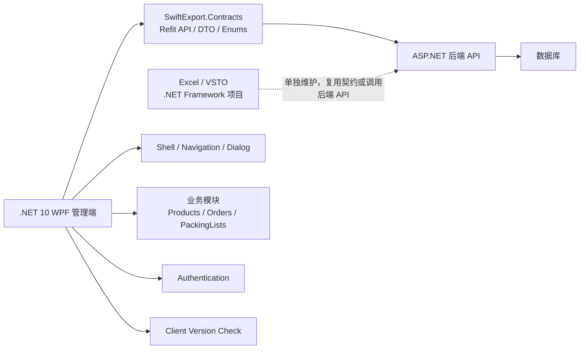
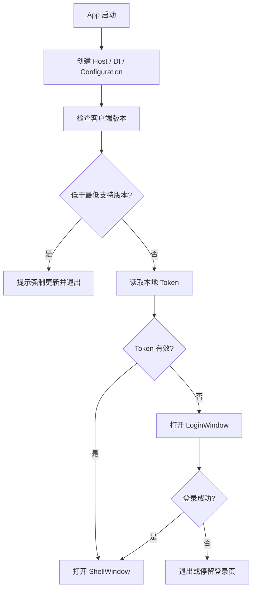

# SwiftExport .NET 10 WPF 前端架构文档

## 1. 架构结论

SwiftExport 新前端采用 **.NET 10 WPF 管理端** 作为主线，使用 **lepoco/WPF UI** 做现代桌面外壳，使用 **CommunityToolkit.Mvvm** 替代旧 MVVMLight，继续复用现有 ASP.NET 后端和 `SwiftExport.Contracts` 契约层。

最终定位：

```text
ASP.NET 后端
  负责业务、数据库、权限、订单、产品、导入记录、API

SwiftExport.Contracts
  负责 Refit API、DTO、枚举、前后端共享契约

.NET 10 WPF 管理端
  负责正式 ERP 管理体验：产品、订单、PackingList、模板、导入记录、设置

Excel / VSTO 插件
  单独作为 .NET Framework 项目维护，不属于 .NET 10 WPF 前端工程
```

这条路线的核心目标不是追求“最新 UI”，而是让你能长期维护、逐步迭代，并且让 WPF 管理端、ASP.NET 后端、`SwiftExport.Contracts` 契约层边界清楚。

## 2. 技术选型

| 领域 | 选择 | 说明 |
| --- | --- | --- |
| 主框架 | `.NET 10 WPF` | 现代 .NET 桌面端，兼顾稳定、可维护和 WPF 生态 |
| MVVM | `CommunityToolkit.Mvvm` | 替代 MVVMLight，减少 ViewModel 样板代码 |
| UI 外壳 | `lepoco/WPF UI` | 用于 `FluentWindow`、`NavigationView`、Dialog、Snackbar、图标等 |
| 业务控件 | 原生 WPF + 自定义样式 | 特别是 `DataGrid`、表单、订单编辑控件，不直接依赖 UI 库 |
| DI/Host | `Microsoft.Extensions.Hosting` + `DependencyInjection` | 建立现代 WPF 启动、配置、服务注册方式 |
| API | `SwiftExport.Contracts` 中的 Refit 接口 | 保持前后端契约统一 |
| 部署 | ClickOnce 起步 | 适合局域网部署；坏版本通过“前进式回滚”处理 |
| Excel 集成 | 单独 .NET Framework / VSTO 项目 | 不放入 .NET 10 WPF 前端工程 |

## 3. 为什么这样选

### 不直接转 Web

Web 对多人协作和更新发布有优势，但你目前不熟悉 Web 前端。当前阶段如果把 Web 作为主线，项目会变成“Codex 能写，但你难以审查和维护”的状态。

所以 Web 可以作为未来查询端、看板端、审批端，但当前主线先用你能掌控的 WPF。

### 不选 WinUI 3

WinUI 3 更现代，但对 SwiftExport 这种表格密集、ERP 管理型桌面软件来说，WPF 更成熟、更稳，也更容易迁移旧 MVVMLight 项目和现有主题。

### 使用 WPF UI，但不让它接管业务架构

WPF UI 适合做外壳体验：

```text
FluentWindow
NavigationView
ContentDialog
Snackbar
SymbolIcon
NumberBox
Card
```

WPF UI 的 Gallery 偶尔卡顿不代表库不能用，但说明它不应该承载所有重业务页面。它更适合做外壳、导航、弹窗、通知和轻量控件；高频表格、订单明细、PackingList 明细这类页面要用原生 WPF 控件和项目自定义控件来掌控性能与交互。

但业务层仍然应该保持独立：

```text
ViewModel 不引用 Wpf.Ui 控件
业务服务不引用 Wpf.Ui
导航、弹窗、通知都通过接口抽象
DataGrid 单独定制
```

## 4. 总体结构



## 5. 推荐项目结构

建议先建立一个新的 WPF 项目，例如：

```text
SwiftExport.Client.Wpf/
├─ App.xaml
├─ App.xaml.cs
├─ appsettings.json
├─ Bootstrapper/
│  ├─ AppHost.cs
│  ├─ ServiceCollectionExtensions.cs
│  └─ ViewRegistrationExtensions.cs
├─ Authentication/
│  ├─ LoginWindow.xaml
│  ├─ LoginWindow.xaml.cs
│  ├─ LoginViewModel.cs
│  ├─ IAuthService.cs
│  ├─ AuthService.cs
│  ├─ ITokenStore.cs
│  ├─ LocalTokenStore.cs
│  └─ CurrentUserService.cs
├─ Shell/
│  ├─ ShellWindow.xaml
│  ├─ ShellWindow.xaml.cs
│  ├─ ShellViewModel.cs
│  └─ NavigationMenuProvider.cs
├─ Navigation/
│  ├─ INavigationService.cs
│  ├─ NavigationService.cs
│  ├─ NavigationItem.cs
│  └─ PageRegistration.cs
├─ Dialogs/
│  ├─ IDialogService.cs
│  └─ WpfUiDialogService.cs
├─ Notifications/
│  ├─ INotificationService.cs
│  └─ WpfUiNotificationService.cs
├─ Updates/
│  ├─ IClientVersionService.cs
│  ├─ ClientVersionService.cs
│  ├─ ClientVersionInfo.cs
│  └─ UpdateRequirement.cs
├─ Services/
│  ├─ Api/
│  ├─ Configuration/
│  └─ ErrorHandling/
├─ Features/
│  ├─ Dashboard/
│  ├─ Products/
│  │  ├─ Views/
│  │  ├─ ViewModels/
│  │  └─ Models/
│  ├─ Orders/
│  ├─ PackingLists/
│  ├─ ImportTemplates/
│  ├─ ImportHistory/
│  ├─ Customers/
│  └─ Settings/
├─ Themes/
│  ├─ Tokens.xaml
│  ├─ Colors.xaml
│  ├─ Typography.xaml
│  └─ Spacing.xaml
├─ Styles/
│  ├─ Button.xaml
│  ├─ TextBox.xaml
│  ├─ ComboBox.xaml
│  ├─ DataGrid.xaml
│  └─ Forms.xaml
├─ Controls/
│  ├─ AdvancedDataGrid.xaml
│  ├─ SearchBox.xaml
│  └─ PageHeader.xaml
└─ Behaviors/
   ├─ DataGridBehaviors.cs
   └─ TextBoxBehaviors.cs
```

## 6. WPF UI 使用边界

推荐使用：

```text
ShellWindow 使用 ui:FluentWindow
主导航使用 ui:NavigationView
图标使用 WPF UI SymbolIcon
通知使用 Snackbar
标准确认/提示弹窗使用 ContentDialog
少量增强输入控件可用 NumberBox 等
```

谨慎使用：

```text
复杂 DataGrid
订单编辑器
PackingList 明细编辑器
大批量表格编辑控件
高度定制业务表单
```

业务页面优先使用原生 WPF 控件：

```xml
<Button Content="保存" />
<TextBox Text="{Binding ProductName}" />
<DataGrid ItemsSource="{Binding Products}" />
```

外壳页面可以使用 WPF UI 控件：

```xml
<ui:FluentWindow
    x:Class="SwiftExport.Client.Wpf.Shell.ShellWindow"
    xmlns:ui="http://schemas.lepo.co/wpfui/2022/xaml">

    <ui:NavigationView
        MenuItemsSource="{Binding NavigationItems}"
        SelectedItem="{Binding SelectedNavigationItem}" />
</ui:FluentWindow>
```

## 7. 主题策略

采用：

```text
WPF UI 主题作为外壳基础
项目自己的 Tokens/Colors/Typography/Spacing 控制业务视觉
业务控件样式放在 Styles/
复杂业务控件放在 Controls/
```

不要同时把 **官方 WPF Fluent Theme** 和 **WPF UI 全套主题** 都作为根主题混用。两者都会覆盖基础控件样式，容易造成资源冲突。

如果决定使用 WPF UI，则推荐：

```xml
<Application.Resources>
    <ResourceDictionary>
        <ResourceDictionary.MergedDictionaries>
            <ui:ThemesDictionary Theme="Light" />
            <ui:ControlsDictionary />

            <ResourceDictionary Source="Themes/Tokens.xaml" />
            <ResourceDictionary Source="Themes/Colors.xaml" />
            <ResourceDictionary Source="Themes/Typography.xaml" />
            <ResourceDictionary Source="Styles/Button.xaml" />
            <ResourceDictionary Source="Styles/TextBox.xaml" />
            <ResourceDictionary Source="Styles/DataGrid.xaml" />
        </ResourceDictionary.MergedDictionaries>
    </ResourceDictionary>
</Application.Resources>
```

## 8. MVVM 规范

使用 `CommunityToolkit.Mvvm`：

```csharp
public partial class ProductListViewModel : ObservableObject
{
    [ObservableProperty]
    private bool isBusy;

    [ObservableProperty]
    private string? keyword;

    [RelayCommand]
    private async Task SearchAsync()
    {
        // Call API service
    }
}
```

原则：

```text
ViewModel 不直接访问 Window、Page、MessageBox、WPF UI 控件
弹窗走 IDialogService
通知走 INotificationService
导航走 INavigationService
API 走服务接口
复杂业务状态不要写在 code-behind
code-behind 只处理纯 UI 生命周期和控件初始化
```

## 9. 启动流程



## 10. 登录模块

第一版必须支持：

```text
登录
退出登录
记住用户名
保存 token
启动时验证 token
API 请求自动带 Authorization
401 / token 过期后回到登录页
```

后续再补：

```text
重置密码
修改密码
记住密码或安全凭据
多用户切换
用户权限
登录日志
```

退出登录流程：

```text
用户点击退出登录
-> 清除 token
-> 清空 CurrentUser
-> 关闭 ShellWindow
-> 回到 LoginWindow
```

## 11. 菜单和导航

第一版菜单不要从数据库读取，先用本地代码配置。原因是模块还在快速变化，过早动态菜单会增加复杂度。

推荐菜单：

```text
Dashboard
Products
Sales Orders
Packing Lists
Import Templates
Import History
Customers
Settings
```

菜单模型预留权限字段：

```csharp
public sealed record NavigationItem(
    string Key,
    string Title,
    string IconKey,
    Type ViewModelType,
    string? RequiredPermission = null,
    int SortOrder = 0);
```

后续当用户权限稳定后，可以让后端返回权限，前端按 `RequiredPermission` 过滤菜单。

## 12. DataGrid 策略

不要因为使用 WPF UI 就把 DataGrid 交给它。ERP 的核心难点常常就在 DataGrid：

```text
行内编辑
筛选
排序
分页
选择列
批量操作
错误标记
导入结果定位
复制粘贴
导出
```

第一阶段使用原生 `DataGrid` + 自定义样式：

```text
Styles/DataGrid.xaml
Behaviors/DataGridBehaviors.cs
Controls/AdvancedDataGrid.xaml
```

如果后期确实需要高级功能，再考虑商业控件：

```text
DevExpress
Telerik
Syncfusion
```

## 13. ClickOnce 更新策略

ClickOnce 可以作为第一阶段部署方案。

更新策略：

```text
客户端启动时调用后端版本接口
后端返回 LatestVersion / MinimumSupportedVersion / DownloadUrl / ReleaseNotes
低于最低版本：必须更新
低于最新版本：提示可选更新
等于或高于最新版本：正常进入
```

坏版本回滚不做真正“降级”，而是采用前进式回滚：

```text
坏版本：1.2.5
稳定版本：1.2.4
处理方式：把 1.2.4 的内容重新发布为 1.2.6
```

## 14. Excel / VSTO 边界

Excel / VSTO 不属于本文档定义的 `.NET 10 WPF` 前端工程。它应该单独作为 `.NET Framework` 项目维护，后续单独写 Excel 插件架构文档。

本文档只约定 WPF 管理端与 Excel 插件之间的边界：

```text
WPF 管理端负责：
产品管理
订单管理
PackingList 管理
导入模板维护
导入记录查看
错误修复

Excel / VSTO 负责：
读取当前 Workbook / Sheet / Range
选择模板
发起导入
显示导入结果
标记错误行
```

不要把 VSTO 代码、Excel 专属 UI、Office COM 操作放进 `.NET 10 WPF` 前端项目。

不要把完整 ERP 逻辑塞进 VSTO：

```text
完整产品管理
完整订单编辑
复杂脏数据修复
复杂权限逻辑
大量业务验证
```

这些应该放在 WPF 管理端和 ASP.NET 后端。

## 15. 架构原则

1. UI 库只做外壳和通用体验，不决定业务架构。
2. ViewModel 不依赖具体控件库。
3. 所有 API 调用通过服务层和 `SwiftExport.Contracts` 中的 Refit 接口。
4. 登录、更新、导航、弹窗、通知全部接口化。
5. 菜单第一版本地固定，权限稳定后再动态化。
6. DataGrid 单独建设，不依赖 WPF UI。
7. 旧 MVVMLight 项目作为参考，不在原地硬改。
8. 先跑通一个完整模块，再大规模迁移。

## 16. 最小可用目标

第一轮 MVP 只追求：

```text
.NET 10 WPF 新项目能启动
WPF UI 外壳能显示
主题资源能加载
Host / DI / Configuration 可用
能检查客户端版本
能登录和退出登录
Shell + NavigationView 可用
Products 模块能列表、搜索、编辑
ClickOnce 能发布给一台测试机
```

完成这些之后，再迁订单、PackingList、导入模板和导入记录。Excel / VSTO 插件另开独立阶段和独立文档。
