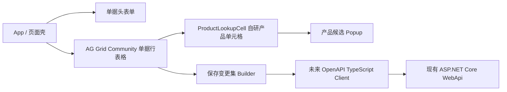
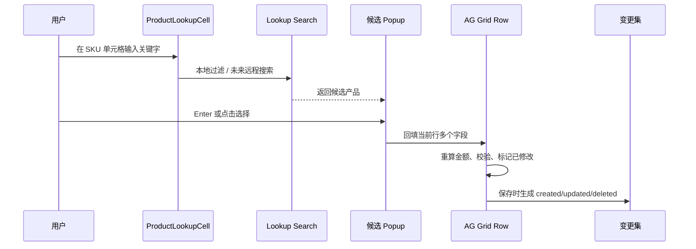
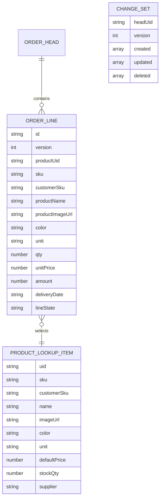

# BS 前端 React 技术方案与后续计划

日期：2026-07-02

本文说明 SwiftExport 未来 BS 前端的建议技术栈、最小 demo 验证内容、前端组件关系和后续实施计划。

## 1. 当前结论

建议 BS 前端采用：

```text
React + TypeScript + Ant Design + AG Grid Community + 自研 ERP Lookup Cell
```

选择原因：

- Ant Design 适合 ERP 后台系统，表单、弹窗、抽屉、选择器、布局和状态反馈成熟。
- AG Grid Community 可以作为免费数据表格底座，承担列定义、行选择、排序、过滤、编辑和虚拟化基础能力。
- 产品、客户、供应商、物料等业务 lookup 不依赖表格库内置高级编辑器，而是自研 `LookupCell`，避免落入 AG Grid Enterprise 付费能力。
- 自研 lookup 能自然支持图片、远程搜索、键盘选择、多字段回填和 ERP 业务校验。

本次 demo 路径：

```text
demos/SwiftExport.ReactWorkbench
```

2026-07-03 追加：demo 已增加“产品管理”页面，使用真实后端 API：

```text
POST /api/Product/search
GET  /api/Product/{uid}
```

前端通过 Vite 代理 `/api -> https://localhost:7286/api` 调用现有 WebApi，避免为了 demo 修改后端 CORS。

## 2. Demo 验证目标

本次最小 demo 验证：

- 单据头 + 单据行页面结构。
- AG Grid Community 单据明细表格。
- SKU 单元格内输入关键字。
- 弹出产品候选 popup。
- 候选项展示产品图片、SKU、客户编码、库存、供应商和价格。
- 按 Enter 或点击候选项后回填当前行多个字段：
  - `productUid`
  - `sku`
  - `customerSku`
  - `productName`
  - `productImageUrl`
  - `color`
  - `unit`
  - `unitPrice`
  - `amount`
- 行状态标记：未修改 / 新增 / 已修改。
- 行校验和保存变更集预览。
- 产品管理页读取真实产品分页数据，并可打开真实产品详情。

## 3. 前端模块关系图



## 4. Lookup Cell 数据流



## 5. 前端核心数据模型



说明：这里的 ER 图是前端交互数据模型，不是数据库物理模型。当前后端使用 PostgreSQL，业务与持久化事实以现有 Entity、DTO、Repository 及实体元数据生成的 PG 结构为准；React 方案不改变当前 WPF 主线。

## 6. 推荐目录结构

未来正式 WebApp 可采用：

```text
SwiftExport.WebApp/
  src/
    app/
      providers/
      router/
      layout/
    shared/
      api/
      components/
      lookup/
      grid/
      models/
      utils/
    features/
      sales-orders/
        pages/
        components/
        models/
        services/
      purchase-orders/
      receives/
      packing-lists/
      master-data/
```

关键约定：

- `shared/lookup` 放通用 lookup 基础设施。
- `features/**/models` 放前端行模型和变更集类型，不污染后端 DTO。
- `shared/api` 未来由 OpenAPI 生成 TypeScript Client。
- 单据页面统一采用“管理页 + 详情页 + 行表格 + 保存变更集”模式。

## 7. 后续实施计划

### 阶段一：技术底座

- 建正式 `SwiftExport.WebApp`。
- 引入 React、TypeScript、Ant Design、AG Grid Community。
- 配置路由、布局、主题、权限占位和 API Client。
- 配置 CORS、JWT、环境变量和本地代理。

### 阶段二：Lookup 基础设施

- 抽象 `BaseLookupCell`。
- 实现 `ProductLookupCell`。
- 实现 `CustomerProductLookupCell`。
- 实现 `SupplierLookupCell`。
- 支持远程搜索、防抖、加载状态、空结果、键盘上下选择、Enter 确认。
- 支持候选项自定义模板，包含图片、编码、名称、库存、价格等字段。

### 阶段三：可编辑单据表格

- 抽象 `EditableDocumentGrid`。
- 实现前端行状态：
  - `clean`
  - `created`
  - `updated`
  - `deleted`
- 实现校验、脏数据提示、删除池、保存前拦截。
- 实现保存变更集 `created/updated/deleted`。

### 阶段四：接入现有后端

- 从 Swagger/OpenAPI 生成 TypeScript API Client。
- 对齐现有 `ServiceResult`、分页结构、错误格式。
- 优先迁移基础资料页面。
- 再迁移销售订单详情页。
- 最后迁移采购、入库、PackingList 和过账类页面。

### 阶段五：增强类 Excel 能力

- 单元格复制 / 粘贴。
- 批量填充。
- 撤销 / 重做。
- 快捷键导航。
- 大数据分页和虚拟滚动。

这些能力先按 ERP 实际需要自研轻量版，不直接依赖 AG Grid Enterprise。

## 8. 风险与边界

- AG Grid Community 不包含全部 Enterprise 类 Excel 高级能力，尤其是复杂区域选择、填充柄、富选择器等。
- 本方案的核心是把业务 lookup 自研，不把关键体验绑死在付费表格功能上。
- 产品图片未来不能依赖本地路径，应由后端提供可访问的文件 URL 或文件 ID。
- Web 前端不要直接引用 WPF UI 状态，也不要让 DTO 混入 `isDirty`、`rowState` 等前端字段。
- 保存、确认、过账等业务命令仍然必须走现有 ASP.NET Application Service。

## 9. 明天建议验收点

- 是否能接受 React + Ant Design 的后台视觉和交互密度。
- SKU 单元格输入搜索是否符合预期。
- 产品候选 popup 展示图片和业务字段是否够用。
- 选中产品后整行回填是否贴近真实单据录入。
- 保存变更集是否符合未来后端批量保存接口思路。
- 产品管理页是否能接受“先真实读取，后续再接写入”的渐进方式。
