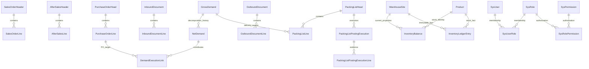

# 当前业务流程与核心逻辑关系

核对日期：2026-10-06。下图是当前核心实体的逻辑关系摘要，不是数据库外键DDL，也不涵盖所有配置和查询投影。

SO/CR来源通过SourceType/SourceUid/SourceLineId追溯原单头/行；PO Link通过TargetType/TargetHeadId/TargetLineId追溯采购，不是物理外键。库存来源身份、TriggerPackingListId与反向流水保持执行归属。当前共享BomNo不表示每个Product独占一个BOM；PurchaseConfirmationLine/Node仅保留历史实体，当前采购确认不创建它们。

正向/反向主链见[流程导航](../.agents/references/ERP业务流程导航图.md)，准确字段、状态和局部约束见[模型说明](../.agents/references/数据模型与状态规则.md)及[实体](../SwiftExport.Core/Entities)。旧SalesDemand、RequirementPool、NetDemandAllocation不在当前主链。未运行图外业务或数据库验收。
