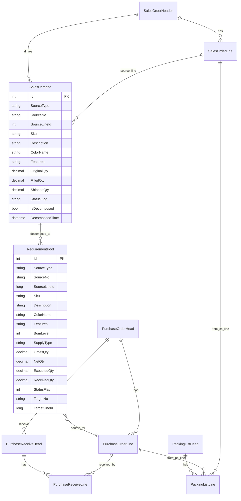
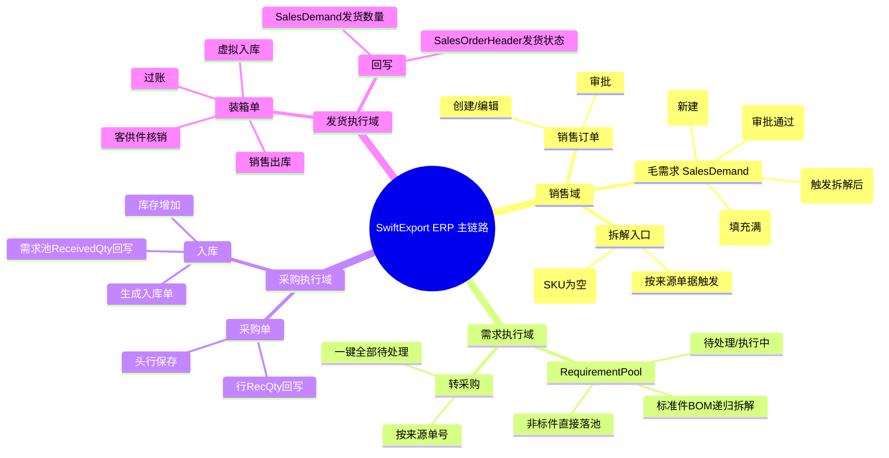

# SwiftExport ERP 流程与 ER 图审阅稿

> 版本：基于当前 main 分支代码（含“销售订单 -> SalesDemand（毛需求） -> RequirementPool”改造）
> 
> 目的：用于你审核流程是否有纰漏或未完成项。

---

## 1. 业务主流程图（当前实现）

```mermaid
flowchart TD
    A[销售订单 SalesOrderHeader+Line\n创建/编辑保存] --> B[同步生成 SalesDemand\n状态=草稿]
    B --> C[销售订单审批通过\nApprovalStatus=已批准]
    C --> D[批量更新 SalesDemand\n状态=待处理]

    D --> E[按来源触发 SalesDemand 拆解\n/api/SalesDemand/decompose-by-source]
    E --> E1{是否已拆解? IsDecomposed}
    E1 -- 是 --> E2[阻断重复拆解\n返回失败提示]
    E1 -- 否 --> F
    E2 --> E3[人工确认后处理]
    E3 --> F
    F -- 否 --> G[按产品供货策略拆解BOM\n写入 RequirementPool]
    F -- 是 --> H[按非标件直接落 RequirementPool\nDescription/ColorName/Features]

    G --> I[RequirementPool 待处理池]
    H --> I

    I --> J[需求池转采购\n按来源或一键全部]
    J --> J1{需求池行SupplierCode是否为空?}
    J1 -- 是 --> J2[阻断转单\n强制用户手工指定Supplier]
    J1 -- 否 --> K
    J2 --> J3[用户补录SupplierCode/SupplierName]
    J3 --> K
    K[生成 PurchaseOrderHead+Line]
    K --> L[回写 RequirementPool\nTargetNo/StatusFlag=1]

    K --> M[采购入库 Receive]
    M --> N[回写 PurchaseOrderLine.RecQty]
    M --> O[智能回写 RequirementPool.ReceivedQty\n按同SourceLine多行缺口比例分摊]
    M --> P[增加库存 Inventory(V_WH)]
    M --> M1[SalesDemand.FilledQty推进\n达到OriginalQty转已到货]

    K --> Q[装箱单 PackingList 过账]
    Q --> R[虚拟入库 + 销售出库 + 客供件核销]
    R --> S[回写 SalesDemand.ShippedQty/LastShippedDate]
    S --> S1[若FilledQty>=OriginalQty 且\nShippedQty>=OriginalQty\nSalesDemand转已完成]
    S --> T[汇总更新 SalesOrderHeader.OrderStatus]
```

---

## 2. ER 图（核心实体关系）



---

## 3. 思维导图（便于评审）



---

## 4. 当前“已实现”与“待确认/可能未完”清单

### 4.1 已实现（代码可见）

1. 销售订单审批不再直接拆 RequirementPool，仅同步 SalesDemand 状态。  
2. SalesDemand 作为拆解驱动入口，新增 API：`/api/SalesDemand/decompose-by-source`。  
3. 非标件支持：SKU 为空时，可通过描述/颜色/规格进入拆解并落 RequirementPool。  
4. PackingList 发货回写目标已改为 SalesDemand，不再回写 SalesOrderLine 的发货状态字段。  
5. RequirementPool 新增 `Description/ColorName/Features` 字段链路。
6. SalesDemand 新增防重字段 `IsDecomposed/DecomposedTime`，拆解重复调用会被拦截。
7. 需求池转采购执行“方案A”：需求池行无供应商时，强制用户先手工指定 Supplier 后再转单。
8. 入库回写升级为智能分摊：同一来源行拆成多条需求池时，按缺口比例分摊回写 ReceivedQty。
9. RequirementPool API 前端注入路径已统一为 `/api/RequirementPool`，与后端控制器路由一致。
10. SalesDemand 状态闭环已补齐：
   - FilledQty >= OriginalQty => 已到货
   - FilledQty >= OriginalQty 且 ShippedQty >= OriginalQty => 已完成

### 4.2 待你重点审核（流程风险点）

1. **需求池转采购对非标件的兼容性（已按方案A落地）**  
   当前执行规则：需求池行必须有 SupplierCode（手工指定优先，产品默认供应商兜底），否则禁止转单。  
   - 结论：非标件可入池，但转采购前必须补录供应商。

2. **Receive 回写 RequirementPool 智能化（已落地）**  
   入库回写已支持同 `SourceLineId` 多条需求池记录，按缺口比例分摊。  
   - 结论：可覆盖箱单自动入库/自动出库主场景。

3. **SalesDemand 拆解幂等控制（已落地）**  
   新增 `IsDecomposed` 防重标记，重复拆解请求直接阻断并返回提示。

4. **RequirementPool API 路由命名一致性（已修复）**  
   前端已改为 `/api/RequirementPool`，与 `RequirementPoolController` 路由一致。

5. **状态闭环定义（已补齐）**  
   SalesDemand 状态推进规则已明确并落地：
   - 拆解后：待处理 -> 采购中
   - 到货满足：FilledQty 达到 OriginalQty -> 已到货
   - 完成满足：ShippedQty 达到 OriginalQty 且已到货 -> 已完成

---

## 5. 建议下一步（评审后可做）

1. 明确“非标件转采购”策略：
   - 方案A：需求池行强制手选 Supplier 后才允许转单；
   - 方案B：按客户/品类预设默认 Supplier 兜底。

2. 入库回写改为“按 SourceLineId 全量更新 RequirementPool 子项”。

3. 增加 SalesDemand 拆解防重标记（如 DecomposedTime / IsDecomposed）。

4. 输出一版“状态机图”（SalesOrder + SalesDemand + RequirementPool）作为测试用例基线。
