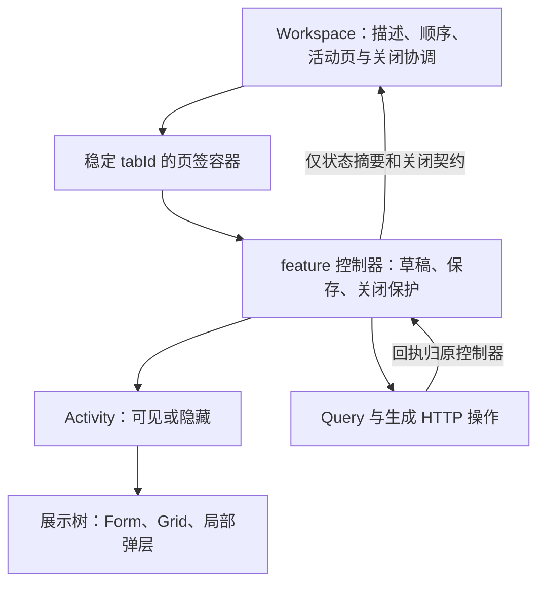

# Web 多标签工作区设计（首期方案基线）

更新：2026-10-09。用户明确要求 ERP 应用内多标签，不依赖浏览器原生页签，也不以切换路由销毁上一业务页。与 [脚手架及目录决策](Web客户端架构与脚手架决策.md) 联合使用。本文维护首期规则；工程、验收页与公共设施的实际覆盖及限制见 [分阶段验收记录](../SwiftExport.WebApp/docs/骨架验收记录.md)，不将模拟保存视为真实业务写入验收。

## 1. 交互目标与范围

同一 ERP 主窗口包含导航、业务页签栏和工作区。产品管理、不同订单及其他已接入业务可以同时打开；切换后保留各页的筛选、分页、表单输入、行编辑、选择、展开及滚动位置。首期单工作区、单活动标签，不建设拖拽分屏、跨窗口同步或通用桌面窗口引擎。

确定首期支持打开/定位已有标签、切换、关闭当前、关闭其他和关闭全部；批量关闭遵循逐页安全确认。拖动排序、固定任意标签和自动恢复整套工作区属于后续需求。业务列表按页面类型复用一个标签，不默认把每种筛选都变成新页签。

保留草稿的范围是当前浏览器运行会话。刷新/关闭浏览器之前按 [公共契约的完整保护摘要](#workspace-contract) 尝试提供原生离开提醒；浏览器可能不展示或不执行提醒，不能可靠阻止关闭，也不保证持久化。首期不把草稿自动写入浏览器磁盘，不承诺跨刷新恢复。12 小时内恢复原 JWT 按 [会话规则](#workspace-session) 执行，恢复标签目录不在本期，记住登录不能等同于完整草稿恢复。

## 2. 三种身份分开

| 身份 | 用途 | 规则 |
| --- | --- | --- |
| 页面类型 pageKind | 定位页面定义、权限和懒加载模块 | 由应用页面目录声明，不使用任意 URL 当组件标识 |
| tabId | 同一会话内稳定 React key 与实例身份 | 新建时生成；保存换服务端 Uid 时保持，避免 remount 丢状态 |
| 业务 identity | 去重、定位文档 | 列表为 pageKind；已有文档为 pageKind + 实体 Uid；新单为 pageKind + 临时草稿身份 |

标签标题、订单号、排序位置和数组下标均不作为身份。重复打开同一已有单据时定位原标签，不能重置其草稿。查看/编辑是同一文档的访问状态，不默认打开两份可互相覆盖的编辑器；实际写按钮仍受权限和生命周期约束。

新单据保存后将业务 identity 改为服务端 Uid，tabId 不变。如果目标实体已被其他标签打开，必须按已保存状态核对后处理，不自动丢弃任一草稿。正式命令的 CommandId 属于一次冻结业务操作，不属于 tabId，也不能用页签 ID 代替它。

## 3. 路由与页面驻留方式

React Router Framework SPA 保留为工程基座，但**只承担登录、工作区与应用级错误入口**。使用稳定 `/workspace` 路由承载多标签。活动文档可通过 `?view=<pageKind>&id=<Uid>` 等白名单参数表达，用于直接打开和定位；参数不包含 token、完整 DTO 或未保存字段。

workspace 的页面目录负责把 pageKind 转为描述和 feature 入口。用户菜单、关联跳转及搜索结果统一调用 open/activate 意图；不在各模块自行 navigate 并建立一份独立页签列表。页面目录是工作区 pageKind/权限/加载入口的权威，导航目录引用它，URL 编解码也由它校验。

浏览器前进/后退在工作区内定位目标标签，不自动关闭当前文档。进入已知文档 URL 时重新检查权限；如果当前会话未打开，就打开，已打开则只激活；找不到实体时在对应标签显示错误，不破坏其他标签。

每个业务标签从自己的 descriptor 接收 Uid 与参数，不能在隐藏标签内 useParams/useSearchParams 获取全局当前文档的身份。否则激活订单 B 时隐藏的订单 A 可能错误读取 B。筛选/分页主要由各标签状态拥有，只有活动标签的可分享参数才同步 URL；不能用同一全局 searchParams 驱动全部列表。

工作区内的页面入口使用显式懒加载，配合每页的 Suspense/错误边界。Framework 的自动路由拆分主要覆盖登录/工作区，**不会自动为非路由的所有业务标签拆包**；页面目录的模块动态 import 是这里必要且有限的接线，不再宣传“每个业务标签都是框架自动拆分”。

## 4. 官方 UI 与状态保留能力

页签栏使用 Ant Design Tabs 的受控 activeKey、editable-card、onEdit 与 items；隐藏默认新增按钮，由菜单/业务动作打开页面。保持隐藏内容，首次激活才载入，不让切换直接销毁标签。[Ant Design Tabs](https://ant.design/components/tabs/)

采用支持稳定 Activity 的 React 19.2 或后续兼容稳定版本作为候选，精确版本须联合验收后锁定。React Activity 在隐藏时保留状态/DOM，同时清理 Effects，恢复显示后重新建立 Effects；它提供生命周期机制，不替代页签身份和业务保存协议。[React Activity](https://react.dev/reference/react/Activity)

**实施门禁**：Ant Tabs + Activity + Ant Form/弹层 + Query 的组合需实际浏览器验证。本轮未实测，不声称仅设置 destroyOnHidden=false 就完成 ERP 标签保活。Ant 的生命周期配置与 Activity 的职责不同，必须保留稳定 tabId 和首次访问状态，并测试实际挂载/卸载次数。

页面控制器、编辑状态和保存操作边界放在 Activity 外，展示树放在 Activity 内；应用注入展示容器与标签控制契约，feature 不反向导入 app/workspace。由此隐藏 UI 时仍能正确处理已发出的提交与回执。具体实现采用小范围组件组合，不建立可插拔 keep-alive 框架或全局 DTO 草稿仓库。



此图是组件职责蓝图。每个真实标签都有自己的控制器实例；隐藏改变展示树生命周期，关闭才移除该页签实例。

**页签控制器的定义**：每个 tabId 对应一个 feature 编辑会话，由组件与 hooks 实现，持有基线/版本、Form 实例或编辑集合、保存快照/状态及关闭契约。Form/集合的当前值所有权遵循 [字段唯一来源](Web客户端架构与脚手架决策.md#web-field-owner)，控制器不另存同字段当前值副本。不创建 BaseController → EditableController 的继承框架，不照搬 WPF ViewModelBase。

**WEB-TAB-01：稳定实例与显式活动状态。** Workspace 向控制器提供 isActive。Activity 外的 Query、轮询和搜索防抖不会随内部展示 Effects 自动清理，必须根据 isActive 与权限显式 enabled/停止调度；隐藏时放弃过期读取回写，恢复按 stale 与完整保护摘要处理，刷新回写不能覆盖受保护输入。是否取消正在读取的请求按查询策略决定，不能取消已经发出的保存。Activity 只管理内部展示生命周期。[React Activity 生命周期边界](https://react.dev/reference/react/Activity)

单纯切换不弹保存确认、不强制提交或校验单元格。尚未提交的原始输入缓冲随该 tabId 保留，隐藏及展示 Effects 清理不得清空缓冲、重设字段或撤销其保护摘要；缓冲与保护注册的寿命不能依赖仅在显示时运行的 Effect。恢复展示继续使用该缓冲，不能用集合旧值覆盖它。

## 5. Workspace 与业务模块的职责

| 对象 | 拥有 | 不拥有 |
| --- | --- | --- |
| Workspace 状态 reducer + Context | 标签顺序、稳定描述、activeTabId、打开去重、状态摘要 | 产品 DTO、表单字段、订单算法、API 事务 |
| 页面目录 | pageKind、标题规则、访问键、创建描述、懒加载入口 | 服务器动态生成的菜单/任意插件扫描 |
| TabFrame | 单页错误/加载边界、显示生命周期、焦点/滚动协调 | 自动保存、丢弃、提升 Version |
| feature 标签控制器 | 本页参数、草稿、保存快照与回执、关闭许可 | 其他标签草稿、Workspace 内部 reducer |
| shared 的标签控制契约 | 页面向宿主报告完整保护摘要和关闭动作，定义见下文 | 引用全部业务模块或实例化 Workspace |
| Query | 服务器快照与提交调用 | 标签生命周期和尚未保存的编辑值 |

Workspace 只接收状态摘要和必要回调，不保存所有页面的完整 DTO。全局保护摘要按状态变化更新，不让每次输入都复制全部标签数据。相同服务器数据允许使用规范 Query key 共享读取；不同实体/筛选必须区分键，独立草稿永远不能共用。

关闭注册/状态摘要由实际 tabId 生命周期管理：Activity 的隐藏清理不能使关闭守卫失效。清除 callback、释放资源只发生在真正关闭/身份销毁时；隐藏时的 UI 订阅清理由展示层负责。这一点必须覆盖隐藏 dirty 标签的关闭测试。

<a id="workspace-contract"></a>

### 5.1 公共契约的必需语义

以下定义契约内容，尚未创建 TypeScript 接口或运行时 registry。实现文件归 shared/workspace；app 负责注入/组合，feature 只依赖该公共契约。

| 方向 | 内容 | 行为约束 |
| --- | --- | --- |
| Workspace → feature | 只读 descriptor：tabId、pageKind、类型化 params、business identity；isActive | descriptor 标识本页，隐藏页不改读活动 URL；参数由页面目录校验 |
| Workspace → feature | open/activate 公共导航意图 | 页面目录检查权限和去重；feature 不导入目标页面/工作区 reducer |
| feature → Workspace | dirty、hasUncommittedInput、preparing、saving、unknown 摘要及必要状态说明 | 不上传 DTO/字段值；摘要来自当前编辑会话，不由宿主推导业务成功 |
| Workspace → feature | requestSave、requestDiscard、canClose | 命令只针对指定 tabId；全部保存复用同一 feature 保存入口 |
| feature → Workspace | saved / unsaved / failed / unknown | saved 须按下文确认成功并接纳，且完整保护摘要已解除；unsaved 表示仍需处理；failed 仅用于确认未生效的失败，显示“业务拒绝”本身不能决定返回 failed |
| feature → Workspace | 关闭许可或阻断原因 | 按同一最新摘要判定；discard 不得绕过准备、保存或未知恢复 |

**保护摘要的唯一语义**：dirty 是 [WEB-EDIT-02 的业务字段比较](Web客户端架构与脚手架决策.md#web-field-owner)；hasUncommittedInput 表示尚未提交的实际输入变化，包括无法转换成业务值的无效或未完成内容。缓冲按字段转换/等价规则与该单元格开始编辑时的业务当前值比较；无法转换的实际输入保持保护。仅聚焦、touched、曾经编辑不产生永久保护。恢复该值或明确取消单元格编辑，只解除对应缓冲的保护，不清除其他业务修改。缓冲仅保留控件原始输入，不另建长期业务数据副本。

**普通关闭直接放行的必要且同时成立条件**：dirty=false、hasUncommittedInput=false、preparing=false、saving=false、unknown=false。preparing 覆盖提交输入、校验及冻结请求阶段。标题/提示可以区分业务修改与未提交输入，不能把集合 dirty=false 当作 clean 放行依据。该判定统一覆盖关闭当前/其他/全部、会替换当前编辑数据的分页/筛选/刷新、离开工作区、主动登出和有限的浏览器离开提醒。

requestSave 是异步的：saved → 重新读取同一会话的完整摘要及权限，再按上述条件关闭；unsaved/failed → 激活目标页并显示可处理错误，停止该轮批量关闭；unknown → 进入恢复入口，停止普通关闭。等待期间拒绝对同一 tabId 发第二次保存/放弃，关闭协调不能以请求已完成或 HTTP 200 代替 saved。Workspace 不解析 Product BatchSave；feature 不操作 Workspace 内部 reducer。

canClose 只查询同一最新摘要的 allowed/blocked 及原因，不触发保存或放弃。requestDiscard 仅在非 preparing/saving/unknown 且用户确认后，恢复基线并清除该次放弃范围的原始输入缓冲，返回 discarded/cancelled/blocked；返回 discarded 后仍须复核完整摘要及权限，满足普通关闭条件才关闭。saved/discarded 回调完成到实际移除页签之间如状态发生变化，必须重新判定，不能依据旧摘要删除实例。结果未知的人工终止由下文专用恢复动作返回 manualTerminated 与保全记录标识，只供该次明确确认的关闭分支使用，不把它转换为 saved/clean，也不让批量关闭自动调用。

注册与回调依稳定 tabId 生命周期保持，状态取最新会话值，不能闭包捕获初始 dirty/旧 Form。真正关闭才注销；换身份清理遵守会话隔离规则。接口的失败/取消只报告事实，不推断后台已回滚。

## 6. 切换、关闭与保存规则

| 场景 | 首期行为 |
| --- | --- |
| 切换标签（含 dirty/未提交输入） | 直接切换并保留输入，不弹保存确认、不强制校验；保护状态在标题有提示 |
| 普通直接关闭 | 仅在公共契约的完整保护摘要全部解除时关闭，激活邻近标签并释放实例；关闭全部后显示空状态 |
| 关闭有业务修改或未提交输入的标签 | 保存 / 放弃 / 取消；保存或放弃完成后复核完整摘要；失败停留 |
| 关闭只读或无保存用例的受保护输入 | 不承诺通用自动保存；提供符合该页面能力的放弃/取消与原因 |
| 保存期间切换 | 可以切换；原标签仍负责回执、状态提示与缓存失效，不能因失活取消写入 |
| 保存期间本页编辑 | 业务编辑区只读；阻止输入、粘贴、填充、增删行及会改动保存字段的操作；其他标签可编辑 |
| 保存准备/保存期间关闭或批量关闭 | 阻止关闭，提示等待结果；不得取消请求后假称服务端未提交 |
| 结果未知 | 保留冻结输入与已有 CommandId，阻止普通关闭；提供该用例允许的核实/恢复流程 |
| 关闭其他/全部 | 汇总所有目标页的完整保护摘要，逐项处理并复核；取消、失败或未知停止，不强制删除剩余状态 |
| 某标签崩溃 | 本标签显示错误并保留可保全的控制器状态；其他标签正常 |
| 筛选/分页/刷新替换本页编辑数据 | 按完整保护摘要处理保存/放弃/取消或阻断；不能只检查集合 dirty |
| 页面离开工作区/主动登出 | 汇总所有标签的完整保护摘要，包括隐藏缓冲；未处理保护状态不能自动释放工作区 |

<a id="workspace-save"></a>

### 6.1 唯一保存入口、隐藏校验与编辑冻结

**WEB-TAB-02：工具栏保存、关闭时保存、关闭其他/全部时保存，均调用同一 feature 保存入口。** 首期对隐藏页统一先激活并等待展示就绪，再提交活动单元格缓冲（包括尚未失焦的输入），校验 Form/编辑集合及本次操作权限，最后从权威当前值生成不可变冻结请求。转换或校验失败保留原始输入及对应保护，定位该页字段，不发送请求，不继续批量关闭。展示就绪通过显式生命周期握手处理，不靠任意 setTimeout 猜测 Form 已挂载。

同一会话锁从准备/校验开始，拒绝重入及修改保存字段。保存期间允许切换和操作其他标签；本页业务编辑区保持只读。解除保存锁依据以下提交结果分类，不能依据“显示了业务拒绝”或请求结束决定。不能接纳请求 A 时顺带清除用户后改的 B；首期不支持保存期间继续编辑。以后要支持须另提 revision/后续 patch 合并设计。

| 提交结果 | 分类所需证据 | 接纳与解除锁 |
| --- | --- | --- |
| A 确认成功 | 满足该 feature 的真实成功契约，核对完整回执、请求关联、实体/版本及覆盖范围 | 仅接纳已确认结果、更新相应基线，完成接纳后解除锁；只有完整保护摘要解除才返回 saved |
| B 确认未生效 | 请求确定未发送（如派发前校验失败），或该端点经过验证的具体契约证明本次操作未生效 | 保留草稿及尚未解决的输入，解除锁，允许修正后再次提交；失败返回 failed，不标 saved/clean |
| C 结果未知 | 请求已发出而无可靠结果，或现有返回不能可靠证明是否生效，包括不完整/无法关联的回执 | 保留冻结请求与追踪信息，进入恢复限制；不解锁供重新提交、不自动重发、不 acceptChanges、不普通放弃 |

分类由 feature 依据真实端点契约完成；通用 HTTP 层只保留发送阶段、status、正文、错误和追踪事实。400/403/422/500/503 不作统一生效判断；短路证据只适用于已验证的端点及场景。不分析中文 message 猜回滚、冲突或成功；网络错误、取消和超时本身不证明未发送或服务器未提交。已有行级部分成功由对应 feature 核对并仅接纳确认成功行，保留明确失败行草稿；完整行级结果均已确认并处理后可解除锁，仍有修改则返回 unsaved。未确认行仍受 C 类限制，返回 unknown，不能把整个会话标 saved，也不能把所有 BatchSave 改成 Product 的整批原子语义。

**WEB-TAB-03：回执绑定发起时的 tabId、编辑会话和提交尝试。** 已派发请求不因 isActive 变化取消，回执只更新原控制器；失活标签更新摘要，错误定位先激活目标，不能写入“当前活动标签”或重复弹窗。会话销毁/换用户时拒绝回写到新会话，取消客户端接收不等于服务端回滚，仍须保留必要核实信息。

Product 原子批量保存仅整批确认成功后接纳；当前失败分支的具体分类限制见 [产品恢复前提](Web首批接口契约验收.md#product-recovery)。专用单据命令按实际 CommandId/Version/回执处理。Workspace 不解析各业务响应，也不发明一个“所有页签通用 saveAll”事务。

<a id="workspace-recovery"></a>

### 6.2 结果未知的恢复与人工退出

**WEB-TAB-04：未知结果不自动重发、不接纳、不普通放弃；必须有可达恢复出口。** feature 按真实后端能力选择流程，Workspace 只展示状态并协调激活/关闭。

| 后端能力 | 可执行恢复路径 | 解除限制的条件 |
| --- | --- | --- |
| 已有 CommandId 和结果查询协议 | 保留原 CommandId/冻结内容；按协议查询或核实，若允许重放也只复用同一意图 | 完整确认成功并接纳，或确认未生效后保留草稿解除冻结；结果仍未知则继续核实 |
| 没有结果查询协议（当前 Product BatchSave） | 保存请求/时间/实体版本/ClientKey/追踪信息；独立读回、逐项比较，必要时由有权限的业务人员按现有运维渠道核实 | 全批结果有充分证据才接纳；确认未生效才解冻保留草稿；读回不足或部分无法确认走人工处理 |
| 只有客户端 attemptId | 仅关联本地尝试和诊断；配合上一行流程 | 不作为服务器幂等键、结果查询凭证或安全重试依据 |

独立读回不能 reset 当前草稿，也不能仅凭某行值相等推断整批成功；新建行无可确认身份或读权不足时，明确交由有权限人员核实，不自动重复新增或临时扩权。恢复确认成功/未生效仍须满足上节 A/B 证据条件；不足时保持 C 类及锁，不能用“可人工核实”默认解锁重提。

**首期恢复记录保全规则**：由用户主动执行、经当前身份及业务权限允许的导出，不自动把完整草稿写入 localStorage，不新增服务端恢复数据库、工单系统或文件服务。人工入口提供查看允许的冻结材料、再次只读核实、记录结论和专用“终止本地恢复并关闭”。保全与人工终止按以下顺序进行：

1. feature 生成 UTF-8 JSON 文件 `SwiftExport-恢复记录-<recordId>.json`；文件内 recordId 与文件名、界面所示及 manualTerminated 返回的记录标识一致。内容包括业务类型、接口操作、提交时间、本地 attemptId、后端真实存在时的 CommandId、各项 ClientKey/实体 Uid/基线 Version、核实必需的冻结提交内容、已有响应/错误及允许保留的追踪信息、仍未确认的事项。不存在的服务器标识不伪造；attemptId 不是后端幂等键。仅留在即将销毁标签内的 GUID 不构成保全。
2. 导出前及终止前重新核对当前身份与业务权限，内容限于核实所需且当前允许保留的范围；对请求、响应、错误和追踪信息过滤 token、密码、Authorization 头、密钥等凭据，不原样转储认证上下文。权限撤销或换身份不能导出旧内容绕过限制。无合法导出权限或无法完成保全时，保持恢复限制，说明需现有合法业务/运维渠道介入；不临时扩权，也不宣称新渠道已存在。
3. 触发浏览器下载后仍不能证明文件已可靠保存。须由用户明确确认与 recordId 对应的记录已妥善保留，再单独确认：“终止本地恢复会释放本地草稿，服务器结果仍未确认，不能据此认定失败、回滚或安全重发。”导出取消/失败、用户未确认或取消终止时，不返回 manualTerminated，保留恢复状态及材料。
4. 完成保全与两步确认后，才返回 manualTerminated 和记录标识并关闭该本地标签；不转换为 saved/clean，不模拟 rollback，不解除为可重提的普通草稿。关闭其他/全部不能自动触发此流程，也不能借已有导出记录跳过本次人工确认。

当前 Product 的“业务拒绝”展示与写入生效分类必须分开：无法可靠证明未生效的失败仍按 C 类限制处理；具体分支及所需后端门槛只维护在 [产品恢复前提](Web首批接口契约验收.md#product-recovery)。公共导出与人工终止已由验收页消费，具体覆盖见分阶段验收记录；Product 真实请求材料及合法核实渠道仍须在业务接入前单独验证。

useBlocker 用于离开工作区的 SPA 导航，不能覆盖普通窗口关闭/刷新，也不能替代内置标签关闭守卫；beforeunload 只提供浏览器有限离开提示。[React Router useBlocker](https://reactrouter.com/api/hooks/useBlocker)

<a id="workspace-session"></a>

## 7. 失活、权限与会话

失活查询按 WEB-TAB-01 的 isActive 接线；显示订阅/弹层在 Activity 内清理，外部 Query/防抖显式控制，恢复不能无条件 reset 草稿。停止读取不等于取消数据库事务，关闭浏览器也不等于回滚。

已经发送的保存操作不在 UI 隐藏清理中 abort。保存完成的状态与错误写回原 tabId 的控制器，不写入“当前活动页”。同一保存结果只展示一次；非活动标签先更新标记/摘要，不弹出会打断另一页输入的强制窗口。

401 进入重新认证状态，阻止新写操作、遮蔽业务内容，保留当前会话内待恢复的控制器；首期重新认证界面由会话层覆盖工作区，不通过跳转登录路由卸载全部页签。登录路由用于初次无会话进入。同一用户重新登录后重读 me，再恢复允许的标签与草稿。切换为其他用户则清理旧工作区和缓存，不能把旧用户草稿交给新用户。权限变更后已打开标签也重新检查，不只隐藏菜单；失去写权后不自动丢弃草稿、不继续保存，失去读取权时遮蔽内容并说明处理路径。

会话期限、Cookie 与缓存规则正文见 [公共设施基线](Web客户端架构与脚手架决策.md#web-common-services)。首次浏览器启动显示恢复状态，restore 原 JWT 后必须完成 me 核实才开放工作区；401 转登录，网络/服务异常提供重试而不误报认证成功。恢复不持久化页签或草稿。同用户当前运行会话重认证保持 identityEpoch；权限改变仅更新 permissionEpoch 并清理旧业务快照，已有草稿仍按最新读写权处理。

主动登出和切换用户先走完整离开保护，unknown/preparing/saving 及待保护输入不得跳过。logout 未获得 204 时保留退出未确认状态；204 后清理本地身份、缓存与诊断，再以不接纳身份的 restore 验证当前不可恢复（401）。200 或网络失败继续显示未确认并允许人工重试，不能自动恢复登录态，也不能宣称服务器撤销旧 JWT。切换用户必须先完成原会话退出，再开放新身份，迟到认证响应不能回写。到期/401 不 abort 已派发保存，回执仍归原 feature 会话。

初期不自动驱逐具有完整保护摘要的 inactive 标签。通过按需加载与关闭释放控制内存，并做真实多标签性能验收；以后需要上限时先提示用户，不擅自关闭文档。弹窗/抽屉通常是标签的局部 UI；确需独立工作的单据则有自己的标签身份。

## 8. 建议新增目录

```text
app/
  routes/工作区路由.tsx            # 稳定入口，不直接承载所有业务页
  workspace/
    工作区状态.ts                 # reducer、open/activate/close
    工作区Provider.tsx
    工作区视图.tsx                # Ant Tabs 与各 TabFrame
    页签容器.tsx
    页面目录.ts                   # pageKind、权限、懒加载入口
    活动页地址.ts                 # descriptor 与 URL 白名单映射
    关闭协调.ts                   # 请求许可、汇总/批量关闭
  shared/workspace/
    页签描述.ts                   # 纯描述/公共控制契约
    useWorkspaceTab.ts            # feature 获得宿主注入的窄接口
  features/products/
    产品页签入口.tsx              # 控制器与展示层的实例边界
    pages/产品管理页.tsx
    model/产品编辑状态.ts
```

框架 routes.ts 与工作区页面目录分别管理应用入口和业务标签，职责明确，不能复制两套同层 URL 清单。其他模块实现时登记页面定义，引用同一个 Workspace，不复制私有 tab manager，也不采用 iframe 或每页独立 React Root。

## 9. 多标签验收矩阵

1. 产品筛选、页码、滚动和编辑输入在切换后保持；dirty 或未提交输入的标签切换不触发确认、不强制校验，原始缓冲不丢失。
2. 同一单据重复打开只激活，不重置；两张不同单据互不串参数/草稿。
3. 新单保存后 tabId 稳定，服务器身份映射与可能冲突被正确处理。
4. 首次修改单元格且集合 dirty=false、尚未失焦时，关闭当前/全部不能直接关闭；切换后关闭原隐藏标签仍保护该输入。关闭其他同用完整摘要，保存失败/结果未知不清草稿、不关闭。
5. 保存时切换，回执只更新原标签；关闭其他/全部遇失败或取消停止。
6. 切换多次没有重复订阅/请求；重新显示不会覆盖 dirty；页面关闭释放实例资源。
7. 本标签错误不摧毁全部工作区；弹层、焦点与键盘操作属于活动标签。
8. 前进/后退与直接 URL 打开只影响目标定位，不重建整套标签；非法参数与无权限被拒绝。
9. 401 同用户恢复与换用户清理分别验证；已打开标签的权限撤销生效。
10. 分页/筛选/刷新替换编辑数据、离开工作区及主动登出按完整摘要保护所有目标标签的缓冲；浏览器刷新/关闭的有限提醒不被误称为可靠阻止关闭、持久化或事务保证。
11. 隐藏页关闭时保存先激活等待 Form 就绪；Grid 最后一个未失焦值进入请求。无效/未完成输入被保留，转换或校验失败不发请求，错误定位原标签。
12. 同页保存准备/请求/接纳期间不能输入、粘贴、填充或增删；可切换编辑 B，A 的回执不覆盖 B。
13. Activity 外的读取确实受 isActive/权限控制；隐藏清理不注销守卫、不取消已发送保存，恢复无重复订阅。
14. 未知提交没有自动重试；有/无 CommandId 两种恢复分别验证，读回不足保持未知及锁，不能普通放弃或默认重提。
15. Form/集合改回原值即业务 clean；单元格缓冲恢复原值或明确取消后解除对应输入保护，聚焦/touched 不产生保护；其他未保存修改仍被保护。控制器不保留第二份字段当前值，展示恢复不覆盖缓冲/草稿。
16. 按真实端点分别验证确定未发送、已验证短路拒绝、无法确认的业务失败、响应丢失、完整成功和已有行级部分成功；仅 A 接纳、B 保留并解锁，C 保持恢复限制；部分成功只接纳确认行，未确认行不得跳过保护。
17. requestSave/requestDiscard/canClose 使用同一最新摘要；saved/discarded 返回后新增输入或状态变化仍阻止关闭，不以旧 dirty=false 放行。
18. 恢复导出取消/失败、用户未确认、权限不足或身份变更均不返回 manualTerminated；合法导出文件内容/recordId 匹配、无凭据，用户确认妥善保留及终止后才关闭。关闭其他/全部不能自动终止或跳过恢复流程。

其中 reducer/身份/关闭协调用单元测试，Activity/Ant Form/焦点/滚动/地址和请求行为用 Playwright 实际验证。首期骨架必须先用两个带可编辑输入的验证标签证明状态保留，再开发产品业务；这两个验证标签不伪造后端能力，也不成为长期业务示例库。
