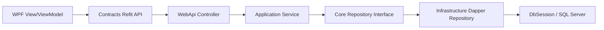

# SwiftExport ERP Project Map

> Draft generated by AI on 2026-06-21. Scope: repository structure and onboarding map only. No business code was changed.

## 1. Repository Shape

This repository is a C# ERP solution with:

- ASP.NET Core Web API backend: `SwiftExport.WebApi`
- Backend layers: `SwiftExport.Application`, `SwiftExport.Core`, `SwiftExport.Infrastructure`, `SwiftExport.Contracts`
- WPF desktop UI library: `SwiftExport.View.FW`
- WPF desktop host app: `SwiftExport.DevApp`
- Excel VSTO add-in host: `SwiftExport.VSTO`
- WPF theme/control library: `MateWpfThemes`
- SQL/scripts/tools: `tools/sql`, `SwiftExport.Infrastructure/Migrations`, `_tools/DbSeed`

Top-level solution files:

- `SwiftExport.slnx`: full solution, grouped into `/Clients/` and `/WebApi/`.
- `SwiftExport-WebAPI.slnx`: backend-only solution.

There is no `package.json`, `vite.config`, `next.config`, `angular.json`, or other JS frontend entry found. In this codebase, "frontend" means WPF/.NET Framework desktop UI.

## 2. Root Directory Map

| Path | Role |
| --- | --- |
| `.github/` | GitHub metadata plus local skill notes. No workflow file was found in `.github/workflows` during scan. |
| `.vscode/` | Editor settings. Currently untracked in git status. |
| `docs/` | Existing documentation and AI-generated project docs. |
| `MateWpfThemes/` | WPF theme/control library and theme test project. |
| `packages/` | Legacy NuGet package folder, currently includes WPF behavior package assets. |
| `SwiftExport.Application/` | Backend application/service layer. |
| `SwiftExport.Contracts/` | Shared DTOs, Refit API contracts, enums, wrappers, UI contracts. Used by backend and WPF clients. |
| `SwiftExport.Core/` | Domain/entity layer plus repository interfaces and read models. |
| `SwiftExport.DevApp/` | Standalone WPF development shell/host for the UI library. |
| `SwiftExport.Infrastructure/` | Dapper/SQL Server infrastructure layer, repositories, DB session, migrations. |
| `SwiftExport.View.FW/` | Main WPF frontend view library: pages, ViewModels, routing, HTTP clients, frontend services. |
| `SwiftExport.VSTO/` | Excel VSTO add-in host that initializes the WPF view layer inside Excel. |
| `SwiftExport.WebApi/` | ASP.NET Core Web API entrypoint, controllers, middlewares, filters, services. |
| `tools/sql/` | Standalone SQL scripts. |
| `_tools/DbSeed/` | Database seed console utility. |

## 3. Frontend Entry Points

Primary frontend code is WPF, split between a reusable UI library and host applications.

### WPF UI Library

- Project: `SwiftExport.View.FW/SwiftExport.View.FW.csproj`
- Output type: library
- Target framework: .NET Framework 4.8
- Main responsibilities:
  - Views and XAML pages
  - ViewModels and UI models
  - Refit API registration
  - View routing
  - frontend services and session/auth helpers

This project does not contain `App.xaml`; it is not directly executable.

### Standalone Development Host

- Project: `SwiftExport.DevApp/SwiftExport.DevApp.csproj`
- Output type: `WinExe`
- Target framework: .NET Framework 4.8
- Application entry:
  - `SwiftExport.DevApp/App.xaml`
  - `SwiftExport.DevApp/App.xaml.cs`
- Main shell:
  - `SwiftExport.DevApp/MainWindow.xaml`
  - `SwiftExport.DevApp/MainWindow.xaml.cs`

`App.xaml.cs` builds a DI container with `services.AddAppServices()`, initializes `IocProvider`/`DiServices`, shows `MainWindow`, then optionally preloads dictionaries and route cache.

### Excel VSTO Host

- Project: `SwiftExport.VSTO/SwiftExport.VSTO.csproj`
- Host application: Excel
- Startup entry:
  - `SwiftExport.VSTO/ThisAddIn.cs`
  - `ThisAddIn_Startup`
- WPF initialization:
  - `InitializeWpfAsync()`
  - `App.EnsureApplication()`
  - `services.AddVstoServices()`

The VSTO host embeds/initializes the shared WPF view layer for Excel scenarios.

## 4. Backend Entry Points

### Full Backend Solution

- `SwiftExport-WebAPI.slnx`

Projects:

- `SwiftExport.WebApi`
- `SwiftExport.Application`
- `SwiftExport.Core`
- `SwiftExport.Infrastructure`
- `SwiftExport.Contracts`

### Web API Project

- Project: `SwiftExport.WebApi/SwiftExport.WebApi.csproj`
- Target framework: `net10.0`
- Entry file: `SwiftExport.WebApi/Program.cs`

`Program.cs` responsibilities:

- Loads `appsettings.json` and environment-specific appsettings.
- Configures Serilog.
- Registers infrastructure services through `AddInfrastructureServices()`.
- Registers application services through `AddApplicationServices()`.
- Configures JWT bearer authentication.
- Registers controllers with Newtonsoft.Json.
- Enables Swagger in Development.
- Adds global exception middleware and dev-user middleware.
- Maps controllers.

Launch profiles:

- `SwiftExport.WebApi/Properties/launchSettings.json`
- HTTP: `http://localhost:5057`
- HTTPS: `https://localhost:7086;http://localhost:5057`
- Swagger launch URL: `swagger`
- Development environment variable: `ASPNETCORE_ENVIRONMENT=Development`

## 5. Backend Layer Map

### API Layer

Path: `SwiftExport.WebApi/`

Important directories:

- `Controllers/Auth`
- `Controllers/Base`
- `Controllers/Customers`
- `Controllers/Orders`
- `Controllers/Products`
- `Controllers/Suppliers`
- `Controllers/Systems`
- `Filters`
- `Middlewares`
- `Services`

Representative controllers:

- `AuthController`
- `CustomerController`
- `CustomerPoConfigController`
- `CustomerProductController`
- `SalesOrderController`
- `PurchaseOrderController`
- `PackingListController`
- `ReceiveController`
- `ProductController`
- `SupplierController`
- `SysDictDataController`
- `SysViewRouteController`

### Application Layer

Path: `SwiftExport.Application/`

Important directories:

- `Interfaces`
- `Services/Base`
- `Services/Customers`
- `Services/Orders`
- `Services/Products`
- `Services/Suppliers`
- `Services/Systems`
- `Services/SystemServices`
- `Mappings`
- `Contexts`

DI entry:

- `SwiftExport.Application/DependencyInjection.cs`

Representative services:

- `SalesOrderManagerService`
- `SalesOrderHeadService`
- `SalesOrderLineService`
- `PurchaseOrderService`
- `PackingListService`
- `ReceiveService`
- `DependentDemandService`
- `IndependentDemandService`
- `ProductService`
- `CustomerService`
- `SupplierService`
- `SysDictDataService`
- `SysViewRouteService`

### Domain / Entity Layer

Path: `SwiftExport.Core/`

Important directories:

- `Common`
- `Entities/Auth`
- `Entities/MasterData`
- `Entities/Orders`
- `Entities/Relations`
- `Entities/SystemEntities`
- `Entities/Systems`
- `Interfaces`
- `Interfaces/Auth`
- `ReadModels`

Representative entities:

- Auth: `SysUser`, `SysRole`, `SysUserRole`, `SysPermission`
- Master data: `Product`, `ProductCategory`, `ProductColor`, `Customer`, `Supplier`, `Warehouse`, `Bom`
- Orders: `SalesOrderHeader`, `SalesOrderLine`, `PurchaseOrderHead`, `PurchaseOrderLine`, `DependentDemand`, `IndependentDemand`, `PackingListHead`, `PackingListLine`, `ReceiveHead`, `ReceiveLine`, `Inventory`
- Systems: `SysDictType`, `SysDictData`, `SysDicCurrency`, `SysDicCurrencyExchange`, `DocumentSequence`, `SysViewRoute`

Repository interfaces live mostly in `SwiftExport.Core/Interfaces`.

### Infrastructure / Repository Layer

Path: `SwiftExport.Infrastructure/`

Important directories:

- `Data`
- `Contexts`
- `Repositories/Auth`
- `Repositories/Base`
- `Repositories/Customers`
- `Repositories/MasterData`
- `Repositories/Orders`
- `Repositories/Products`
- `Repositories/Suppliers`
- `Repositories/SystemRepositories`
- `Repositories/Systems`
- `Services/Auth`
- `Migrations`

DI entry:

- `SwiftExport.Infrastructure/DependencyInjection.cs`

DB/session files:

- `SwiftExport.Infrastructure/Data/DbSession.cs`
- `SwiftExport.Infrastructure/Data/DbConnectionFactory.cs`
- `SwiftExport.Infrastructure/Data/UnitOfWork.cs`
- `SwiftExport.Infrastructure/Contexts/RepositoryBaseContext.cs`

Data access stack:

- Dapper
- `Microsoft.Data.SqlClient`
- SQL Server connection string from `IConfiguration.GetConnectionString("Default")`

## 6. Contracts Layer

Path: `SwiftExport.Contracts/`

Purpose:

- Shared DTOs between backend and frontend.
- Refit API interface definitions used by WPF clients.
- Common wrappers/enums/models.

Important directories:

- `Apis/AuthApis`
- `Apis/CustomerApis`
- `Apis/Orders`
- `Apis/ProductApis`
- `Apis/SalesOrderApis`
- `Apis/SupplierApis`
- `Apis/SystemApis`
- `DTOs`
- `Models`
- `SysEnums`
- `Wrappers`
- `UiInterface`

The WPF client registers Refit clients using these API interfaces.

## 7. Frontend Directory Map

Path: `SwiftExport.View.FW/`

### Pages / Views

Business modules follow a repeated WPF MVVM folder pattern:

- `CustomerViews/Views`, `CustomerViews/ViewModels`, `CustomerViews/Models`
- `DictViews/Views`, `DictViews/ViewModels`, `DictViews/Models`
- `Independent/Views`, `Independent/ViewModels`, `Independent/Models`
- `OrderDecomposeViews/Views`, `OrderDecomposeViews/ViewModels`, `OrderDecomposeViews/Models`
- `PackingListViews/Views`, `PackingListViews/ViewModels`, `PackingListViews/Models`
- `ProductViews/Views`, `ProductViews/ViewModels`, `ProductViews/Models`
- `PurchaseOrderViews/Views`, `PurchaseOrderViews/ViewModels`, `PurchaseOrderViews/Models`
- `SalesOrderViews/Views`, `SalesOrderViews/ViewModels`, `SalesOrderViews/Models`
- `SupplierViews/Views`, `SupplierViews/ViewModels`, `SupplierViews/Models`
- `SystemViews/Views`, `SystemViews/ViewModels`, `SystemViews/Models`
- `WarehouseViews/Views`, `WarehouseViews/ViewModels`, `WarehouseViews/Models`

Page/ViewModel DI registration:

- `SwiftExport.View.FW/DI/DependencyInjection.Pages.cs`

### API Calls

Frontend API client registration:

- `SwiftExport.View.FW/DI/DependencyInjection.Apis.cs`

HTTP handlers:

- `SwiftExport.View.FW/Http/HttpHandlers.cs`
- `HttpLoggingHandler`
- `AuthTokenHandler`

Auth token store:

- `SwiftExport.View.FW/Http/AuthTokenStore.cs`

Shared Refit API interfaces:

- `SwiftExport.Contracts/Apis/**`

Current frontend API base URL:

- Hardcoded in `SwiftExport.View.FW/DI/DependencyInjection.Apis.cs`
- Value points at HTTPS Web API host.
- The source contains a TODO to move it to appsettings/config center.

### Routing

Routing registration:

- `SwiftExport.View.FW/DI/DependencyInjection.Routing.cs`

Routing implementation:

- `SwiftExport.View.FW/Routing/IViewRouteService.cs`
- `SwiftExport.View.FW/Routing/ViewRouteService.cs`
- `SwiftExport.View.FW/Routing/ViewRoutes.cs`
- `SwiftExport.View.FW/Routing/ViewLocatorSelector.cs`

Routing behavior:

- `ViewRouteService` preloads route config from backend/DB.
- Static fallback routes live in `ViewRoutes.cs`.
- Comments indicate route config is backed by `SysViewRoute`/`SysViewRouteModel` data.

### State Management

There is no JS-style Redux/Vuex/Pinia state management. State is WPF/MVVM-based:

- View-level state: module ViewModels under `*/ViewModels`.
- UI models: module `*/Models`.
- Shared base MVVM classes: `SwiftExport.View.FW/Mvvm`.
- Session/auth state: `SwiftExport.View.FW/Services/SessionService.cs`, `ISessionService.cs`, and `Http/AuthTokenStore.cs`.
- Permission helpers: `SwiftExport.View.FW/Security`.
- DI/service locator helpers: `SwiftExport.View.FW/DI`, plus host-level `DiServices`.

## 8. Database Scripts, Migrations, SQL, and Connection Configuration

SQL/migration locations:

- `SwiftExport.Infrastructure/Migrations/001_CreateSysUser.sql`
- `tools/sql/20260430_create_packing_list_tables.sql`
- `_tools/DbSeed/Program.cs`

Connection-string configuration locations:

- `SwiftExport.WebApi/appsettings.json`
- root `appsettings.json`
- `_tools/DbSeed/Program.cs` has hardcoded seed-tool connection strings.

Runtime connection resolution:

- `SwiftExport.Infrastructure/Data/DbSession.cs`
- Uses `IConfiguration.GetConnectionString("Default")`.

Security note:

- The repository currently contains local SQL Server connection strings with credentials in config/tool files. This map intentionally does not reproduce those secrets.

## 9. Build / Run / Test Commands

### Backend Build

```powershell
dotnet build .\SwiftExport-WebAPI.slnx
```

or:

```powershell
dotnet build .\SwiftExport.WebApi\SwiftExport.WebApi.csproj
```

### Backend Run

```powershell
dotnet run --project .\SwiftExport.WebApi\SwiftExport.WebApi.csproj --launch-profile https
```

Expected development URLs from `launchSettings.json`:

- `https://localhost:7086/swagger`
- `http://localhost:5057/swagger`

### Full Solution Build

The full solution includes .NET Framework WPF/VSTO projects. Prefer Visual Studio or Developer PowerShell/MSBuild:

```powershell
msbuild .\SwiftExport.slnx /p:Configuration=Debug /p:Platform=AnyCPU
```

Backend-only projects can use `dotnet build`; WPF/VSTO legacy project support may depend on local Visual Studio/MSBuild workloads.

### WPF Dev Host Run

From Visual Studio:

- Set `SwiftExport.DevApp` as startup project.
- Run/debug normally.

From command line after build:

```powershell
.\SwiftExport.DevApp\bin\Debug\SwiftExport.DevApp.exe
```

### VSTO Run

From Visual Studio:

- Set `SwiftExport.VSTO` as startup project.
- Debug starts Excel according to VSTO project settings.

### DB Seed Tool

```powershell
dotnet run --project .\_tools\DbSeed\DbSeed.csproj
```

### Tests

No dedicated test project was found during scan. The only project name matching "test" is the WPF theme test app:

- `MateWpfThemes/MateThemeFWTest/MateThemeFWTest.csproj`

No xUnit/NUnit/MSTest test project was identified.

## 10. High-Level Request Flow

Typical backend request flow:

1. WPF ViewModel calls Refit API interface from `SwiftExport.Contracts/Apis`.
2. Refit client configured in `SwiftExport.View.FW/DI/DependencyInjection.Apis.cs` sends HTTP request.
3. Web API controller in `SwiftExport.WebApi/Controllers`.
4. Application service in `SwiftExport.Application/Services`.
5. Repository interface in `SwiftExport.Core/Interfaces`.
6. Dapper repository implementation in `SwiftExport.Infrastructure/Repositories`.
7. SQL Server connection from `DbSession`.



