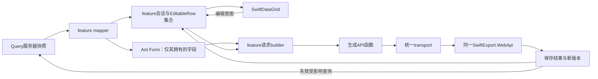

# Web 前端架构与编辑基础设施

原规划：2026-10-07。当时建议新建独立 `SwiftExport.WebApp`，未创建应用或修改现有 WPF。业务事实仍由同一 SwiftExport.WebApi、Application、PG 事务负责。初次源据与差距见 [盘点](web-readiness-audit.md)、[差距](web-api-gap-analysis.md)，权限见 [统一权限设计](web-permission-design.md)。

2026-10-09 同步：工程、主壳与公共编辑入口已建立，当前使用点见 [公共设施说明](../SwiftExport.WebApp/docs/前端基础设施与使用入口.md)，分阶段证据见 [骨架验收记录](../SwiftExport.WebApp/docs/骨架验收记录.md)。脚手架/目录/字段所有权及会话、缓存、偏好、诊断规则以 [总决策](Web客户端架构与脚手架决策.md#web-common-services) 为权威，本文只维护 Grid、编辑集合和模块数据细则。输入保护、提交分类、锁与人工终止以 [多标签公共契约](Web多标签工作区设计.md#workspace-contract) 为准；真实 Product 写入须满足 [接口门槛](Web首批接口契约验收.md#product-recovery)，不要求机械改为 409。正式入口见 [Web 工作流](../.agents/workflows/Web前端工作流.md) 与 [技能组](../.codex/skills/react-web/index/SKILL.md)。

## 1. 最小技术栈与版本策略

| 项目 | 已确定方向 | 边界 / 原因 |
| --- | --- | --- |
| Node / npm | Node 24 LTS，同一补丁版本用于开发/CI；npm使用随选定Node提供的版本并固定 | 用.nvmrc或.node-version、engines/packageManager、package-lock.json记具体版本；npm ci可重复安装。不要在任务中随意改包管理器 |
| 构建 | React Router 官方基础模板，Framework SPA，Vite 构建 | ssr:false；构建期根渲染须安全，生产静态产物；独立于 .NET publish |
| React | 支持稳定 Activity 的 React 19 系列，React/react-dom/types匹配并锁定 | 用实际骨架验收确定 patch，不默认引实验 API/Compiler |
| TypeScript | 当期开工时稳定、与Vite/Orval兼容的一条主线，锁定版本 | strict、noUncheckedIndexedAccess；DTO由schema生成，类型检查单独执行 |
| UI | Ant Design 6稳定系列 + 官方icons、独立 ProComponents | 复用控件及高级组合；不引入 Ant Design Pro/Umi 应用模板，实际兼容版本见工程入口 |
| 远程状态 | TanStack Query v5 | query负责服务器快照，mutation负责动作和cache失效；不存未保存编辑行 |
| 路由与工作区 | React Router Framework SPA + 内部多标签 Workspace | 框架负责应用入口；Workspace 管理业务页签、关闭与显式懒加载；Query 不与 loader 建两套缓存 |
| API | Orval生成Fetch操作函数和DTO；统一transport/custom mutator | 不默认Axios；生成hooks可后续选择，不能生成后又手写同样的HTTP方法 |
| 表单 | Ant Design Form / ProForm + rules + feature纯验证函数 | ProForm 复用同一 Form 实例；不增加第二份当前值或 React Hook Form/Formik/Zod |
| 日期 | Day.js + Intl | 与Ant DatePicker协作，boundary转换；业务日期与UTC时刻分开，插件仅按真实需要引入 |
| 状态管理 | React useState/useReducer/Context | 工作区只管页签描述/摘要，feature 管各页签草稿；首期不加 Redux/Zustand |
| 国际化 | 首期中文zh_CN locale、集中消息；多语言确认后react-i18next | 业务字段显示名与HTTP错误码分开；不把大规模翻译工程作为PoC条件 |
| 权限 | me.Permissions + 后端目录生成的 PermissionKey + 本地页面/操作映射 | 精确匹配，服务器最终授权；权限快照更新按公共设施基线隔离 Query |
| 错误 | 请求事实/RequestTransportError、feature 字段映射、路由 ErrorBoundary | 展示与写入结果分类分开，不吞异常或反复 Toast |
| 日志 | shared/diagnostics 的内存白名单入口 | 会话切换清理；不记录原始错误、请求正文或凭据，不默认外部 SDK |
| 测试 | Vitest、Playwright | 实际工程使用 Fetch 模拟及浏览器验证；编辑集合纯逻辑优先，不为转发机械补测试 |
| 规范 | ESLint flat config + typescript-eslint + React hooks规则 + Prettier | 禁any逃逸/手改generated；import边界规则应针对已有边界，不一次堆数十插件 |
| 环境 | .env.example + API_PROXY_TARGET；VITE_* 仅公开开关 | API 走同源 /api，代理目标不进入浏览器包；开发 HTTPS 与命令见工程说明 |
| 发布 | npm ci→generate/check→tsc→lint→test→build；HTTPS静态站+同源/api代理 | 部署/推送需单独授权；React深链接fallback必须避开/api和图片资源，hash assets长缓存、index短缓存 |

依据：2026-10-07读取[Node版本策略](https://nodejs.org/en/about/previous-releases)、[Vite运行要求](https://vite.dev/guide/)、[React版本](https://react.dev/versions)、[Ant Design](https://ant.design/docs/react/introduce/)、[TanStack Query](https://tanstack.com/query/latest/docs/framework/react/overview)、[React Router模式](https://reactrouter.com/start/modes)、[Ant日期控件](https://ant.design/components/date-picker/)、[Vite环境变量](https://vite.dev/guide/env-and-mode)。这里选择系列和锁定策略，不把在线最新版patch写成已安装或已经完成兼容性验证。

技术选型已经收敛；实际锁定版本与来源见 [工程入口](../SwiftExport.WebApp/docs/工程入口与命令.md)。业务任务沿用总决策，不重新比较基座；确需改变时走 [架构变更门禁](Web客户端架构与脚手架决策.md#web-change-control)。

## 2. 目录与依赖方向

唯一完整目录蓝图见 [脚手架决策第 5 节](Web客户端架构与脚手架决策.md)。实际工程保留框架默认 app 源码根，不同时维护另一套 src/app 模板；下列是职责摘要，不要求机械创建所有规划目录。

| 放置点 | 应放 | 禁止 |
| --- | --- | --- |
| app/root、routes、bootstrap、layouts、navigation | 框架入口、Provider、主壳与导航组装 | 产品保存 DTO、全部模块业务逻辑 |
| app/workspace | 页面目录、稳定 tabId、激活/关闭协调、状态摘要、显式懒加载 | 完整业务草稿、通用 saveAll 事务、取消写入后宣称回滚 |
| app/features/* | 该业务页面、页签控制器、query/mutation、mapper、validator | 导入 workspace 内部实现；跨 feature 深层引用；直接访问 DB |
| app/shared/api/generated | schema 导出的模型和 HTTP 操作 | dirty/selected/React 状态；手改生成文件 |
| app/shared/api | 网络协议、会话头、传输事实；文件 adapter 按真实契约另接入 | SKU 规则、库存数量、BatchSave 合并、角色判断 |
| app/shared/workspace | 上层注入的页签参数、状态报告和关闭契约 | 引用具体业务模块、另造 tab manager |
| app/shared/ui/swift-data-grid | 显示、选择、编辑意图、键盘 | 调 API、持有 dirty、组 BatchSave、自动赋 Version |
| app/shared/editing | baseline、变更集、恢复、结果接纳；React 适配 | HTTP、弹窗、权限授权、库存/单据生命周期 |
| app/shared/session、authorization | 身份快照、精确键匹配 | JWT 解码角色即授权、客户端 IsAdmin 万能放行 |
| app/shared/query | 唯一 QueryClient、身份/权限范围键和三类原生查询策略 | 草稿缓存、第二套读取状态库 |
| app/shared/preferences、diagnostics | 用户显示偏好和有限内存诊断 | 业务 DTO、草稿、凭据持久化或新的恢复数据库 |
| app/shared/format | 已被真实用例需要的日期/数字纯转换 | 万能 utils/service/manager、DTO 副本 |

依赖方向是应用组装 → feature → shared；组装也可直接使用 shared。产品候选查询使用生成操作和规范 query key，不导入其他维护页的内部 hook。手写文件优先中文，工具固定入口使用标准名称；不机械生成空模块。

源码理由：[Contracts netstandard2.0](../SwiftExport.Contracts/SwiftExport.Contracts.csproj)保留 WPF/VSTO 共享兼容性；[NavigationRouteRegistry](../SwiftExport.Client.Wpf/Navigation/NavigationRouteRegistry.cs)说明菜单与权限不等于服务端动态页面；[ProductSearchRequest](../SwiftExport.Contracts/DTOs/Products/Catalog/Requests/ProductSearchRequest.cs)与[SaveSalesOrderRequest](../SwiftExport.Contracts/DTOs/SalesOrders/Draft/SaveSalesOrderRequest.cs)体现查询/写命令/编辑模型需要不同责任。

### 首期多标签工作区

业务入口统一登记到 workspace 页面目录，以 descriptor 传入业务身份。列表按 pageKind 去重，已有单据按 pageKind + Uid 去重，新单据用独立临时身份；React key 使用稳定 tabId。切换保留输入和滚动，不执行关闭确认；关闭、离开工作区和刷新分别保护全部相关草稿。

Ant Tabs 控制页签栏；稳定 React Activity 保留隐藏展示状态并清理展示 Effects。控制器/保存/关闭保护在 Activity 外，通过 shared 窄契约接宿主，不能因隐藏注销守卫。URL 只定位活动页，隐藏页不读取全局 useParams/useSearchParams。工程已有这一组合，适用行为的当前证据见骨架记录；完整规则与验收仍见 [多标签工作区](Web多标签工作区设计.md)。

## 3. 查询、表单、权限和错误数据流



Query key 使用 [查询键](../SwiftExport.WebApp/app/shared/query/查询键.ts) 的 userId、identityEpoch、permissionEpoch 与规范操作/输入，不由页面另拼缓存作用域。POST page/search 是读查询，也使用 useQuery；信号透传，活动状态、读取权限和搜索词由 feature 接线。规范化不改变服务器定义的业务含义。

编辑页从快照显式初始化会话，后台刷新不重置 Form/Grid 的 baseline 或当前值；明确放弃并重载失败时保留原会话。回执接纳和保存锁遵守 [保存契约](Web多标签工作区设计.md#workspace-save)，再失效相关列表/详情。直接展开 [queryPolicies](../SwiftExport.WebApp/app/shared/query/查询策略.ts) 的 live/lookup/reference 原生选项；新鲜度、权限撤销与自动重试的唯一规则见 [公共设施基线](Web客户端架构与脚手架决策.md#web-common-services)。

普通 Form 用 Ant rules 做必填和范围体验。feature 解读服务端错误后，用 [locateFieldIssues](../SwiftExport.WebApp/app/shared/editing/字段错误.ts) 映射 Form 路径或 ClientKey/列；未知字段保留页级说明。数值/日期转换和候选受控入口见公共设施说明，业务范围、DTO 映射与最终校验仍归 feature/服务端；不能为方便输入改变后端精度或日期契约。

统一传输错误保留发送阶段、status、code、message、field、correlationId 及网络/取消事实；字段定位、重认证、权限更新、业务拒绝等展示由 feature/会话处理。是否生效、回执接纳与解锁只按 [三类提交结果](Web多标签工作区设计.md#workspace-save)，不从状态码或中文 message 统一推导；Product 的 BUSINESS_BLOCKED/UNEXPECTED 保守处理见 [真实契约缺口](Web首批接口契约验收.md#product-recovery)。依据[ServiceErrorHttpMapper](../SwiftExport.WebApi/ErrorHandling/ServiceErrorHttpMapper.cs)、[GlobalExceptionMiddleware](../SwiftExport.WebApi/ErrorHandling/GlobalExceptionMiddleware.cs)、[WPF ApiCallRunner](../SwiftExport.Client.Wpf/Services/Api/ApiCallRunner.cs)。

## 4. SwiftDataGrid边界与首期能力

用户提出的拆分合理，Web不需要复制全部WPF EnterpriseGrid。其选择/验证等模块职责可作行为参考，不能把WPF AttachedProperty结构搬到React。

按场景直接复用 ProComponents：查询列表用 ProTable，行编辑可选 EditableProTable，行拖序用 DragSortTable，详情与列表用 ProDescriptions/ProList，表单及弹窗表单用 ProForm/ModalForm/DrawerForm。DragSortTable 的行拖序不等于拖动列宽。组件数据由 feature 提供，不通过组件的 `request` 建第二条请求链；列设置不启用 ProComponents 自带的持久化，仍走现有用户偏好入口。

SwiftDataGrid 是受控 ProTable 的薄组合，只补单元格选择、区域填充、列宽及项目编辑意图：

- 实际 [类型入口](../SwiftExport.WebApp/app/shared/ui/swift-data-grid/类型.ts) 接受 rows、getRowKey、columns、selectedKeys/onSelectionChange、pagination 与可写限制。列 editor 转交输入/取消并读取错误，onFillDown 仅发填充意图，feature 处理业务状态。
- showRowNumber 只显示平面分页序号 `(pageIndex-1)*pageSize+index+1`，不能当 ClientKey/行 ID；树编号需随实际树页面单独定义。
- 已有受控文本编辑及列内 `kind: "custom"` 组合；日期、枚举和候选复用 Ant 控件及公共转换，不建编辑器注册表。自定义编辑器接收一致的只读、错误、标签与取消上下文；尚未提交缓冲仍遵守多标签公共契约。
- 单击选中一个单元格；Shift 点击、Shift 方向键或从单元格空白处拖动扩展成矩形区域。区域锚点/终点使用稳定 rowKey/columnKey，与删除等操作的行勾选分别维护。可见行列顺序或分页改变时解除旧区域，业务值变化不解除，Activity 隐藏保留区域及输入。
- 向下填充和 Ctrl+D 使用同一个区域意图：每个选中可编辑列的顶部单元格为源，按当前可见顺序填到区域内后续可编辑目标。一次发出全部列意图；feature 核对最新行、权限、候选及全部源输入后才更新目标缓冲，任一源无效则整次不填。填充不提交后端、不接纳基线，也不绕过未提交输入保护。Grid 内存在有效操作时才拦截 Ctrl+D，文本编辑框内不抢快捷键。
- 禁止填Uid/Version/审计字段、已交付/已收货投影等只读事实；权限和生命周期限定由feature传入canEdit。
- 行选择、单元格区域为会话 UI 状态，不进入持久偏好。列显示/顺序使用 ProTable 原生列设置，通过 [PreferenceDataGrid](../SwiftExport.WebApp/app/shared/ui/偏好表格.tsx) 的受控 columnsState 接现有声明列白名单。列宽用表头分隔柄拖动或键盘调整，并由同一用户偏好入口保存。
- 固定表格布局并按列宽计算横向滚动范围；输入、Select 与自定义编辑器限制在单元格内，长文本截断或提供完整内容提示，不撑开其他列。多选直接使用 Ant Select 的 multiple 模式，公共候选入口只适配受控值与已有搜索/权限边界。
- TreeData 与大数据虚拟化尚未建立；后续树只渲染 parent/children 派生投影，排序/展开不改变业务父子关系。大数据先服务端分页，不先建完整 Excel 引擎。
- 键盘/焦点/屏幕阅读器、空状态、loading与行错误反馈属于组件质量；业务存储和未保存导航不属于Grid。

ProForm 保留原 Form 实例的字段所有权；项目编辑表单显式关闭自动提交按钮、日期格式化和空值剔除，由原 feature 保存入口转换、校验和冻结。EditableProTable 用于业务前先验证受控行值、无效原始输入、隐藏保留、取消及保存阻断，不把它的编辑数据和编辑集合同时设为当前值权威。组件兼容夹具只证明指定组合，不宣称真实业务已接入。

当前行为参考：[SwiftExport.Wpf.EnterpriseGrid](../SwiftExport.Wpf.EnterpriseGrid)、[BaseListModel](../SwiftExport.Client.Wpf/Mvvm/BaseListModel.cs)。单元格区域、列宽、长内容布局、原始输入与 Activity 必须有浏览器行为验证；实际版本和证据见工程入口及骨架验收记录。

## 5. 公共编辑集合模型

早期 useEditableCollection hook 草案已收敛为 [编辑集合](../SwiftExport.WebApp/app/shared/editing/编辑集合.ts) 的纯函数；React 会话绑定由 feature 拥有，不要求新增统一 hook、控制器继承或数据源框架。

| 已有 API | 职责 |
| --- | --- |
| EditableRow<T>、createEditableRow / createCreatedEditableRow | 分离稳定 ClientKey、Uid/Version 元数据与独立 baseline/current 可写投影 |
| addEditableRow / updateEditableRow / removeEditableRow / restoreEditableRow | 操作单一平面集合与本地行生命周期，不生成 HTTP DTO |
| isRowDirty / getEditableChanges / getVisibleEditableRows | 按可写字段和行状态派生 dirty、互斥增改删及展示视图 |
| discardEditableRows | 普通放弃允许后恢复既有行基线、移除新增行；调用者先检查完整锁 |
| acceptEditableRow / acceptDeletedEditableRow | 仅接纳 feature 已核对的对应回执，不解释业务结果、不全局清除其他草稿 |

T 是可写投影，不是直接扩展生成 DTO。isRowDirty 只表达集合业务修改，完整保护摘要由 feature 合并原始输入及保存阶段；保存/放弃/关闭仍调用公共契约。默认结构比较隔离基线，特殊值归一化由 feature 的 valuesEqual 明确提供；排除 selection/error/联表展示字段，null 与空串是否等价由字段契约决定。

### 状态转换与重要边界

| 场景 | 正确行为 |
| --- | --- |
| Guid新建行 | crypto.randomUUID生成ClientKey；需临时Uid作树关系时另外保留临时身份。通用PG AddAsync会重生成Uid，保存后用ClientKey→响应Uid映射 |
| Version | 保存Update/Delete用已接受baseline的版本；编辑值不能改变Version；成功用NewVersion/重读快照更新，失败不得增加版本 |
| 新增后删除 | 从created与可见items移除，不产生DeleteItemRequest；不得向服务端删除从未持久化的Uid |
| 既有行删除后恢复 | 单一集合保留原实体与删除前草稿；restoreEditableRow 恢复删除前编辑态；discardEditableRows 只用于公共放弃允许时，不自行放行关闭或未知结果 |
| 修改后恢复原值 | 对可写投影重新比较，回到clean，不因“曾编辑”永久dirty |
| 修改后删除 | 只生成Delete；保留baseline Version；恢复删除可继续原修改 |
| 原始集合别名 | baseline必须与可编辑对象隔离，不能深层数组/对象共引用；immutable patch |
| Tree | 存储flat身份关系，渲染时构树；父子新增按后端协议提交，保存后重映射ParentId；删除父不能自动级联猜测业务语义 |
| 行排序 | 展示排序不是业务修改；只有服务端可写SortNo改变才dirty |
| 服务端分页 | 替换编辑数据按完整保护摘要处理，不只检查集合 dirty；不同页快照不能当完整集合，未出现行不等于删除 |
| 跨页编辑（以后） | baseline/变更按稳定身份保存局部片段；明确已加载范围、版本和服务端排序，不能通过合并页实现任意全局Ctrl+D |
| 页签切换/关闭/刷新 | 切换保留原始缓冲、不强制校验；所有关闭/数据替换/离开遵守公共契约最新摘要，beforeunload 仅有限提醒 |
| 结果不明 | 按 [WEB-TAB-04](Web多标签工作区设计.md#workspace-recovery) 保持冻结与锁；仅真实协议允许查询/重放，人工终止须先合法导出保全并确认，不能默认解锁重提 |
| 后台数据刷新 | 不替换既有 Form/Grid baseline 或当前值；明确放弃后的重载失败保留原会话，详见公共设施基线 |
| 保存时再编辑 | 首期禁用；以后若允许需提交快照/revision，只accept实际提交且确认的值，保留后续patch |

通用新增身份与分类树事实分别见[PostgreSqlDapperRepository.AddAsync](../SwiftExport.Infrastructure/Repositories/Base/PostgreSqlDapperRepository.cs)、[ProductCategoryService](../SwiftExport.Application/Services/Products/Categories/ProductCategoryService.cs)。分类保存通过logicalUid→persistedUid及父先子后处理，不表示所有树端点都有同一能力。

### 构建BatchSave

```typescript
// 示例伪代码：实际类型从generated引用，mapWriteDto排除所有UI/只读字段。
const request = {
  createItems: createdItems.map(row => ({
    clientKey: row.clientKey,
    data: mapWriteDto(row),
  })),
  updateItems: updatedItems.map(row => ({
    clientKey: row.clientKey,
    uid: baseline(row.clientKey).uid,
    version: baseline(row.clientKey).version,
    data: mapWriteDto(row),
  })),
  deleteItems: deletedItems.map(row => ({
    clientKey: row.clientKey,
    uid: baseline(row.clientKey).uid,
    version: baseline(row.clientKey).version,
    isSoftDelete: true,
  })),
};
```

RowIndex可带显示位置辅助用户定位，不能当响应关联主键。发送前校验集合互斥、ClientKey唯一、Uid非空、版本正数、必需权限；服务器仍做最终校验。SoftDelete选择沿用模块政策，不让Grid暴露任意硬删开关。

feature 可通过纯 mapper 构建通用 BatchSaveRequest；销售 SaveSalesOrderRequest、售后 SaveAfterSalesCommand、采购/库存/PackingList 仍由专用 builder 完成。头 Form 与明细集合由同一 feature 会话校验、冻结及接纳，不能为复用集合把单据改成普通逐行 CRUD。

### 保存结果协议

[BatchSaveResponseBase](../SwiftExport.Contracts/Wrappers/BatchSaveResponseBase.cs)包含Items、SuccessCount/FailedCount/AllSucceeded，**类型存在不证明该接口允许部分提交**。

1. 按 [三类提交结果](Web多标签工作区设计.md#workspace-save) 判定可接纳范围和锁。HTTP非2xx/外层Success=false 不代表未生效；不能清除本地推测成功变更，已有明确行级/文件部分结果仍由各 feature 按真实契约核对。
2. 原子接口（已核对Product、ProductCategory、Supplier等整批事务）：仅整批确认成功且Items逐项成功才整体接纳。缺失/重复ClientKey、Operation不匹配、SuccessCount不一致视为协议异常，重读确认，不手动丢行。
3. 明确逐项提交接口：按ClientKey+Operation对齐，仅接纳已确认成功项；失败项保留草稿/删除池/error，新Uid与Version只对成功项更新。不能先全局accept再把失败行重新加回来。
4. 产品图片是明确部分成功，但它是ProductImageBatchUploadResultDto，不套SaveItemResult。multipart解析中途失败仍可能已有文件发布，不得以外层失败推断文件全回滚；应读回/逐项确认，禁止无条件整批重传覆盖。
5. 专用单据保存返回服务器详情/新头行版本时，以该专用响应为准，不强行解析BatchSaveResponseBase。
6. 网络断线或commit结果未知时走 WEB-TAB-04。只有后端真实允许重放才复用同 CommandId/内容；Product 普通批量没有此协议，禁止赋前端随机 id 宣称幂等。证据不足保持限制，授权记录导出及人工终止的正文不在此重复维护。

源码依据：[ProductMaintenanceService](../SwiftExport.Application/Services/Products/Catalog/Maintenance/ProductMaintenanceService.cs)、[SupplierService](../SwiftExport.Application/Services/Suppliers/Management/SupplierService.cs)、[ProductImageController](../SwiftExport.WebApi/Controllers/Files/ProductImageController.cs)、[ProductImageUploadService](../SwiftExport.Application/Services/Files/ProductImages/ProductImageUploadService.cs)、[BusinessCommandExecutor](../SwiftExport.Application/Commands/BusinessCommandExecutor.cs)。

## 6. 首个真实业务接入与扩展标准

选择**Product产品管理**，先列表、筛选、详情/lookup，再单页批量编辑、新增/修改/软删与冲突反馈；首轮引用已有分类/颜色/供应商/仓候选，不同时扩建它们的全部维护页。Product覆盖真实分页、复杂筛选、权限、Guid/Version、原子BatchSave且不用跨域库存过账，是比SalesOrder/PackingList更小的验证面。

PoC按 [架构规则矩阵](Web客户端架构与脚手架决策.md#web-rule-checks) 与多标签第 9 节验证首次未失焦输入、隐藏关闭、恢复/取消、无效输入无请求、保存分类/回执/恢复保全；同时核验 me/独立操作键、字段转换、身份版本映射及 Ctrl+D 可写范围。Product 真实写入须先满足独立契约门槛；422 业务拒绝不当作未生效证据，不解析中文消息，也不自动重试。读页面/模拟验证可先开展，不要求先机械统一为 409。

骨架先通过两个编辑页签切换保留、隐藏页关闭守卫、保存回原页签及同实体去重验证；Product 闭环随后接入。真实 PostgreSQL 写入/并发和浏览器联调仍需实际验收，不由隔离 HTTP 测试代替。

第二步可选ProductCategory树验证父子新建与映射；第三步SupplierProduct验证报价字段与SupplierId作用域；第四步SalesOrder验证专用头行CommandId。TreeData、服务器分页、部分成功与复杂单据分别验收，不要求首个Grid同时证明所有场景。

2026-10-07 规划阶段没有 npm 安装或 Web 实现，首批生成器实测随后由独立契约任务完成，历史证据保留在上述报告。2026-10-09 工程、Workspace、公共 Grid/编辑集合与辅助入口已建立；当前整合验收另记，不替代真实业务写入/账号或发布证据，不改变现行 .NET 10 WPF 主线。

