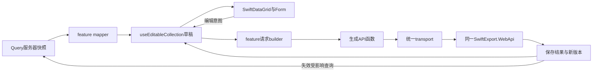

# Web 前端架构与编辑基础设施（草案）

日期：2026-10-07。推荐新建独立 `SwiftExport.WebApp`，本轮不创建应用或修改现有WPF。业务事实仍由同一SwiftExport.WebApi、Application、PG事务负责。现有源据与差距见[盘点](web-readiness-audit.md)、[差距](web-api-gap-analysis.md)，权限见[统一权限设计](web-permission-design.md)。

## 1. 最小技术栈与版本策略

| 项目 | 推荐 | 边界 / 原因 |
| --- | --- | --- |
| Node / npm | Node 24 LTS，同一补丁版本用于开发/CI；npm使用随选定Node提供的版本并固定 | 用.nvmrc或.node-version、engines/packageManager、package-lock.json记具体版本；npm ci可重复安装。不要在任务中随意改包管理器 |
| 构建 | Vite + React TypeScript模板 | 单SPA，静态产物；没有SSR/SEO用例，不增加Next.js、Umi或服务端前端框架 |
| React | React 19稳定系列，React/react-dom/types匹配并锁定 | 不默认启用实验API或额外Compiler；用PoC确定具体patch |
| TypeScript | 当期开工时稳定、与Vite/Orval兼容的一条主线，锁定版本 | strict、noUncheckedIndexedAccess；DTO由schema生成，类型检查单独执行 |
| UI | Ant Design 6稳定系列 + 官方icons | Form/Table/Drawer/Modal/ConfigProvider；不同时加另一套组件库或Ant Design Pro框架 |
| 远程状态 | TanStack Query v5 | query负责服务器快照，mutation负责动作和cache失效；不存未保存编辑行 |
| 路由 | React Router稳定版的Data Mode，createBrowserRouter | 需要页面离开阻断和路由错误边界；业务请求仍由Query负责，loader不建第二套数据缓存。主版本在PoC时固定 |
| API | Orval生成Fetch操作函数和DTO；统一transport/custom mutator | 不默认Axios；生成hooks可后续选择，不能生成后又手写同样的HTTP方法 |
| 表单 | Ant Design Form + rules + feature纯验证函数 | 普通表单不再加React Hook Form/Formik/Zod；只有实际复杂跨对象验证需求才评估schema库 |
| 日期 | Day.js + Intl | 与Ant DatePicker协作，boundary转换；业务日期与UTC时刻分开，插件仅按真实需要引入 |
| 状态管理 | React useState/useReducer/Context | Context用于会话/配置；编辑集合局部状态；首期不加Redux/Zustand |
| 国际化 | 首期中文zh_CN locale、集中消息；多语言确认后react-i18next | 业务字段显示名与HTTP错误码分开；不把大规模翻译工程作为PoC条件 |
| 权限 | me.Permissions +本地路由/操作映射 | 精确匹配同一PermissionKey，服务器最终授权；不引CASL或自定义权限树 |
| 错误 | 一个ApiError模型、Query/mutation错误展示、路由ErrorBoundary | 401/403/409/422/429/503分类，保留草稿；不吞异常或反复Toast |
| 日志 | 轻量集中logger，production脱敏 | Code/status/correlation/use case，不记录token/password/整单敏感DTO；暂不默认外部监控SDK |
| 测试 | Vitest、Testing Library；Playwright覆盖关键浏览器闭环 | Fetch mock按需用MSW；EditableCollection纯逻辑测试优先，不每个转发函数机械补测试 |
| 规范 | ESLint flat config + typescript-eslint + React hooks规则 + Prettier | 禁any逃逸/手改generated；import边界规则应针对已有边界，不一次堆数十插件 |
| 环境 | .env.example + VITE_API_BASE_URL等公开配置 | VITE_*进入浏览器包，不能放JWT签名key/DB密码；部署差异先采用构建时公开配置 |
| 发布 | npm ci→generate/check→tsc→lint→test→build；HTTPS静态站+同源/api代理 | 部署/推送需单独授权；React深链接fallback必须避开/api和图片资源，hash assets长缓存、index短缓存 |

依据：2026-10-07读取[Node版本策略](https://nodejs.org/en/about/previous-releases)、[Vite运行要求](https://vite.dev/guide/)、[React版本](https://react.dev/versions)、[Ant Design](https://ant.design/docs/react/introduce/)、[TanStack Query](https://tanstack.com/query/latest/docs/framework/react/overview)、[React Router模式](https://reactrouter.com/start/modes)、[Ant日期控件](https://ant.design/components/date-picker/)、[Vite环境变量](https://vite.dev/guide/env-and-mode)。这里选择系列和锁定策略，不把在线最新版patch写成已安装或已经完成兼容性验证。

**不建议首期使用Refine。** 它的data provider/resource/action约定还需映射现有POST查询、BatchSave逐项结果、整单CommandId/Preview/反向。当前已有Query、路由、权限与生成Client，加入Refine会再加一层对接。只有以后大量标准CRUD页面且试点证明能明显减少维护时才评估，不为它改后端。依据[Refine Data Provider](https://refine.dev/core/docs/data/data-provider/)与当前[BaseController](../SwiftExport.WebApi/Controllers/Base/BaseController.cs)、[PackingListController](../SwiftExport.WebApi/Controllers/Shipping/PackingLists/PackingListController.cs)。

## 2. 目录与依赖方向

以下为建议目录，文件按实际职责出现，不要求每个feature都创建空目录：

```text
SwiftExport.WebApp/
  docs/                         # 未来批准后的Web规则入口，引用现有权威规范
  openapi/                      # 固定schema快照，不含运行凭据
  src/
    app/
      providers.tsx             # Query/Ant/session组合
      router.tsx                # 路由注册与lazy加载
      layouts/ErpLayout.tsx
      error-boundary.tsx
    api/
      generated/                # Orval DTO和操作函数，禁止手改
      transport.ts              # token、headers、HTTP/error、signal与binary
      api-error.ts
    auth/
      session.tsx               # token/me状态，登出清理
      LoginPage.tsx
    permissions/
      permission-keys.ts        # 来自同一代码目录的机器可核对投影
      usePermission.ts
      route-access.ts
    components/
      swift-data-grid/           # UI/选择/单元格，不依赖feature或API
      lookup/                   # 通用候选呈现，查询由feature传入
      feedback/                 # 错误和保存摘要等跨模块体验
    hooks/
      editable-collection/      # 纯状态reducer + React适配 +测试
      use-unsaved-changes.ts
    features/
      products/
        pages/                  # 管理页、详情页；负责协调
        components/             # 产品专用列、表单、候选呈现
        queries.ts              # Query key/options/hooks
        mutations.ts            # 保存后精确失效与结果处理
        api.ts                  # 仅在需shape转换时对生成函数做窄适配
        models.ts               # EditorRow/输入状态，不复制生成DTO
        mappers.ts              # DTO↔编辑模型、构建专用请求
        permissions.ts          # 操作到既有键的映射
        validators.ts          # 客户端输入校验，不重算业务状态
        routes.ts
      product-categories/
      suppliers/
      supplier-products/
      sales-orders/
      after-sales/
      demand-planning/
      purchase-orders/
      inventory/
      packing-lists/
      system/
    utils/                      # 已被多个feature真实复用的纯函数
    styles/
    test/
```

| 放置点 | 应放 | 禁止 |
| --- | --- | --- |
| app | provider、壳、路由和错误边界 | 产品保存DTO、所有模块业务逻辑 |
| api/generated | schema导出的模型和HTTP操作 | dirty/selected/React状态；人工修生成文件 |
| api/transport | 网络协议、会话头、错误读取/Blob | SKU规则、库存数量、BatchSave合并、角色判断 |
| features/* | 该业务页面、query/mutation、mapper、validator | 复制另一个feature内部实现；绕过现有API直接访问DB |
| components/swift-data-grid | 显示、选择、编辑意图、键盘 | 调API、持久dirty tracking、组BatchSave、自动赋Version |
| hooks/editable-collection | baseline、变更集、恢复、结果接纳 | HTTP、UI弹窗、权限授权、库存/单据生命周期 |
| permissions/auth | 身份快照、键匹配、菜单体验 | JWT解码角色即授权，客户端IsAdmin万能放行 |
| utils | 独立纯通用逻辑 | 万能service/manager、提前“可扩展”框架、DTO副本 |

feature依赖api/generated和公共组件；公共组件不能依赖feature。跨feature候选调用通过窄公开查询/组件组合，不把全部业务扔进utils或共用BasePage。数据库/Core Entity不会直接进入Web包。

源码理由：[Contracts netstandard2.0](../SwiftExport.Contracts/SwiftExport.Contracts.csproj)保留WPF/VSTO共享兼容性；[NavigationRouteRegistry](../SwiftExport.Client.Wpf/Navigation/NavigationRouteRegistry.cs)说明菜单与权限不等于服务端动态页面；[ProductSearchRequest](../SwiftExport.Contracts/DTOs/Products/Catalog/Requests/ProductSearchRequest.cs)与[SaveSalesOrderRequest](../SwiftExport.Contracts/DTOs/SalesOrders/Draft/SaveSalesOrderRequest.cs)体现查询/写命令/编辑模型需要不同责任。

## 3. 查询、表单、权限和错误数据流



Query key必须含规范化筛选/页码/业务身份与会话隔离；登出清缓存，不能让下一用户看到上一用户数据。POST page/search是读查询，也使用useQuery；Query function传递AbortSignal，debounce作用于提交的搜索词。日期/集合规范化不应改变服务器定义的业务含义。

编辑页从快照显式初始化草稿。后台刷新不能覆盖dirty集合；Table显示草稿而不是直接改Query缓存。保存成功采用服务器归一化快照与NewVersion，再失效相关列表/详情；首期保存中锁住编辑，避免提交旧值后误accept新修改。Query默认重试/焦点刷新需显式约束，依据[TanStack defaults](https://tanstack.com/query/latest/docs/framework/react/guides/important-defaults)：读请求可有限重试瞬时网络故障，401/403等不重试；写mutation默认禁盲重试。

普通Form用Ant规则做必填和范围体验；服务器error.Field映射到表单/行，跨业务规则仍服务端最终校验。金额保留输入文本，在mapper验证并转当前decimal JSON；展示用Intl，不把JS浮点计算当权威金额。若业务要求超出JS number安全范围/精度，应先确认金额契约，再选择十进制库或字符串传输，不能自改后端schema。

统一错误至少携带status、code、message、field、correlationId、是否结果未知。400定位输入；401终止身份且保留用户内存草稿供重新登录流程；403刷新me和权限；409提供刷新/比较，不自动覆盖；422展示业务阻断；429按Retry-After提示；503/OUTCOME_UNKNOWN保留原意图。500不得只显示“未保存所以可以直接重试”。依据[ServiceErrorHttpMapper](../SwiftExport.WebApi/ErrorHandling/ServiceErrorHttpMapper.cs)、[GlobalExceptionMiddleware](../SwiftExport.WebApi/ErrorHandling/GlobalExceptionMiddleware.cs)、[WPF ApiCallRunner](../SwiftExport.Client.Wpf/Services/Api/ApiCallRunner.cs)。

## 4. SwiftDataGrid边界与首期能力

用户提出的拆分合理，Web不需要复制全部WPF EnterpriseGrid。其选择/验证等模块职责可作行为参考，不能把WPF AttachedProperty结构搬到React。

SwiftDataGrid是Ant Table的受控组合：
- 接受rows、稳定getRowKey、columns、selection、pagination与cell errors；emit onCellChange/onRowSelectionChange/onFillDown，feature处理状态。
- ShowRowNumber只用于显示：平面分页为(pageIndex-1)*pageSize+index+1；树使用当前可见顺序或明确层级编号，不能当ClientKey/行ID。
- Editable Cell先实现文本、数值、日期、lookup；cell提交多字段patch经feature validator，不能直接写row对象。
- Ctrl+D：定义源为选择区首行，按当前可见顺序填至后续目标；首期无完整矩形区选择时限定为同一活动列。跳过非编辑列/行和禁用单元格，校验每个patch，阻止浏览器收藏快捷键仅限Grid内有效操作。文本编辑框内不抢快捷键。
- 禁止填Uid/Version/审计字段、已交付/已收货投影等只读事实；权限和生命周期限定由feature传入canEdit。
- Selection与activeCell为UI状态；持久选择只保存稳定rowKey，重载时核对存在性。
- TreeData仅渲染parent/children派生投影；排序/展开不改变业务父子关系。大数据先服务端分页，不先引虚拟化和完整Excel引擎。
- 键盘/焦点/屏幕阅读器、空状态、loading与行错误反馈属于组件质量；业务存储和未保存导航不属于Grid。

当前对照：[SwiftExport.Wpf.EnterpriseGrid](../SwiftExport.Wpf.EnterpriseGrid)、[BaseListModel](../SwiftExport.Client.Wpf/Mvvm/BaseListModel.cs)。ShowRowNumber/Ctrl+D必须有浏览器行为验证，组件库自带Table不自动提供ERP这些语义。

## 5. useEditableCollection模型

建议以纯reducer为状态内核，hook负责React绑定；只暴露当前真实所需API，不提前造插件/数据源框架。

```typescript
// 草案接口：ClientKey是会话内稳定行键，Uid可能在首次保存后被服务端替换。
type EditableIdentity = {
  clientKey: string;
  uid?: string;
  version?: number;
};

// originalItems是不可变已接受快照，items是可见草稿。
// created/updated/deleted是按clientKey推导的互斥集合，不再维护三套可漂移的副本。
type EditableCollection<T> = {
  originalItems: ReadonlyMap<string, T>;
  items: readonly T[];
  createdItems: readonly T[];
  updatedItems: readonly T[];
  deletedItems: readonly T[];
  isDirty: boolean;
  add: (item: T) => void;
  update: (key: string, patch: Partial<T>) => void;
  remove: (key: string) => void;
  reset: (snapshot: readonly T[]) => void;
  acceptChanges: (confirmedSnapshot: readonly T[]) => void;
  rejectChanges: () => void;
};
```

以上是设计草案，不是生成DTO。acceptChanges只能由已确认保存成功路径调用；reset用于首次载入或用户明确放弃重载，不能静默覆盖dirty。原值比较按可写字段normalize/project函数，排除UI selection/error/服务器联表展示字段；使用结构化比较而非整个JSON字符串机械比较。null与空串是否等价由字段契约决定。

### 状态转换与重要边界

| 场景 | 正确行为 |
| --- | --- |
| Guid新建行 | crypto.randomUUID生成ClientKey；需临时Uid作树关系时另外保留临时身份。通用PG AddAsync会重生成Uid，保存后用ClientKey→响应Uid映射 |
| Version | 保存Update/Delete用已接受baseline的版本；编辑值不能改变Version；成功用NewVersion/重读快照更新，失败不得增加版本 |
| 新增后删除 | 从created与可见items移除，不产生DeleteItemRequest；不得向服务端删除从未持久化的Uid |
| 既有行删除后恢复 | 删除池保留原实体与删除前草稿；restore恢复删除前编辑态，RejectChanges恢复baseline并清全部变更 |
| 修改后恢复原值 | 对可写投影重新比较，回到clean，不因“曾编辑”永久dirty |
| 修改后删除 | 只生成Delete；保留baseline Version；恢复删除可继续原修改 |
| 原始集合别名 | baseline必须与可编辑对象隔离，不能深层数组/对象共引用；immutable patch |
| Tree | 存储flat身份关系，渲染时构树；父子新增按后端协议提交，保存后重映射ParentId；删除父不能自动级联猜测业务语义 |
| 行排序 | 展示排序不是业务修改；只有服务端可写SortNo改变才dirty |
| 服务端分页 | 首期dirty时禁止直接切页/筛选，提供保存/放弃/取消。不同页快照不能当完整集合，未出现行不等于删除 |
| 跨页编辑（以后） | baseline/变更按稳定身份保存局部片段；明确已加载范围、版本和服务端排序，不能通过合并页实现任意全局Ctrl+D |
| 切页/关闭/刷新 | app用router blocker + beforeunload；保存失败保持阻断；登出/401与草稿恢复须明确同用户，不能跨用户共享 |
| 结果不明 | 不accept、不reject；保留提交快照与原CommandId（有该契约时），重放/查询确认；普通BatchSave没有CommandId时核对当前持久状态后人工决定 |
| 后台数据刷新 | 若dirty保留本地并提示远端变化；不能在Query onSuccess中无条件reset |
| 保存时再编辑 | 首期禁用；以后若允许需提交快照/revision，只accept实际提交且确认的值，保留后续patch |

通用新增身份与分类树事实分别见[PostgreSqlDapperRepository.AddAsync](../SwiftExport.Infrastructure/Repositories/Base/PostgreSqlDapperRepository.cs)、[ProductCategoryService](../SwiftExport.Application/Services/Products/Categories/ProductCategoryService.cs)。分类保存通过logicalUid→persistedUid及父先子后处理，不表示所有树端点都有同一能力。

### 构建BatchSave

```typescript
// 示例伪代码：实际类型从generated引用，mapWriteDto排除所有UI/只读字段。
const request = {
  createItems: createdItems.map(row => ({
    clientKey: row.clientKey,
    data: mapWriteDto(row),
  })),
  updateItems: updatedItems.map(row => ({
    clientKey: row.clientKey,
    uid: baseline(row.clientKey).uid,
    version: baseline(row.clientKey).version,
    data: mapWriteDto(row),
  })),
  deleteItems: deletedItems.map(row => ({
    clientKey: row.clientKey,
    uid: baseline(row.clientKey).uid,
    version: baseline(row.clientKey).version,
    isSoftDelete: true,
  })),
};
```

RowIndex可带显示位置辅助用户定位，不能当响应关联主键。发送前校验集合互斥、ClientKey唯一、Uid非空、版本正数、必需权限；服务器仍做最终校验。SoftDelete选择沿用模块政策，不让Grid暴露任意硬删开关。

hook可通过纯mapper构建通用BatchSaveRequest，但销售SaveSalesOrderRequest、售后SaveAfterSalesCommand、采购/库存/PackingList仍由feature专用builder完成；不能为了复用hook把单据改成普通逐行CRUD。

### 保存结果协议

[BatchSaveResponseBase](../SwiftExport.Contracts/Wrappers/BatchSaveResponseBase.cs)包含Items、SuccessCount/FailedCount/AllSucceeded，**类型存在不证明该接口允许部分提交**。

1. HTTP非2xx/外层Success=false：不接纳任何行，不把本地推测的成功变更清掉。
2. 原子接口（已核对Product、ProductCategory、Supplier等整批事务）：仅整批确认成功且Items逐项成功才整体接纳。缺失/重复ClientKey、Operation不匹配、SuccessCount不一致视为协议异常，重读确认，不手动丢行。
3. 明确逐项提交接口：按ClientKey+Operation对齐，仅接纳已确认成功项；失败项保留草稿/删除池/error，新Uid与Version只对成功项更新。不能先全局accept再把失败行重新加回来。
4. 产品图片是明确部分成功，但它是ProductImageBatchUploadResultDto，不套SaveItemResult。multipart解析中途失败仍可能已有文件发布，不得以外层失败推断文件全回滚；应读回/逐项确认，禁止无条件整批重传覆盖。
5. 专用单据保存返回服务器详情/新头行版本时，以该专用响应为准，不强行解析BatchSaveResponseBase。
6. 网络断线或commit结果未知时，保留输入。具有BusinessCommandExecutor协议的请求重试复用同CommandId及内容；Product普通批量没有此协议，禁止赋一个前端随机id就认为获得幂等。

源码依据：[ProductMaintenanceService](../SwiftExport.Application/Services/Products/Catalog/Maintenance/ProductMaintenanceService.cs)、[SupplierService](../SwiftExport.Application/Services/Suppliers/Management/SupplierService.cs)、[ProductImageController](../SwiftExport.WebApi/Controllers/Files/ProductImageController.cs)、[ProductImageUploadService](../SwiftExport.Application/Services/Files/ProductImages/ProductImageUploadService.cs)、[BusinessCommandExecutor](../SwiftExport.Application/Commands/BusinessCommandExecutor.cs)。

## 6. 第一阶段PoC与扩展标准

选择**Product产品管理**，先列表、筛选、详情/lookup，再单页批量编辑、新增/修改/软删与冲突反馈；首轮引用已有分类/颜色/供应商/仓候选，不同时扩建它们的全部维护页。Product覆盖真实分页、复杂筛选、权限、Guid/Version、原子BatchSave且不用跨域库存过账，是比SalesOrder/PackingList更小的验证面。

PoC必须覆盖：me加载、View与Create/Edit/Delete分别授权、query取消、null/enum/date字段、临时Uid替换、恢复原值、新增后删除、失败保留草稿、409、网络未知、未保存切页、Ctrl+D不能改Uid/Version。先关闭API-11的Product错误分类缺口；如果未解决可做只读PoC，但不能宣布写入闭环完成。

第二步可选ProductCategory树验证父子新建与映射；第三步SupplierProduct验证报价字段与SupplierId作用域；第四步SalesOrder验证专用头行CommandId。TreeData、服务器分页、部分成功与复杂单据分别验收，不要求首个Grid同时证明所有场景。

本轮没有npm安装、Web代码或生成器实测；上述目录和接口都是待批准落地的规划，不改变现行.NET 10 WPF主线。

