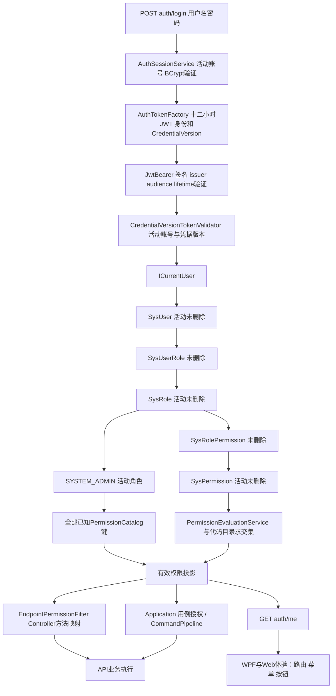

# Web 与 WPF 统一权限设计（方案基线，Web 未实施）

日期：2026-10-07。本文区分当前源码、偏差、Web需求和推荐目标，不删除任何模型/表、不迁移授权数据、不扩大角色权限。完整Endpoint到Key见[盘点附录](web-readiness-audit.md)。

2026-10-08 同步：盘点附录是初次快照，五端点漏登记已修复；首批 login/me 的契约与权限 HTTP 证据见 [接口验收](Web首批接口契约验收.md)。前端目录以 [脚手架决策](Web客户端架构与脚手架决策.md) 为准，多标签规则见 [工作区设计](Web多标签工作区设计.md)。

## 1. 当前真实模型

当前活动授权链已经是 **SysUser → SysUserRole → SysRole → SysRolePermission → SysPermission.PermissionKey**，并由代码PermissionCatalog约束有效键。不是需要从零建设的新目标。

| 输入中的名称 | 当前源码事实 |
| --- | --- |
| SysUser | [SysUser](../SwiftExport.Core/Entities/Auth/SysUser.cs)，账号状态/软删/密码哈希/CredentialVersion |
| SysRoles | 实际类[SysRole](../SwiftExport.Core/Entities/Auth/SysRole.cs)，PG表sys_role；旧summary中的dbo.SysRoles是过期说明 |
| SysUser_Roles | 实际类[SysUserRole](../SwiftExport.Core/Entities/Auth/SysUserRole.cs)，表sys_user_role |
| SysRolePermission | [SysRolePermission](../SwiftExport.Core/Entities/Auth/SysRolePermission.cs)，表sys_role_permission |
| Permission | [SysPermission](../SwiftExport.Core/Entities/Auth/SysPermission.cs)，表sys_permission；稳定PermissionKey |
| SysUser_ModulePermissions / SysUserModulePermission | 当前活动Core/Application/Infrastructure/WebApi/Contracts/WPF源码搜索未发现；不能根据背景认定它仍授予权限 |
| SysViewRoute | 当前活动源码未发现；WPF路由来自本地NavigationRouteRegistry |
| DocumentPermissionDto | 类型保留，注释明确旧预留未接入；不能作为新的字段授权事实来源 |

未查询运行数据库，因此历史表是否残留、存量数据是否合规为“待确认”。源代码中没有活动链不等于已证明数据库表不存在或已清理；本轮没有任何删除建议的实施授权。

## 2. JWT与实际权限链路

认证源码：[AuthController](../SwiftExport.WebApi/Controllers/Auth/AuthController.cs)、[AuthSessionService](../SwiftExport.Application/Services/Auth/Session/AuthSessionService.cs)、[AuthTokenFactory](../SwiftExport.WebApi/Authentication/AuthTokenFactory.cs)、[CredentialVersionTokenValidator](../SwiftExport.WebApi/Authentication/CredentialVersionTokenValidator.cs)、[PG账号仓储](../SwiftExport.Infrastructure/Repositories/Auth/Accounts/PostgreSqlAuthRepository.cs)。

授权源码：[PG权限事实查询](../SwiftExport.Infrastructure/Repositories/Auth/Permissions/PostgreSqlUserPermissionRepository.cs)、[PermissionEvaluationService](../SwiftExport.Application/Services/Auth/Permissions/Evaluation/PermissionEvaluationService.cs)、[PermissionCatalog](../SwiftExport.Contracts/DTOs/Auth/Permissions/PermissionCatalog.cs)、[EndpointPermissionFilter](../SwiftExport.WebApi/Authentication/EndpointPermissionFilter.cs)、[CommandPipeline](../SwiftExport.Application/Commands/CommandPipeline.cs)。

JWT本身不包含整组角色/Permission；每次OnTokenValidated核对活动用户和CredentialVersion，密码修改/重置递增凭据版本使旧token失效。用户停用/软删也会拒绝；角色变化无需重签JWT才能在后端生效。客户端me是快照，仍需重新读取才能更新菜单，不能把“后端实时查”误写为“界面实时推送”。

DevUser仅Development+配置允许+没有Bearer时注入；Program禁止生产开启。它会影响本地匿名/登录测试，应在验证时关闭。依据[DevUserMiddleware](../SwiftExport.WebApi/Development/DevUserMiddleware.cs)、[Program](../SwiftExport.WebApi/Program.cs)。Refresh Token、服务端logout/revoke接口本轮未发现；客户端清token不等于撤销泄露token。

## 3. 权限计算与管理边界

普通用户：有效角色所贡献的有效PermissionKey取并集，再与PermissionCatalog中IsAssignable=true的已知键求交集。未知键拒绝，精确Ordinal比较。管理员：活动SYSTEM_ADMIN角色触发全部已知代码键投影；不是角色显示名称等于“Admin”就授权。

PermissionCatalog中的System.Files.Manage、System.Users/Roles/Permissions管理查看键为保留项，不能任意分配普通角色。全局Filter对RbacController族放行到服务，并不绕过权限：[RbacManagementService.ReadAsync](../SwiftExport.Application/Services/Auth/Permissions/RbacManagementService.cs)核验对应保留查看键；WriteAsync在Serializable事务内重新锁验管理员、检查ExpectedVersion和最后有效管理员。它产生业务审计，但服务端生成审计CommandId，不等于客户端具备重试幂等协议。

Auth注册/重置还通过UserAccountService实时验证管理员；新注册用户不自动赋角色，须后续关系配置。文件上传既要求System.Files.Manage端点键，又要求FileAccessPolicy实时IsAdmin。活动用户下载原文件；公共图片静态目录在认证前服务，不属于受保护文件容器下载。

## 4. 风险和是否存在多套权限

| 关注点 | 当前判断 | 推荐 |
| --- | --- | --- |
| 多套权限来源 | 活动权限事实只有角色链+代码目录约束；Endpoint与Application是执行边界，不是两套授权数据 | 继续一个evaluation service，不新增Web PermissionService数据库 |
| Role与User直接授权冲突 | 未发现活动User→Permission直接授权路径，也没有allow/deny覆盖算法 | 不为了未来灵活性新增直接授权和角色继承 |
| ModulePermission重复 | NavigationModuleKeys/PermissionCatalog.GroupKey用于菜单或分组，不参与User直接模块赋权 | Group/Module不授予所有子操作，View不包含Confirm/Post/Reverse |
| 后端Key统一程度 | PermissionKeys/Catalog已有统一常量；部分Application/WPF仍使用同值字符串字面量，存在漂移维护风险 | 新触碰代码引用同一目录；TS必须自动核对键，逐步替换即可 |
| 初次五端点漏登记 | 已补采购关联四动作 Procurement.Order.Edit、采购 Excel 检查 Procurement.Order.Create | 已关闭，不重复修复；默认拒绝保留，后续接入按实际键验收 |
| WPF权限不同源 | CurrentUserService读取me.Permissions，NavigationAccessService精确匹配，无角色名兜底 | Web复用同一me，不建立另一个模块权限API |
| SysViewRoute混合职责 | 未见活动实体；WPF本地注册页面与RequiredPermission，不从DB授权表动态生成页面 | Web 用本地 workspace 页面目录；导航引用 pageKind，URL 不是 PermissionKey |
| 字段/行权限 | DocumentPermissionDto旧预留未接入，没有通用服务器字段级授权模型 | feature编辑限制是体验；真正字段授权新增必须后端明确规则，不能假称已经支持 |

WPF依据：[CurrentUserService](../SwiftExport.Client.Wpf/Authentication/CurrentUserService.cs)、[NavigationAccessService](../SwiftExport.Client.Wpf/Navigation/NavigationAccessService.cs)、[NavigationRouteRegistry](../SwiftExport.Client.Wpf/Navigation/NavigationRouteRegistry.cs)、[DocumentPermissionDto](../SwiftExport.Contracts/DTOs/Auth/Permissions/DocumentPermissionDto.cs)。

## 5. Web需要的最小接口

现成可复用：

- `POST /api/auth/login`：LoginRequestDto → LoginTokenDto.access_token。
- `GET /api/auth/me`：MeDto含UserId、UserName、NickName、Roles（显示）、RoleCodes（稳定编码）、IsAdmin、Permissions。
- `POST /api/system/users/page`及用户详情/启停/角色整组替换/有效权限查看。
- `POST /api/system/roles/page`及角色CRUD/启停/权限整组替换。
- `GET /api/system/permissions`：管理目录；保留查看键，普通用户不能把它当自己的必需初始化请求。
- 用户自己权限已经在me，**无需新建CurrentUser Permissions API**。Module定义API暂无必要，本地模块显示配置即可，PermissionCatalog.GroupKey供管理界面分组。

反向说明：`system/users/{id}/effective-permissions`是管理员查看目标用户，不能替代当前用户me。SysViewRoute也不应当作导航配置和授权的共同主表。权限目录同步已有[显式工具](../_tools/DbSeed/同步权限目录.ps1)，本轮只引用，不执行；数据库目录是否同步为待确认。

## 6. 推荐最终模型与Web规则

目标继续 **User → Role → Permission → PermissionKey**，维持当前扁平RBAC、不增加User直接授权/deny继承/通用ABAC。WPF与Backend继续用Contracts常量，Web从同一目录生成或经过CI比对的TS投影。

OpenAPI只描述PermissionKey为string，不会自动导出C#静态常量值集合。未来可通过既有代码目录的构建期小工具输出TS键，或先维护窄投影并用目录一致性检查保证值完全相等；选择一个正式入口，不能让普通用户读取受保护目录接口才能启动应用。此生成接线需要后续授权，不是本轮已实现。

路由要求View/Read，按钮要求独立Create/Edit/Delete/Maintain/Confirm等；BatchSave根据实际操作集合检查所有需要的键。例如Product：

| 操作 | Key |
| --- | --- |
| 列表/详情/Lookup | Products.Product.View |
| 新增 | Products.Product.Create |
| 修改/拉取主型号字段 | Products.Product.Edit |
| 删除 | Products.Product.Delete |
| 包含新增+更新的批量 | Create与Edit都必须具备 |

一个可见页面不代表所有写入都可做。编辑按钮还需结合服务端返回状态和本地输入规则；服务器必须独立拒绝。遇403重新读me并保持草稿，禁止自动换Admin重试；遇401保留当前会话内草稿、重认证同用户后恢复。登出切用户须清query cache和私有草稿。

多标签中的授权不能只作用于菜单。打开/URL 定位/重新激活及权限快照更新都核对页面读取权，写入前按实际操作重新检查。失去写权时冻结写按钮并保留原草稿；失去读权时遮蔽已打开内容，不继续后台读取。401 遮蔽整个工作区、停止新写入，已派发请求仍按结果处理；同用户重认证后重读 me 再恢复有权页签，不同用户清旧工作区与缓存。主动登出先汇总所有页签的 dirty/pending/unknown，不只检查当前页；不把服务器拒绝误当客户端已回滚。

不要删除SysUserModulePermission/SysViewRoute：源码已无活动链，本轮无删除对象与数据库证据。若未来发现残留，先列真实引用、数据用途、备份与迁移范围，再决定退役；不从背景旧名重新创建这些模型。

## 7. 后续验收

复用[PermissionCatalogConsistencyTests](../SwiftExport.Application.Tests/Authentication/PermissionCatalogConsistencyTests.cs)、[RbacPermissionEvaluationTests](../SwiftExport.Application.Tests/Authentication/RbacPermissionEvaluationTests.cs)、[EndpointPermissionFilterTests](../SwiftExport.Application.Tests/Authentication/EndpointPermissionFilterTests.cs)、[RbacManagementServiceTests](../SwiftExport.Application.Tests/Authentication/RbacManagementServiceTests.cs)、[WPF导航测试](../SwiftExport.Client.Wpf.Tests/Navigation/NavigationAuthorizationTests.cs)。

验收要证明：停用账号/角色不授予、未知 Key 拒绝、非 Admin 不能获保留键、最后管理员保护、混合 BatchSave 精确授权、合法新端点能到达、旧 token 后端授权随角色变化、已打开/隐藏页签权限撤销、同用户重认证与不同用户隔离。首批隔离测试证据见报告；本轮只复核权限数量断言一项通过，未读取运行库授权数据，也未完成 Web 多标签权限实测。

