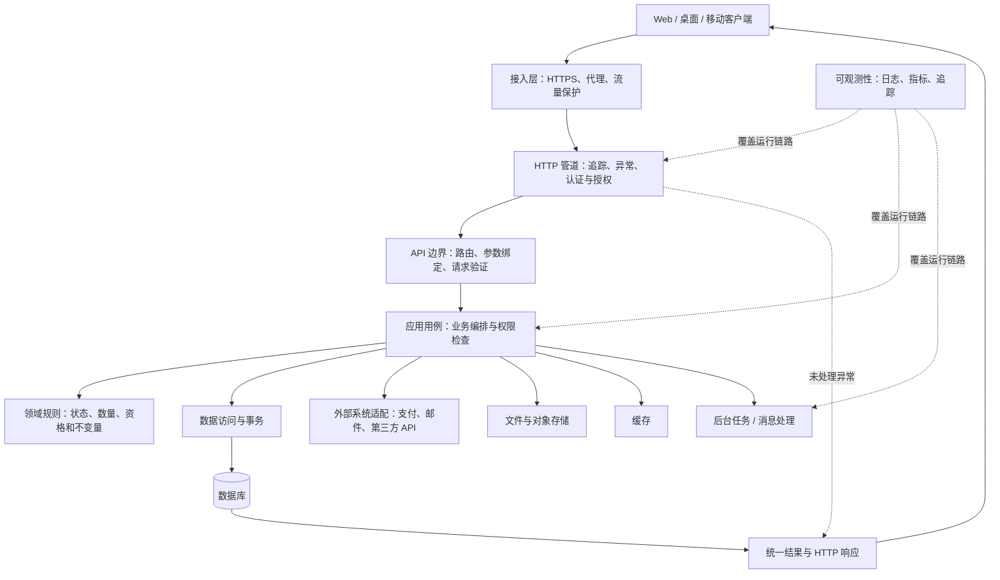

# 前后端分离架构的后端公共能力与中间件地图

这是一份通用后端架构指南，适用于 Web、桌面和移动客户端调用 API 的系统。它说明一个完整后端需要考虑哪些能力、各自负责什么、什么时候需要，以及一次请求如何经过这些能力。

SwiftExport 当前已在 Application/Commands 建立公共命令执行与持久化回执，入库草稿、过账、反向及出库草稿已接入。入库 Query、SourceQuery、Draft、Posting、Reversal 已分为独立用例服务，HTTP 入口与共享 DTO 也已按五类职责归档；其他模块仍按各自协议运行。2026-10-03 已只读发现现有 SQL Server dv_next 库；真实 SQL 原子性仍待确认隔离数据库验证，旧回执和数据迁移不能假定不存在。当前解耦与核验边界见[后端架构审查](后端整体架构与文件夹职责建议.md)。本图中的其余能力按场景选择，不表示项目均已实现。

**完善不等于组件多，而是每项实际需求都有明确负责人、可靠实现和验证方式。** 小型单体和大型分布式系统可以具备相同的职责边界，但采用不同的实现规模。

## 1. 先看整体地图



图中缓存、文件、消息等是按需分支，不是每个请求必经的环节；读取、写入、外部调用的结果最终都通过 API 边界返回。后台任务通常不在当前 HTTP 请求中等待执行完成。

常见代码分层是：API 层负责传输边界，应用层组织用例，领域层表达业务规则，基础设施层接入数据库和外部系统。简单系统可以少分项目，但职责仍需清楚。

## 2. 中间件、公共服务和基础设施有什么区别

| 名称 | 工作位置 | 典型职责 |
|---|---|---|
| 中间件 | HTTP 管道中，通常可包住下游请求处理 | 请求追踪、异常兜底、认证、请求日志 |
| Filter / Interceptor | 特定框架的端点或方法调用边界 | 模型验证、结果转换、端点级处理 |
| 公共服务 | 由业务用例显式调用 | 当前用户、权限判断、时间、审计、幂等执行 |
| 领域服务 | 某个业务领域内部 | 库存过账、价格计算、资格判断 |
| Repository / Adapter | 外部资源访问边界 | 数据库读写、对象存储、第三方接口 |
| 平台能力 | 应用部署和运行环境 | TLS 终止、密钥管理、监控、备份、发布 |

同一种能力可以由框架、代理或应用实现。先确定责任归属，再决定是否需要自定义类。公共能力也不等于必须放进 CommonServices 目录。

## 3. 一份完整的能力清单

“基础必备”表示必须作出明确设计，可以直接使用框架或平台实现；“按需”表示满足相应业务条件时才建设。

### 3.1 接入与 API 边界

| 能力 | 解决的问题 | 何时需要及边界 |
|---|---|---|
| HTTPS 与可信代理配置 | 防止传输被窃听或篡改，正确识别请求来源 | 网络服务基础；TLS 可由应用或受信代理终止 |
| 路由与 HTTP 协议 | 请求交给谁，怎样表达成功和失败 | 基础必备；方法、状态码和响应头应有一致语义 |
| 参数绑定、序列化、输入验证 | 请求能否被理解，格式是否合法 | 基础必备；明确大小、长度、类型、日期、数值及空值语义 |
| API 契约与文档 | 前后端怎样协作、变更怎样交付 | 基础必备；包括分页、错误、兼容或同步切换策略 |
| 统一错误与异常兜底 | 客户端如何处理错误，技术信息如何隔离 | 基础必备；业务失败有稳定分类，未知异常不暴露内部详情 |
| 超时、取消与请求大小限制 | 防止无限等待和资源耗尽 | 基础必备；客户端断开不自动证明写入失败 |
| CORS | 浏览器是否允许跨源读取响应 | 浏览器跨源调用时需要；桌面调用不依赖 CORS，CORS 不是身份认证 |
| 限流、配额与过载保护 | 防刷、控制成本、保护容量 | 按暴露面和负载设计；可在网关、应用或两者配合实现 |
| API 版本与弃用策略 | 怎样处理不能同步升级的消费者 | 多版本消费者存在时需要；不等于所有系统都必须长期保留旧 API |

### 3.2 身份与安全

| 能力 | 解决的问题 | 何时需要及边界 |
|---|---|---|
| 身份认证 | 谁在调用，身份是否有效 | 受保护资源必需；可采用会话、Token 或外部身份提供方，不限于 JWT |
| 当前用户上下文 | 业务代码怎样取得身份信息 | 有身份时需要；身份来自可信认证结果，不信任请求体自报的用户 ID |
| 操作与资源授权 | 能做什么，能访问哪条数据 | 受保护资源必需；包含对象、字段或租户范围，不能只校验登录 |
| 凭据与会话生命周期 | 登录、过期、登出、撤销及账号失效如何处理 | 按身份方案实现；自管密码时还需安全哈希、找回和防暴力尝试 |
| 租户隔离 | 不同组织的数据如何隔离 | 多租户系统必需；查询、缓存、任务和文件都要遵守同一隔离边界 |
| CSRF 防护 | 防止浏览器自动携带身份而产生伪造操作 | 使用 Cookie 等自动附带凭据的场景需要评估；不能只靠 CORS |
| 密钥与敏感数据保护 | 防止凭据泄露、越权读取和过量收集 | 基础必备；配置脱敏、最小权限、必要加密、保留和删除策略 |

### 3.3 应用执行与业务正确性

| 能力 | 解决的问题 | 何时需要及边界 |
|---|---|---|
| 用例编排 | 完成一次业务操作需要哪些步骤 | 有业务逻辑时需要；按用例组织，避免万能服务 |
| 领域校验 | 状态、数量、资格等是否符合规则 | 业务自身负责；不能全部搬到通用输入校验器 |
| 事务协调 | 多步数据库修改怎样全成全败 | 多步原子写入时需要；外层拥有事务，内部调用不擅自提交 |
| 并发控制 | 多人同时操作是否覆盖或超额 | 共享可变事实需要；按不变量选择版本条件、锁、原子更新等手段 |
| 幂等与结果恢复 | 重试是否重复扣款、建单或发放权益 | 有重复副作用或结果不确定的操作需要；持久化身份与结果不能仅靠内存防抖 |
| 业务审计 | 谁在何时因何原因改变了业务事实 | 关键业务、安全管理和追溯场景需要；与技术日志、命令回执分工 |
| 时间来源与业务日期 | 怎样处理时区、截止时间和可测试性 | 涉及时间的系统需要明确语义；统一时间来源不等于统一所有业务日期 |
| 业务编号 | 怎样生成对人可读且符合规则的号码 | 有编号需求时需要；与数据库主键、请求追踪 ID 分开 |

### 3.4 数据与外部资源

| 能力 | 解决的问题 | 何时需要及边界 |
|---|---|---|
| 数据访问、连接管理与参数化 | 怎样可靠、安全地读写数据库 | 使用数据库时必需；可用 ORM、SQL 映射或驱动，不强制 Repository 模式 |
| 数据约束与索引 | 唯一性、局部合法性和查询性能如何保证 | 数据库存储必需；约束与应用校验共同保障不变量 |
| 数据库变更管理 | 代码和表结构如何匹配 | 持久化系统必需；明确发布顺序、数据转换、失败恢复和验证 |
| 缓存 | 怎样减少重复读取和昂贵计算 | 性能证据支持时建设；明确键、有效期、失效、隔离和一致性容忍度 |
| 文件与对象存储 | 怎样上传、下载和管理文件 | 有附件等需求时建设；校验内容、大小、访问权限、生命周期和孤立文件清理 |
| 外部系统适配 | 如何调用支付、邮件或第三方 API | 有集成时建设；明确超时、重试、认证、错误转换与可观测性 |
| 后台任务和调度 | 长操作、定时工作怎样脱离 HTTP 请求 | 有需求时建设；需考虑持久化、并发领取、重复执行、取消和失败恢复 |
| 消息与可靠事件投递 | 服务间或异步步骤怎样可靠衔接 | 有异步解耦需求时建设；考虑重复、顺序、失败重试和补偿 |

数据库事务通常不能一起回滚第三方扣款、邮件或对象存储写入。涉及这些副作用时，需要按场景设计可靠投递、幂等调用、状态查询或补偿；不能把它们放进一个数据库事务就宣称原子完成。

### 3.5 可观测性、交付与运维

| 能力 | 解决的问题 | 何时需要及边界 |
|---|---|---|
| 结构化日志 | 出错后怎样定位原因 | 基础必备；明确级别、关联身份和敏感信息边界 |
| 请求关联与调用追踪 | 一个请求跨组件后如何串联 | 基础关联必备；跨服务时考虑完整分布式追踪 |
| 指标与告警 | 怎样发现错误率、延迟和容量异常 | 生产系统需要；围绕用户影响和可执行处理设置告警 |
| 健康检查 | 进程是否存活、是否可以接流量 | 按部署平台接入；存活与就绪分开，避免错误重启或放流量 |
| 配置与密钥管理 | 不同环境怎样配置和轮换凭据 | 基础必备；不把生产秘密写进源码 |
| 自动化验证 | 如何证明变更没有破坏行为 | 基础必备；按风险选择单元、集成、契约、并发和端到端验证 |
| 构建发布与恢复 | 怎样重复部署、退出故障版本 | 生产系统需要；包含优雅停机、数据库兼容和回退或前向修复方案 |
| 备份与恢复演练 | 数据丢失后能恢复到什么程度 | 有重要持久化数据时必需；备份存在不等于可以恢复 |
| 依赖与安全维护 | 漏洞、过期依赖和权限变化如何处理 | 持续维护必需；不能只在首次上线检查 |

## 4. 一次请求怎样走

### 4.1 查询请求

```text
客户端请求列表
  → 接入保护与请求追踪
  → 身份认证、端点授权
  → 参数绑定与格式校验
  → 用例检查数据访问范围
  → 查询数据库或读取有效缓存
  → 转换响应 DTO
  → 返回 HTTP 状态、数据及追踪标识
```

查询不因为经过公共层就必须开启写事务、创建回执或追加业务审计。跨多次读取需要一致视图时，单独设计读取一致性。

### 4.2 有副作用的可重试命令

```text
客户端携带稳定幂等键、业务输入及所需版本
  → 身份、权限与输入检查
  → 按命令协议开启事务，串行保护命令身份
  → 查询持久化回执
      相同身份与内容：检查当前回执访问权限，返回原结果
      相同身份但内容不同：拒绝冲突
      没有结果：继续
  → 锁定或以版本条件保护相关业务事实
  → 校验当前状态与业务规则
  → 写业务数据、回执和本次要求的审计
  → 提交并返回结果
```

这一示例适用于在同一数据库事务中完成的命令。跨数据库或包含外部副作用时，执行协议需要另外设计。

提交后响应丢失，客户端使用原幂等键查询或重试。幂等不是对相同请求体永久去重：两次合法购买可能内容相同，却是不同业务意图。

### 4.3 长任务

```text
提交任务 → 校验与持久化受理 → 返回任务 ID
                                  ↓
后台执行 → 更新进度和结果 → 客户端查询或接收通知
```

受理成功不等于业务完成。任务需要自己的授权、执行状态、幂等和失败恢复机制。

## 5. 最容易混淆的保护机制

| 机制 | 回答的问题 | 不能替代什么 |
|---|---|---|
| 页面 Busy / 防抖 | 能否减少连续点击？ | 并发控制和持久化幂等 |
| 限流 | 能否限制单位时间消耗的资源？ | 业务权限和命令去重 |
| Version / ETag | 客户端依据是否已经过期？ | 同一意图的结果恢复 |
| 幂等键 / CommandId | 是否已经处理这次业务意图？ | 库存、余额等业务规则 |
| 事务 | 多个数据库操作能否一起提交？ | 外部副作用的原子性 |
| 锁、原子更新与约束 | 并发时哪些不变量不能被破坏？ | 完整业务资格判断 |
| CorrelationId / TraceId | 这次调用经过哪里？ | 业务幂等身份 |
| 业务审计 | 谁改变了什么业务事实？ | 技术诊断和机器重放协议 |

## 6. 什么应该复用，什么应该留在模块

公共机制可以复用身份读取、权限检查方式、错误结构、事务生命周期、幂等协议、日志上下文和外部访问适配。

业务模块保留自己的权限要求、数据访问范围、状态流转、数量口径、锁资源集合、输入规范化和结果含义。库存服务被多个模块调用，仍然是库存领域能力，不因此变成全局工具。

可参考以下职责位置，不要求照此创建所有项目或目录：

```text
API
  请求管道、Controller、HTTP 结果映射
Application
  用例服务、公共执行机制、依赖端口
Domain / Core
  领域规则、业务实体、领域接口
Infrastructure
  数据库、缓存、文件、外部 API、任务和消息适配
Contracts
  请求、响应、错误契约
Deployment / Operations
  配置、发布、监控、备份与恢复
```

## 7. 分阶段建设，而不是一次装齐

| 阶段 | 首要建设内容 | 可以怎样保持简单 |
|---|---|---|
| 基础可用 | API 契约、验证、身份权限、错误、日志、数据访问、配置、测试 | 使用框架已有能力，保持单体与少量明确模块 |
| 写入可靠 | 事务、并发、必要的幂等、审计、数据库变更与恢复 | 用真实高风险操作验证公共机制，不预建万能执行框架 |
| 生产可运维 | 指标告警、健康检查、发布恢复、备份演练、安全维护 | 平台能承担的能力交给平台，避免重复实现 |
| 按业务与规模扩展 | 缓存、文件、任务、消息、搜索、租户隔离等 | 有实际需求再引入，部分产品从第一阶段就需要其中一些能力 |

微服务、Redis、消息队列、API 网关产品、通用工作流引擎，都不是“完善后端”的必选清单。它们是满足特定需求的实现选择。

## 8. 怎样判断是否完善

拿一个真实请求逐项问：

1. 谁能调用，能访问哪些数据？非法输入在哪里拒绝？
2. 正常结果、业务拒绝和未知故障怎样表达？客户端是否能正确处理？
3. 两个请求同时修改同一事实会怎样？网络重试会怎样？
4. 中途失败、提交后断线或外部系统超时，怎样确认与恢复结果？
5. 能否通过日志、指标和追踪发现并定位问题？
6. 数据库升级、应用发布、机器故障及误删除后，怎样恢复？
7. 上述保证是否有测试、监控或恢复演练作为证据？

每个问题都有清楚答案，比服务数量、目录数量或中间件数量更能说明后端是否完善。
