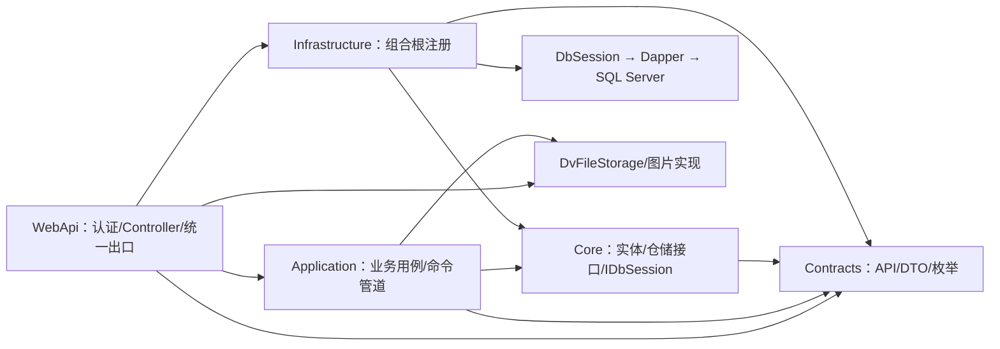

# 后端整体架构与数据库解耦审查

## 第十六批：产品 BOM 保存边界与事务清理（2026-10-04，限定验收完成）

本批初始源码确认：BomService写入口已统一，但ProductMaintenanceService单项仍走BaseService、未统一事务；产品批量保存默认隔离，DTO可改变BomNo/BomVersion、角色和IsDeleted，删除主要检查身份与存在性。产品写入会改变当前图可见性及组成资格，因此只让BOM保存使用Serializable不足以关闭BOM-005；单次顺序写入也可能破坏结构，须先补产品业务校验。用户随后明确批准先补产品保存边界，保留API/DTO与历史快照，不新增全表锁。

批准范围已实现：单条产品增删改复用现有批量事务，wrapper Uid/Version作为写入依据。新增GetCurrentReferencesForProductsAsync只读本次UID作为父/组件的当前组成，由数据库按编号排序规则联接有效父产品当前版本，不加锁。服务直接使用数据库确认的引用，阻止删除请求和Data.IsDeleted绕过；已有当前组成不能普通改编号/版本，无当前组成也不能借改身份激活旧组成。历史激活复用GetByBomNoAndVersionAsync后按父Uid判断。审查发现C# OrdinalIgnoreCase会漏掉数据库全半角等值，已取消应用层的组成归属重判，并补实库反例。纯历史不冻结一般资料编辑，角色变化用全部本批候选产品复用既有父件/组成策略；未改SKU更名治理、完整停用策略或需求展开算法。

MaterialDemandEstablishmentService的真实BuildPlanAsync读取根产品和指定版本的一层组成，BusinessCommandExecutor未传可选隔离级别；IBomExecutionReader仅注册和测试，没有生产消费者。本次不得自动改为多层展开，也不能用未被调用的执行读取器宣称真实链路一致性完成。命令执行器已支持可选隔离，PG回执已有事务前租约；不引入第二事务或新全局业务锁。

并发方案依据：[PostgreSQL 18应用一致性](https://www.postgresql.org/docs/18/applevel-consistency.html)要求将相关操作纳入正确的一致性协议；[事务隔离](https://www.postgresql.org/docs/18/transaction-iso.html)说明Serializable可能因序列化冲突终止事务。这里的候选方案是参与写入者统一事务与校验后，再验证Serializable及40001整事务失败，不自动重试；不是已完成的部署或性能结论。

事务清理已修复：BomService本地持有自有事务，回滚、Dispose或日志失败不遮盖既定业务结果，释放异常时尝试关闭连接且最终清空Session.Transaction；外部事务不接管。覆盖校验拒绝、写失败、已确认提交及Begin失败，保留错误码、隔离与提交异常协议；没有提升为通用事务框架。

仍需独立设计的错误语义：版本预检及行写失败现为BusinessBlocked；提供者唯一/序列化/死锁/超时/连接错误、取消和提交异常现统一Unexpected。IDbSession.Errors已有分类能力但BOM未接入。提交确认丢失或回滚失败时，原提示“所有操作已回滚”并不可靠；需区分已知失败与结果未知，不能直接改成可自动重试。后续修改须明确现有HTTP映射及调用方兼容影响。

验证：全部执行窗口停写后串行运行289项相关离线测试（含34项产品保存边界、BOM清理故障及两提供者查询契约），全部通过、无失败或跳过。5项BOM查询实库测试全部通过，仅使用dv_next_pg_failure_tests_20261004随机记录事务回滚；前后50表17,595行逐表全字段摘要完全一致，无新增残留。后端构建0错误，3条既有NU1900环境警告；测试编译另有既有MSTest分析警告。未运行全量后端、SQL Server实库、真实HTTP、跨连接BOM写并发或混合快照验证，不能把本批边界保护视为BOM-005关闭。

本批修改Application产品维护/BOM清理、Core窄查询接口、两提供者实现及对应测试，未改Contracts、前端、运行DI或数据库结构。现行架构报告、窗口路由、数据库README及两份能力地图原位更新；无文档新增、删除或归档。下一批先确定BOM失败分类与提交结果未知协议，再完成参与写入者的PG并发实现及真实需求读取一致性测试；当前仍不能切换宿主。

## 第十五批：BOM 普通读取适配（2026-10-04，限定验收完成）

范围为六个普通读取：按号DTO、按号实体、编号版本、任意有效组成判断、分页和原编号/组件快照存在判断。新增PG实现复用现有名称映射、参数、LIKE模式和调用方事务，保持各自筛选口径；暂不实现完整IBomRepository或注册DI，不加入锁。集合查询、整图保护、按号物理删除及执行依据读取尚未适配，不造默认成功或空结果占位。

数据库只读复核：PG dv_next 的bom为17列，父与组件身份可空，3个索引分别为主键、有效父/版本查询及有效编号/版本/行号唯一键；编号仍普通文本唯一键。SQL Server Bom的6个文本列为Chinese_PRC_CI_AS。本批兼容查询等值的ICU/ASCII尾空格并不意味着唯一约束已对齐，无DDL。专用库dv_next_pg_failure_tests_20261004测试前50表、17,595行摘要已记录，实测只用随机事务回滚，不写原库或备份。

按号及分页要求有效父产品当前编号/版本，子产品或颜色失效只影响展示，组件快照保留；指定编号/版本不要求父产品当前有效。HasActive过滤软删但允许历史版本，IsBomItemExist连软删与历史行都计入，不能擅自合并为同一资格判断。普通展示不证明多层执行读取一致；当前普通索引无需因本批再变更。

交付新增PostgreSqlBomRepository.cs及PostgreSqlBomQueryTests.cs/.Integration.cs；共享离线记录连接仅增加可选多结果集支持，默认单表行为保留。三个窗口均停写后主控审阅并串行验证：223项相关离线（含本批10项和前批BOM44项）及4项专用库实测全部通过，0失败、0跳过。实测覆盖可空组件到DTO Guid.Empty/实体NULL、当前展示与历史快照、失效关联、多行存在语义、ICU及ASCII尾空格、十字段搜索与转义、批量300词边界、多结果集分页和稳定顺序。测试前后50表17,595行全字段摘要一致，无新增残留。

后端构建0错误、3条既有NU1900警告；未运行全量后端、SQL Server实库、真实HTTP宿主、BOM并发写入或混合快照验证。不改Application/Core/Contracts/DI、数据库结构、原库或备份，不新增锁。架构报告、窗口路由、数据库README原位更新，无新增/删除/归档文档。下一批需先明确剩余整图读取与调用方事务隔离、父BOM身份变更协作及40001失败协议，再实现剩余仓储和并发验收，不能把六个普通查询注册成完整IBomRepository。

## 第十四批：BOM 保存入口统一（2026-10-04，限定验收完成）

用户批准后，修改 BomService.cs 并新增 BomService.兼容写入.cs，将单条 Add/Update/Delete 与按号删除交给既有批量保存内核。API/DTO 不变；所有写入口均执行当前版本、完整结构和最终图校验。按号删除在同一事务内解析当前行，不删除历史版本、不自动清父产品 BOM 身份；删除最后组成行会失败。保留批量 BusinessBlocked/Unexpected 协议，不新增事务机制、锁、隔离级别或数据库结构。本批确实收紧旧入口行为，属于已批准范围。

新增 BomSaveEntryTests.cs、BomSaveRollbackTests.cs，覆盖包装 Uid/Version 权威、重复/自环/跨层环、比例、当前版本及历史保留、软硬删除、共享事务、外层事务不接管、中途失败停止写入和完整持久集合回滚。新增25个场景连同既有19项 BOM 验证共44项通过、0失败、0跳过。首轮新增夹具1项失败：按号读取错误包含历史行；核对真实仓储后修正夹具筛选，未削弱断言。后端构建0错误、3条既有NU1900警告。

本批只验证服务编排，未运行 BOM 实库并发、SQL Server实库或真实HTTP；未创建PG BOM实现或切换DI。BOM-002保存旁路已收口，bool校验口径仍待统一；BOM-001修改记录、BOM-003完整读取和BOM-005跨连接并发仍未关闭。下一步先适配普通BOM读取，再单独评审整图并发与执行读取一致性，不将行锁视为范围锁替代品。

## 第十三批：双方产品关系适配与 BOM 审查（2026-10-04，限定验收完成）

新增两个PG仓储与四个专项测试文件，完成双方关系13个专用读取及原接口，继承现有通用CRUD，未改变Application、Core、Contracts、DI或SQL Server实现。客户侧当前客户码与关系SKU快照、供应商侧当前产品展示与采购关系快照分别保留；采购成对UUID数组按500分块读取，不交叉匹配、不静默去重。集合等值兼容ASCII尾空格/ICU，原DISTINCT入口返回等价组真实存储码，普通Existing入口仍返回全部。

验收：三窗停写后主控统一检查，181项相关离线、9项专用库实测（客户4/供应商5）全部通过，无新增失败或跳过。实测覆盖可空产品、失效联表、停用、DTO投影、原码占用与作用域、分页、500配对边界、Version、准确23505约束及保存点恢复。专用库50表17,595行完整摘要与本批前相同，无新增残留。后端构建0错误、3条既有NU1900环境警告；未运行SQL Server实库、全量后端或真实HTTP宿主。本批无DDL、新锁、备份创建、原库写入或运行切换，查询适配不代表服务保存缺口已解决。

用户随后明确批准下一批BOM先统一保存内核，见下述边界；此前“需确认”已满足该有限范围，不扩大为并发方案或DDL批准。

复用三个已停写窗口，以backend/后端API工作流按独立文件实施。客户产品7个、供应商产品6个专用读取拟新增PG实现，复用公共CRUD/参数/映射/事务，不改运行DI、契约或前端。BOM9个维护仓储方法及3个执行读取先只读审查：整图范围保护与旁路写入需单独决定，不能机械将HOLDLOCK改FOR UPDATE。本批没有索引或触发器DDL授权。

数据库事实：MCP只读核验两种dv_next，PG三表共60列、9个索引；客户料号唯一键仍普通文本，供应商唯一键是supplier_id+sku_id且过滤空产品和软删，并不存在supplier_sku唯一键。PG双方sku_id均可空；SQL Server供应商SkuId实际仍NOT NULL，与当前实体/本地基线不同。PG可空来自用户前序明确批准，不因本批修改SQL Server结构。代码预期与实库差异必须分别记录。

已发现而未改的保存边界：双方资料预检发生在事务之前，未冻结主数据引用或缺失料号；客户批量catch返回异常Message，供应商批量把Version和唯一冲突落入Unexpected。普通读取转换不代表这些保存错误语义或并发准入已验收。BOM-002旧通用CRUD/按号物理删除旁路及BOM-005并发整图规则仍有效，不扩大或复制为新的可运行保存协议。

BOM只读结论：6个普通查询可独立适配；集合查询未传Transaction且包含历史版本/软删，未找到生产调用；按号物理删除无HTTP action及生产调用，但继承通用DELETE与batch-save会转发IsSoftDelete=false，所以物理删除旁路仍存在。IBomExecutionReader仅找到DI和测试，不能虚构生产消费者。真实需求建立直接读编号/版本，执行器默认BeginTransaction；BOM批量保存同样默认隔离，都不能称为Serializable。全图读取HOLDLOCK与3个执行读取的空范围保护不得机械翻译为行锁。

后续BOM边界：第十四批已获批准并完成旧保存入口收口；父产品BOM身份变更协调、显式Serializable及40001整事务失败仍需独立评审，不自动重试，不加全表业务锁。第十三批本身仅审查BOM，无新增仓储、锁或占位接口，也不恢复旧采购确认读BOM流程。

## 最新推进：产品目录、资料与包装（第十二批，2026-10-04，14方法限定验收完成）

保留7562f6da及前批未提交修改，三个既有窗口按明确文件归属并行；主控审阅后串行测试。本批不修改数据库索引、触发器或运行DI，不改变API/DTO或前端。基线后端构建通过，3条NU1900环境警告。资料ProductDetail与包装ProductPackage没有独立保存服务或专用仓储，无需为通用CRUD新造实现；本批补既有PG通用仓储的映射、版本及回滚验收。产品目录14专用方法按普通查询、主型号同步、默认供应商和销售选择分部迁移，partial只拆物理SQL职责，不宣称已经拆分业务接口。

### 本批交付与验证

补充验收：用户已明确采用客户代码来源方案。SQL Server和PG的GetAllCustomerCodeListAsync均从未删除CustomerProduct关联未删除Product与Customer读取当前非空代码，EXISTS避免多关系放大，保留停用记录并去重；不读关系历史快照或不存在的产品列。PG现实现完整IProductRepository，运行DI不变。本轮154项仓储离线测试通过（含新增两提供者查询契约），本批36项PG实库串行全部通过（新增三表关系、停用、软删、悬空、空SkuId和重复关系场景）。专用库50表17,595行摘要不变，构建0错误/3条NU1900；SQL Server新查询只有离线执行契约验证，未运行SQL Server实库。

- 新增Catalog仓储7个分部，实现8普通读取、3主型号同步、默认供应商和销售选择共13方法；第14个客户代码查询已获用户批准按三表关系实现，现已接IProductRepository，未注册DI。复用公共CRUD、映射、审计和外层事务；资料及包装无需专用仓储。未改Application业务流程、API/DTO或前端。
- 新增6个测试文件。离线首轮7项新增失败暴露参数绑定与断言不一致；保留类型断言，在既有PostgreSqlParameters补命名UUID数组及无时区时间显式绑定后，相关测试225通过、0失败，34项外部集成环境测试未启用而跳过。未将跳过项计入业务通过数。
- 保留专用库dv_next_pg_failure_tests_20261004以Workers=1串行执行35项实库测试，全部通过：目录5、销售选择3、同步20、资料包装7。覆盖复杂投影、客户覆盖与筛选、大小写和空值、停用/软删边界、同步精确差异、Version拒绝、唯一冲突、预取消及跨仓储回滚。未执行提交夹具或新增并发锁竞争，不扩大验收结论。
- 专用库50表17,595行的行数及全字段摘要测试前后完全一致，无残留。dv_next与现有最新备份dv_next_backup_20261004_181602的50表17,594行、列索引约束、触发器函数、排序规则、序列定义和状态全部一致；没有执行DDL、断开连接或创建备份。
- 后端解决方案构建0错误、3条既有NU1900环境警告；SQL Server/PG两份生成基线校验通过。本批基线只更正Cbm说明，前批索引变更保留。完整后端、SQL Server实库和真实PG HTTP宿主未运行，不宣称可切库。
- 原位更新本报告、窗口路由、Database/README，无新增、删除或归档文档。下一步推进双方产品关系、BOM及引用冻结并发协议；文本索引统一按下表评审，不逐仓储机械改库。

### 剩余索引统一清单：先核验，不逐仓储机械改库

MCP只读核验dv_next实际58个ux命名唯一索引，以及产品/资料/包装/双方产品/BOM/客户采购配置7表20个全部索引，与本次源码盘点相符。下表是后续适配清单，不是新增DDL批准；所有已有软删、NULL和状态谓词必须分别保留，数据重复须先列清单，不能自动清理。

| 分类 | 对象及依据 | 后续边界 |
|---|---|---|
| 已适配，保留 | 客户、供应商、分类、颜色、主型号、中性6个编码索引已用rtrim ASCII＋ICU；字典类型已使用字典列ICU与rtrim | 不重复改；有限Unicode兼容仍适用 |
| 文本语义差异 | Product.Sku；CustomerProduct的CustomerId＋CustomerSku；ProductPackage的ProductId＋PackageType；Bom的BomNo＋版本＋行号 | 当前普通文本键仍区分大小写/尾空格。只评估文本部分，不能给Guid/int套比较转换；PackageType未有canonical CHECK，不能当枚举已等价 |
| 文本及NULL差异 | CustomerPoConfig的CustomerCode＋SupplierCode实际均nullable，索引只过滤is_deleted=false | PG默认NULLS DISTINCT与SQL Server不同，业务口径及旧数据须先核验；不能擅自加NOT NULL过滤 |
| 其余文本键待核验 | 仓库Code、币种及汇率Pair、取号DocType/年月、Excel配置组名称/字段键、账号名/角色码/权限键、销售采购及出入库装箱售后单号 | 有PG仓储或规范化输入不等于数据库约束兼容；合并形成有限结构方案，不在每个仓储中顺带改DDL |
| 固定协议文本键 | 审计Module/OperationType/CommandId、毛需求SourceType/SourceUid/SourceLineId | 核对协议值和遗留值后判断，不归为纯Guid安全键 |
| 可保留的非文本键 | 供应商产品SupplierId＋SkuId、中性父型号＋颜色、用户角色/角色权限、库存仓库＋产品、命令Guid、头Guid＋行号、修订/执行/流水号、非空反向和替代身份、采购executionRequest＋supplier、仓库supplier＋SiteType | 保留原NULL、活动、软删及生命周期谓词，不扩大唯一范围 |
| 无需因替换修改 | ProductDetail仅两个普通查询索引；Product_Master_Color为普通索引 | 不新增“一产品一资料”或产品型号颜色唯一规则；性能优化等待真实查询计划 |

### 已确认缺陷与替换障碍

1. **已确认缺陷，已按批准修复**：ProductRepository.GetAllCustomerCodeListAsync原先查询不存在的Product.CustomerCode。现两提供者均从未删除CustomerProduct关联未删除Product、Customer取得当前去重客户代码，不增加IsActive筛选。API签名及DTO不变，PG主类型已接完整IProductRepository，运行DI未变。
2. **已确认缺陷，保留待修**：原SearchSalesOrderProductsAsync投影DefaultDescriptionEn，但SalesOrderProductLookupDto仅有DescriptionEn；当前映射会丢描述。Product按ID详情原SQL也投影IsActive，但ProductDto及BaseDto没有对应属性；其他原查询投影FakeName/颜色代码也未进入ProductDto。本批保留原输出及列，不借迁移扩DTO；资格保护通过真实Product实体读取/更新验证。
3. **已确认文档错误**：ProductPackage.Cbm注释称计算列；两个实库均是普通可空数值列，PG is_generated=NEVER、SQL Server is_computed=false。已原位更正注释，未改列、生成行为或体积计算业务。
4. **替换障碍**：SQL Server裸LIKE在轻量Lookup和分类名称包含查询中允许方括号字符组，PG LIKE语义不同；普通分页和销售Keyword已有SqlLikePattern转义规则，不可混为一个搜索协议。完整字符组兼容待单独决策，不用大型通用转换框架掩盖差异。
5. **替换障碍**：MCP实际Product Unit冻结函数仅检查已有PurchaseOrderLine及InventoryLedgerEntry，包含软删采购行；无引用INSERT侧锁，普通EXISTS不替代SQL Server范围锁。采购现有HOLDLOCK产品资格读取、自动库存逐产品UPDLOCK与普通库存无显式产品锁必须按各自入口审查，不能全表加锁。后续PG共享行锁需能阻止非键Unit更新，不能以FOR KEY SHARE冒充；须验证“单位先改/引用先增”两种交错以及外层隔离级别。
6. **仍有效部署限制**：单位比较原SQL Server EXCEPT沿列排序规则，PG IS DISTINCT FROM为普通文本精确比较；通用单条维护事务、默认供应商关系→产品→供应商与主型号同步的反向顺序、普通产品颜色/供应商/仓库引用校验也没有全域并发闭环。本批不擅自加全局锁、改触发器或声称可切库。

## 前批实施：型号中性编码唯一性与错误分类（第十一批，2026-10-04，限定验收完成）

用户明确批准两个编码索引、精确错误分类及验收后新建备份。保留第八至十批全部未提交工作；三个既有窗口交付并停止写入后，由主控审查、串行构建测试和执行DDL。运行仍为SQL Server+Dapper，未改DI、API/DTO或前端，未提交Git或切库。

### 实施范围与依赖

- [索引变更](../SwiftExport.Infrastructure/Database/PostgreSQL型号中性编码索引变更.sql)和[严格回退](../SwiftExport.Infrastructure/Database/PostgreSQL型号中性编码索引回退.sql)：仅两个活动编码键采用rtrim(code,' ') COLLATE public.erp_dictionary_ci，名称、is_deleted=false谓词、varchar(300) NOT NULL物理列及ux_product_neutral_master_color均保留。执行开关仍默认FALSE，逐次绑定单个目标库，不是幂等启动脚本。
- 生成器只扩展精确实体＋索引＋属性白名单并复用既有ICU初始化；PG基线本批仅两行索引变化，第九批两行既有变化保留。SQL Server基线无变化，不扩大列级比较规则。
- 三个PG型号/中性仓储Add/Update继续委托公共基类，只捕获SqlState=23505且schema=public、table及constraint准确匹配的已知业务约束。两个中性仓储共用模块内19行识别辅助，未扩展全局classifier、Core或Contracts，没有新事务或重试机制。
- 两个Application维护服务只调整EnsureWrite分类，仍依赖Core接口与RepositoryWriteResult，不引用Npgsql。失败立即停止用例并回滚；Update在委托基类前保存归一化旧Version，失败回执AffectedRows=0、NewVersion=null，保留现有实体对象副作用。

| 精确业务约束 | 内部仓储错误 | 现有服务契约与固定文案 | 已批准行为变化 |
|---|---|---|---|
| public.product_master / ux_product_master_master_sku | PRODUCT_MASTER_SKU_OCCUPIED | VALIDATION，“主型号编码已被占用” | 数据库兜底500→400，与预检一致 |
| public.product_neutral / ux_product_neutral_product_code | PRODUCT_NEUTRAL_CODE_OCCUPIED | VALIDATION，“中性产品编码已被占用” | 数据库兜底500→400，与预检一致 |
| public.product_neutral / ux_product_neutral_master_color | PRODUCT_NEUTRAL_MASTER_COLOR_OCCUPIED | BUSINESS_BLOCKED，“该主型号下颜色已被占用” | 数据库兜底500→422，包含跨父迁入冲突 |
| 主键、未知/空约束、schema/table不匹配 | 原异常 | 原技术错误 | 不猜测为编码、组合或Version |

超时、死锁、序列化失败、取消及连接故障不被上述白名单捕获；原CONCURRENCY_CONFLICT→409及其他写入失败结果→422保留。SQL Server仓储不产生新增内部码，原运行行为保留。

### 数据库演练、同步与备份

只读预检两目标库均4条主型号、0条中性，拟议冲突组0，三个原唯一索引一致；SQL Server有对应三个唯一索引。ICU und-u-ks-level2实际与记录版本均153.128。专用库dv_next_pg_failure_tests_20261004已完成前向ROLLBACK演练、按真实目录填六个回退守卫、前向/回退全程ROLLBACK演练，再正式提交两个索引。

DDL固定ONLY product_master→product_neutral的短时ACCESS EXCLUSIVE，等锁5秒、语句30秒、事务60秒；只用于索引替换，不增加业务锁。全部候选索引建好才替换，目录/列/ICU不符或冲突即失败回滚；不清理数据、不使用CASCADE。需要回退时严格核对目录，保留新防线直到两原索引建好；提交结果不明先只读核实，不盲重跑。

专用库验收后已同步dv_next。与变更前dv_next_backup_20261004_170031相比，仅两个获批索引变化，其余表列、索引、约束、触发器、函数、排序规则、序列定义/状态和50表17,594行全字段摘要一致。依持续授权，复制前核实并仅终止源库空闲、无事务客户端PID1436，创建新备份dv_next_backup_20261004_181602；与dv_next全部50表17,594行、完整上述结构及序列状态一致。旧备份均未修改。

### 验证与剩余边界

- 相关离线测试199项全部通过，涵盖精确约束、错误作用域/未知/主键原异常、版本回执、真实服务四条保存路径的前序写入回滚及后续操作停止、HTTP分类。没有新增失败。
- 专用库Workers=1串行59项：55通过、4项因无既有已提交中性记录而Inconclusive；这4项来自上批既有行锁场景，仍未验证。本批新增27项全部通过：大小写/尾空格23505及准确约束、前导空格/重音区别、空串/空格/U+200B有限边界、NOT NULL、软删释放、组合唯一与跨父碰撞、整行保存点回滚、三个真实仓储Add/Update错误回执。
- 两个随机编码双连接场景用服务器阻塞来源及transactionid锁证明B等待A；A回滚后B成功，随后B回滚。没有提交随机夹具，不声称已测“A提交后B冲突”。专用库50表17,595行全字段摘要前后完全一致，无新增残留。
- 后端解决方案构建0错误、3条NU1900（漏洞源不可达）环境警告；测试构建另有7条既有分析器警告。SQL Server及PG生成基线漂移检查通过。全量后端、SQL Server实库及PG真实HTTP宿主尚未运行，不以这些局部测试宣称可切库。
- ICU不是Chinese_PRC_CI_AS完整仿真，U+200B差异仍保留已批准有限边界。两个中性入口仍缺父型号＋颜色组合预检，代码占用查询后的OrdinalIgnoreCase二次比较可能漏掉SQL已匹配等价码；现有索引及精确错误兜底，不代表预检已修复。Create→Update→Delete顺序不改，待删行不会提前释放唯一键。
- 原位更新本报告、窗口路由和Database/README；无新增、删除或归档文档。下一批优先盘点产品目录及产品资料/包装，再按独立写入归属适配，引用冻结和并发新增引用协调必须一起审查；双方产品关系及BOM随后推进。

## 前批实施：主型号与中性产品（第十批，2026-10-04，限定验收完成）

用户批准三仓储切片及“有效中性产品引用阻止颜色删除”。继续7562f6da上的第八/九批未提交工作，复用三个真实执行窗口；各自停止后主控接管审查及串行验证，归属见[窗口路由](PostgreSQL迁移窗口路由.md)。运行仍为SQL Server+Dapper，未修改DI、API/DTO或前端，未部署新DDL、提交Git或切库。

### 本批实现与依赖

- 新增Products/ProductMasters/PostgreSqlProductMasterRepository（4方法）及Products/ProductNeutrals下PostgreSqlProductNeutralRepository（3方法）、PostgreSqlProductNeutralManagerRepository（2方法），继承公共PG CRUD，复用映射、参数、DbSession。Application仍依赖原Core接口，没有新增跨层依赖或事务机制。
- 详情/管理分页保留有效父记录、分类组合、颜色筛选、可空投影及主图价格；主图OUTER APPLY替换为稳定排序LATERAL。详情锁明确OF pm/OF pn，不锁可空联表侧。DTO默认20条、无效页大小回退50条，保留无额外上限行为。取消、归类实际变化、Version、审计及级联零行成功均保留。
- Application主型号详情先校验并锁请求中的分类/供应商、颜色，再锁主型号与明细；独立明细保存先颜色后主从。跨主型号管理先无锁观察归属，再锁颜色及旧/新父集合，重读子行检查归属及Version；观察后改父拒绝写入。删除-only只需旧父及子行，不新增颜色锁。
- SQL Server及PG颜色引用仓储增加有效ProductNeutral域；批量删除保留父颜色锁，单条Delete原先绕过引用保护，现由ProductColorService.Deletion拥有事务并使用原BaseService返回契约。中性引用检查只读，父颜色锁协调新增，不重复申请中性子行更新锁；Product原有锁暂保留。软删中性行不阻断颜色删除。
- 通用软删原本只校验Version而不递增，级联软删才递增有效明细Version；本批保留差别。源SQL Server Chinese_PRC_CI_AS只读验证：ASCII空格等于空串，U+200B不等于空串；颜色显示回退使用rtrim ASCII+C空值判断，避免ICU吞掉该字符。

### 验证及限制

先建立两个回归断言，确认原中性保存锁顺序和颜色引用遗漏均失败，再修复。最终相关离线145项全部通过，测试项目及完整后端依赖链构建0错误，保留7条既有分析器警告、3条NU1900漏洞源不可达警告。新增夹具遗漏Supplier必填字段造成编译失败、分页默认值断言4例错误、级联测试误认为通用软删递增Version，均已纠正并复测；未改生产契约迎合测试。无遗留新增失败，全量后端和SQL Server实库未运行。

固定192.168.3.12:5432/dv_next_pg_failure_tests_20261004，Workers=1串行32项：28通过、4 Inconclusive。包括本批16项及分类颜色16项；中性两仓储各2项既有行竞争因表无已提交有效行未验证，未提交夹具造测试条件。通过项覆盖主型号普通读/锁读的真实等待释放、Version拒绝、级联已删行全字段不变、颜色中性引用/软删解除、复杂投影及回滚CRUD。全程随机写入回滚，既有行只读；测试前后50表/17,595行全部字段摘要一致。未验证真实中性同行竞争、完整Application跨入口双连接竞争、真实死锁及提交型事务链，离线调用顺序不能替代这些。

本批只解决明确的跨实体反向锁序。泛型GetByIdList没有SQL排序，传入Guid排序不等于数据库按此顺序取锁；编码占用者可能位于其他聚合、供应商同步还存在其他锁序，不能宣称全后端无死锁。产品目录新增引用协议也未全面闭合，后续按具体链验证，不引入全局锁、表锁或自动重试业务委托。

### 剩余数据库障碍及下一批

MCP只读核实dv_next的9个型号/中性索引：ux_product_master_master_sku与ux_product_neutral_product_code仍按原列唯一，过滤is_deleted=false；ux_product_neutral_master_color按父型号+颜色唯一，分类/供应商/父型号/颜色各有有效行索引。编码查询已用rtrim+ICU，而两个编码唯一索引未采用相同比较，这是切库障碍。下一批先做冲突预检和有限索引方案，另行批准后才在专用库演练并同步dv_next；不修改父型号+颜色组合唯一规则。唯一冲突到业务错误/API的分类仍需针对具体约束处理，不统一吞成Version或Unexpected。

dv_next及备份本批未写入，最新备份仍为dv_next_backup_20261004_170031，旧备份保持恢复点。本批新增三个PG仓储、六个数据库测试文件、三个Application行为测试文件及颜色删除partial；更新三个维护服务、两提供者颜色仓储、Core接口说明及已有中性/颜色测试。三份现行文档原位更新，无新增、删除或归档文档。第九批“尚未下发三切片”和“中性引用域待决”已被本节批准与实现替代，其余历史验收保留为当时证据。

## 前批实施：分类颜色索引与引用协议（第九批，2026-10-04）

### 批准后的执行结果（替代下方准备时点状态）

用户已明确批准两个索引、专用库先行验收、同步dv_next及新备份。前向回滚演练采集到真实pg_get_indexdef/表达式/谓词，已填入严格回退守卫；随后在同一事务前向→回退并最终ROLLBACK，确认能恢复两个原定义，再正式提交专用库。脚本保留默认关闭的执行开关及单次approved_database绑定，后续不得盲目重跑。没有清数据、修改列或其他索引，未扩大业务锁范围。

新增PostgreSqlClassificationUniquenessTests.Integration.cs的7方法14案例，与第八批15项仓储回归在保留专用库Workers=1串行共29项全部通过，无失败/跳过。覆盖分类多NULL、非NULL空串/ASCII空格碰撞、颜色普通ColorCode可重复、大小写/尾空格23505及确切索引名、前导空格/重音区别、软删复用、碰撞更新保存点回滚原文/Version、实际transactionid等待及竞争方回滚后成功。没有提交随机夹具，提交方成功后另一方23505及Application/API错误映射未在本组实测。专用库前后50表/17,595行全字段摘要一致，无新增残留。

通过后已同步dv_next同名两索引。与变更前dv_next_backup_20261004_153556相比，除了这两索引，表列、其他索引、约束、触发器、函数、排序规则、序列定义/状态及50表/17,594行全部字段摘要一致；两份既有备份没有修改。新备份创建曾被dv_next空闲连接PID5972（客户端192.168.3.10，应用名空）阻挡。用户随后持续授权备份受阻时关闭核实后的源库空闲客户端连接；活动查询、未提交事务和其他库不在授权范围。重新核实PID5972符合条件后实际终止该连接，确认源库无其他连接，创建dv_next_backup_20261004_170031。与dv_next全部50表/17,594行、全字段摘要、列/索引/约束/触发器/函数/排序规则及序列定义和状态一致。旧备份保留；DBX或MCP连接池可能持有空闲连接，但应用名为空，来源未证实。

生成器IndexColumn只增加分类/颜色精确实体＋索引＋属性白名单，不扩大IsDictionary列级规则；生成基线实际仅两行索引变化。新增2项结构测试保留分类NULL及排除普通ColorCode；相关基础/仓储/结构离线107项通过，SQL Server与PG生成基线漂移检查通过。首次新增测试漏using导致4条编译错误，补齐后构建通过0错误；最终10警告为7条既有分析器警告及3条NuGet漏洞源不可达NU1900，未隐藏。生成器普通权限写Generated失败，提升权限运行现有纯文件生成器成功；一次演练命令PowerShell解析失败发生在连库前，修正后演练通过。本批无遗留新增测试失败；全量后端及SQL Server实库未运行。

本批实际修改两SQL脚本、生成器/PG生成基线、基础测试、新增唯一性测试及三份现行文档；未改Application业务、API/DTO、前端或运行DI，不提交、推送或切库。第八批未提交文件全部保留。下方记录审查依据、业务待决与批准前方案，后续执行状态以本节为准。

### 批准前方案与审查记录

本批保留第八批全部未提交改动，HEAD仍7562f6da。新增[索引变更草案](../SwiftExport.Infrastructure/Database/PostgreSQL分类颜色编码索引变更.sql)与[回退草案](../SwiftExport.Infrastructure/Database/PostgreSQL分类颜色编码索引回退.sql)，不修改业务源码、生成器、生成基线、API或运行注册。两个草案均默认拒绝执行，回退中新索引目录表达式留明确待填标记；只有获批后在回滚演练取得真实目录值才能补齐，不把草案写成已部署事实。

### 已核验事实与拟议执行范围

通过MCP只读核验dv_next：ux_product_category_category_code当前为原列category_code的独立有效唯一索引，过滤is_deleted=false AND category_code IS NOT NULL；ux_product_color_color_code_unique为原列color_code_unique、过滤is_deleted=false。均无约束归属、继承、注释、额外表空间或索引选项。已有ICU配置及实际版本为153.128。分类34行，其中29条有效NULL编码；颜色35行无NULL编码，两表有效空白编码均0。按拟议rtrim(code,' ') COLLATE public.erp_dictionary_ci分组，两表冲突组均0。

专用库的MCP检查被DATABASE_OUT_OF_SCOPE拒绝，未放宽MCP配置；沿此前用户已批准的本机Npgsql专用连接执行只读核验，dv_next_pg_failure_tests_20261004两原索引定义与dv_next一致，拟议冲突组也均0。仅报告结构与计数，不输出密码、连接串或业务编码。

建议仅将两个索引键改为上述rtrim+既有ICU，保留索引名称、软删谓词及分类NULL例外，不改列级排序规则、不修剪存储文本、不填码、不加IsActive条件。该规则覆盖常见大小写、全半角、假名和ASCII尾空格，仍有已记录U+200B等Unicode差异；本批新增适用实体需明确批准，不能沿用第七批只针对客户供应商的授权。

审批范围建议：先在192.168.3.12:5432/dv_next_pg_failure_tests_20261004执行前向回滚演练、取得真实回退守卫并验证回退路径，再提交限定索引及串行随机回滚测试；通过后同步dv_next两个索引，并更新生成器和生成基线。唯一性验收覆盖大小写/尾空格碰撞、分类多NULL、非NULL空串仍受约束、前导空格与重音区别、软删例外、更新碰撞与Version回滚、双连接唯一键等待。测试不提交随机记录，不删除既有测试记录。数据与关键结构前后核对；保留现有两份备份，dv_next验收后另建带时间戳新备份，复制若需断开连接须另行确认。正式Erp与运行切库不在范围。

每次维护固定ONLY分类→颜色的ACCESS EXCLUSIVE锁，短时阻断这两表读写，等锁5秒、单语句30秒、事务60秒；不会断开其他连接。先建候选索引再替换旧索引，失败停止并整事务回滚；提交结果不明先只读查目录，不盲重试。回退仅恢复已采集的原索引定义，不改数据，保留当前索引防线直到原索引全部重建成功。DDL锁不进入业务仓储，不解决未来引用竞争。

### 源码审查发现与后续边界

| 类型 | 证据与影响链 | 建议及验证 |
|---|---|---|
| 已确认错误分类缺口 | PG基类Add/Update抛23505；ProductCategoryService:108、ProductColorService:89捕获为UNEXPECTED，ServiceErrorHttpMapper默认500；预检同批重复则BusinessBlocked/422 | 索引防重不等于友好错误已完成。后续只识别确切编码唯一约束，使用现有业务错误契约并另行确认可见行为，不吞其他唯一冲突/Version/技术异常 |
| 已确认写序边界 | 分类最终图先移除待删节点并查重，但实际写序是Create→Update→Delete（ProductCategoryService:70起）；同批删旧建同码或交换码可能预检通过而即时唯一约束失败。颜色owners预检未排除待删记录（ProductColorService:160起） | 属原用例行为，不因迁移延迟约束、修改过滤或偷偷重排写入；另做针对业务决策的测试与方案 |
| 已确认锁顺序不一致；实际死锁未实测 | 分类维护先分类→主型号；主型号详情先LoadDetailAsync锁主型号/中性再ValidateMasterReferencesAsync锁分类。独立中性批量ValidateAsync先子行→主型号，与聚合主型号→子行相反 | 优先统一现有锁顺序，不加全局或表锁。详情先锁请求父分类再重读校验；中性改归属须先观察旧/新父集合，锁父后重读子归属/Version，不能简单交换两行调用 |
| 业务待决 | 颜色删除仅检查Product，中性保存却验证/锁Color；主数据能力地图规定保留引用身份，未明确中性引用是否阻止颜色删除 | 建议有效ProductNeutral引用也阻止颜色删除，并要求新增引用和删除在同一父颜色行协调；这会扩大删除阻断域，必须先确认，不作为机械PG适配实施 |

主型号与中性维护服务各自拥有外层事务，拒绝已有事务，调用无参数BeginTransaction；它们不走BaseService单条CRUD，不能误报为无事务。产品目录的BaseService路径另审。Version与真实唯一约束负责原子版本/编码防线，不冒充引用完整性；当前隔离下普通NOT EXISTS也不能替代新增引用与软删除的并发协议。

后续可按现有目录分三片：ProductMasters/PostgreSqlProductMasterRepository（4专用方法）、ProductNeutrals/PostgreSqlProductNeutralRepository（3）、ProductNeutrals/PostgreSqlProductNeutralManagerRepository（2），各配专项测试。复用元数据、参数、共享事务及CRUD；外连接锁只锁主实体，主图TOP/OUTER APPLY用稳定排序的lateral投影替换。Application维护服务及partial锁顺序修改由单一负责人接管，不能三个窗口同时调整。当前仅完成切片建议，尚未下发这三个实现。

本批增量构建通过0错误/0警告（已有分析器警告未因本批消除）；未运行新DDL、真实唯一性测试、死锁复现或全量回归，不复用第八批通过数量冒充本批验收。文档原位更新本报告、窗口路由与数据库README；无文档新增、删除或归档。执行前仍须用户确认上述有限数据库范围及比较边界。

## 前批实施：分类与颜色仓储（第八批，2026-10-04）

从用户已提交的7562f6da干净工作区开始，复用两个实现窗口与一个只读审查窗口，交付停止后由主控接管验收。新增Products/Categories/PostgreSqlProductCategoryRepository、Products/Colors/PostgreSqlProductColorRepository，以及Application.Tests/Database下各自MigrationTests.cs/.Integration.cs，共六文件；目录遵循现有业务横向切片。分类4方法、颜色5方法及继承CRUD继续依赖原Core接口、Dapper、共享映射和DbSession，未新增公共抽象或事务机制。未改Application、Contracts、SQL Server实现、前端、运行DI或数据库结构。

分类树包含自身，两端过滤软删；只读SQL Server常量链实测深度100成功（101行），101触发错误530。PG根深度0，最多生成失败证据层101，缓冲读取后超限抛固定中文InvalidOperationException，循环也有限失败，不返回截断树。当前未发现业务调用GetSubById或针对它的异常转换，因此不虚构API错误码兼容；具体驱动异常类型不同，不宣称完整异常等价。保留分类十二字段与颜色编码读取七字段窄投影、可空值、原Trim/软删差异、通配构造和稳定排序。分类无效页大小回退20，颜色回退50；共享请求DTO未指定页大小时实际默认20，均无新增上限。

普通树、分页、编码查询不申请更新锁。现有维护锁要求调用方事务，只锁命中的底层现存行并按uid排序，引用结果在内存去重；分类检查ProductMaster，颜色仍只检查Product。分类GetAll沿用原批量维护的全部有效分类行锁范围，不新增显式表锁、advisory锁或自动重试。双连接测试读取现存已提交行，仅SELECT/FOR UPDATE并回滚，不修改旧行；根据pg_blocking_pids及pg_locks确认实际等待，释放A后B取得锁。新增随机记录仅在单事务内写入并最终回滚，不用对另一连接不可见的夹具冒充锁验证。

验证：后端构建0错误、7条既有警告；相关仓储、分类层级及产品引用离线回归110项通过，其中本批新增14项。实库PostgreSqlClassificationIntegration仅在192.168.3.12:5432/dv_next_pg_failure_tests_20261004按Workers=1执行：首轮14通过、1失败；失败为新颜色分页测试误将DTO默认20断言成50。主控修正为分别断言默认20和无效值回退50，重建并单独复测该场景通过，未改生产行为或删除断言。最终15场景（分类10、颜色5）均有通过结果，无跳过或遗留新增失败。覆盖树删除断链、100/101层、自环/双节点环、映射/分页/通配、CRUD旧Version及引用去重、普通读不阻塞和维护锁等待/回滚释放。测试前后50表/17,595行逐表全字段摘要一致，无新增残留；原库及两份备份没有写入。

剩余替换障碍：MCP实查源分类/颜色全部文本列为Chinese_PRC_CI_AS，目标ux_product_category_category_code和ux_product_color_color_code_unique仍按原列唯一比较；本批查询使用既有ICU不代表唯一约束兼容，未批准或执行这两索引DDL，两个仓储不接入运行。完整引用新增/删除互斥、分类与主型号反向锁顺序、颜色是否包含ProductNeutral、公共批量锁顺序仍须独立处理；本批不证明缺失行保护、未来引用保护、颜色Product引用入口的双连接竞争或API全链路。全量后端、SQL Server实库及其他历史失败本批未重跑。

下一步先明确分类/颜色编码唯一约束的比较边界并只读检查冲突，准备可审查的限定DDL和回退；与主型号/中性产品的引用写入口盘点可并行，具体业务引用域或事务协议变化先确认。文档仅原位更新本报告与[窗口路由](PostgreSQL迁移窗口路由.md)，无新增规范、删除或归档；本批代码尚未提交，不自动推送或切库。

## 前批实施：客户与供应商仓储及编码索引（2026-10-04）

第六批从用户已提交的ed224755开始，两个既有窗口按文件独占并行实现客户、供应商，第三窗只读审查编码约束和后续引用锁。全部交付并明确停止写入后由主控接管，新增两个PostgreSql仓储和四个专项测试文件，未改共享接口、DTO、Application业务规则、SQL Server实现、前端或DI。依赖继续为原Core接口→Dapper/RepositoryBaseContext/共享DbSession，不引入公共框架；窗口链接与归属见[迁移窗口路由](PostgreSQL迁移窗口路由.md)。

客户7个专用方法、供应商6个专用方法及继承CRUD保持原入口差异：存在性/已有编码包含软删；客户其他身份占用只查未删且不去重，供应商包含历史并按比较键去重后返回原文；销售客户Lookup仍不额外过滤停用。普通更新排除IsActive，保留Version及原软删合同。列表参数使用已有text数组能力和EXISTS unnest，避免重复输入放大结果；客户实体/DTO使用元数据别名，销售Lookup保持专用投影。搜索沿用SqlLikePattern.Build，空格、问号仍为通配，其余转义字符保持原义，与前批仓库搜索不同。

后端构建通过（0错误、7条既有分析器警告）；PostgreSqlRepositoryTests及客户/供应商服务筛选回归72项通过，含新增13项离线场景。新增PostgreSqlPartyIntegration在192.168.3.12:5432/dv_next_pg_failure_tests_20261004以Workers=1串行执行15项全部通过，无失败或跳过：客户11项、供应商4项。验证实际映射、可空值、分页、编码比较、软删/停用、通配/字面字符、预取消、CRUD及过期Version。所有新记录位于外层回滚事务；前后50表/17,595行逐表行数及全部字段摘要完全一致，无新增残留，原有取号测试记录保留。未运行全量后端、SQL Server实库回归、新唯一索引竞争或API切库验收，不以这些测试推断并发唯一性已完成。

第六批MCP只读核验发现SQL Server客户/供应商活动编码唯一索引采用Chinese_PRC_CI_AS，PG当时仍按原列比较，条件均为is_deleted=false；此偏差已在下述第七批按用户批准规则处理。ICU已知U+200B等Unicode差异意味着它不是SQL Server排序规则的完整仿真。计数和取页不额外建立快照，NOLOCK改为PG正常事务读取的差异保留记录；以上实现尚未放行PG运行注册。

[变更脚本](../SwiftExport.Infrastructure/Database/PostgreSQL客户供应商编码索引变更.sql)与[回退脚本](../SwiftExport.Infrastructure/Database/PostgreSQL客户供应商编码索引回退.sql)保留索引名称与is_deleted=false谓词，以rtrim(code,' ') COLLATE public.erp_dictionary_ci作为键，不修改存储文本、列或历史数据。普通DROP INDEX需要ACCESS EXCLUSIVE，已纠正初稿“SHARE锁只停写”的说明：两表固定顺序以ONLY锁定，短时阻断这两表读写，每次锁等待5秒、单语句30秒、事务60秒；失败停止并整事务回滚。先回滚演练取得规范表达式填满回退守卫，再正式提交；提交确认丢失时只读核实状态，不盲重跑。回退只按保存的真实indexdef恢复原索引，不删数据或collation。

本批文档原位更新本报告和窗口路由，无新增规范、删除或归档。前批工作已由用户提交，本批新增文件和文档尚未提交，不自动推送。

### 第七批验收：唯一索引同步与新备份（2026-10-04）

第六批已由用户提交，本批基线5a42129c。用户批准采用已说明Unicode边界的ICU规则，先专用库验收再同步dv_next；随后选择保留旧备份、验收后新建备份。实例为192.168.3.12:5432、PostgreSQL 18.6；变更前两索引为有效独立原列唯一索引，无约束归属、聚簇标记、复制身份、额外表空间、选项或注释；ICU记录及实际版本153.128、冲突组均0。专用库前向回滚演练成功、确认原索引未变后正式提交，又执行严格回退脚本并回滚该演练事务，保留新索引；所有步骤成功，无需故障恢复。

新增PostgreSqlPartyUniquenessTests.Integration.cs（4方法10案例），与客户/供应商15项回归在专用库串行共25项全部通过，无失败或跳过。覆盖23505与确切索引名、大小写/ASCII尾空格、前导空格及重音区别、软删/停用、更新碰撞保存点回滚，以及观测到transactionid锁由指定竞争连接阻塞、竞争者回滚后另一连接成功。随机行全部回滚，专用库50表/17,595行逐表全字段摘要与测试前一致。已提交竞争者导致另一连接失败的提交场景不在本组覆盖内。后端构建0错误/7既有警告；基础能力、仓储和结构契约97项离线测试通过，新增2项生成器范围断言；SQL Server和PG基线漂移检查均通过。生成器只扩展两个已批准编码索引，生成SQL差异仅两行；未改列级collation或其他实体索引。

专用库验证通过后，同步dv_next相同两索引；数据50表/17,594行与变更前一致。与保留旧备份相比，除两个获批索引外，表列、约束、触发器、函数、排序规则、序列定义/状态及全字段摘要均一致。新建dv_next_backup_20261004_153556，完整复制更新后的dv_next；全部50表/17,594行和上述关键结构（包含新索引）逐项一致。旧dv_next_backup_20261004的数据摘要与本批前基线一致，未执行任何修改。备份前发现PID5620空闲连接并获得用户限定终止授权，但执行时该连接已不存在，实际未终止任何连接；确认无源库连接后创建，无覆盖、无删库。

并行引用锁审查发现待决事项：分类删除和主型号归类均为分类→主型号，但详情维护存在主型号/中性→分类的反向顺序，死锁风险尚未实测；产品目录读取颜色未申请父行更新锁，部分单条BaseService入口没有外层事务；中性维护锁颜色，而颜色删除只检查Product，不能擅自扩大到ProductNeutral。分类4方法、颜色5方法可按源行为分别适配，但完整父行互斥、缺失行/全树保护、引用域与统一锁顺序需独立设计，不让两个仓储窗口自行修改业务语义。本批只修改生成器、生成基线、人工索引脚本、测试和现行文档，未改运行业务规则、DI、Core、Contracts或前端，也未推送或切库。

用户强调最小锁边界，后续按此执行：普通读取不默认加锁；单行并发优先原子条件更新/Version，唯一性优先唯一约束；仅跨行或跨仓储不变量确需串行化时，才在最外层短事务锁明确对象，登记必要性、稳定顺序、等待预算及释放路径。命令幂等锁只保护相同命令身份，不扩成全模块互斥。DDL排他锁只用于本次限时维护，不进入仓储查询。超时、死锁、序列化失败、乐观并发分别处理，不用自动重试业务委托掩盖协议缺陷。

## 前批实施：仓库只读查询与采购候选（2026-10-04）

用户明确保留dv_next_pg_failure_tests_20261004供后续使用，替代第四批“待删除”安排；不得自动清库、删除既有测试记录或扩大原库写入。该库本批前后均50表/17,595行（含前批1条取号记录），逐表行数和全部字段摘要完全一致；结构、索引、约束、触发器及序列状态与备份一致，其他连接0。本批只在事务内构造随机supplier/warehouse_site状态并回滚，无新增残留；未改原库或备份。

新增Infrastructure/Repositories/Inventory/Warehouses/PostgreSqlWarehouseQueryRepository六方法及PostgreSqlWarehouseCandidateRepository一方法，继续使用原接口、DTO、Dapper、RepositoryBaseContext及共享Session，不新增公共框架、不注册宿主。两个仓储分别保留管理展示与采购资格：身份/详情/管理查询保留停用仓；产品默认仓与Picker只活动仓；Picker搜索及显示均允许供应商快照回退，管理搜索仅实时供应商字段但显示可回退；实时空串不被快照覆盖。采购候选强制调用方事务，要求真实供应商与仓库双方活动、身份完整，不能靠快照取得资格。调用方权限和原事务隔离未改，未实施仓库写入/库存仓储。

通过MCP只读确认SQL Server Supplier/WarehouseSite六个查询文本列为Chinese_PRC_CI_AS，PG既有public.erp_dictionary_ci为非确定性ICU und-u-ks-level2、记录及实际版本153.128。两端大小写、宽度、假名、重音、特殊字符字面搜索和不扩大通配六组样例一致。PG搜索和编码排序显式使用该既有规则，无DDL。空格、问号、反斜杠保持字面语义，不调用会扩展通配的SqlLikePattern.Build；Query保留Trim，Candidate仓储不再Trim或重设分页（Application已校验）。Nullable关键词、SupplierId、IsActive显式CAST，复用PostgreSqlParameters克隆绑定。

资格检查与搜索不混用排序规则：SQL Server常量实测U+200B不等于空串，PG ICU却相等，因此四个身份字段按完整Unicode空白字符集合btrim后使用C比较，防止零宽字符被误判为空。此例及四字段全空白均有实库测试。完整Unicode排序等价仍未证明；同编码的PG uuid与SQL Server uniqueidentifier次序可能不同，双方仅保证各自稳定Uid次序。计数和取页仍沿用调用方隔离，未新建一致快照事务；大页号溢出的旧行为本批未改。

新增四个专项测试文件。构建0错误、7条既有分析器警告；PostgreSqlRepositoryTests及相关Application/候选回归65通过，包含本批10项离线用例，5项旧SQL Server隔离实库测试因未启用环境开关而未运行，无失败。PG仓库Query10项、Candidate3项实库测试全部通过，以Workers=1串行执行；验证实际别名映射、状态/软删、实时空串/快照/可空字段、过滤、稳定翻页、特殊字符及事务回滚。主控修正了新增候选测试夹具：通用Add会清IsDeleted，故只对本事务新插入的随机行显式构造软删状态后验证；没有修改生产新增逻辑或削弱断言。全量测试、SQL Server实库写入和API运行切库本批未执行。

后续主数据顺序已按当前源码盘点：客户7/供应商6个直接方法→分类4/颜色5→主型号4/中性3/中性管理2→产品目录14→客户产品7/供应商产品6→BOM9及执行读取3；客户PO配置6可在双方主数据与币种就绪后独立实施。共13接口76个直接方法，12接口还继承基础CRUD。PG基类已支持UpdateProperties覆写，须保持普通客户/供应商更新排除IsActive、产品排除IsActive及旧CategoryId。下一批先确认编码比较与唯一索引兼容，再实现客户/供应商；不能把UPDLOCK/HOLDLOCK机械改为FOR UPDATE，分类全树及缺失引用的新增竞争、DISTINCT底层锁、外连接锁目标均须单独处理。非字典主数据唯一索引目前仍为原列比较，不能宣称已经兼容服务端OrdinalIgnoreCase。

本批未改Application业务规则、SQL Server实现、Contracts、前端或DI；文档原位更新本报告和窗口路由，无新增规范、删除或归档。代码与前批改动仍未提交，不自动推送。

## 前批实施：命令失败清理与真实故障验证（2026-10-04）

本批保留85d3a090之后尚未提交的前批改动，复用原执行窗口分担异常审查、离线测试和独立故障测试，主控接管实现及串行验收。修改BusinessCommandExecutor的事务释放和错误诊断：回滚/Dispose/日志故障不能覆盖原异常或已确认提交结果，事务Dispose失败时尝试关闭连接；首次提交失败仍返回OUTCOME_UNKNOWN，重放Commit异常仍按原路径传播，不自动重试。PostgreSqlCommandLock的诊断日志失效不再阻断连接丢弃或租约状态清理，未引入公共日志框架。

Core内部DatabaseFailureKind末尾新增SerializationFailure与ServerQueryCanceled，PostgreSqlExceptionClassifier分别识别40001与57014。枚举不属Contracts或HTTP协议，既有类别数值和Application/API映射不变。40001不等同ExpectedVersion冲突；57014只表示服务端语句被取消，不推断用户取消、statement_timeout或管理员取消的来源。依据：[PostgreSQL错误码](https://www.postgresql.org/docs/18/errcodes-appendix.html)、[序列化失败处理](https://www.postgresql.org/docs/18/mvcc-serialization-failure-handling.html)。

异常调用链核对结果：唯一冲突仍由RBAC/Excel用例分别判断；其他原始数据库异常在采购、出入库支持类通常落OUTCOME_UNKNOWN（503），销售/售后/PackingList部分用例落UNEXPECTED（500），本批不统一这些业务合同。首次Commit与重放Commit的错误转换差异仍保留。Excel重复名称码尚未注册HTTP mapper而被归一500是已确认待修偏差；请求取消是否返回499仍依赖RequestAborted及各层catch，不能仅凭内部Canceled类别推断。后续修改上述公共可见行为须单独提出兼容方案。

清理回归测试先运行11项，实际复现10失败、1通过；修复后包含SQL Server边界、PG分类、仓储和执行器的126项离线测试全通过。再加强连接关闭断言，受影响执行器27项复测通过。后端构建0错误、7条既有分析器警告。新增PostgreSqlCommandFailureTests.Integration.cs的4项实库测试串行全部通过：解锁返回false后物理PID消失及同池新连接重取锁、仅终止自身后端后的清理、双Serializable快照更新得到40001且失败事务回滚、本事务statement_timeout产生57014而调用令牌未取消。全量后端测试、前批51项实库场景本批未重复运行；“提交已生效但客户端未收到确认”仍未真实模拟，不能把自身连接终止测试当成提交确认丢失验收。

用户批准新库dv_next_pg_failure_tests_20261004，从备份复制前曾发现备份有空闲连接而停止。用户随后批准仅终止PID7748指定空闲连接；实际执行时该连接已不存在，没有终止操作命中，确认无备份连接后复制成功。复制后50表/17,594行、全部字段摘要及关键结构/序列状态与备份一致。独立故障测试入口固定本库；测试后49张未改表仍一致，document_sequence仅新增1条__pgfail_随机记录，CurrentNo=3；专用库共17,595行，其他连接0、advisory锁0，核验连接已释放。dv_next及备份仍50表/17,594行全部一致，无残留。**待用户手动删除：dv_next_pg_failure_tests_20261004。上批命令测试库已不存在，本批未重建或自动删除任何库。**

本批更新Core内部分类、Application执行器、Infrastructure锁与分类器及相关测试，未改SQL Server仓储、API、DTO、前端、宿主DI或原库结构。文档仅原位更新本报告和窗口路由，无新增规范、删除或归档；下方历史“尚未故障注入”的限制由本节明确通过的四项替代，其余限制保留。

## 前批实施：高隔离命令提交与重放（2026-10-04）

本批从用户已提交的85d3a090开始，复用三个执行窗口；交付停止写入后由主控审阅并串行验证。Core新增可选ICommandTransactionPreparation，Application执行器在开启业务事务前获取租约，事务释放后才释放租约。PostgreSqlCommandReceiptRepository实现该能力，PostgreSqlCommandLock与DbSession记录唯一命令、连接周期和物理连接身份。SQL Server未实现此可选能力，保留原事务内锁顺序；未改API、DTO、前端、运行DI或现有数据库结构。

PG会话锁与原事务锁使用同一命令键，10秒竞争预算；高隔离事务仅在同身份有效租约下通行，不降低隔离级别或自动重试业务委托。获取结果不明及释放失败使用独立清理预算，不能确认解锁时隔离连接并清池；拒绝环境事务、重复租约、Multiplexing和NoResetOnClose。要求同一物理数据库会话，不支持PgBouncer事务池模式。没有事务前准备的直接高隔离调用仍明确拒绝，不能将本批验收推广至全部高隔离业务链。

用户批准后从dv_next_backup_20261004创建dv_next_pg_command_tests_20261004，创建前确认无重名及源连接，无断连。复制后50表/17,594行、全字段摘要、表列索引约束触发器和序列状态均一致。提交回执测试通过独立环境变量及固定目标入口仅连接专用库，原dv_next入口未放宽。用户随后要求自行删库，本批未执行删库或关闭其他连接。

验证结果：后端构建0错误、7条既有分析器警告；新增测试的1条可空性警告已修复。75项相关离线测试全部通过，其中新增执行器9项、租约生命周期10项；51项PostgreSqlIntegration以Workers=1串行全部通过，无失败、无跳过。新增10项真实Serializable执行器场景覆盖提交后换连接重放、操作者/内容/操作/目标冲突、业务或回执写入后失败/取消的统一回滚，以及同身份并发等待先于事务快照、只执行一次业务委托。真实Npgsql断线、提交确认丢失和解锁失败后的物理池丢弃尚未注入验证；相关清理失败分支仅有离线替身测试。全量后端测试及既有历史失败本批未重跑。

测试后dv_next仍为50表/17,594行，与备份全部字段摘要、关键结构和序列状态一致，无残留。专用库47张非测试表与备份一致，结构和序列状态一致；另外三表各保留10条本批记录（command_receipt、business_operation_log、document_sequence），取号值均为1，共17,624行。专用库其他连接0、advisory锁0，核验连接已释放。**待用户手动删除的仅为dv_next_pg_command_tests_20261004；dv_next和dv_next_backup_20261004保留。**

剩余边界：首次提交异常统一OUTCOME_UNKNOWN而重放提交异常未同样转换是原有处理差异；40001序列化失败和57014取消/超时来源尚需分辨，不能改称Version冲突或自动重试，23505仍按具体业务识别。下一批先收口这些异常事实，再推进主数据及业务仓储切片。本批原位更新本报告和窗口路由，无文档删除、归档或新增规范；下方公共命令基础记录为前批历史，当前高隔离支持范围以上文为准。

## 前批实施：公共命令基础的 PostgreSQL 适配（2026-10-04）

本批以codex/postgresql-main / d82341c8干净工作区启动，复用原三个执行窗口，主控审查并串行构建、测试。新增4个Infrastructure文件：Systems/Numbering/PostgreSqlDocumentSequenceRepository、Commands/PostgreSqlCommandReceiptRepository、Auditing/PostgreSqlBusinessOperationLogRepository，以及Data/PostgreSqlCommandLock。三个仓储保持现有接口，复用映射、参数和DbSession；没有修改SQL Server实现、Application、Core、Contracts、前端、DI或数据库结构。

- 取号用活动业务键部分唯一索引仲裁单条UPSERT，首次为1、后续递增，同外层事务回滚；无外层事务时单语句自动提交。返回真实持久Uid，现编号服务只消费CurrentNo，API不变。保留原取号不递增Version及服务器UTC审计语义。
- 命令锁为内部窄能力，按全库Guid命令身份映射到事务advisory锁，回执与审计共用；10秒竞争预算耗尽返回负值，取消及数据库异常不混成繁忙、不自动重试，也不修改连接级lock_timeout。
- 回执保存原始指纹、结果JSON和UTC时间，CommandId唯一及只追加约束均保留。审计两种命令查询和Insert共同参与命令锁保护缺失键，普通Trace不取锁；保留日志旧回执兼容用途，没有扩展到新业务。

**当前限制：公共锁只支持ReadCommitted及PG等效ReadUncommitted；在发锁SQL前明确拒绝RepeatableRead/Serializable。** 等待advisory锁不能刷新固定事务快照，不能靠反复Find解决。采购、售后、PackingList及部分权限/主数据的高隔离事务尚未兼容，因此本批三个实现不注册运行宿主。下一优先项是设计并验证高隔离命令的快照与整事务失败处理边界，不能简单降低隔离级别或自动重试业务委托。源库文本比较与目标唯一约束等价也未完成。

新增7个测试文件：取号、回执、审计各有离线与真实PG专项测试，另有PostgreSqlCommandFoundationIntegrationTests验证三仓储同事务可见、跨连接不可见和统一回滚。后端构建通过（0错误、7条既有分析器警告）；PostgreSqlRepositoryTests与BusinessCommandExecutorTests合计56通过（基线45，本批新增11）。实库按Workers=1串行运行41场景：首轮39通过、2失败，原因是新回执纯锁测试结束事务后未清空Session引用，夹具再次回滚已结束事务。主控只修复测试生命周期，重建通过，受影响回执组12场景复测全部通过。没有删除断言或把编译结果代替实库结果；全量测试及既有历史失败未重跑。

本批新增22个实库场景：取号5、回执12、审计4、跨仓储1；验证原子初始化/已有键竞争、计数回滚、唯一冲突、JSON检查、不可变保护、锁超时/取消/释放及高隔离拒绝。回执和审计均未提交，未关闭触发器；取号仅提交随机测试键并精确清理。测试前后对照dv_next_backup_20261004，50表/17,594行全字段摘要、表列索引约束触发器与序列状态一致，无残留，详见[逐表核验](PostgreSQL备份与测试逐表核验_20261004.csv)。未执行提交真实回执后跨连接重放的整条Executor链，后续需要可销毁隔离环境及明确清理范围，不能在dv_next禁用不可变防线。

## 前批实库验收与备份（2026-10-04）

按用户授权，在192.168.3.12:5432创建`dv_next_backup_20261004`，使用PostgreSQL原生`CREATE DATABASE ... TEMPLATE dv_next`完整复制。创建前确认无同名库、源库无其他连接；未断开连接、未修改源库结构。备份后只读核对50张表、17,594行，逐表行数及全部字段的排序摘要一致；表、列、默认值、索引、约束、触发器、函数、视图、排序规则、表授权及序列定义与状态均匹配。此处为实际复制及核验结果，不代表后端适配全部完成。

随后仅对`dv_next`运行`TestCategory=PostgreSqlIntegration`，MSTest Workers=1串行执行：权限15、汇率1、Excel配置3，共19通过、0失败、0跳过。覆盖权限撤销与无效关联过滤、可空汇率参数、仓储事务回滚、Excel主从归属、双连接ExpectedVersion竞争和RepeatableRead一致快照。测试中的双连接竞争是单个测试内部的必要并发，不是多个测试并行运行。测试连接校验固定实例、端口和dv_next；备份库仅用于只读核验。

测试后再次比对全部50表及17,594行的全字段摘要，源库与备份完全匹配；表、列、索引、约束、触发器和序列状态也一致，确认本批无数据残留。核验脚本曾将information_schema的catalog库名差异误报为列差异，排除库标识字段后复核通过，未因此改库。[逐表核验清单](PostgreSQL备份与测试逐表核验_20261004.csv)仅保存计数和比较结果，不保存业务数据、密码或连接密钥。

本批未修改业务代码，复用已构建程序集执行测试；此前后端构建通过。本次未重跑全量测试，既有失败仍保留。可空Rate参数的本次真实INSERT已通过，但不推广为所有参数场景均通过。比较与唯一约束等价、运行中取消、完整Application命令、取号竞争及其他仓储仍待验收；宿主仍使用SQL Server，未切库、部署或推送。

## 前批实施：三个并行切片的离线集成验收（2026-10-04）

三个GPT-6.1 Sol/medium窗口交付后均明确停止写入，主控读取实现并串行验证。新增权限读取PostgreSqlUserPermissionRepository（2方法）、汇率PostgreSqlSysDicCurrencyExchangeRepository（3专用方法）和Excel配置PostgreSqlExcelReadProfileRepository（6专用方法），各配1个专项测试文件。实现位于原业务目录，测试复用已有PostgreSqlRepositoryTests partial夹具；没有复制公共参数/连接/事务机制，没有修改SQL Server实现、Application、Contracts或前端。

权限事实使用单SELECT快照聚合角色与权限，保留无角色的活动账号；汇率引用先锁定现存原始行再投影去重；Excel配置保留主Uid、ExpectedVersion及字段所属关系，事务仍由Application拥有。完整账号/RBAC写入、币种重置尚未实施。当前各窗归属和后续审批见[窗口路由](PostgreSQL迁移窗口路由.md)。

主控运行后端解决方案build --no-restore成功，0错误、7条既有测试分析器警告；PostgreSqlRepositoryTests筛选38通过、0失败、0跳过，其中本批新增22个场景。该结果仅覆盖离线Dapper SQL/参数/映射/事务身份及预取消，不证明真实聚合SQL、运行中取消、锁竞争、整份业务回滚或比较/唯一约束等价。未重跑全量测试，历史失败未被本结果消除。宿主DI仍为SQL Server，未部署或推送。

公共待办：相关源文本列实测Chinese_PRC_CI_AS，目标列未指定专用collation，比较及唯一索引必须一起核验；RateToBase在两库均非空，旧重置SQL写NULL是既有矛盾；DBNull参数未显式绑定类型属于待驱动实测项，不能仅凭代码断言INSERT失败。上述事项未通过改变业务含义或扩大公共抽象来规避。

> 当前执行状态（2026-10-04）：应用仍使用SQL Server + Dapper；PG测试库已建表，基础数据部分迁入，权限数据已补齐（第20.2节）。主线为codex/postgresql-main。正式仓储适配已启动窗口盘点，窗口ID、模块、文件归属和审批状态统一见[PostgreSQL迁移窗口路由](PostgreSQL迁移窗口路由.md)。尚未切换应用、未改API/DTO、未部署。后文各批次“未执行”均按其当时日期理解。
> 完成了代码扫描、映射与依赖解耦及离线验证；**实际数据库结构已恢复只读采集并完成第一轮差异对照（见1.1节）；约束语义复核和数据库并发验收未完成**。不能将本报告或生成脚本视为生产数据库一致性证明。

## 1. 范围、基线与证据边界

覆盖 WebApi、Application、Core、Infrastructure、Contracts 后端依赖、DvFileStorage、图片处理、数据库生成器/脚本、部署工具及后端测试。WPF/VSTO 实现不修改。初始分支 main、工作区干净；本次不提交、推送、合并或部署。

规则入口为 [AGENTS](../AGENTS.md)、[工程架构总纲](../.agents/references/工程架构总纲.md)及相关后端 Skill。源码确认当前实现，业务总纲/能力地图仍决定已确认目标；不因现状而废除未实现的业务约定。

### 数据库只读结果

| 连接 | 工具可见范围 | 已核实事实 | 用途和限制 |
|---|---|---|---|
| SQL Server，192.168.3.12:1433，连接显示名 master | 仅 dv_next | 15.0.2000.5，Enterprise；Chinese_PRC_CI_AS；dbo 下 52 张表 | 当前 SQL Server 核对对象；不能因连接名 master 误认为可访问系统库；用户确认仅为测试库，未部署正式库，无其他客户端/服务使用 |
| PostgreSQL，192.168.3.12:5432 | 仅 dv_next | PostgreSQL 18.6，x86_64-windows；未发现用户表 | 用户确认是未来接替目标；本次零写入 |

用户再次确认备份可用，本任务接受这一确认；未独立执行恢复演练。前次读取 msdb 备份目录被 MCP 的 DATABASE_OUT_OF_SCOPE 拒绝，未绕过；备份时间、链完整性和可恢复性未独立验证。前次 MCP 后续返回 HTTP 502；本次重试已恢复，更新结果见下节。用户后续确认两套dv_next均为测试库；具体初始化/清理内容尚未批准，本次未运行写入测试。

代码生成基线为 **50 张表、58 个唯一索引、110 个 CHECK、1 个序列、10 个触发器**（生成 SQL 静态计数）。实际表清单比基线多 `ExcelFieldMapping` 和 `ProcurementCommandReceipt`，证明实际库与新库基线不能直接等同。用户明确前者计划淘汰；后者当前无源码消费者，但保有历史回执，不据此删表。

### 1.1 MCP恢复后的实际结构核验（2026-10-03）

本轮仅对 SQL Server `dv_next` 执行 SELECT/结构读取，`VIEW DEFINITION` 权限为1。采集52表、1102列、索引列明细202行、113个CHECK、10个触发器、1个序列；非主键唯一索引60个，外键0个；本库可见用户对象未发现视图、存储过程或函数。列查询达到1000行上限后以OFFSET补取102行，未把截断结果当作完整结构。原始结构快照保存在本地忽略目录 `.artifacts/postgresql-review/database/`，未导出ResultJson或业务明细。

与当前SQL Server生成基线对照：

| 项目 | 实际差异与影响 | 后续边界 |
|---|---|---|
| 表/列 | 基线50表1076列均存在；额外26列全部属于两张旧表 | 不据此复制旧表进入目标业务模型 |
| SupplierProduct.SkuId | 代码/基线允许NULL，实际uniqueidentifier NOT NULL；其余共有列类型、长度、精度及可空性第一轮对照一致 | 核实未关联SKU的供应商产品是否为有效场景，再决定源库修正与目标约束；本次不改库 |
| 默认值 | 去除SQL Server系统包装括号后，共有列默认表达式未发现差异 | 属静态文本对照，不代表跨数据库默认值语义已验证 |
| 索引与CHECK | 基线命名的索引/CHECK均存在；额外2个唯一索引、3个CHECK属于旧表；未发现禁用索引或禁用/不可信CHECK | 索引键、包含列、筛选表达式与CHECK定义已采集；全量表达式语义等价复核仍待完成，不能只按名称宣布一致 |
| 产品单位冻结 | 实际缺少基线TR_Product_Unit_FrozenOnReference；旧TR_ProcurementCommandReceipt_AppendOnly仍存在；其余触发器名称存在，已采集定义，均启用 | 已确认部署差异，数据库层少一道“产品单位被库存/采购事实引用后禁止更改”的防线；先评估实际调用和数据，再决定补齐方案，未经授权不改原库 |
| 序列 | InventoryLedgerSequence为bigint，起点/步长1，当前73，不循环，启用缓存 | 迁移需结合实际流水最大值重置目标序列，不能简单复制起点；本次不取号 |

`ProcurementCommandReceipt` 在当前仓库非历史C#/SQL文件中未找到引用。采购实施记录说明草稿、确认及反向已改用公共 `CommandReceipt`，但未实施旧库历史回执迁移。旧表实际有10条（Confirm 4、Void 5、CancelConfirmation 1），CreatedDate介于2026-09-16 17:51:30与20:52:04（数据库原值，未推定时区）。公共表有6条；旧10个CommandId均未出现在公共表中，不能宣称已迁移。数据库静态依赖查询未见其他业务模块引用旧表，旧表自身约束和只追加触发器仍在；动态SQL、旧部署进程及外部工具不能靠这一查询排除。

结论：这是**当前应用已退出、仍保存历史幂等证据的旧表**，建议退出新库在线业务模型，但先确定历史留存及旧命令重放边界。默认保留原库/备份中的历史记录，不直接删除，不把旧ResultJson未经协议核对塞进公共回执。`ExcelFieldMapping`按用户说明标为计划淘汰，未获删表执行授权。

用户已允许修改实体名及采用PostgreSQL表/字段命名。此授权用于后续目标结构设计，现阶段未重命名原库/API/DTO。后续顺序调整为：完成结构差异决策→确认隔离验证目标→确定命名、类型、比较与时间语义→实现PostgreSQL及双库业务验收→迁移演练与正式切换审批。Linux部署仍单列。

## 2. 依赖与运行链路

- 修改前 Application 项目引用 Infrastructure，11 处会话声明/参数直接使用 DbSession，7 个文件直接使用 SqlException。修改后项目引用移除，改依赖 Core IDbSession/异常分类契约；日志包显式声明，不再借 Infrastructure 传递。
- WebApi 引用 Infrastructure 用于组合根是合法边界。Controller 扫描未发现 SqlClient/Dapper/DbSession 访问。Core、Infrastructure 没有反向引用 Application，项目引用未发现环；这不等于已证明所有运行时业务依赖无环。
- ServiceBaseContext → IDbSession 和 RepositoryBaseContext → DbSession 指向同一 scoped 对象，Connection/Transaction 相同；工厂只负责创建未打开连接，Session 负责打开/释放。连接建立仍发生在会话构造时，不改变延迟或隔离级别。
- Application 仍用 ADO.NET IDbConnection/IDbTransaction 编排原有事务。这是有限解耦，不宣称纯领域层、异步事务全面改造或已有 PostgreSQL 提供者。
- 现有五层项目、按业务用例组织的服务/仓储、独立文件存储继续保留。不新增万能 CommonServices、DocumentService、UnitOfWork、消息总线或数据库方言大框架。

## 3. 已确认缺陷与兼容风险

| 编号 | 证据与影响链 | 本次处理/边界 | 验证方法与缺口 |
|---|---|---|---|
| D01 | [PurchaseOrderLine](../SwiftExport.Core/Entities/Procurement/PurchaseOrderLine.cs) Quantity→QTY；原 EntityMetadataCache/DapperRepository 按属性名写列并 SELECT *，与建表器不一致 | 已修：共享表/schema、属性/列/参数映射，查询显式别名；QTY 物理名称不变，DTO 不变 | 两个回归先失败后通过；真实 Dapper + 无网络 ADO.NET 替身验证增读改删；生成基线逐字不变；实际库列级核验待恢复 |
| D02 | [DbSession](../SwiftExport.Infrastructure/Data/DbSession.cs) 原直接 new SqlConnection，既有工厂没有接线；打开失败未释放，事务 Dispose 抛错时跳过连接释放 | 已接入原工厂；打开失败保留原异常并清理，Dispose 幂等/finally 释放连接；接口与实现共享实例 | DI 同一实例、打开失败、事务释放失败及重复 Dispose 测试通过 |
| D03 | [ExcelReadProfileService](../SwiftExport.Application/Services/Systems/ExcelReadProfiles/ExcelReadProfileService.cs) 唯一冲突返回 EXCEL_READ_DUPLICATE_NAME；[HTTP 映射](../SwiftExport.WebApi/ErrorHandling/ServiceErrorHttpMapper.cs) 未登记，最终 500 | 保留现有行为并登记缺陷；改为 400/409 属公共错误契约变化，须先确认 | 后续增加唯一冲突→ServiceResult→HTTP 全链测试，不仅验证异常分类 |
| D04 | [WarehouseManagementRepository](../SwiftExport.Infrastructure/Repositories/Inventory/Warehouses/WarehouseManagementRepository.cs) 唯一冲突转换为零行，与版本不匹配共享返回路径 | 未改业务契约；迁移时要保持差异信息，不能用“并发”统称稳定编码/活动仓唯一冲突 | 隔离库分别制造唯一冲突与旧版本，再核对服务错误；未运行 |
| D05 | [DocumentSequenceRepository](../SwiftExport.Infrastructure/Repositories/Systems/Numbering/DocumentSequenceRepository.cs) UPDATE→条件 INSERT 依赖外层事务，独立取号服务未开启事务；首次并发取号可能触发唯一约束失败，未专门重试 | 保留既有取号契约/SQL；不在仓储偷偷新增业务事务、不以替身声称竞争已通过 | 核实实际 UX_DocumentSequence_Type_Period；并发首号/跨月/回滚/重试验收待隔离库；已有唯一索引为代码预期，不等于实际部署 |
| D06 | [PurchaseDraftAppendSqlTests](../SwiftExport.Application.Tests/Procurement/PurchaseDraftAppendSqlTests.cs) 不经显式开关创建/删除 LocalDB；其他夹具也含 CREATE/DROP DATABASE | 本次未运行此类测试；不要直接 dotnet test 全量后端而不知道数据库目标 | 写库测试需确认实例/库与初始化清理授权；本次过滤掉数据库测试，源码 SQL 契约测试单独纳入 |
| D07 | 泛型 Update 在执行前增加传入实体 Version，失败后未恢复；软删除不递增 Version；部分旧服务直接 Rollback/Dispose 可掩盖原异常 | 属既有行为，未借解耦改写；不能把所有版本异常当提供者错误 | 明确契约后补失败对象状态与清理异常测试；本次只证明原行为保留 |

## 4. PostgreSQL 替换障碍与建议边界

统计范围为五层后端和 DvFileStorage 的 C# 文件，不含生成 SQL、测试及工具；文件命中数不是缺陷数。

| 能力 | 代码证据/命中 | 影响与后续实施边界 |
|---|---|---|
| 锁与隔离 | NOLOCK 21 文件，UPDLOCK/HOLDLOCK/ROWLOCK 40，sp_getapplock 3 | PostgreSQL 不能直译 SQL Server 脏读、范围锁和应用锁；在具体仓储保持命令锁、容量、库存键的语义，实测锁顺序与死锁恢复 |
| 方言 | OUTPUT 8，TOP 19，ISNULL 37，STRING_AGG 3，OPENJSON/FOR JSON 1，NEXT VALUE 1 | 逐仓储适配返回行、分页稳定性、聚合/JSON、序列；不全局字符串替换 SQL |
| 模式与类型 | dbo、方括号、uniqueidentifier/bit/nvarchar/datetime2/decimal、Column.TypeName 和 DbColumn.StoreType/DefaultExpression | 当前物理名称保留；PostgreSQL 类型/大小写/quoted identifiers 与后续 snake_case 方案待决，公共 DTO 不随库命名变化 |
| 约束与触发器 | EntitySchemaMetadata、SqlServerSchemaGenerator；只追加、身份不可变、单位引用冻结等规则 | SQL Server 生成器仍是具体实现；未来 PostgreSQL 实现需验证等价防线，不用删除触发器换取可迁移 |
| 默认值与时间 | 时间相关 47 文件，DateTime.Now、UtcNow、SYSUTCDATETIME 并存 | 审计、业务日期、命令 RecordedAtUtc 分别确认语义；Linux 时区变化不能悄悄改变日期或取号年月，禁止本阶段批量 UTC 化 |
| 文本比较 | 实库 Chinese_PRC_CI_AS；COLLATE 2 文件，另有 CLR 大小写比较 | 测试用户名/编码的大小写、尾空格、中文、唯一性和 LIKE 排序；不要假设 PostgreSQL 默认比较等价 |
| 存储过程与批量 | 未命中 CommandType.StoredProcedure、SqlBulkCopy/TVP；存在 sys.sp_getapplock、sp_addextendedproperty 和 Dapper 批次执行 | 无需替换 Dapper；无“没有存储过程”的数据库结论，实际例程仍待核验；工具脚本也需独立适配 |
| 运维工具 | DbSeed、PermissionCatalogSync、AdminPasswordRecovery 直接使用 SqlClient；跨库复制脚本依赖 SQL Server 元数据 | 工具的直连不属于 Controller 越层，但属于迁移范围；明确目标库后才运行，不把业务应用接口用于危险初始化 |

专用查询（采购详情/追溯/反向）已有 QTY AS Quantity，保持原业务投影；不以通用实体映射取代 DTO 的多表聚合别名。当前采购数量以外未扫描到显式 Column 名称例外；TypeName 注解只表达类型。映射覆盖继承属性和 NotMapped，拒绝重复属性/列；未来复杂继承或 schema 改名必须另补测试。

## 5. 异常识别、业务转换与 API 出口

分类器只识别原因，既不包装掉原 SqlException，也不自动重试；保持已有 catch 顺序和原错误码。不能依据错误消息文本做分支。

| 类/用例边界 | 当前识别与转换 | 最终出口 |
|---|---|---|
| BaseService 与部分旧主数据批量保存 | 校验/RepositoryWriteResult；未知异常记录日志→UNEXPECTED | 500；版本写入结果可能在 SaveItemResult 内，须按具体接口消费 |
| BusinessCommandExecutor | CommandId/指纹冲突、成功重放；锁负值 COMMAND_BUSY；提交异常 OUTCOME_UNKNOWN；失败回滚，finally 清空事务 | 各用例保留 code，通常冲突 409、结果未知 503；重放提交分支与首次提交异常边界不完全相同，后续补测 |
| 销售/售后命令 | CommandValidationException、BusinessCommandException、各领域 Exception；取消透传；其他 UNEXPECTED | VALIDATION 400、权限 401/403、状态/版本 409、业务阻断 422、未知 500 |
| ProcurementOrderCommandSupport/ReadSupport | 领域异常保留 code；InvalidOperationException→BUSINESS_BLOCKED；命令未知 OUTCOME_UNKNOWN，读取未知 UNEXPECTED | 422/503/500；保留差异，不统一全部重试 |
| RbacManagementService | 唯一冲突→VALIDATION(Code)；旧版本→VERSION_CONFLICT；取消回滚透传，未知→UNEXPECTED | 400/409/499/500，不能改成一律 409 |
| ExcelReadProfileService | 请求已取消优先；唯一冲突→EXCEL_READ_DUPLICATE_NAME；其他→UNEXPECTED | 唯一冲突当前也落到 500（D03），本次不改协议 |
| InboundServiceSupport | DBConcurrencyException→VERSION_CONFLICT；207/208 结构问题及51001历史门禁分别保留不同消息，均 BUSINESS_BLOCKED；未知 OUTCOME_UNKNOWN | 409/422/503；两种422不能混淆业务含义 |
| OutboundServiceSupport | 版本冲突；207/208结构阻断；未知 OUTCOME_UNKNOWN | 409/422/503 |
| GrossDemandQueryService/MaterialDemandQueryService | 51001单独提示正式收货量未知；其他查询失败 | 单参数 Fail 默认 BUSINESS_BLOCKED→422，因此技术查询失败也可能表现为422；本次保留并登记为错误语义缺口 |
| PurchaseOrderTraceService | 51001→带 InnerException 的 InvalidOperationException→读取支持 BUSINES_BLOCKED | 422，保留历史数量未知，不返回零 |
| WarehouseManagementRepository/AuthRepository | 2601/2627 分别→零行/UserNameInUse | 仓库需区分版本/唯一语义（D04）；账号经业务层处理，不直接暴露 SQL 错误 |
| DocumentSequenceRepository | 逐 SqlError 输出控制台后原样抛出，未重试 | 无专用转换时全局 UNEXPECTED 500；日志统一属于后续可选整理 |
| 全局异常中间件 | RequestAborted + OCE→499；验证400；请求体超限413；其他UNEXPECTED | 500，隐藏技术细节；响应已开始则继续抛出 |

内部分类区分 UniqueConflict、Timeout、Deadlock、ConnectionFailure、SchemaMismatch、UnverifiedReceiptHistory、Canceled、Unknown。乐观并发仍由受影响行数/DBConcurrencyException 和业务 ExpectedVersion 判断，不能由 SQL 错误号代替。未识别的触发器错误保持 Unknown，不猜成唯一冲突。

重试策略未改：客户端正式命令仍使用原 CommandId；不新增死锁自动重试，不重试取消/业务校验，不把提交结果未知当作确定回滚。全链 CancellationToken 尚非全覆盖（泛型 CRUD 和部分旧接口没有 token），后续接口演进单独评估。后附逐文件捕获清单用于可追踪复核，不把正则扫描等同于每个异常路径已运行。

## 6. 关键业务事务链

| 链路 | 当前边界/防线 | 本次结论 |
|---|---|---|
| 销售确认→来源需求 | 命令执行器外层事务，来源接收复用同一会话；权限先于重放，Version/来源身份另校验 | 不改业务状态和协议；已有编排/失败/重放测试继续通过 |
| 采购草稿/确认/反向 | 业务用例→执行器/仓储；链接释放、确认资格、收货追溯分别处理；采购反向仓储显式 QTY 别名 | 不能借替换改变“取消确认不释放 Link”等规则；实际唯一约束、交错锁待实库验证 |
| 入出库→库存 | 外层命令事务→PostingPort→InventoryPostingService；按仓库/产品排序锁定余额，写不可变流水并更新 Version | Inventory 内核失败会回滚外层但不释放/清空，这是既有行为；不引入子事务；替身验证不是实际锁验证 |
| PackingList | 正式过账/反向通过执行器及自动单据端口共享事务；业务、执行事实、库存、日志与回执原子组合 | 保留既有库存与客供件业务限制；目标地图中未完成能力不借本次解耦自动补齐 |
| 权限管理 | Serializable，锁定管理员集合重验操作者及最后管理员，版本更新与授权关系同事务 | DI共享与现有授权编排测试通过；实际数据库撤权/并发仍待隔离库 |
| 取号与幂等 | 单号表唯一期望、库存流水序列；CommandReceipt全局CommandId唯一、sp_getapplock 事务锁 | 不把序列当连续无空洞业务号；序列与事务号回滚语义迁移时分别验证；D05待解决 |

## 7. Linux 部署单列

- WebApi 当前依赖 SkiaSharp.NativeAssets.Win32，Linux 需要适配原生资产、依赖库、字体及图片输出回归；本次不改图片运行环境。
- `_tools/Deployment` 当前针对 Windows Server/IIS、证书存储和 PowerShell 安装。Linux 的反向代理、服务账户、证书、环境变量与健康检查另建部署方案，不能只改数据库连接。
- DvFileStorage 已按 OS 使用路径比较，保留 Windows 保留名称等跨平台可迁移约束；仍需 Linux 文件系统真实验证大小写、符号链接、路径穿越、并发替换与权限。
- Program 的相对 Logs 路径和配置工作目录依赖、文件容器根路径、时区、日志轮转/写权限需按宿主验证。当前代码未发现 BackgroundService/IHostedService/Hangfire/Quartz/Timer 接线；运维外部调度未审计，不声明服务器上没有计划任务。
- 配置文件存在 ConnectionStrings 节，本报告不输出值；后续迁移配置应走部署密钥注入，不复制敏感配置到报告/测试。当前文件/图片库的调用和 API 不修改。

## 8. 已实施批次、验证与尚未完成事项

1. 映射统一：EntityMetadata/Cache、SqlServerSchemaGenerator、DapperRepository；保留生成SQL、现有物理名称与业务写入语义。12项定向测试通过。
2. 会话/提供者边界：Core IDbSession/异常分类契约、Infrastructure工厂/会话/DI/SqlServer分类器、Application依赖与catch筛选。去掉Application→Infrastructure引用，显式日志依赖。49项会话/命令/权限/自动过账定向测试通过。
3. 文档原位清理与历史归档；没有实施 PostgreSQL SQL、迁移脚本、snake_case、业务错误协议改变或 Linux 运行环境。

| 验证 | 结果 |
|---|---|
| 修改前后端 build --no-restore | 通过；初始8警告（NU1900及原有MSTest分析器） |
| 修改前不连库后端测试 | 709通过、4失败、2跳过；715项 |
| 映射批次相同离线筛选 | 715通过、同4失败、2跳过；721项 |
| 解耦后离线测试 + SqlContract源码契约 | 759通过、同4失败、2跳过；765项 |
| DvFileStorage 基线 | 8通过 |
| Schema生成基线逐字比较 | 通过，Generated文件未改 |
| 数据库原子性/唯一冲突/取号竞争/死锁/真实回滚 | 未运行：隔离目标未确认，MCP后续502；不能以编译/替身代替 |
| PostgreSQL/Linux | 未实施、未运行 |

四个原有失败：ManagerContractsUseOnePublicTypePerFile、SourceBoundary_MustNotExposeMaterialCommandsOrReadMaterialRepository、DictCodes_ExposeSupportedGenericSystemDictionaries、NetDemandSpecialty_MustNotReferenceLegacyDemandChain。未删除断言或放宽业务规则。扩展的SqlContract检查是源码检查，不连接数据库。NuGet源不可达后使用现有缓存恢复，并在该次restore关闭在线审计；这不代表漏洞审查通过。

后续依赖顺序：完成只读结构差异决策→确认隔离SQL Server目标并验证当前解耦→针对D03/D04/D05提交业务/错误协议决策→确认命名/比较/时间方案→逐仓储实现PostgreSQL及同场景双库契约测试→迁移演练、数据对账、可恢复切换方案→单独Linux部署验证。正式切库仍需明确授权。

## 9. 文档整理决策

| 文档组 | 用途与适用范围 | 本次处置 |
|---|---|---|
| AGENTS、Router、Agent、Workflow | 授权/路由/执行门禁 | 保留路由；根规则区分事实与目标，增加本阶段边界，未删除门禁 |
| 工程/业务/数据模型/测试总纲及模块能力地图 | 已确认目标、当前偏差与验收标准 | 工程总纲同步依赖和VSTO事实；其他业务目标保留，不借技术解耦改变 |
| 后端Skill及连接/上下文/仓储/DI参考 | 实施技术规范 | 原位同步接口/工厂/映射，旧“直接依赖DbSession实现”和“泛型SELECT *例外”退出 |
| 本文 | 后端职责、审查事实、批次结果及迁移缺口 | 原位整理既有架构建议，避免新增第二份冲突架构规范 |
| 数据库README | 生成基线与安全验证入口 | 区分代码预期/实际部署，明确隔离目标；保留禁止手改生成SQL、禁止外键等有效约束 |
| 公共能力地图、复杂单据链路 | 通用职责和示例 | 保留有用内容，修正“没有业务库”的过期环境断言 |
| Commands设计与实施计划 | 当前执行协议/历史批次 | 修正不存在的独立建表入口与部署断言，保留指纹/回执/事务约束 |
| 采购反向验收、采购DTO清理记录 | 2026-09-15/09-30历史验证证据 | 移至docs/历史记录并标注历史状态；内容不作为当前规范 |
| 权限旧库迁移执行说明、售后迁移段落 | 旧批次迁移设计，关联脚本已不存在 | 权限说明归档；售后原位标注历史路径与未验证能力；旧清库授权不能沿用 |
| 各模块待办、前端/VSTO/演示说明 | 特定模块计划或非本次实现范围 | 只登记用途，不批量宣布完成/废除；规划与代码不同不自动判为过时 |

无确认可直接销毁且无追溯价值的文档，未做内容永久删除。三个原路径因归档移除，入站链接已同步修复；本文提供新入口：[采购反向记录](历史记录/采购反向操作验收记录.md)、[采购DTO记录](历史记录/采购DTO旧链路清理记录.md)、[权限旧库迁移记录](历史记录/权限收敛旧库迁移执行记录.md)。未为满足“清理数量”删除有效设计或历史证据。

有争议的规则继续保留：工程/测试总纲的旧采购确认快照措辞与2026-09-16修订存在冲突；业务修订明确不再要求首次采购确认快照，但PackingList目标仍有历史快照描述。这属于领域目标澄清，未擅自将全部目标改成当前实现。

## 10. Application 逐文件异常覆盖清单

以下按当前源码逐文件列出类型、catch 和可见转换标记（partial 按文件列示）。无本地 catch 的类由调用服务/命令支持器/全局出口处理；空项不表示不会失败。局部函数、动态返回码及共享支持器的完整含义须结合第5节；这是静态追踪索引，不是已运行的全路径异常测试。

| 文件/类型 | 捕获类型 | 本文件转换线索 |
|---|---|---|
| [BcryptPasswordHasher.cs](../SwiftExport.Application/Services/Auth/Passwords/BcryptPasswordHasher.cs) | ArgumentException、BCrypt.Net.SaltParseException | 调用方处理/委托共享边界 |
| [PasswordPolicy.cs](../SwiftExport.Application/Services/Auth/Passwords/PasswordPolicy.cs) | 无本地捕获 | 调用方处理/委托共享边界 |
| [PermissionEvaluationService.cs](../SwiftExport.Application/Services/Auth/Permissions/Evaluation/PermissionEvaluationService.cs) | 无本地捕获 | 调用方处理/委托共享边界 |
| [RbacManagementService.cs](../SwiftExport.Application/Services/Auth/Permissions/RbacManagementService.cs) | Exception、OperationCanceledException、原样捕获/清理 | DatabaseFailureKind.UniqueConflict、ServiceErrorCodes.BusinessBlocked、ServiceErrorCodes.Forbidden、ServiceErrorCodes.Unauthenticated、ServiceErrorCodes.Unexpected、ServiceErrorCodes.Validation、ServiceErrorCodes.VersionConflict |
| [AuthSessionService.cs](../SwiftExport.Application/Services/Auth/Session/AuthSessionService.cs) | 无本地捕获 | ServiceErrorCodes.Unauthenticated、ServiceErrorCodes.Validation |
| [UserAccountService.cs](../SwiftExport.Application/Services/Auth/Users/UserAccountService.cs) | 无本地捕获 | ServiceErrorCodes.BusinessBlocked、ServiceErrorCodes.Forbidden、ServiceErrorCodes.Unauthenticated、ServiceErrorCodes.Validation、ServiceErrorCodes.VersionConflict |
| [BaseService.cs](../SwiftExport.Application/Services/Base/BaseService.cs) | Exception | ServiceErrorCodes.NotFound、ServiceErrorCodes.Unexpected |
| [CustomerProductMaintenanceService.cs](../SwiftExport.Application/Services/Customers/CustomerProducts/Maintenance/CustomerProductMaintenanceService.cs) | Exception | Fail/领域拒绝；查看调用边界 |
| [CustomerProductQueryService.cs](../SwiftExport.Application/Services/Customers/CustomerProducts/Query/CustomerProductQueryService.cs) | Exception | ServiceErrorCodes.Unexpected |
| [CustomerService.cs](../SwiftExport.Application/Services/Customers/Management/CustomerService.cs) | Exception | ServiceErrorCodes.Unexpected |
| [CustomerPoConfigService.cs](../SwiftExport.Application/Services/Customers/PoConfigs/CustomerPoConfigService.cs) | Exception、OperationCanceledException | ServiceErrorCodes.Unexpected |
| [EstablishMaterialDemandsCommandValidator.cs](../SwiftExport.Application/Services/DemandPlanning/Materials/Establishment/EstablishMaterialDemandsCommandValidator.cs) | 无本地捕获 | 调用方处理/委托共享边界 |
| [GrossDemandDecompositionPlanner.cs](../SwiftExport.Application/Services/DemandPlanning/Materials/Establishment/GrossDemandDecompositionPlanner.cs) | 无本地捕获 | Fail/领域拒绝；查看调用边界 |
| [MaterialDemandEstablishmentService.cs](../SwiftExport.Application/Services/DemandPlanning/Materials/Establishment/MaterialDemandEstablishmentService.cs) | BusinessCommandException、CommandValidationException、Exception、MaterialDemandException、OperationCanceledException | ServiceErrorCodes.Forbidden、ServiceErrorCodes.Unauthenticated、ServiceErrorCodes.Unexpected、ServiceErrorCodes.Validation |
| [MaterialDemandSuggestedSupplierInitializer.cs](../SwiftExport.Application/Services/DemandPlanning/Materials/Establishment/MaterialDemandSuggestedSupplierInitializer.cs) | 无本地捕获 | 调用方处理/委托共享边界 |
| [GrossDemandDecompositionPlan.cs](../SwiftExport.Application/Services/DemandPlanning/Materials/Establishment/Models/GrossDemandDecompositionPlan.cs) | 无本地捕获 | 调用方处理/委托共享边界 |
| [MaterialDemandException.cs](../SwiftExport.Application/Services/DemandPlanning/Materials/MaterialDemandException.cs) | 无本地捕获 | 调用方处理/委托共享边界 |
| [MaterialDemandQueryService.cs](../SwiftExport.Application/Services/DemandPlanning/Materials/Query/MaterialDemandQueryService.cs) | Exception、OperationCanceledException | DatabaseFailureKind.UnverifiedReceiptHistory |
| [MaterialDemandReversalService.cs](../SwiftExport.Application/Services/DemandPlanning/Materials/Reversal/MaterialDemandReversalService.cs) | BusinessCommandException、CommandValidationException、Exception、MaterialDemandException、OperationCanceledException | ServiceErrorCodes.Forbidden、ServiceErrorCodes.Unauthenticated、ServiceErrorCodes.Unexpected、ServiceErrorCodes.Validation |
| [RollbackMaterialDemandsCommandValidator.cs](../SwiftExport.Application/Services/DemandPlanning/Materials/Reversal/RollbackMaterialDemandsCommandValidator.cs) | 无本地捕获 | 调用方处理/委托共享边界 |
| [MaterialDemandSourceExitService.cs](../SwiftExport.Application/Services/DemandPlanning/Materials/SourceExit/MaterialDemandSourceExitService.cs) | 无本地捕获 | 调用方处理/委托共享边界 |
| [MaterialDemandSourceQueryService.cs](../SwiftExport.Application/Services/DemandPlanning/Materials/Sources/MaterialDemandSourceQueryService.cs) | Exception、OperationCanceledException | Fail/领域拒绝；查看调用边界 |
| [MaterialDemandSupplierSuggestionService.cs](../SwiftExport.Application/Services/DemandPlanning/Materials/SupplierSuggestion/MaterialDemandSupplierSuggestionService.cs) | BusinessCommandException、CommandValidationException、Exception、OperationCanceledException、SuggestedSupplierException | ServiceErrorCodes.Forbidden、ServiceErrorCodes.Unauthenticated、ServiceErrorCodes.Unexpected、ServiceErrorCodes.Validation |
| [UpdateSuggestedPurchaseSupplierCommandValidator.cs](../SwiftExport.Application/Services/DemandPlanning/Materials/SupplierSuggestion/UpdateSuggestedPurchaseSupplierCommandValidator.cs) | 无本地捕获 | 调用方处理/委托共享边界 |
| [CustomerSuppliedMaterialPolicy.cs](../SwiftExport.Application/Services/DemandPlanning/Policies/CustomerSuppliedMaterialPolicy.cs) | 无本地捕获 | 调用方处理/委托共享边界 |
| [SourceDemandDeliveryService.cs](../SwiftExport.Application/Services/DemandPlanning/Sources/Delivery/SourceDemandDeliveryService.cs) | 无本地捕获 | Fail/领域拒绝；查看调用边界 |
| [ManualGrossDemandCommandValidators.cs](../SwiftExport.Application/Services/DemandPlanning/Sources/Manual/ManualGrossDemandCommandValidators.cs) | 无本地捕获 | 调用方处理/委托共享边界 |
| [ManualGrossDemandService.cs](../SwiftExport.Application/Services/DemandPlanning/Sources/Manual/ManualGrossDemandService.cs) | BusinessCommandException、CommandValidationException、Exception、GrossDemandValidationException、OperationCanceledException | ServiceErrorCodes.BusinessBlocked、ServiceErrorCodes.Forbidden、ServiceErrorCodes.Unauthenticated、ServiceErrorCodes.Unexpected、ServiceErrorCodes.Validation、ServiceErrorCodes.VersionConflict |
| [SourceDemandBasisFingerprintFactory.cs](../SwiftExport.Application/Services/DemandPlanning/Sources/Policies/SourceDemandBasisFingerprintFactory.cs) | 无本地捕获 | 调用方处理/委托共享边界 |
| [SourceDemandCancellationPolicy.cs](../SwiftExport.Application/Services/DemandPlanning/Sources/Policies/SourceDemandCancellationPolicy.cs) | 无本地捕获 | 调用方处理/委托共享边界 |
| [GrossDemandQueryService.cs](../SwiftExport.Application/Services/DemandPlanning/Sources/Query/GrossDemandQueryService.cs) | Exception、OperationCanceledException | DatabaseFailureKind.UnverifiedReceiptHistory |
| [SourceDemandReceptionService.cs](../SwiftExport.Application/Services/DemandPlanning/Sources/Reception/SourceDemandReceptionService.cs) | InvalidOperationException、SourceDeliveryException、SourceDemandReceptionException | 调用方处理/委托共享边界 |
| [FileAccessPolicy.cs](../SwiftExport.Application/Services/Files/FileAccessPolicy.cs) | 无本地捕获 | ServiceErrorCodes.Forbidden、ServiceErrorCodes.Unauthenticated |
| [FileTransferService.cs](../SwiftExport.Application/Services/Files/FileTransferService.cs) | ArgumentException、FileAlreadyExistsException、FileNotFoundException、FileUploadLimitExceededException | FileErrorCodes.Conflict、FileErrorCodes.UploadTooLarge、ServiceErrorCodes.NotFound、ServiceErrorCodes.Unexpected、ServiceErrorCodes.Validation |
| [FileUploadLimitExceededException.cs](../SwiftExport.Application/Services/Files/FileUploadLimitExceededException.cs) | 无本地捕获 | 调用方处理/委托共享边界 |
| [ProductImageTargetLockManager.cs](../SwiftExport.Application/Services/Files/ProductImages/ProductImageTargetLockManager.cs) | 原样捕获/清理 | 调用方处理/委托共享边界 |
| [ProductImageUploadService.cs](../SwiftExport.Application/Services/Files/ProductImages/ProductImageUploadService.cs) | Exception、OperationCanceledException、ProductImageProcessingException | ProductImageErrorCodes.DuplicateTargetInBatch、ProductImageErrorCodes.InvalidFileName、ProductImageErrorCodes.ProcessingFailed、ProductImageErrorCodes.PublishFailed、ProductImageErrorCodes.UnsupportedType、ServiceErrorCodes.ServiceUnavailable、ServiceErrorCodes.Unexpected |
| [UploadLimitStream.cs](../SwiftExport.Application/Services/Files/UploadLimitStream.cs) | 无本地捕获 | 调用方处理/委托共享边界 |
| [ForExcelPackingListService.cs](../SwiftExport.Application/Services/ForExcel/ForExcelPackingListService.cs) | 无本地捕获 | ServiceErrorCodes.Forbidden、ServiceErrorCodes.Unauthenticated、ServiceErrorCodes.Validation |
| [ForExcelPurchaseOrderService.cs](../SwiftExport.Application/Services/ForExcel/ForExcelPurchaseOrderService.cs) | ProcurementOperationException | ServiceErrorCodes.Forbidden、ServiceErrorCodes.Unauthenticated、ServiceErrorCodes.Validation |
| [ForExcelSalesOrderService.cs](../SwiftExport.Application/Services/ForExcel/ForExcelSalesOrderService.cs) | OverflowException | ServiceErrorCodes.Forbidden、ServiceErrorCodes.Unauthenticated、ServiceErrorCodes.Validation |
| [AutomaticPostingPorts.cs](../SwiftExport.Application/Services/Inventory/AutomaticDocuments/AutomaticPostingPorts.cs) | Exception | Fail/领域拒绝；查看调用边界 |
| [AutomaticPostingPorts.Reversal.cs](../SwiftExport.Application/Services/Inventory/AutomaticDocuments/AutomaticPostingPorts.Reversal.cs) | Exception | 调用方处理/委托共享边界 |
| [AutomaticPostingScope.cs](../SwiftExport.Application/Services/Inventory/AutomaticDocuments/AutomaticPostingScope.cs) | 原样捕获/清理 | 调用方处理/委托共享边界 |
| [InboundDraftException.cs](../SwiftExport.Application/Services/Inventory/InboundDraftException.cs) | 无本地捕获 | ServiceErrorCodes.BusinessBlocked |
| [InboundPurchasePostingValidator.cs](../SwiftExport.Application/Services/Inventory/InboundPurchasePostingValidator.cs) | 无本地捕获 | ServiceErrorCodes.BusinessBlocked |
| [InboundDraftService.cs](../SwiftExport.Application/Services/Inventory/Inbounds/InboundDraftService.cs) | 无本地捕获 | ServiceErrorCodes.Validation、ServiceErrorCodes.VersionConflict |
| [InboundPostingService.cs](../SwiftExport.Application/Services/Inventory/Inbounds/InboundPostingService.cs) | InventoryPostingException | ServiceErrorCodes.BusinessBlocked、ServiceErrorCodes.Forbidden、ServiceErrorCodes.Validation、ServiceErrorCodes.VersionConflict |
| [InboundQueryService.cs](../SwiftExport.Application/Services/Inventory/Inbounds/InboundQueryService.cs) | 无本地捕获 | ServiceErrorCodes.Validation |
| [InboundReversalService.cs](../SwiftExport.Application/Services/Inventory/Inbounds/InboundReversalService.cs) | InventoryPostingException | ServiceErrorCodes.BusinessBlocked、ServiceErrorCodes.Forbidden、ServiceErrorCodes.Validation、ServiceErrorCodes.VersionConflict |
| [InboundServiceSupport.cs](../SwiftExport.Application/Services/Inventory/Inbounds/InboundServiceSupport.cs) | BusinessCommandException、DBConcurrencyException、DraftException、Exception、OperationCanceledException | DatabaseFailureKind.SchemaMismatch、DatabaseFailureKind.UnverifiedReceiptHistory、ServiceErrorCodes.BusinessBlocked、ServiceErrorCodes.Forbidden、ServiceErrorCodes.OutcomeUnknown、ServiceErrorCodes.Unauthenticated、ServiceErrorCodes.VersionConflict |
| [InboundSourceQueryService.cs](../SwiftExport.Application/Services/Inventory/Inbounds/InboundSourceQueryService.cs) | 无本地捕获 | 调用方处理/委托共享边界 |
| [InboundDraftCommandValidators.cs](../SwiftExport.Application/Services/Inventory/Inbounds/Validation/InboundDraftCommandValidators.cs) | 无本地捕获 | 调用方处理/委托共享边界 |
| [PostInboundCommandValidator.cs](../SwiftExport.Application/Services/Inventory/Inbounds/Validation/PostInboundCommandValidator.cs) | 无本地捕获 | 调用方处理/委托共享边界 |
| [ReverseInboundCommandValidator.cs](../SwiftExport.Application/Services/Inventory/Inbounds/Validation/ReverseInboundCommandValidator.cs) | 无本地捕获 | 调用方处理/委托共享边界 |
| [OutboundDraftService.cs](../SwiftExport.Application/Services/Inventory/Outbounds/OutboundDraftService.cs) | 无本地捕获 | ServiceErrorCodes.Validation、ServiceErrorCodes.VersionConflict |
| [OutboundPostingService.cs](../SwiftExport.Application/Services/Inventory/Outbounds/OutboundPostingService.cs) | InventoryPostingException | ServiceErrorCodes.BusinessBlocked、ServiceErrorCodes.Forbidden、ServiceErrorCodes.Validation、ServiceErrorCodes.VersionConflict |
| [OutboundQueryService.cs](../SwiftExport.Application/Services/Inventory/Outbounds/OutboundQueryService.cs) | 无本地捕获 | ServiceErrorCodes.Validation |
| [OutboundReversalService.cs](../SwiftExport.Application/Services/Inventory/Outbounds/OutboundReversalService.cs) | InventoryPostingException | ServiceErrorCodes.Forbidden、ServiceErrorCodes.Validation、ServiceErrorCodes.VersionConflict |
| [OutboundServiceSupport.cs](../SwiftExport.Application/Services/Inventory/Outbounds/OutboundServiceSupport.cs) | BusinessCommandException、DBConcurrencyException、Exception、OperationCanceledException、OutboundDraftException | DatabaseFailureKind.SchemaMismatch、OutboundErrorCodes.OutcomeUnknown、ServiceErrorCodes.BusinessBlocked、ServiceErrorCodes.Forbidden、ServiceErrorCodes.Unauthenticated、ServiceErrorCodes.VersionConflict |
| [OutboundDraftCommandValidators.cs](../SwiftExport.Application/Services/Inventory/Outbounds/Validation/OutboundDraftCommandValidators.cs) | 无本地捕获 | 调用方处理/委托共享边界 |
| [PostOutboundCommandValidator.cs](../SwiftExport.Application/Services/Inventory/Outbounds/Validation/PostOutboundCommandValidator.cs) | 无本地捕获 | 调用方处理/委托共享边界 |
| [ReverseOutboundCommandValidator.cs](../SwiftExport.Application/Services/Inventory/Outbounds/Validation/ReverseOutboundCommandValidator.cs) | 无本地捕获 | 调用方处理/委托共享边界 |
| [InventoryPostingException.cs](../SwiftExport.Application/Services/Inventory/Posting/InventoryPostingException.cs) | 无本地捕获 | ServiceErrorCodes.BusinessBlocked |
| [InventoryPostingService.cs](../SwiftExport.Application/Services/Inventory/Posting/InventoryPostingService.cs) | 原样捕获/清理 | ServiceErrorCodes.CommandConflict |
| [PostingFact.cs](../SwiftExport.Application/Services/Inventory/Posting/Models/PostingFact.cs) | 无本地捕获 | 调用方处理/委托共享边界 |
| [InventoryQueryService.cs](../SwiftExport.Application/Services/Inventory/Query/InventoryQueryService.cs) | Exception、InventoryPostingException、OperationCanceledException | ServiceErrorCodes.Forbidden、ServiceErrorCodes.Unexpected |
| [WarehouseManagementCommandValidators.cs](../SwiftExport.Application/Services/Inventory/Warehouses/Validation/WarehouseManagementCommandValidators.cs) | 无本地捕获 | 调用方处理/委托共享边界 |
| [WarehouseCandidateQueryService.cs](../SwiftExport.Application/Services/Inventory/Warehouses/WarehouseCandidateQueryService.cs) | 无本地捕获 | 调用方处理/委托共享边界 |
| [WarehouseManagementService.cs](../SwiftExport.Application/Services/Inventory/Warehouses/WarehouseManagementService.cs) | BusinessCommandException、CommandValidationException、Exception、InventoryPostingException、OperationCanceledException | ServiceErrorCodes.Forbidden、ServiceErrorCodes.Unexpected、ServiceErrorCodes.Validation |
| [WarehouseQueryService.cs](../SwiftExport.Application/Services/Inventory/Warehouses/WarehouseQueryService.cs) | Exception、InventoryPostingException、OperationCanceledException | ServiceErrorCodes.Forbidden、ServiceErrorCodes.Unexpected |
| [ExecutionEligibilityService.cs](../SwiftExport.Application/Services/MasterData/ExecutionEligibilityService.cs) | 原样捕获/清理 | ServiceErrorCodes.Forbidden、ServiceErrorCodes.NotFound、ServiceErrorCodes.StateBlocked、ServiceErrorCodes.Unauthenticated、ServiceErrorCodes.Validation、ServiceErrorCodes.VersionConflict |
| [ProcurementMasterDataQueryService.cs](../SwiftExport.Application/Services/MasterData/ProcurementMasterDataQueryService.cs) | 无本地捕获 | 调用方处理/委托共享边界 |
| [ProcurementDemandAssociationPolicy.cs](../SwiftExport.Application/Services/Procurement/PurchaseOrders/Association/ProcurementDemandAssociationPolicy.cs) | 无本地捕获 | ServiceErrorCodes.BusinessBlocked、ServiceErrorCodes.NotFound、ServiceErrorCodes.VersionConflict |
| [ProcurementDemandAssociationService.cs](../SwiftExport.Application/Services/Procurement/PurchaseOrders/Association/ProcurementDemandAssociationService.cs) | 无本地捕获 | ServiceErrorCodes.CommandConflict、ServiceErrorCodes.VersionConflict |
| [AssociateProcurementDemandsCommandValidator.cs](../SwiftExport.Application/Services/Procurement/PurchaseOrders/Association/Validation/AssociateProcurementDemandsCommandValidator.cs) | 无本地捕获 | 调用方处理/委托共享边界 |
| [ProcurementConfirmationBuilder.cs](../SwiftExport.Application/Services/Procurement/PurchaseOrders/Confirmation/ProcurementConfirmationBuilder.cs) | 无本地捕获 | 调用方处理/委托共享边界 |
| [ProcurementOrderConfirmationService.cs](../SwiftExport.Application/Services/Procurement/PurchaseOrders/Confirmation/ProcurementOrderConfirmationService.cs) | 无本地捕获 | ProcurementErrorCodes.BomBasisChanged |
| [PurchaseDraftCreationService.cs](../SwiftExport.Application/Services/Procurement/PurchaseOrders/Draft/FromDemand/PurchaseDraftCreationService.cs) | Exception、OperationCanceledException、PurchaseDraftException | Fail/领域拒绝；查看调用边界 |
| [PurchaseDraftException.cs](../SwiftExport.Application/Services/Procurement/PurchaseOrders/Draft/FromDemand/PurchaseDraftException.cs) | 无本地捕获 | 调用方处理/委托共享边界 |
| [PurchaseDraftPreviewBuilder.cs](../SwiftExport.Application/Services/Procurement/PurchaseOrders/Draft/FromDemand/PurchaseDraftPreviewBuilder.cs) | 无本地捕获 | 调用方处理/委托共享边界 |
| [PurchaseDraftPreviewService.cs](../SwiftExport.Application/Services/Procurement/PurchaseOrders/Draft/FromDemand/PurchaseDraftPreviewService.cs) | Exception、OperationCanceledException、PurchaseDraftException | Fail/领域拒绝；查看调用边界 |
| [PurchaseDraftWriteModelBuilder.cs](../SwiftExport.Application/Services/Procurement/PurchaseOrders/Draft/FromDemand/PurchaseDraftWriteModelBuilder.cs) | 无本地捕获 | 调用方处理/委托共享边界 |
| [IndependentPurchaseOrderInputPolicy.cs](../SwiftExport.Application/Services/Procurement/PurchaseOrders/Draft/IndependentPurchaseOrderInputPolicy.cs) | 无本地捕获 | 调用方处理/委托共享边界 |
| [ProcurementOrderDraftService.cs](../SwiftExport.Application/Services/Procurement/PurchaseOrders/Draft/ProcurementOrderDraftService.cs) | 无本地捕获 | 调用方处理/委托共享边界 |
| [ProcurementOrderPolicy.cs](../SwiftExport.Application/Services/Procurement/PurchaseOrders/Draft/ProcurementOrderPolicy.cs) | OverflowException | ServiceErrorCodes.VersionConflict |
| [ProcurementOrderCommandValidators.cs](../SwiftExport.Application/Services/Procurement/PurchaseOrders/Draft/Validation/ProcurementOrderCommandValidators.cs) | 无本地捕获 | 调用方处理/委托共享边界 |
| [ProcurementNamespaceImports.cs](../SwiftExport.Application/Services/Procurement/PurchaseOrders/ProcurementNamespaceImports.cs) | 无本地捕获 | 调用方处理/委托共享边界 |
| [PurchaseOrderProgressQueryService.cs](../SwiftExport.Application/Services/Procurement/PurchaseOrders/Progress/PurchaseOrderProgressQueryService.cs) | 无本地捕获 | 调用方处理/委托共享边界 |
| [PurchaseOrderProgressReportService.cs](../SwiftExport.Application/Services/Procurement/PurchaseOrders/Progress/PurchaseOrderProgressReportService.cs) | 无本地捕获 | ServiceErrorCodes.VersionConflict |
| [ReportPurchaseOrderProgressCommandValidator.cs](../SwiftExport.Application/Services/Procurement/PurchaseOrders/Progress/Validation/ReportPurchaseOrderProgressCommandValidator.cs) | 无本地捕获 | 调用方处理/委托共享边界 |
| [ProcurementOrderQueryService.cs](../SwiftExport.Application/Services/Procurement/PurchaseOrders/Query/ProcurementOrderQueryService.cs) | 无本地捕获 | 调用方处理/委托共享边界 |
| [PurchaseOrderManagerQueryService.cs](../SwiftExport.Application/Services/Procurement/PurchaseOrders/Query/PurchaseOrderManagerQueryService.cs) | 无本地捕获 | 调用方处理/委托共享边界 |
| [ProcurementOrderReversalService.cs](../SwiftExport.Application/Services/Procurement/PurchaseOrders/Reversal/ProcurementOrderReversalService.cs) | 无本地捕获 | 调用方处理/委托共享边界 |
| [ProcurementReversalPolicy.cs](../SwiftExport.Application/Services/Procurement/PurchaseOrders/Reversal/ProcurementReversalPolicy.cs) | 无本地捕获 | ServiceErrorCodes.VersionConflict |
| [ProcurementOrderReversalCommandValidators.cs](../SwiftExport.Application/Services/Procurement/PurchaseOrders/Reversal/Validation/ProcurementOrderReversalCommandValidators.cs) | 无本地捕获 | 调用方处理/委托共享边界 |
| [PurchaseDraftCandidateService.cs](../SwiftExport.Application/Services/Procurement/PurchaseOrders/Sources/PurchaseDraftCandidateService.cs) | Exception、OperationCanceledException | Fail/领域拒绝；查看调用边界 |
| [ProcurementOperationException.cs](../SwiftExport.Application/Services/Procurement/PurchaseOrders/Support/ProcurementOperationException.cs) | 无本地捕获 | ServiceErrorCodes.BusinessBlocked、ServiceErrorCodes.Validation |
| [ProcurementOrderCommandSupport.cs](../SwiftExport.Application/Services/Procurement/PurchaseOrders/Support/ProcurementOrderCommandSupport.cs) | BusinessCommandException、Exception、InvalidOperationException、OperationCanceledException、ProcurementOperationException | ServiceErrorCodes.BusinessBlocked、ServiceErrorCodes.Forbidden、ServiceErrorCodes.NotFound、ServiceErrorCodes.OutcomeUnknown、ServiceErrorCodes.Unauthenticated、ServiceErrorCodes.Validation、ServiceErrorCodes.VersionConflict |
| [ProcurementOrderReadSupport.cs](../SwiftExport.Application/Services/Procurement/PurchaseOrders/Support/ProcurementOrderReadSupport.cs) | Exception、InvalidOperationException、OperationCanceledException、ProcurementOperationException | ServiceErrorCodes.BusinessBlocked、ServiceErrorCodes.Forbidden、ServiceErrorCodes.Unauthenticated、ServiceErrorCodes.Unexpected |
| [PurchaseOrderTraceService.cs](../SwiftExport.Application/Services/Procurement/PurchaseOrders/Trace/PurchaseOrderTraceService.cs) | Exception | DatabaseFailureKind.UnverifiedReceiptHistory |
| [BomService.cs](../SwiftExport.Application/Services/Products/BomService.cs) | BomBatchWriteException、Exception | ServiceErrorCodes.Unexpected |
| [BomStructureValidator.cs](../SwiftExport.Application/Services/Products/BomStructureValidator.cs) | 无本地捕获 | 调用方处理/委托共享边界 |
| [ProductDefaultSupplierPolicy.cs](../SwiftExport.Application/Services/Products/Catalog/DefaultSupplier/ProductDefaultSupplierPolicy.cs) | 无本地捕获 | 调用方处理/委托共享边界 |
| [ProductDefaultSupplierService.cs](../SwiftExport.Application/Services/Products/Catalog/DefaultSupplier/ProductDefaultSupplierService.cs) | Exception | ServiceErrorCodes.Unexpected |
| [ProductMaintenanceService.cs](../SwiftExport.Application/Services/Products/Catalog/Maintenance/ProductMaintenanceService.cs) | Exception、ProductBatchWriteException | ServiceErrorCodes.Unexpected |
| [ProductUnitPolicy.cs](../SwiftExport.Application/Services/Products/Catalog/Maintenance/ProductUnitPolicy.cs) | 无本地捕获 | 调用方处理/委托共享边界 |
| [ProductQueryService.cs](../SwiftExport.Application/Services/Products/Catalog/Query/ProductQueryService.cs) | Exception、OperationCanceledException | ServiceErrorCodes.Forbidden、ServiceErrorCodes.NotFound、ServiceErrorCodes.Unexpected、ServiceErrorCodes.Validation |
| [ProductCategoryService.cs](../SwiftExport.Application/Services/Products/Categories/ProductCategoryService.cs) | Exception、ProductCategoryBatchWriteException | ServiceErrorCodes.Unexpected |
| [ProductColorService.cs](../SwiftExport.Application/Services/Products/Colors/ProductColorService.cs) | Exception、ProductColorBatchWriteException | ServiceErrorCodes.Unexpected |
| [BomExecutionReader.cs](../SwiftExport.Application/Services/Products/Execution/BomExecutionReader.cs) | 无本地捕获 | 调用方处理/委托共享边界 |
| [BomExecutionSnapshotBuilder.cs](../SwiftExport.Application/Services/Products/Execution/BomExecutionSnapshotBuilder.cs) | 无本地捕获 | 调用方处理/委托共享边界 |
| [ProductMasterMainImagePolicy.cs](../SwiftExport.Application/Services/Products/ProductMasters/Maintenance/ProductMasterMainImagePolicy.cs) | 无本地捕获 | 调用方处理/委托共享边界 |
| [ProductMasterMaintenanceService.cs](../SwiftExport.Application/Services/Products/ProductMasters/Maintenance/ProductMasterMaintenanceService.cs) | Exception、OperationCanceledException、ProductMasterWriteException | ServiceErrorCodes.BusinessBlocked、ServiceErrorCodes.Unexpected、ServiceErrorCodes.Validation、ServiceErrorCodes.VersionConflict |
| [ProductMasterQueryService.cs](../SwiftExport.Application/Services/Products/ProductMasters/Query/ProductMasterQueryService.cs) | 无本地捕获 | ServiceErrorCodes.BusinessBlocked、ServiceErrorCodes.Validation |
| [ProductMasterMaintenanceService.Neutrals.cs](../SwiftExport.Application/Services/Products/ProductNeutrals/Maintenance/ProductMasterMaintenanceService.Neutrals.cs) | 无本地捕获 | ServiceErrorCodes.BusinessBlocked、ServiceErrorCodes.Unexpected、ServiceErrorCodes.Validation |
| [ProductNeutralBatchMaintenanceService.cs](../SwiftExport.Application/Services/Products/ProductNeutrals/Maintenance/ProductNeutralBatchMaintenanceService.cs) | Exception、OperationCanceledException、ProductNeutralBatchWriteException | ServiceErrorCodes.BusinessBlocked、ServiceErrorCodes.Unexpected、ServiceErrorCodes.Validation、ServiceErrorCodes.VersionConflict |
| [ProductNeutralQueryService.cs](../SwiftExport.Application/Services/Products/ProductNeutrals/Query/ProductNeutralQueryService.cs) | 无本地捕获 | 调用方处理/委托共享边界 |
| [AfterSalesCancellationService.cs](../SwiftExport.Application/Services/QualityControl/AfterSales/Confirmation/AfterSalesCancellationService.cs) | AfterSalesException、BusinessCommandException、CommandValidationException、Exception、OperationCanceledException、SourceDemandReceptionException | ServiceErrorCodes.Forbidden、ServiceErrorCodes.Unauthenticated、ServiceErrorCodes.Unexpected、ServiceErrorCodes.Validation |
| [AfterSalesConfirmationService.cs](../SwiftExport.Application/Services/QualityControl/AfterSales/Confirmation/AfterSalesConfirmationService.cs) | AfterSalesException、BusinessCommandException、CommandValidationException、Exception、OperationCanceledException、SourceDemandReceptionException | ServiceErrorCodes.Forbidden、ServiceErrorCodes.Unauthenticated、ServiceErrorCodes.Unexpected、ServiceErrorCodes.Validation |
| [CancelAfterSalesDemandConfirmationCommandValidator.cs](../SwiftExport.Application/Services/QualityControl/AfterSales/Confirmation/CancelAfterSalesDemandConfirmationCommandValidator.cs) | 无本地捕获 | 调用方处理/委托共享边界 |
| [ConfirmAfterSalesDemandCommandValidator.cs](../SwiftExport.Application/Services/QualityControl/AfterSales/Confirmation/ConfirmAfterSalesDemandCommandValidator.cs) | 无本地捕获 | 调用方处理/委托共享边界 |
| [AfterSalesException.cs](../SwiftExport.Application/Services/QualityControl/AfterSales/Exceptions/AfterSalesException.cs) | 无本地捕获 | 调用方处理/委托共享边界 |
| [AfterSalesCommandAudit.cs](../SwiftExport.Application/Services/QualityControl/AfterSales/Internal/AfterSalesCommandAudit.cs) | 无本地捕获 | 调用方处理/委托共享边界 |
| [AfterSalesRules.cs](../SwiftExport.Application/Services/QualityControl/AfterSales/Internal/AfterSalesRules.cs) | 无本地捕获 | 调用方处理/委托共享边界 |
| [AfterSalesLifecycleCommandValidators.cs](../SwiftExport.Application/Services/QualityControl/AfterSales/Lifecycle/AfterSalesLifecycleCommandValidators.cs) | 无本地捕获 | 调用方处理/委托共享边界 |
| [AfterSalesLifecycleService.cs](../SwiftExport.Application/Services/QualityControl/AfterSales/Lifecycle/AfterSalesLifecycleService.cs) | AfterSalesException、BusinessCommandException、CommandValidationException、Exception、OperationCanceledException、SourceDemandReceptionException | ServiceErrorCodes.Forbidden、ServiceErrorCodes.Unauthenticated、ServiceErrorCodes.Unexpected、ServiceErrorCodes.Validation |
| [AfterSalesMaintenanceService.cs](../SwiftExport.Application/Services/QualityControl/AfterSales/Maintenance/AfterSalesMaintenanceService.cs) | AfterSalesException、BusinessCommandException、CommandValidationException、Exception、OperationCanceledException、SourceDemandReceptionException | ServiceErrorCodes.Forbidden、ServiceErrorCodes.Unauthenticated、ServiceErrorCodes.Unexpected、ServiceErrorCodes.Validation |
| [SaveAfterSalesCommandValidator.cs](../SwiftExport.Application/Services/QualityControl/AfterSales/Maintenance/SaveAfterSalesCommandValidator.cs) | 无本地捕获 | 调用方处理/委托共享边界 |
| [AfterSalesPolicy.cs](../SwiftExport.Application/Services/QualityControl/AfterSales/Policies/AfterSalesPolicy.cs) | 无本地捕获 | 调用方处理/委托共享边界 |
| [AfterSalesQueryService.cs](../SwiftExport.Application/Services/QualityControl/AfterSales/Query/AfterSalesQueryService.cs) | AfterSalesException、ArgumentException | Fail/领域拒绝；查看调用边界 |
| [CancelSalesOrderConfirmationCommandValidator.cs](../SwiftExport.Application/Services/SalesOrders/Confirmation/CancelSalesOrderConfirmationCommandValidator.cs) | 无本地捕获 | 调用方处理/委托共享边界 |
| [ConfirmSalesOrderCommandValidator.cs](../SwiftExport.Application/Services/SalesOrders/Confirmation/ConfirmSalesOrderCommandValidator.cs) | 无本地捕获 | 调用方处理/委托共享边界 |
| [SalesOrderCancellationService.cs](../SwiftExport.Application/Services/SalesOrders/Confirmation/SalesOrderCancellationService.cs) | BusinessCommandException、CommandValidationException、Exception、OperationCanceledException、SalesOrderValidationException、SourceDemandReceptionException | ServiceErrorCodes.BusinessBlocked、ServiceErrorCodes.Forbidden、ServiceErrorCodes.NotFound、ServiceErrorCodes.Unauthenticated、ServiceErrorCodes.Unexpected、ServiceErrorCodes.Validation、ServiceErrorCodes.VersionConflict |
| [SalesOrderConfirmationService.cs](../SwiftExport.Application/Services/SalesOrders/Confirmation/SalesOrderConfirmationService.cs) | BusinessCommandException、CommandValidationException、Exception、OperationCanceledException、SalesConfirmationException、SourceDemandReceptionException | ServiceErrorCodes.BusinessBlocked、ServiceErrorCodes.Forbidden、ServiceErrorCodes.Unauthenticated、ServiceErrorCodes.Unexpected、ServiceErrorCodes.Validation |
| [SalesOrderDraftCommandValidators.cs](../SwiftExport.Application/Services/SalesOrders/Draft/SalesOrderDraftCommandValidators.cs) | 无本地捕获 | 调用方处理/委托共享边界 |
| [SalesOrderDraftService.cs](../SwiftExport.Application/Services/SalesOrders/Draft/SalesOrderDraftService.cs) | BusinessCommandException、CommandValidationException、Exception、OperationCanceledException、SalesOrderValidationException | ServiceErrorCodes.BusinessBlocked、ServiceErrorCodes.Forbidden、ServiceErrorCodes.NotFound、ServiceErrorCodes.Unauthenticated、ServiceErrorCodes.Unexpected、ServiceErrorCodes.Validation、ServiceErrorCodes.VersionConflict |
| [SalesOrderRules.cs](../SwiftExport.Application/Services/SalesOrders/Internal/SalesOrderRules.cs) | 无本地捕获 | ServiceErrorCodes.BusinessBlocked、ServiceErrorCodes.NotFound、ServiceErrorCodes.Validation、ServiceErrorCodes.VersionConflict |
| [CloseSalesOrderRequestValidator.cs](../SwiftExport.Application/Services/SalesOrders/Lifecycle/CloseSalesOrderRequestValidator.cs) | 无本地捕获 | 调用方处理/委托共享边界 |
| [SalesOrderLifecycleService.cs](../SwiftExport.Application/Services/SalesOrders/Lifecycle/SalesOrderLifecycleService.cs) | BusinessCommandException、CommandValidationException、Exception、OperationCanceledException、SalesOrderValidationException、SourceDemandReceptionException | ServiceErrorCodes.BusinessBlocked、ServiceErrorCodes.Forbidden、ServiceErrorCodes.NotFound、ServiceErrorCodes.Unauthenticated、ServiceErrorCodes.Unexpected、ServiceErrorCodes.Validation、ServiceErrorCodes.VersionConflict |
| [SalesFulfillmentQueryService.cs](../SwiftExport.Application/Services/SalesOrders/Query/SalesFulfillmentQueryService.cs) | Exception、OperationCanceledException | Fail/领域拒绝；查看调用边界 |
| [SalesOrderQueryService.cs](../SwiftExport.Application/Services/SalesOrders/Query/SalesOrderQueryService.cs) | Exception、OperationCanceledException、SalesOrderValidationException | Fail/领域拒绝；查看调用边界 |
| [PackingListAutomaticCommandBuilder.cs](../SwiftExport.Application/Services/Shipping/PackingLists/PackingListAutomaticCommandBuilder.cs) | 无本地捕获 | 调用方处理/委托共享边界 |
| [PackingListCapacityAllocator.cs](../SwiftExport.Application/Services/Shipping/PackingLists/PackingListCapacityAllocator.cs) | 无本地捕获 | 调用方处理/委托共享边界 |
| [PackingListDraftService.Association.cs](../SwiftExport.Application/Services/Shipping/PackingLists/PackingListDraftService.Association.cs) | 无本地捕获 | PackingListErrorCodes.InvalidDraft、PackingListErrorCodes.SourceChanged、PackingListErrorCodes.StateBlocked、PackingListErrorCodes.VersionConflict |
| [PackingListDraftService.cs](../SwiftExport.Application/Services/Shipping/PackingLists/PackingListDraftService.cs) | BusinessCommandException、CommandValidationException、DBConcurrencyException、Exception、OperationCanceledException、OverflowException、PackingListException、SourceDeliveryException | PackingListErrorCodes.CommandConflict、PackingListErrorCodes.CustomerMismatch、PackingListErrorCodes.DeliveryUnavailable、PackingListErrorCodes.InvalidDraft、PackingListErrorCodes.LineSetMismatch、PackingListErrorCodes.NotFound、PackingListErrorCodes.OutcomeUnknown、PackingListErrorCodes.SourceChanged、PackingListErrorCodes.StateBlocked、PackingListErrorCodes.VersionConflict、ServiceErrorCodes.Forbidden、ServiceErrorCodes.Unexpected |
| [PackingListDraftValidators.cs](../SwiftExport.Application/Services/Shipping/PackingLists/PackingListDraftValidators.cs) | 无本地捕获 | 调用方处理/委托共享边界 |
| [PackingListException.cs](../SwiftExport.Application/Services/Shipping/PackingLists/PackingListException.cs) | 无本地捕获 | 调用方处理/委托共享边界 |
| [PackingListExecutionQuantities.cs](../SwiftExport.Application/Services/Shipping/PackingLists/PackingListExecutionQuantities.cs) | 无本地捕获 | 调用方处理/委托共享边界 |
| [PackingListImportChecker.cs](../SwiftExport.Application/Services/Shipping/PackingLists/PackingListImportChecker.cs) | 无本地捕获 | 调用方处理/委托共享边界 |
| [PackingListPostingFactsResolver.cs](../SwiftExport.Application/Services/Shipping/PackingLists/PackingListPostingFactsResolver.cs) | 无本地捕获 | 调用方处理/委托共享边界 |
| [PackingListPostingPreviewBuilder.cs](../SwiftExport.Application/Services/Shipping/PackingLists/PackingListPostingPreviewBuilder.cs) | 无本地捕获 | 调用方处理/委托共享边界 |
| [PackingListPostingService.cs](../SwiftExport.Application/Services/Shipping/PackingLists/PackingListPostingService.cs) | AutomaticPostingException、CommandValidationException、PackingListPostingFailure | ServiceErrorCodes.Forbidden、ServiceErrorCodes.Unexpected |
| [PackingListPostingService.Execution.cs](../SwiftExport.Application/Services/Shipping/PackingLists/PackingListPostingService.Execution.cs) | BusinessCommandException | 调用方处理/委托共享边界 |
| [PackingListPostingValidators.cs](../SwiftExport.Application/Services/Shipping/PackingLists/PackingListPostingValidators.cs) | 无本地捕获 | 调用方处理/委托共享边界 |
| [PackingListQueryService.cs](../SwiftExport.Application/Services/Shipping/PackingLists/PackingListQueryService.cs) | DBConcurrencyException、Exception、OperationCanceledException、PackingListException | PackingListErrorCodes.DeliveryUnavailable、PackingListErrorCodes.InvalidDraft、PackingListErrorCodes.NotFound、PackingListErrorCodes.SourceChanged、PackingListErrorCodes.VersionConflict、ServiceErrorCodes.Forbidden、ServiceErrorCodes.Unexpected |
| [PackingListReversalService.cs](../SwiftExport.Application/Services/Shipping/PackingLists/PackingListReversalService.cs) | AutomaticPostingException、BusinessCommandException、CommandValidationException、PackingListPostingFailure | ServiceErrorCodes.Forbidden |
| [PackingListReversePreviewBuilder.cs](../SwiftExport.Application/Services/Shipping/PackingLists/PackingListReversePreviewBuilder.cs) | 无本地捕获 | 调用方处理/委托共享边界 |
| [PackingListTraceService.cs](../SwiftExport.Application/Services/Shipping/PackingLists/PackingListTraceService.cs) | 无本地捕获 | Fail/领域拒绝；查看调用边界 |
| [SourceDeliveryService.cs](../SwiftExport.Application/Services/Shipping/SourceDeliveryService.cs) | Exception、OperationCanceledException、SourceDeliveryException | SourceDeliveryErrorCodes.ClaimInvalid、SourceDeliveryErrorCodes.Exceeded、SourceDeliveryErrorCodes.Inactive、SourceDeliveryErrorCodes.NotFound、SourceDeliveryErrorCodes.QueryUnavailable、SourceDeliveryErrorCodes.VersionConflict |
| [SupplierService.cs](../SwiftExport.Application/Services/Suppliers/Management/SupplierService.cs) | Exception | ServiceErrorCodes.Unexpected |
| [SupplierProductMaintenanceService.cs](../SwiftExport.Application/Services/Suppliers/SupplierProducts/Maintenance/SupplierProductMaintenanceService.cs) | Exception | ServiceErrorCodes.Unexpected |
| [SupplierProductQueryService.cs](../SwiftExport.Application/Services/Suppliers/SupplierProducts/Query/SupplierProductQueryService.cs) | Exception | ServiceErrorCodes.Unexpected |
| [SysDicCurrencyService.cs](../SwiftExport.Application/Services/Systems/Currencies/SysDicCurrencyService.cs) | Exception、SystemBatchWriteException | ServiceErrorCodes.Unexpected |
| [SysDictDataService.cs](../SwiftExport.Application/Services/Systems/Dictionaries/Data/SysDictDataService.cs) | Exception、SystemBatchWriteException | ServiceErrorCodes.Unexpected |
| [SysDictTypeService.cs](../SwiftExport.Application/Services/Systems/Dictionaries/Types/SysDictTypeService.cs) | Exception、SystemBatchWriteException | ServiceErrorCodes.Unexpected |
| [ExcelReadProfileMapping.cs](../SwiftExport.Application/Services/Systems/ExcelReadProfiles/ExcelReadProfileMapping.cs) | 无本地捕获 | 调用方处理/委托共享边界 |
| [ExcelReadProfilePolicy.cs](../SwiftExport.Application/Services/Systems/ExcelReadProfiles/ExcelReadProfilePolicy.cs) | 无本地捕获 | ServiceErrorCodes.Validation |
| [ExcelReadProfileService.cs](../SwiftExport.Application/Services/Systems/ExcelReadProfiles/ExcelReadProfileService.cs) | Exception、OperationCanceledException | DatabaseFailureKind.UniqueConflict、ServiceErrorCodes.NotFound、ServiceErrorCodes.Unexpected、ServiceErrorCodes.Validation、ServiceErrorCodes.VersionConflict |
| [SysDicCurrencyExchangeService.cs](../SwiftExport.Application/Services/Systems/ExchangeRates/SysDicCurrencyExchangeService.cs) | Exception、SystemBatchWriteException | ServiceErrorCodes.Unexpected |
| [SystemBatchSaveSupport.cs](../SwiftExport.Application/Services/Systems/Internal/SystemBatchSaveSupport.cs) | Exception | 调用方处理/委托共享边界 |
| [DocumentNoService.cs](../SwiftExport.Application/Services/Systems/Numbering/DocumentNoService.cs) | 无本地捕获 | Fail/领域拒绝；查看调用边界 |

## 11. 文档目录用途盘点

下表登记后端与全局治理相关文档的用途和范围。历史记录只作追溯；计划不视为已实施。前端、VSTO、Grid 与演示的专用说明不在本次实现中改写；仓库当前没有根 README，AGENTS 是执行入口。

| 文档 | 用途/适用范围 |
|---|---|
| [_tools/AdminPasswordRecovery/使用说明.md](../_tools/AdminPasswordRecovery/使用说明.md) | 对应目录/能力的使用、职责或契约说明 |
| [_tools/Deployment/首次部署与升级说明.md](../_tools/Deployment/首次部署与升级说明.md) | 对应业务或工具说明，限文档主题范围 |
| [_tools/Deployment/现有服务器后端更新操作手册.md](../_tools/Deployment/现有服务器后端更新操作手册.md) | 对应业务或工具说明，限文档主题范围 |
| [.agents/references/测试与验收总纲.md](../.agents/references/测试与验收总纲.md) | 治理或业务目标；现状偏差须按源码核实 |
| [.agents/references/工程架构总纲.md](../.agents/references/工程架构总纲.md) | 治理或业务目标；现状偏差须按源码核实 |
| [.agents/references/架构治理与路由判定规则.md](../.agents/references/架构治理与路由判定规则.md) | 治理或业务目标；现状偏差须按源码核实 |
| [.agents/references/领域治理/00-全链路治理总计划.md](../.agents/references/领域治理/00-全链路治理总计划.md) | 治理或业务目标；现状偏差须按源码核实 |
| [.agents/references/领域治理/00A-来源需求汇聚与交付治理.md](../.agents/references/领域治理/00A-来源需求汇聚与交付治理.md) | 治理或业务目标；现状偏差须按源码核实 |
| [.agents/references/领域治理/01-销售领域治理.md](../.agents/references/领域治理/01-销售领域治理.md) | 治理或业务目标；现状偏差须按源码核实 |
| [.agents/references/领域治理/02-采购与BOM执行依据治理.md](../.agents/references/领域治理/02-采购与BOM执行依据治理.md) | 治理或业务目标；现状偏差须按源码核实 |
| [.agents/references/领域治理/03-入库与订单池治理.md](../.agents/references/领域治理/03-入库与订单池治理.md) | 治理或业务目标；现状偏差须按源码核实 |
| [.agents/references/领域治理/04-PackingList与出库治理.md](../.agents/references/领域治理/04-PackingList与出库治理.md) | 治理或业务目标；现状偏差须按源码核实 |
| [.agents/references/领域治理/05-需求计划治理.md](../.agents/references/领域治理/05-需求计划治理.md) | 治理或业务目标；现状偏差须按源码核实 |
| [.agents/references/领域治理/06-全链路验收与切换.md](../.agents/references/领域治理/06-全链路验收与切换.md) | 治理或业务目标；现状偏差须按源码核实 |
| [.agents/references/领域治理/采购创建预览优化治理计划.md](../.agents/references/领域治理/采购创建预览优化治理计划.md) | 治理或业务目标；现状偏差须按源码核实 |
| [.agents/references/领域治理/来源需求收窄-01-本体与查询.md](../.agents/references/领域治理/来源需求收窄-01-本体与查询.md) | 治理或业务目标；现状偏差须按源码核实 |
| [.agents/references/领域治理/来源需求收窄-02-物料建立交接.md](../.agents/references/领域治理/来源需求收窄-02-物料建立交接.md) | 治理或业务目标；现状偏差须按源码核实 |
| [.agents/references/领域治理/来源需求收窄-03-交付与生命周期收口.md](../.agents/references/领域治理/来源需求收窄-03-交付与生命周期收口.md) | 治理或业务目标；现状偏差须按源码核实 |
| [.agents/references/领域治理/来源需求职责与依赖核对-2026-09-08.md](../.agents/references/领域治理/来源需求职责与依赖核对-2026-09-08.md) | 治理或业务目标；现状偏差须按源码核实 |
| [.agents/references/模块能力地图/采购模块能力地图.md](../.agents/references/模块能力地图/采购模块能力地图.md) | 治理或业务目标；现状偏差须按源码核实 |
| [.agents/references/模块能力地图/出库模块能力地图.md](../.agents/references/模块能力地图/出库模块能力地图.md) | 治理或业务目标；现状偏差须按源码核实 |
| [.agents/references/模块能力地图/库存模块能力地图.md](../.agents/references/模块能力地图/库存模块能力地图.md) | 治理或业务目标；现状偏差须按源码核实 |
| [.agents/references/模块能力地图/入库模块能力地图.md](../.agents/references/模块能力地图/入库模块能力地图.md) | 治理或业务目标；现状偏差须按源码核实 |
| [.agents/references/模块能力地图/售后模块能力地图.md](../.agents/references/模块能力地图/售后模块能力地图.md) | 治理或业务目标；现状偏差须按源码核实 |
| [.agents/references/模块能力地图/销售模块能力地图.md](../.agents/references/模块能力地图/销售模块能力地图.md) | 治理或业务目标；现状偏差须按源码核实 |
| [.agents/references/模块能力地图/需求计划模块能力地图.md](../.agents/references/模块能力地图/需求计划模块能力地图.md) | 治理或业务目标；现状偏差须按源码核实 |
| [.agents/references/模块能力地图/主数据模块能力地图.md](../.agents/references/模块能力地图/主数据模块能力地图.md) | 治理或业务目标；现状偏差须按源码核实 |
| [.agents/references/模块能力地图/BOM模块能力地图.md](../.agents/references/模块能力地图/BOM模块能力地图.md) | 治理或业务目标；现状偏差须按源码核实 |
| [.agents/references/模块能力地图/PackingList模块能力地图.md](../.agents/references/模块能力地图/PackingList模块能力地图.md) | 治理或业务目标；现状偏差须按源码核实 |
| [.agents/references/数据模型与状态规则.md](../.agents/references/数据模型与状态规则.md) | 治理或业务目标；现状偏差须按源码核实 |
| [.agents/references/业务架构总纲.md](../.agents/references/业务架构总纲.md) | 治理或业务目标；现状偏差须按源码核实 |
| [.agents/references/业务模块能力与页面契约治理规则.md](../.agents/references/业务模块能力与页面契约治理规则.md) | 治理或业务目标；现状偏差须按源码核实 |
| [.agents/references/ERP业务流程导航图.md](../.agents/references/ERP业务流程导航图.md) | 治理或业务目标；现状偏差须按源码核实 |
| [.agents/references/WPF ERP页面纵向切片开发教程.md](../.agents/references/WPF ERP页面纵向切片开发教程.md) | 治理或业务目标；现状偏差须按源码核实 |
| [.agents/workflows/代码审查工作流.md](../.agents/workflows/代码审查工作流.md) | 治理或业务目标；现状偏差须按源码核实 |
| [.agents/workflows/后端API工作流.md](../.agents/workflows/后端API工作流.md) | 治理或业务目标；现状偏差须按源码核实 |
| [.agents/workflows/架构治理工作流.md](../.agents/workflows/架构治理工作流.md) | 治理或业务目标；现状偏差须按源码核实 |
| [.agents/workflows/前端NET10工作流.md](../.agents/workflows/前端NET10工作流.md) | 治理或业务目标；现状偏差须按源码核实 |
| [.agents/workflows/数据模型治理工作流.md](../.agents/workflows/数据模型治理工作流.md) | 治理或业务目标；现状偏差须按源码核实 |
| [.agents/workflows/业务规划工作流.md](../.agents/workflows/业务规划工作流.md) | 治理或业务目标；现状偏差须按源码核实 |
| [.agents/workflows/业务模块设计治理工作流.md](../.agents/workflows/业务模块设计治理工作流.md) | 治理或业务目标；现状偏差须按源码核实 |
| [.agents/workflows/WPF企业级DataGrid工作流.md](../.agents/workflows/WPF企业级DataGrid工作流.md) | 治理或业务目标；现状偏差须按源码核实 |
| [.codex/skills/aspdotnet10/api-application-service/SKILL.md](../.codex/skills/aspdotnet10/api-application-service/SKILL.md) | 技术技能，按索引按需加载 |
| [.codex/skills/aspdotnet10/application-base-service/references/服务基类规则.md](../.codex/skills/aspdotnet10/application-base-service/references/服务基类规则.md) | 技术技能，按索引按需加载 |
| [.codex/skills/aspdotnet10/application-base-service/SKILL.md](../.codex/skills/aspdotnet10/application-base-service/SKILL.md) | 技术技能，按索引按需加载 |
| [.codex/skills/aspdotnet10/application-document-command/references/事务锁与预览规则.md](../.codex/skills/aspdotnet10/application-document-command/references/事务锁与预览规则.md) | 技术技能，按索引按需加载 |
| [.codex/skills/aspdotnet10/application-document-command/references/业务命令执行协议.md](../.codex/skills/aspdotnet10/application-document-command/references/业务命令执行协议.md) | 技术技能，按索引按需加载 |
| [.codex/skills/aspdotnet10/application-document-command/SKILL.md](../.codex/skills/aspdotnet10/application-document-command/SKILL.md) | 技术技能，按索引按需加载 |
| [.codex/skills/aspdotnet10/application-mapster-mapping/references/Mapster映射规则.md](../.codex/skills/aspdotnet10/application-mapster-mapping/references/Mapster映射规则.md) | 技术技能，按索引按需加载 |
| [.codex/skills/aspdotnet10/application-mapster-mapping/SKILL.md](../.codex/skills/aspdotnet10/application-mapster-mapping/SKILL.md) | 技术技能，按索引按需加载 |
| [.codex/skills/aspdotnet10/application-service-context/references/服务上下文规则.md](../.codex/skills/aspdotnet10/application-service-context/references/服务上下文规则.md) | 技术技能，按索引按需加载 |
| [.codex/skills/aspdotnet10/application-service-context/SKILL.md](../.codex/skills/aspdotnet10/application-service-context/SKILL.md) | 技术技能，按索引按需加载 |
| [.codex/skills/aspdotnet10/application-transfer-dtos/references/传输DTO基类.md](../.codex/skills/aspdotnet10/application-transfer-dtos/references/传输DTO基类.md) | 技术技能，按索引按需加载 |
| [.codex/skills/aspdotnet10/application-transfer-dtos/SKILL.md](../.codex/skills/aspdotnet10/application-transfer-dtos/SKILL.md) | 技术技能，按索引按需加载 |
| [.codex/skills/aspdotnet10/backend-file-organization/references/复杂单据文件切片.md](../.codex/skills/aspdotnet10/backend-file-organization/references/复杂单据文件切片.md) | 技术技能，按索引按需加载 |
| [.codex/skills/aspdotnet10/backend-file-organization/SKILL.md](../.codex/skills/aspdotnet10/backend-file-organization/SKILL.md) | 技术技能，按索引按需加载 |
| [.codex/skills/aspdotnet10/backend-quality-gates/references/后端风险测试矩阵.md](../.codex/skills/aspdotnet10/backend-quality-gates/references/后端风险测试矩阵.md) | 技术技能，按索引按需加载 |
| [.codex/skills/aspdotnet10/backend-quality-gates/SKILL.md](../.codex/skills/aspdotnet10/backend-quality-gates/SKILL.md) | 技术技能，按索引按需加载 |
| [.codex/skills/aspdotnet10/contracts-common-helpers/references/Common工具规则.md](../.codex/skills/aspdotnet10/contracts-common-helpers/references/Common工具规则.md) | 技术技能，按索引按需加载 |
| [.codex/skills/aspdotnet10/contracts-common-helpers/SKILL.md](../.codex/skills/aspdotnet10/contracts-common-helpers/SKILL.md) | 技术技能，按索引按需加载 |
| [.codex/skills/aspdotnet10/contracts-dto-models/references/DTO复用与文件组织门禁.md](../.codex/skills/aspdotnet10/contracts-dto-models/references/DTO复用与文件组织门禁.md) | 技术技能，按索引按需加载 |
| [.codex/skills/aspdotnet10/contracts-dto-models/references/DTO模型规则.md](../.codex/skills/aspdotnet10/contracts-dto-models/references/DTO模型规则.md) | 技术技能，按索引按需加载 |
| [.codex/skills/aspdotnet10/contracts-dto-models/SKILL.md](../.codex/skills/aspdotnet10/contracts-dto-models/SKILL.md) | 技术技能，按索引按需加载 |
| [.codex/skills/aspdotnet10/contracts-netstandard20/references/Contracts兼容性规则.md](../.codex/skills/aspdotnet10/contracts-netstandard20/references/Contracts兼容性规则.md) | 技术技能，按索引按需加载 |
| [.codex/skills/aspdotnet10/contracts-netstandard20/SKILL.md](../.codex/skills/aspdotnet10/contracts-netstandard20/SKILL.md) | 技术技能，按索引按需加载 |
| [.codex/skills/aspdotnet10/contracts-refit-api/references/Refit接口规则.md](../.codex/skills/aspdotnet10/contracts-refit-api/references/Refit接口规则.md) | 技术技能，按索引按需加载 |
| [.codex/skills/aspdotnet10/contracts-refit-api/SKILL.md](../.codex/skills/aspdotnet10/contracts-refit-api/SKILL.md) | 技术技能，按索引按需加载 |
| [.codex/skills/aspdotnet10/contracts-refit-dto/SKILL.md](../.codex/skills/aspdotnet10/contracts-refit-dto/SKILL.md) | 技术技能，按索引按需加载 |
| [.codex/skills/aspdotnet10/contracts-shared-enums/references/共享枚举规则.md](../.codex/skills/aspdotnet10/contracts-shared-enums/references/共享枚举规则.md) | 技术技能，按索引按需加载 |
| [.codex/skills/aspdotnet10/contracts-shared-enums/SKILL.md](../.codex/skills/aspdotnet10/contracts-shared-enums/SKILL.md) | 技术技能，按索引按需加载 |
| [.codex/skills/aspdotnet10/contracts-wrappers/references/Wrappers规则.md](../.codex/skills/aspdotnet10/contracts-wrappers/references/Wrappers规则.md) | 技术技能，按索引按需加载 |
| [.codex/skills/aspdotnet10/contracts-wrappers/SKILL.md](../.codex/skills/aspdotnet10/contracts-wrappers/SKILL.md) | 技术技能，按索引按需加载 |
| [.codex/skills/aspdotnet10/dapper-repository/SKILL.md](../.codex/skills/aspdotnet10/dapper-repository/SKILL.md) | 技术技能，按索引按需加载 |
| [.codex/skills/aspdotnet10/data-model-governance/references/实体变更影响分析.md](../.codex/skills/aspdotnet10/data-model-governance/references/实体变更影响分析.md) | 技术技能，按索引按需加载 |
| [.codex/skills/aspdotnet10/data-model-governance/references/数据库设计检查清单.md](../.codex/skills/aspdotnet10/data-model-governance/references/数据库设计检查清单.md) | 技术技能，按索引按需加载 |
| [.codex/skills/aspdotnet10/data-model-governance/references/Core实体与关系治理.md](../.codex/skills/aspdotnet10/data-model-governance/references/Core实体与关系治理.md) | 技术技能，按索引按需加载 |
| [.codex/skills/aspdotnet10/data-model-governance/references/DTO分类与字段来源.md](../.codex/skills/aspdotnet10/data-model-governance/references/DTO分类与字段来源.md) | 技术技能，按索引按需加载 |
| [.codex/skills/aspdotnet10/data-model-governance/references/Infrastructure实现路线.md](../.codex/skills/aspdotnet10/data-model-governance/references/Infrastructure实现路线.md) | 技术技能，按索引按需加载 |
| [.codex/skills/aspdotnet10/data-model-governance/SKILL.md](../.codex/skills/aspdotnet10/data-model-governance/SKILL.md) | 技术技能，按索引按需加载 |
| [.codex/skills/aspdotnet10/index/SKILL.md](../.codex/skills/aspdotnet10/index/SKILL.md) | 技术技能，按索引按需加载 |
| [.codex/skills/aspdotnet10/infrastructure-audit-stamp/references/审计打戳规则.md](../.codex/skills/aspdotnet10/infrastructure-audit-stamp/references/审计打戳规则.md) | 技术技能，按索引按需加载 |
| [.codex/skills/aspdotnet10/infrastructure-audit-stamp/SKILL.md](../.codex/skills/aspdotnet10/infrastructure-audit-stamp/SKILL.md) | 技术技能，按索引按需加载 |
| [.codex/skills/aspdotnet10/infrastructure-db-session/references/DbSession与连接事务规则.md](../.codex/skills/aspdotnet10/infrastructure-db-session/references/DbSession与连接事务规则.md) | 技术技能，按索引按需加载 |
| [.codex/skills/aspdotnet10/infrastructure-db-session/SKILL.md](../.codex/skills/aspdotnet10/infrastructure-db-session/SKILL.md) | 技术技能，按索引按需加载 |
| [.codex/skills/aspdotnet10/infrastructure-di-registration/references/基础设施DI注册规则.md](../.codex/skills/aspdotnet10/infrastructure-di-registration/references/基础设施DI注册规则.md) | 技术技能，按索引按需加载 |
| [.codex/skills/aspdotnet10/infrastructure-di-registration/SKILL.md](../.codex/skills/aspdotnet10/infrastructure-di-registration/SKILL.md) | 技术技能，按索引按需加载 |
| [.codex/skills/aspdotnet10/infrastructure-repository-base/references/仓储基类与Dapper规则.md](../.codex/skills/aspdotnet10/infrastructure-repository-base/references/仓储基类与Dapper规则.md) | 技术技能，按索引按需加载 |
| [.codex/skills/aspdotnet10/infrastructure-repository-base/SKILL.md](../.codex/skills/aspdotnet10/infrastructure-repository-base/SKILL.md) | 技术技能，按索引按需加载 |
| [.codex/skills/aspdotnet10/webapi-auth-current-user/references/认证与当前用户规则.md](../.codex/skills/aspdotnet10/webapi-auth-current-user/references/认证与当前用户规则.md) | 技术技能，按索引按需加载 |
| [.codex/skills/aspdotnet10/webapi-auth-current-user/SKILL.md](../.codex/skills/aspdotnet10/webapi-auth-current-user/SKILL.md) | 技术技能，按索引按需加载 |
| [.codex/skills/aspdotnet10/webapi-controller-boundary/references/Controller边界规则.md](../.codex/skills/aspdotnet10/webapi-controller-boundary/references/Controller边界规则.md) | 技术技能，按索引按需加载 |
| [.codex/skills/aspdotnet10/webapi-controller-boundary/SKILL.md](../.codex/skills/aspdotnet10/webapi-controller-boundary/SKILL.md) | 技术技能，按索引按需加载 |
| [.codex/skills/aspdotnet10/webapi-pipeline-filters/references/WebApi管道与Filter规则.md](../.codex/skills/aspdotnet10/webapi-pipeline-filters/references/WebApi管道与Filter规则.md) | 技术技能，按索引按需加载 |
| [.codex/skills/aspdotnet10/webapi-pipeline-filters/SKILL.md](../.codex/skills/aspdotnet10/webapi-pipeline-filters/SKILL.md) | 技术技能，按索引按需加载 |
| [.codex/skills/vsto-client/SKILL.md](../.codex/skills/vsto-client/SKILL.md) | 技术技能，按索引按需加载 |
| [.codex/skills/wpf-dotnet10-design/communitytoolkit-mvvm/references/官方MVVMToolkit示例.md](../.codex/skills/wpf-dotnet10-design/communitytoolkit-mvvm/references/官方MVVMToolkit示例.md) | 技术技能，按索引按需加载 |
| [.codex/skills/wpf-dotnet10-design/communitytoolkit-mvvm/SKILL.md](../.codex/skills/wpf-dotnet10-design/communitytoolkit-mvvm/SKILL.md) | 技术技能，按索引按需加载 |
| [.codex/skills/wpf-dotnet10-design/custom-controls/SKILL.md](../.codex/skills/wpf-dotnet10-design/custom-controls/SKILL.md) | 技术技能，按索引按需加载 |
| [.codex/skills/wpf-dotnet10-design/feature-page/SKILL.md](../.codex/skills/wpf-dotnet10-design/feature-page/SKILL.md) | 技术技能，按索引按需加载 |
| [.codex/skills/wpf-dotnet10-design/file-organization/references/WPF客户端文件与职责拆分.md](../.codex/skills/wpf-dotnet10-design/file-organization/references/WPF客户端文件与职责拆分.md) | 技术技能，按索引按需加载 |
| [.codex/skills/wpf-dotnet10-design/file-organization/SKILL.md](../.codex/skills/wpf-dotnet10-design/file-organization/SKILL.md) | 技术技能，按索引按需加载 |
| [.codex/skills/wpf-dotnet10-design/fluent-layout/SKILL.md](../.codex/skills/wpf-dotnet10-design/fluent-layout/SKILL.md) | 技术技能，按索引按需加载 |
| [.codex/skills/wpf-dotnet10-design/index/SKILL.md](../.codex/skills/wpf-dotnet10-design/index/SKILL.md) | 技术技能，按索引按需加载 |
| [.codex/skills/wpf-dotnet10-design/official-theme/SKILL.md](../.codex/skills/wpf-dotnet10-design/official-theme/SKILL.md) | 技术技能，按索引按需加载 |
| [.codex/skills/wpf-dotnet10-design/page-architecture/references/页面架构边界决策表.md](../.codex/skills/wpf-dotnet10-design/page-architecture/references/页面架构边界决策表.md) | 技术技能，按索引按需加载 |
| [.codex/skills/wpf-dotnet10-design/page-architecture/SKILL.md](../.codex/skills/wpf-dotnet10-design/page-architecture/SKILL.md) | 技术技能，按索引按需加载 |
| [.codex/skills/wpf-dotnet10-design/quality-gates/references/检查清单与代表性验收.md](../.codex/skills/wpf-dotnet10-design/quality-gates/references/检查清单与代表性验收.md) | 技术技能，按索引按需加载 |
| [.codex/skills/wpf-dotnet10-design/quality-gates/references/前端质量门禁矩阵.md](../.codex/skills/wpf-dotnet10-design/quality-gates/references/前端质量门禁矩阵.md) | 技术技能，按索引按需加载 |
| [.codex/skills/wpf-dotnet10-design/quality-gates/SKILL.md](../.codex/skills/wpf-dotnet10-design/quality-gates/SKILL.md) | 技术技能，按索引按需加载 |
| [.codex/skills/wpf-dotnet10-design/runtime-safety/references/运行时安全门禁.md](../.codex/skills/wpf-dotnet10-design/runtime-safety/references/运行时安全门禁.md) | 技术技能，按索引按需加载 |
| [.codex/skills/wpf-dotnet10-design/runtime-safety/SKILL.md](../.codex/skills/wpf-dotnet10-design/runtime-safety/SKILL.md) | 技术技能，按索引按需加载 |
| [.codex/skills/wpf-dotnet10-design/searchtextbox/SKILL.md](../.codex/skills/wpf-dotnet10-design/searchtextbox/SKILL.md) | 技术技能，按索引按需加载 |
| [.codex/skills/wpf-dotnet10-design/wpf-enterprise-grid/references/总体架构.md](../.codex/skills/wpf-dotnet10-design/wpf-enterprise-grid/references/总体架构.md) | 技术技能，按索引按需加载 |
| [.codex/skills/wpf-dotnet10-design/wpf-enterprise-grid/SKILL.md](../.codex/skills/wpf-dotnet10-design/wpf-enterprise-grid/SKILL.md) | 技术技能，按索引按需加载 |
| [.codex/skills/wpf-dotnet10-design/wpf-grid-column/SKILL.md](../.codex/skills/wpf-dotnet10-design/wpf-grid-column/SKILL.md) | 技术技能，按索引按需加载 |
| [.codex/skills/wpf-dotnet10-design/wpf-grid-core/SKILL.md](../.codex/skills/wpf-dotnet10-design/wpf-grid-core/SKILL.md) | 技术技能，按索引按需加载 |
| [.codex/skills/wpf-dotnet10-design/wpf-grid-editing/SKILL.md](../.codex/skills/wpf-dotnet10-design/wpf-grid-editing/SKILL.md) | 技术技能，按索引按需加载 |
| [.codex/skills/wpf-dotnet10-design/wpf-grid-export/SKILL.md](../.codex/skills/wpf-dotnet10-design/wpf-grid-export/SKILL.md) | 技术技能，按索引按需加载 |
| [.codex/skills/wpf-dotnet10-design/wpf-grid-filter/SKILL.md](../.codex/skills/wpf-dotnet10-design/wpf-grid-filter/SKILL.md) | 技术技能，按索引按需加载 |
| [.codex/skills/wpf-dotnet10-design/wpf-grid-selection/SKILL.md](../.codex/skills/wpf-dotnet10-design/wpf-grid-selection/SKILL.md) | 技术技能，按索引按需加载 |
| [.codex/skills/wpf-dotnet10-design/wpf-grid-state/SKILL.md](../.codex/skills/wpf-dotnet10-design/wpf-grid-state/SKILL.md) | 技术技能，按索引按需加载 |
| [.codex/skills/wpf-dotnet10-design/wpf-grid-validation/SKILL.md](../.codex/skills/wpf-dotnet10-design/wpf-grid-validation/SKILL.md) | 技术技能，按索引按需加载 |
| [.codex/skills/wpf-dotnet10-design/wpfui-controls/references/WPFUI控件规则.md](../.codex/skills/wpf-dotnet10-design/wpfui-controls/references/WPFUI控件规则.md) | 技术技能，按索引按需加载 |
| [.codex/skills/wpf-dotnet10-design/wpfui-controls/SKILL.md](../.codex/skills/wpf-dotnet10-design/wpfui-controls/SKILL.md) | 技术技能，按索引按需加载 |
| [用户与权限及设置中心实施计划.md](../用户与权限及设置中心实施计划.md) | 特定能力规划/分批任务，不表示已全部实施 |
| [AGENTS.md](../AGENTS.md) | 对应业务或工具说明，限文档主题范围 |
| [docs/采购工作台与详情原位重构实施与验收.md](../docs/采购工作台与详情原位重构实施与验收.md) | 特定批次的实现和验证证据，不作全局部署证明 |
| [docs/采购前置_仓库候选实施与验收.md](../docs/采购前置_仓库候选实施与验收.md) | 特定批次的实现和验证证据，不作全局部署证明 |
| [docs/采购前置_能力与错误契约实施与验收.md](../docs/采购前置_能力与错误契约实施与验收.md) | 特定批次的实现和验证证据，不作全局部署证明 |
| [docs/采购物料需求关联后端实施与验收.md](../docs/采购物料需求关联后端实施与验收.md) | 特定批次的实现和验证证据，不作全局部署证明 |
| [docs/代码审查报告_销售到客供流程_2026-审阅版.md](../docs/代码审查报告_销售到客供流程_2026-审阅版.md) | 对应业务或工具说明，限文档主题范围 |
| [docs/历史记录/采购反向操作验收记录.md](../docs/历史记录/采购反向操作验收记录.md) | 历史验收，不作当前规范 |
| [docs/历史记录/采购DTO旧链路清理记录.md](../docs/历史记录/采购DTO旧链路清理记录.md) | 历史验收，不作当前规范 |
| [docs/前后端分离架构的后端公共能力与中间件地图.md](../docs/前后端分离架构的后端公共能力与中间件地图.md) | 对应目录/能力的使用、职责或契约说明 |
| [docs/权限管理收敛实施/00-实施总览.md](../docs/权限管理收敛实施/00-实施总览.md) | 对应业务或工具说明，限文档主题范围 |
| [docs/权限管理收敛实施/01-目标模型与权限目录.md](../docs/权限管理收敛实施/01-目标模型与权限目录.md) | 对应业务或工具说明，限文档主题范围 |
| [docs/权限管理收敛实施/02-字典动态路由清理.md](../docs/权限管理收敛实施/02-字典动态路由清理.md) | 对应业务或工具说明，限文档主题范围 |
| [docs/权限管理收敛实施/03-后端授权与管理接口.md](../docs/权限管理收敛实施/03-后端授权与管理接口.md) | 对应业务或工具说明，限文档主题范围 |
| [docs/权限管理收敛实施/04-WPF管理与权限接入.md](../docs/权限管理收敛实施/04-WPF管理与权限接入.md) | 对应业务或工具说明，限文档主题范围 |
| [docs/权限管理收敛实施/05-旧链清理与验收.md](../docs/权限管理收敛实施/05-旧链清理与验收.md) | 特定批次的实现和验证证据，不作全局部署证明 |
| [docs/权限管理收敛实施/06-实施交接与Review记录.md](../docs/权限管理收敛实施/06-实施交接与Review记录.md) | 特定批次的实现和验证证据，不作全局部署证明 |
| [docs/历史记录/权限收敛旧库迁移执行记录.md](../docs/历史记录/权限收敛旧库迁移执行记录.md) | 对应业务或工具说明，限文档主题范围 |
| [docs/权限管理收敛实施/权限目录与接口页面矩阵.md](../docs/权限管理收敛实施/权限目录与接口页面矩阵.md) | 对应业务或工具说明，限文档主题范围 |
| [docs/售后模块后端实施计划.md](../docs/售后模块后端实施计划.md) | 特定能力规划/分批任务，不表示已全部实施 |
| [docs/售后模块后端实施与前端交接.md](../docs/售后模块后端实施与前端交接.md) | 特定批次的实现和验证证据，不作全局部署证明 |
| [docs/售后模块前端实施计划.md](../docs/售后模块前端实施计划.md) | 特定能力规划/分批任务，不表示已全部实施 |
| [docs/售后模块设计方案.md](../docs/售后模块设计方案.md) | 特定能力规划/分批任务，不表示已全部实施 |
| [docs/统一错误与HTTP响应契约.md](../docs/统一错误与HTTP响应契约.md) | 对应目录/能力的使用、职责或契约说明 |
| [docs/文件存储与图片缓存设计共识.md](../docs/文件存储与图片缓存设计共识.md) | 对应目录/能力的使用、职责或契约说明 |
| [docs/系统设置独立窗口实施/00-实施方案.md](../docs/系统设置独立窗口实施/00-实施方案.md) | 特定能力规划/分批任务，不表示已全部实施 |
| [docs/系统设置独立窗口实施/01-实施交接与Review记录.md](../docs/系统设置独立窗口实施/01-实施交接与Review记录.md) | 特定批次的实现和验证证据，不作全局部署证明 |
| [docs/销售订单查询与履约实施待办.md](../docs/销售订单查询与履约实施待办.md) | 特定能力规划/分批任务，不表示已全部实施 |
| [docs/销售订单单位快照实施交接.md](../docs/销售订单单位快照实施交接.md) | 特定批次的实现和验证证据，不作全局部署证明 |
| [docs/需求单位链修复说明.md](../docs/需求单位链修复说明.md) | 特定批次的实现和验证证据，不作全局部署证明 |
| [docs/一次复杂单据命令的完整链路.md](../docs/一次复杂单据命令的完整链路.md) | 对应目录/能力的使用、职责或契约说明 |
| [docs/BS前端React技术方案与后续计划.md](../docs/BS前端React技术方案与后续计划.md) | 特定能力规划/分批任务，不表示已全部实施 |
| [docs/ERP流程与ER图审阅稿.md](../docs/ERP流程与ER图审阅稿.md) | 对应业务或工具说明，限文档主题范围 |
| [docs/Excel单据地址读取配置后端说明.md](../docs/Excel单据地址读取配置后端说明.md) | 对应业务或工具说明，限文档主题范围 |
| [docs/ForExcel采购订单导入后端说明.md](../docs/ForExcel采购订单导入后端说明.md) | 对应业务或工具说明，限文档主题范围 |
| [docs/ForExcel销售订单导入检查接口.md](../docs/ForExcel销售订单导入检查接口.md) | 对应业务或工具说明，限文档主题范围 |
| [docs/PackingList导入与来源关联实施说明.md](../docs/PackingList导入与来源关联实施说明.md) | 对应业务或工具说明，限文档主题范围 |
| [docs/PackingList第二阶段实施进度.md](../docs/PackingList第二阶段实施进度.md) | 对应业务或工具说明，限文档主题范围 |
| [docs/PackingList过账设计讨论记录.md](../docs/PackingList过账设计讨论记录.md) | 特定能力规划/分批任务，不表示已全部实施 |
| [docs/PackingList前端契约与后端交接.md](../docs/PackingList前端契约与后端交接.md) | 特定批次的实现和验证证据，不作全局部署证明 |
| [docs/PackingList实施文件清单.md](../docs/PackingList实施文件清单.md) | 对应业务或工具说明，限文档主题范围 |
| [docs/PackingList实体与关联交付设计.md](../docs/PackingList实体与关联交付设计.md) | 对应目录/能力的使用、职责或契约说明 |
| [docs/PackingList自动入出库内部接口交接.md](../docs/PackingList自动入出库内部接口交接.md) | 特定批次的实现和验证证据，不作全局部署证明 |
| [docs/WPF网络图片与产品主图地址实施计划及提示词.md](../docs/WPF网络图片与产品主图地址实施计划及提示词.md) | 特定能力规划/分批任务，不表示已全部实施 |
| [DvFileStorage/本地文件存储首期实施计划与提示词.md](../DvFileStorage/本地文件存储首期实施计划与提示词.md) | 特定能力规划/分批任务，不表示已全部实施 |
| [DvFileStorage/使用说明.md](../DvFileStorage/使用说明.md) | 对应目录/能力的使用、职责或契约说明 |
| [DvFileStorage/项目说明.md](../DvFileStorage/项目说明.md) | 对应业务或工具说明，限文档主题范围 |
| [SwiftExport.Application/Commands/命令验证与耗时日志实施方案.md](../SwiftExport.Application/Commands/命令验证与耗时日志实施方案.md) | 特定能力规划/分批任务，不表示已全部实施 |
| [SwiftExport.Application/Commands/统一命令回执与执行器设计.md](../SwiftExport.Application/Commands/统一命令回执与执行器设计.md) | 对应目录/能力的使用、职责或契约说明 |
| [SwiftExport.Application/Commands/统一命令能力实施计划.md](../SwiftExport.Application/Commands/统一命令能力实施计划.md) | 特定能力规划/分批任务，不表示已全部实施 |
| [SwiftExport.Application/Services/DemandPlanning/来源需求与物料需求后续分批执行提示词.md](../SwiftExport.Application/Services/DemandPlanning/来源需求与物料需求后续分批执行提示词.md) | 特定能力规划/分批任务，不表示已全部实施 |
| [SwiftExport.Application/Services/DemandPlanning/来源需求与物料需求盘点整理实施计划.md](../SwiftExport.Application/Services/DemandPlanning/来源需求与物料需求盘点整理实施计划.md) | 特定能力规划/分批任务，不表示已全部实施 |
| [SwiftExport.Application/Services/DemandPlanning/四个维护命令统一回执收尾计划与提示词.md](../SwiftExport.Application/Services/DemandPlanning/四个维护命令统一回执收尾计划与提示词.md) | 特定能力规划/分批任务，不表示已全部实施 |
| [SwiftExport.Application/Services/DemandPlanning/Sources/Reception/第七步确认切片与来源回执实施提示词.md](../SwiftExport.Application/Services/DemandPlanning/Sources/Reception/第七步确认切片与来源回执实施提示词.md) | 特定能力规划/分批任务，不表示已全部实施 |
| [SwiftExport.Application/Services/DemandPlanning/Sources/Reception/来源接收事务内回执设计.md](../SwiftExport.Application/Services/DemandPlanning/Sources/Reception/来源接收事务内回执设计.md) | 对应目录/能力的使用、职责或契约说明 |
| [SwiftExport.Application/Services/Inventory/仓库与库存公共能力盘点整理计划.md](../SwiftExport.Application/Services/Inventory/仓库与库存公共能力盘点整理计划.md) | 特定能力规划/分批任务，不表示已全部实施 |
| [SwiftExport.Application/Services/Inventory/仓库与库存整理第二至第五批执行提示词.md](../SwiftExport.Application/Services/Inventory/仓库与库存整理第二至第五批执行提示词.md) | 特定能力规划/分批任务，不表示已全部实施 |
| [SwiftExport.Application/Services/Inventory/仓库与库存整理第一批执行提示词.md](../SwiftExport.Application/Services/Inventory/仓库与库存整理第一批执行提示词.md) | 特定能力规划/分批任务，不表示已全部实施 |
| [SwiftExport.Application/Services/Inventory/Inbounds/入库仓储职责拆分实施计划.md](../SwiftExport.Application/Services/Inventory/Inbounds/入库仓储职责拆分实施计划.md) | 特定能力规划/分批任务，不表示已全部实施 |
| [SwiftExport.Application/Services/Inventory/Inbounds/入库反向拆分第三阶段实施计划.md](../SwiftExport.Application/Services/Inventory/Inbounds/入库反向拆分第三阶段实施计划.md) | 特定能力规划/分批任务，不表示已全部实施 |
| [SwiftExport.Application/Services/Inventory/Inbounds/入库过账拆分第二阶段实施计划.md](../SwiftExport.Application/Services/Inventory/Inbounds/入库过账拆分第二阶段实施计划.md) | 特定能力规划/分批任务，不表示已全部实施 |
| [SwiftExport.Application/Services/Inventory/Inbounds/入库接口与契约目录整理第四阶段实施计划.md](../SwiftExport.Application/Services/Inventory/Inbounds/入库接口与契约目录整理第四阶段实施计划.md) | 特定能力规划/分批任务，不表示已全部实施 |
| [SwiftExport.Application/Services/Inventory/Inbounds/入库用例服务拆分首批实施计划.md](../SwiftExport.Application/Services/Inventory/Inbounds/入库用例服务拆分首批实施计划.md) | 特定能力规划/分批任务，不表示已全部实施 |
| [SwiftExport.Application/Services/Inventory/Inbounds/入库用例职责说明.md](../SwiftExport.Application/Services/Inventory/Inbounds/入库用例职责说明.md) | 对应目录/能力的使用、职责或契约说明 |
| [SwiftExport.Application/Services/Inventory/Outbounds/出库后端小批次重构实施计划.md](../SwiftExport.Application/Services/Inventory/Outbounds/出库后端小批次重构实施计划.md) | 特定能力规划/分批任务，不表示已全部实施 |
| [SwiftExport.Application/Services/Procurement/采购后端盘点与分批整理实施计划.md](../SwiftExport.Application/Services/Procurement/采购后端盘点与分批整理实施计划.md) | 特定能力规划/分批任务，不表示已全部实施 |
| [SwiftExport.Application/Services/Products/基础资料职责整理与可空关联实施计划与提示词.md](../SwiftExport.Application/Services/Products/基础资料职责整理与可空关联实施计划与提示词.md) | 特定能力规划/分批任务，不表示已全部实施 |
| [SwiftExport.Application/Services/Products/Catalog/产品兼容字段清理与非标编号实施方案及提示词.md](../SwiftExport.Application/Services/Products/Catalog/产品兼容字段清理与非标编号实施方案及提示词.md) | 特定能力规划/分批任务，不表示已全部实施 |
| [SwiftExport.Application/Services/Products/Catalog/产品默认仓库与制造商实施方案及提示词.md](../SwiftExport.Application/Services/Products/Catalog/产品默认仓库与制造商实施方案及提示词.md) | 特定能力规划/分批任务，不表示已全部实施 |
| [SwiftExport.Application/Services/SalesOrders/销售与售后公共命令回执收尾计划与提示词.md](../SwiftExport.Application/Services/SalesOrders/销售与售后公共命令回执收尾计划与提示词.md) | 特定能力规划/分批任务，不表示已全部实施 |
| [SwiftExport.Application/Services/SalesOrders/销售与售后职责切片实施计划与提示词.md](../SwiftExport.Application/Services/SalesOrders/销售与售后职责切片实施计划与提示词.md) | 特定能力规划/分批任务，不表示已全部实施 |
| [SwiftExport.Application/Services/Shipping/PackingLists/装箱单后端小批次重构实施计划.md](../SwiftExport.Application/Services/Shipping/PackingLists/装箱单后端小批次重构实施计划.md) | 特定能力规划/分批任务，不表示已全部实施 |
| [SwiftExport.Application/Services/Systems/系统设置与身份权限职责整理实施计划与提示词.md](../SwiftExport.Application/Services/Systems/系统设置与身份权限职责整理实施计划与提示词.md) | 特定能力规划/分批任务，不表示已全部实施 |
| [SwiftExport.Infrastructure/Database/README.md](../SwiftExport.Infrastructure/Database/README.md) | 对应目录/能力的使用、职责或契约说明 |
| [SwiftExport.WebApi/目录职责说明.md](../SwiftExport.WebApi/目录职责说明.md) | 对应目录/能力的使用、职责或契约说明 |
| [SwiftExport.WebApi/Files/产品图片批量上传与缩略图实施计划及提示词.md](../SwiftExport.WebApi/Files/产品图片批量上传与缩略图实施计划及提示词.md) | 特定能力规划/分批任务，不表示已全部实施 |
| [SwiftExport.WebApi/Files/产品图片批量上传与缩略图使用说明.md](../SwiftExport.WebApi/Files/产品图片批量上传与缩略图使用说明.md) | 对应目录/能力的使用、职责或契约说明 |
| [SwiftExport.WebApi/Files/容器配置与文件上传读取API实施计划及提示词.md](../SwiftExport.WebApi/Files/容器配置与文件上传读取API实施计划及提示词.md) | 特定能力规划/分批任务，不表示已全部实施 |
| [SwiftExport.WebApi/Files/容器文件API使用说明.md](../SwiftExport.WebApi/Files/容器文件API使用说明.md) | 对应目录/能力的使用、职责或契约说明 |
| [SwiftExport.WebApi/Files/缩略图内嵌来源指纹实施方案与提示词.md](../SwiftExport.WebApi/Files/缩略图内嵌来源指纹实施方案与提示词.md) | 特定能力规划/分批任务，不表示已全部实施 |

## 12. 最终验证补充与修改清单

最终 `SwiftExport-WebAPI.slnx --no-restore` 构建通过（本次增量构建0警告）；文件存储8项通过；生成器 `--verify` 通过，未改生成SQL。后端765项中759通过、4个基线失败、2跳过，TRX保存在本地 `.artifacts/postgresql-review/final/`。未执行数据库写入测试。

扩展工具：DbSeed、SchemaGenerator、DemandUnitBackendTests构建通过；AdminPasswordRecovery缺少当前IPasswordHasher命名空间，ProcurementReversalTests缺少ProcurementReversalPolicy命名空间接线，构建失败。这两个项目及相关源码未修改，属于扩大检查后首次发现的问题，未以本次基线已复现冒充验证。Skill自带校验器因Python缺少yaml未成功运行，改用人工检查前言与引用；不宣称自动Skill校验通过。

更新与新增文件如下；旧文件路径删除仅因第9节归档，无永久销毁的文档。代码修改限于映射、基础设施资源与依赖边界及相应测试；服务业务错误码与客户端Contracts保持原状。

| 文件 | 动作与原因 |
|---|---|
| `"docs/\345\216\206\345\217\262\350\256\260\345\275\225/\346\235\203\351\231\220\346\224\266\346\225\233\346\227\247\345\272\223\350\277\201\347\247\273\346\211\247\350\241\214\350\256\260\345\275\225.md"` | 移出旧路径，归档至docs/历史记录，保留追溯 |
| `"docs/\345\216\206\345\217\262\350\256\260\345\275\225/\351\207\207\350\264\255DTO\346\227\247\351\223\276\350\267\257\346\270\205\347\220\206\350\256\260\345\275\225.md"` | 移出旧路径，归档至docs/历史记录，保留追溯 |
| `"docs/\345\216\206\345\217\262\350\256\260\345\275\225/\351\207\207\350\264\255\345\217\215\345\220\221\346\223\215\344\275\234\351\252\214\346\224\266\350\256\260\345\275\225.md"` | 移出旧路径，归档至docs/历史记录，保留追溯 |
| `.agents/references/工程架构总纲.md` | 原位更新职责、现行约束或失效引用 |
| `.codex/skills/aspdotnet10/application-service-context/SKILL.md` | 原位更新职责、现行约束或失效引用 |
| `.codex/skills/aspdotnet10/application-service-context/references/服务上下文规则.md` | 原位更新职责、现行约束或失效引用 |
| `.codex/skills/aspdotnet10/index/SKILL.md` | 原位更新职责、现行约束或失效引用 |
| `.codex/skills/aspdotnet10/infrastructure-db-session/references/DbSession与连接事务规则.md` | 原位更新职责、现行约束或失效引用 |
| `.codex/skills/aspdotnet10/infrastructure-di-registration/references/基础设施DI注册规则.md` | 原位更新职责、现行约束或失效引用 |
| `.codex/skills/aspdotnet10/infrastructure-repository-base/references/仓储基类与Dapper规则.md` | 原位更新职责、现行约束或失效引用 |
| `AGENTS.md` | 原位更新职责、现行约束或失效引用 |
| `SwiftExport.Application.Tests/Database/DatabaseBoundaryTests.cs` | 验证映射、资源边界与错误语义，适配内部构造参数 |
| `SwiftExport.Application.Tests/Database/EntityMappingTests.cs` | 验证映射、资源边界与错误语义，适配内部构造参数 |
| `SwiftExport.Application.Tests/Database/GenericRepositoryMappingTests.cs` | 验证映射、资源边界与错误语义，适配内部构造参数 |
| `SwiftExport.Application.Tests/Inventory/InboundManagerServiceTests.cs` | 验证映射、资源边界与错误语义，适配内部构造参数 |
| `SwiftExport.Application/Commands/统一命令回执与执行器设计.md` | 原位更新职责、现行约束或失效引用 |
| `SwiftExport.Application/Commands/统一命令能力实施计划.md` | 原位更新职责、现行约束或失效引用 |
| `SwiftExport.Application/Contexts/ServiceBaseContext.cs` | 去除具体Infrastructure/SqlClient依赖，保留业务与API行为 |
| `SwiftExport.Application/Interfaces/SalesOrders/Confirmation/ISalesOrderCancellationService.cs` | 去除具体Infrastructure/SqlClient依赖，保留业务与API行为 |
| `SwiftExport.Application/Interfaces/SalesOrders/Draft/ISalesOrderDraftService.cs` | 去除具体Infrastructure/SqlClient依赖，保留业务与API行为 |
| `SwiftExport.Application/Interfaces/SalesOrders/Lifecycle/ISalesOrderLifecycleService.cs` | 去除具体Infrastructure/SqlClient依赖，保留业务与API行为 |
| `SwiftExport.Application/Interfaces/SalesOrders/Query/ISalesOrderQueryService.cs` | 去除具体Infrastructure/SqlClient依赖，保留业务与API行为 |
| `SwiftExport.Application/Services/Auth/Permissions/RbacManagementService.cs` | 去除具体Infrastructure/SqlClient依赖，保留业务与API行为 |
| `SwiftExport.Application/Services/Base/BaseService.cs` | 去除具体Infrastructure/SqlClient依赖，保留业务与API行为 |
| `SwiftExport.Application/Services/DemandPlanning/Materials/Query/MaterialDemandQueryService.cs` | 去除具体Infrastructure/SqlClient依赖，保留业务与API行为 |
| `SwiftExport.Application/Services/DemandPlanning/Materials/SourceExit/MaterialDemandSourceExitService.cs` | 去除具体Infrastructure/SqlClient依赖，保留业务与API行为 |
| `SwiftExport.Application/Services/DemandPlanning/Sources/Query/GrossDemandQueryService.cs` | 去除具体Infrastructure/SqlClient依赖，保留业务与API行为 |
| `SwiftExport.Application/Services/DemandPlanning/Sources/Reception/SourceDemandReceptionService.cs` | 去除具体Infrastructure/SqlClient依赖，保留业务与API行为 |
| `SwiftExport.Application/Services/Inventory/Inbounds/InboundServiceSupport.cs` | 去除具体Infrastructure/SqlClient依赖，保留业务与API行为 |
| `SwiftExport.Application/Services/Inventory/Outbounds/OutboundServiceSupport.cs` | 去除具体Infrastructure/SqlClient依赖，保留业务与API行为 |
| `SwiftExport.Application/Services/Inventory/Posting/InventoryPostingService.cs` | 去除具体Infrastructure/SqlClient依赖，保留业务与API行为 |
| `SwiftExport.Application/Services/Procurement/PurchaseOrders/Draft/FromDemand/PurchaseDraftCreationService.cs` | 去除具体Infrastructure/SqlClient依赖，保留业务与API行为 |
| `SwiftExport.Application/Services/Procurement/PurchaseOrders/Draft/FromDemand/PurchaseDraftPreviewService.cs` | 去除具体Infrastructure/SqlClient依赖，保留业务与API行为 |
| `SwiftExport.Application/Services/Procurement/PurchaseOrders/Trace/PurchaseOrderTraceService.cs` | 去除具体Infrastructure/SqlClient依赖，保留业务与API行为 |
| `SwiftExport.Application/Services/Products/Catalog/DefaultSupplier/ProductDefaultSupplierService.cs` | 去除具体Infrastructure/SqlClient依赖，保留业务与API行为 |
| `SwiftExport.Application/Services/Products/ProductMasters/Maintenance/ProductMasterMaintenanceService.cs` | 去除具体Infrastructure/SqlClient依赖，保留业务与API行为 |
| `SwiftExport.Application/Services/Products/ProductNeutrals/Maintenance/ProductNeutralBatchMaintenanceService.cs` | 去除具体Infrastructure/SqlClient依赖，保留业务与API行为 |
| `SwiftExport.Application/Services/SalesOrders/Confirmation/SalesOrderCancellationService.cs` | 去除具体Infrastructure/SqlClient依赖，保留业务与API行为 |
| `SwiftExport.Application/Services/SalesOrders/Draft/SalesOrderDraftService.cs` | 去除具体Infrastructure/SqlClient依赖，保留业务与API行为 |
| `SwiftExport.Application/Services/SalesOrders/Lifecycle/SalesOrderLifecycleService.cs` | 去除具体Infrastructure/SqlClient依赖，保留业务与API行为 |
| `SwiftExport.Application/Services/SalesOrders/Query/SalesOrderQueryService.cs` | 去除具体Infrastructure/SqlClient依赖，保留业务与API行为 |
| `SwiftExport.Application/Services/Shipping/SourceDeliveryService.cs` | 去除具体Infrastructure/SqlClient依赖，保留业务与API行为 |
| `SwiftExport.Application/Services/Systems/ExcelReadProfiles/ExcelReadProfileService.cs` | 去除具体Infrastructure/SqlClient依赖，保留业务与API行为 |
| `SwiftExport.Application/Services/Systems/Internal/SystemBatchSaveSupport.cs` | 去除具体Infrastructure/SqlClient依赖，保留业务与API行为 |
| `SwiftExport.Application/Services/Systems/Numbering/DocumentNoService.cs` | 去除具体Infrastructure/SqlClient依赖，保留业务与API行为 |
| `SwiftExport.Application/SwiftExport.Application.csproj` | 去除具体Infrastructure/SqlClient依赖，保留业务与API行为 |
| `SwiftExport.Core/Interfaces/Data/IDbSession.cs` | 新增最小会话与异常分类契约 |
| `SwiftExport.Infrastructure/Data/DbConnectionFactory.cs` | 统一映射元数据、SQL Server实现及会话DI/资源释放 |
| `SwiftExport.Infrastructure/Data/DbSession.cs` | 统一映射元数据、SQL Server实现及会话DI/资源释放 |
| `SwiftExport.Infrastructure/Data/SqlServerExceptionClassifier.cs` | 统一映射元数据、SQL Server实现及会话DI/资源释放 |
| `SwiftExport.Infrastructure/Database/README.md` | 原位更新职责、现行约束或失效引用 |
| `SwiftExport.Infrastructure/DatabaseSchema/SqlServerSchemaGenerator.cs` | 统一映射元数据、SQL Server实现及会话DI/资源释放 |
| `SwiftExport.Infrastructure/DependencyInjection.cs` | 统一映射元数据、SQL Server实现及会话DI/资源释放 |
| `SwiftExport.Infrastructure/Repositories/Base/DapperRepository.cs` | 统一映射元数据、SQL Server实现及会话DI/资源释放 |
| `SwiftExport.Infrastructure/Repositories/Base/EntityMetadata.cs` | 统一映射元数据、SQL Server实现及会话DI/资源释放 |
| `SwiftExport.Infrastructure/Repositories/Base/EntityMetadataCache.cs` | 统一映射元数据、SQL Server实现及会话DI/资源释放 |
| `docs/前后端分离架构的后端公共能力与中间件地图.md` | 原位更新职责、现行约束或失效引用 |
| `docs/后端整体架构与文件夹职责建议.md` | 原位更新职责、现行约束或失效引用 |
| `docs/售后模块设计方案.md` | 原位更新职责、现行约束或失效引用 |
| `docs/权限管理收敛实施/07-旧库迁移执行说明.md` | 移出旧路径，归档至docs/历史记录，保留追溯 |
| `docs/采购DTO旧链路清理记录.md` | 移出旧路径，归档至docs/历史记录，保留追溯 |
| `采购反向操作验收记录.md` | 移出旧路径，归档至docs/历史记录，保留追溯 |
| `docs/权限管理收敛实施/06-实施交接与Review记录.md` | 更新权限迁移记录的归档链接，保留原验收历史 |

文档验证：检查171份范围内Markdown的本地内联链接，归档入站链接修复后无失效目标；Agent TOML解析通过。Git差异空白检查通过。

## 13. 只迁有效主数据的PostgreSQL目标方案（2026-10-03，待实施）

用户确认：两套dv_next都是测试库，无其他SQL Server客户端或服务，未部署正式库；只迁主数据、账号权限，排除软删除/停用记录；正式库拟名Erp，建议物理名erp。备份由用户确认可用。此处是目标设计，不是已执行的数据库初始化或清理授权。

### 13.1 逐表范围与命名

表名取当前实体名称的snake_case单数形式，保留C#类型与API/DTO；仅数据库旧复数表和属性例外有显式映射。不为改名本身批量重命名实体。50表全部建立结构，25表进入数据迁移候选；另外25表建空表。旧ExcelFieldMapping与ProcurementCommandReceipt不建在线业务表，原库/备份保留。

| 旧表 | 当前实体 | 目标表建议（public） | 数据处置 | 源总数 / 自身有效数 |
|---|---|---|---|---|
| AfterSalesHeader | AfterSalesHeader | after_sales_header | 建空表；不迁历史 | 不迁历史 |
| AfterSalesLine | AfterSalesLine | after_sales_line | 建空表；不迁历史 | 不迁历史 |
| Bom | Bom | bom | 迁有效记录 | 17 / 17 |
| BusinessOperationLog | BusinessOperationLog | business_operation_log | 建空表；不迁历史 | 不迁历史 |
| CommandReceipt | CommandReceipt | command_receipt | 建空表；不迁历史 | 不迁历史 |
| Customer | Customer | customer | 迁有效记录 | 30 / 14 |
| CustomerPoConfig | CustomerPoConfig | customer_po_config | 迁有效记录 | 73 / 73 |
| CustomerProduct | CustomerProduct | customer_product | 迁有效记录 | 17005 / 17005 |
| DemandExecutionLink | DemandExecutionLink | demand_execution_link | 建空表；不迁历史 | 不迁历史 |
| DocumentSequence | DocumentSequence | document_sequence | 建空表；不迁历史 | 不迁历史 |
| ExcelReadField | ExcelReadField | excel_read_field | 迁有效记录 | 10 / 10 |
| ExcelReadProfile | ExcelReadProfile | excel_read_profile | 迁有效记录 | 2 / 2 |
| GrossDemand | GrossDemand | gross_demand | 建空表；不迁历史 | 不迁历史 |
| InboundDocument | InboundDocument | inbound_document | 建空表；不迁历史 | 不迁历史 |
| InboundDocumentLine | InboundDocumentLine | inbound_document_line | 建空表；不迁历史 | 不迁历史 |
| InventoryBalance | InventoryBalance | inventory_balance | 建空表；不迁历史 | 不迁历史 |
| InventoryLedgerEntry | InventoryLedgerEntry | inventory_ledger_entry | 建空表；不迁历史 | 不迁历史 |
| NetDemand | NetDemand | net_demand | 建空表；不迁历史 | 不迁历史 |
| OutboundDocument | OutboundDocument | outbound_document | 建空表；不迁历史 | 不迁历史 |
| OutboundDocumentLine | OutboundDocumentLine | outbound_document_line | 建空表；不迁历史 | 不迁历史 |
| PackingListHead | PackingListHead | packing_list_head | 建空表；不迁历史 | 不迁历史 |
| PackingListLine | PackingListLine | packing_list_line | 建空表；不迁历史 | 不迁历史 |
| PackingListPostingExecution | PackingListPostingExecution | packing_list_posting_execution | 建空表；不迁历史 | 不迁历史 |
| PackingListPostingExecutionLine | PackingListPostingExecutionLine | packing_list_posting_execution_line | 建空表；不迁历史 | 不迁历史 |
| Product | Product | product | 迁有效记录 | 17309 / 17309 |
| ProductCategory | ProductCategory | product_category | 迁有效记录 | 42 / 34 |
| ProductColor | ProductColor | product_color | 迁有效记录 | 36 / 35 |
| ProductDetails | ProductDetail | product_detail | 迁有效记录 | 17287 / 17287 |
| ProductMaster | ProductMaster | product_master | 迁有效记录 | 4 / 4 |
| ProductNeutral | ProductNeutral | product_neutral | 迁有效记录 | 8 / 7 |
| ProductPackage | ProductPackage | product_package | 迁有效记录 | 0 / 0 |
| PurchaseConfirmationLine | PurchaseConfirmationLine | purchase_confirmation_line | 建空表；不迁历史 | 不迁历史 |
| PurchaseConfirmationNode | PurchaseConfirmationNode | purchase_confirmation_node | 建空表；不迁历史 | 不迁历史 |
| PurchaseOrderHead | PurchaseOrderHead | purchase_order_head | 建空表；不迁历史 | 不迁历史 |
| PurchaseOrderLine | PurchaseOrderLine | purchase_order_line | 建空表；不迁历史 | 不迁历史 |
| SalesOrderHeader | SalesOrderHeader | sales_order_header | 建空表；不迁历史 | 不迁历史 |
| SalesOrderLine | SalesOrderLine | sales_order_line | 建空表；不迁历史 | 不迁历史 |
| Supplier | Supplier | supplier | 迁有效记录 | 15 / 15 |
| SupplierProduct | SupplierProduct | supplier_product | 迁有效记录 | 0 / 0 |
| SupplierProgressReport | SupplierProgressReport | supplier_progress_report | 建空表；不迁历史 | 不迁历史 |
| SysDicCurrency | SysDicCurrency | sys_dic_currency | 迁有效记录 | 2 / 2 |
| SysDicCurrencyExchange | SysDicCurrencyExchange | sys_dic_currency_exchange | 迁有效记录 | 0 / 0 |
| SysDictData | SysDictData | sys_dict_data | 迁有效记录 | 30 / 27 |
| SysDictType | SysDictType | sys_dict_type | 迁有效记录 | 10 / 10 |
| SysPermissionDefinitions | SysPermission | sys_permission | 迁有效记录 | 111 / 111 |
| SysRole_Permissions | SysRolePermission | sys_role_permission | 迁有效记录 | 12 / 12 |
| SysRoles | SysRole | sys_role | 迁有效记录 | 2 / 2 |
| SysUser | SysUser | sys_user | 迁有效记录 | 3 / 2 |
| SysUser_Roles | SysUserRole | sys_user_role | 迁有效记录 | 5 / 3 |
| WarehouseSite | WarehouseSite | warehouse_site | 迁有效记录 | 37 / 37 |

“自身有效”仅指IsDeleted=0，存在IsActive/IsEnabled字段时同时为1；关系有效还需父对象进入迁移集合。上表并非最终导入数量。白名单基于旧脚本23表，补入ExcelReadProfile/ExcelReadField；废弃ExcelFieldMapping不替代这两个现行配置表。Excel字段路径、权限键、枚举值、业务编码及快照内容不做snake_case转换。

字段逐项映射见[1076字段设计清单](PostgreSQL字段映射草案.csv)，清理建议见[29条关联清理清单](主数据迁移关联清理清单.csv)。两份CSV是本节设计数据附件，非可执行SQL、非第二套规范。

### 13.2 关联清理建议与迁移前置条件

用户进一步明确：基础数据不按名称或外观猜测是否为测试记录；单据全部不要。有效状态仍按已确认筛选，结构合法但疑似测试的基础数据不擅自删除。只读检查不修改源库。此次“清理”表示迁移集合处理，不表示DELETE原数据。

| 项目 | 事实 | 建议与影响 |
|---|---|---|
| 22个WarehouseSite | 自身有效但SupplierId在Supplier中不存在；SiteType=0为供应商虚拟仓，非公司仓；当前有效Product没有DefaultWarehouseSiteId引用它们 | 从迁移集合排除22条，保留源库；候选仓库37→15，不伪造供应商或改成公司仓 |
| 6条ProductDetails | ProductId为空，按ProductSKU也没有有效Product匹配；其余17281条关联产品与SKU一致 | 排除6条，保留源库及实际文件；候选资料17287→17281，不猜测近似SKU、不删除文件 |
| 1条SysUser_Roles | 关系本身有效，但UserId对应停用账号 | 随该账号排除；自身有效关系3→2，不通过迁移恢复账号或扩大权限 |
| 2个Product.ColorId空Guid | 普通产品维护校验明确跳过Guid.Empty，表示未选择颜色 | 保留原值和产品，不当作损坏引用；未来空值统一另作设计，不在迁移中静默改数据 |
| 1个ProductMaster.DefaultSupplierId空Guid | ValidateMasterReferencesAsync明确允许空Guid作为未选关系；该型号还有4个有效中性产品 | 保留型号和子记录，不误删，不伪造供应商；这是当前兼容语义，不等于推荐永久以空Guid建模 |
| 权限与字典 | 27条元数据逻辑引用按有效集合检查；上述例外外未发现目标缺失/停用。有效字典项均有有效DictType；SYSTEM_ADMIN有1个有效成员，另一业务角色有1个有效成员 | 迁移后重新核对权限目录键/Uid及账号授权闭包；不输出PasswordHash、不重置密码、不自动赠予新权限 |

以上为当前读取时点结果，不是最终迁移快照。CSV逐条列出29条建议排除记录；本次未执行排除或搬迁。另需在迁移预检覆盖业务编码关系、BOM全图循环、文件可访问性及权限目录版本；27条逻辑引用查询不替代这些检查。存在歧义时暂停该行并输出清单，不像旧SQL Server复制脚本那样只警告后带着悬空引用提交。

迁移按有效基础数据依赖闭包处理：字典/颜色/分类/供应商/客户→主型号与仓库→产品→中性产品、资料、包装、BOM和客户/供应商关系→Excel读取配置及字段；账号、角色、代码权限目录先于授权关系。分类自引用和产品/仓库互引先建立最终有效集合再搬迁，不假装简单排序即可解决所有引用。保留入选记录Uid、Version、审计值、业务编码及状态，不重建身份。密码哈希仅经受控搬迁通道流转，不进入CSV、日志或报告；新环境JWT密钥独立配置，测试令牌不搬迁。

文件数据独立于数据库：保留Product.MainImage、ProductDetail路径、ProductNeutral.ImagePath及Customer资料目录值，并出存在性清单。当前不搬文件、不重写Windows路径；改操作系统与文件根路径另行验证。

### 13.3 结构差异处置建议

- **SupplierProduct.SkuId允许NULL**：实体summary、服务独立建档校验及Core逻辑引用均明确允许。实际表当前0条，目标按此业务规则建可空uuid，无需询问是否允许独立供应商资料。实际唯一索引过滤式仅IsDeleted=0，代码另要求SkuId IS NOT NULL；PostgreSQL目标同时落实可空性与该部分唯一索引。原库本次不ALTER。
- **产品单位冻结**：目标保留基线所要求的触发器能力（已有库存流水或采购行引用时拦截单位修改），同时补应用层可解释错误和对应测试。当前产品维护只校验单位字典，不能拿应用校验替代缺失触发器。更广的订单/BOM引用门禁仍属MD-002未完成目标，不因数据库迁移宣称全部完成。
- **索引第一轮复核**：基线非主键索引的键列顺序、升降序和唯一标志未发现差异；过滤式去除包装括号/空白后唯一差异为上述SupplierProduct索引。CHECK的SQL Server IN展开、触发器异常协议和跨库等价仍需实现阶段实测，不用文本相似当行为证明。
- 原始采购确认快照表当前均为空，但现有实体与调用边界仍保留，目标先建空结构；仅“不要单据数据”不等于授权删掉现有业务能力或结构。

### 13.4 PostgreSQL结构与兼容方案

| 对象 | 建议 | 验证/限制 |
|---|---|---|
| 数据库/schema | 正式物理名建议erp，业务表public；测试目标仍为现有PostgreSQL dv_next，当前无用户表 | 当前PG18.6/UTF8/Asia/Shanghai，仅确认环境，不是已建表；正式库未创建 |
| 实体与表名 | C#保留PascalCase；目标按实体snake_case单数，如ProductDetails→product_detail、SysRoles→sys_role、SysPermissionDefinitions→sys_permission | 未发现必须为迁移改名的实体，不批量美化命名；接口/DTO/JSON均不变 |
| 字段例外 | PurchaseOrderLine.QTY→quantity，对应Quantity；ProductSKU→product_sku、IMPath→im_path；Uid→uid | SQL Server映射保留旧值；PG读取投影显式AS映射CLR属性，复杂Query DTO保留自己的联表别名 |
| Guid/数值/枚举 | uuid；boolean；integer/bigint；numeric(p,s)保留精度；枚举沿用整数和CHECK | Uid仍由应用生成，不改serial；Version仍显式列和条件更新，不改xmin；bit默认0映射false |
| 字符串/JSON | nvarchar(n)→varchar(n)，max→text；JSON文本第一批仍text | JSON有效性约束重写，不能改jsonb后悄悄改变回执文本、序列化或指纹；varchar字符长度与SQL Server UTF-16长度差异需边界测试 |
| 时间 | date继续date；现行本地/未指定时间先timestamp(6) without time zone；明确Utc字段如RecordedAtUtc用timestamp(6) with time zone | 现AuditStamp使用DateTime.Now，不批量转UTC；提供者边界明确DateTime.Kind，禁止依赖PG会话时区隐式转换。7位到6位精度需规定舍入并测试 |
| 默认值/审计 | 保留Version=1、IsDeleted=false等原责任；审计仍由AuditStamp打戳 | 不给原来无默认值的字段随意加NOW/随机Guid，避免双重写入来源 |
| 索引/约束 | 保留业务键、键顺序、过滤范围和不可变规则；过滤索引改PG部分索引；不新增强外键 | 标识符小写、ASCII，长度最多63字节；长约束名以稳定短哈希收尾并检测碰撞，不能任由PG截断 |
| 比较规则 | 用户名/编码保持当前业务预期的大小写不敏感；自由文本按用例明确排序/搜索 | 不假定PG默认排序规则等于Chinese_PRC_CI_AS；ICU或规范化键方案需在目标环境验证中文、大小写、重音、尾空格与LIKE后选定。本阶段未选定最终实现 |
| 流水与幂等 | DocumentSequence为空，由取号服务按新业务建立；InventoryLedgerSequence从1开始；CommandReceipt建空表 | 不迁旧7条取号状态、不继承序列当前值73、不导入旧CommandId；仍修复并验收首号并发与重复提交 |

目标命名按已确认的实体/属性生成独立提供者映射，不能直接全局改Table/Column注解使SQL Server失效；共用元数据仍分别保留属性、参数和提供者物理名。建表器继续按提供者实现，约束表达式与SQL锁策略不做字符串全局替换。不引入第二套事务框架，Npgsql只替代底层驱动，Dapper保留。

官方依据：[PG标识符](https://www.postgresql.org/docs/18/sql-syntax-lexical.html)、[PG时间类型](https://www.postgresql.org/docs/18/datatype-datetime.html)、[Npgsql时间映射](https://www.npgsql.org/doc/types/datetime.html)、[PG比较规则](https://www.postgresql.org/docs/18/collation.html)。上述建议仍须以项目真实查询和写入测试验收。

### 13.5 实施批次与验收

1. 确认清理建议及文本比较策略；形成迁移前只读预检，输出有效集合、待处理行及最终计数。CSV不得直接被当作动态SQL执行配置。
2. Backend实现提供者映射、Npgsql连接/异常分类、PG结构生成及泛型CRUD；保持SQL Server既有测试与行为，API/DTO无需前端适配。
3. 分批适配主数据/权限/复杂查询→取号及命令幂等→采购/库存/出入库锁与事务；补所有已有业务能力的PG测试，不能因为不迁历史单据而跳过单据运行能力。
4. 在明确测试库初始化内容和清理边界后进行建表与数据迁移演练：原库只读；目标写入失败完整回滚；重复执行拒绝非空目标或有明确批次记录。既有SQLServer主数据复制脚本不适用于跨提供者，也不符合此次只迁有效记录策略，不能直接运行。
5. 验收：入选数据逐表计数/主键及规范化内容对账、零悬空必需关系、账号登录和权限、文件引用、独立供应商建档、单位冻结、泛型CRUD/复杂投影、提交回滚、Version、唯一冲突、CommandId重复、取号竞争。非主数据表保持空；后续业务测试数据与最终正式初始化分开。
6. 再决定正式erp创建与初始化。当前没有正式库和运行流量，正式初始化只使用本轮验证后的有效基础数据，不迁演练单据。Linux仍是独立工作项。

本批未修改业务源码/实体/DTO/SQL脚本，未执行建库/建表/迁移/删数据。验证采用真实只读查询、源码追踪、映射数量/唯一性/命名长度校验及文档链接检查；没有业务代码变更，因此不重复运行构建和离线业务测试，前批结果不冒充本批PG业务验收。

## 14. PostgreSQL基础能力批次（2026-10-03）

用户已明确批准目标SupplierProduct.SkuId可空并进入实现。本批已实现连接、名称映射和结构评审生成，**没有实现完整PostgreSQL后端运行能力或数据迁移工具**。第13节保留为目标方案；“未实施”描述以各批次当时状态理解，当前完成范围以下表为准。

| 文件/模块 | 已完成内容 | 边界 |
|---|---|---|
| Infrastructure/Data/PostgreSqlConnectionFactory、PostgreSqlExceptionClassifier | Npgsql 10.0.3未打开连接工厂，按SQLSTATE分类唯一、死锁、结构与连接故障 | 不根据消息/IsTransient统一重试；57014含超时/取消歧义，40001、55P03和保护触发器状态暂保留Unknown，业务转换后续明确 |
| DbConnectionFactory、DbSession | 工厂携带分类器进入原有会话，连接/事务仍单实例 | SQL Server工厂/DI默认不变，没有增加切库配置开关；Application和Contracts无修改 |
| PostgreSqlNames、PostgreSqlEntityMetadata | 独立public/snake_case映射，参数和查询别名保留CLR名；长名称稳定缩短并检测碰撞 | 不覆盖SQL Server Table/Column；通用CRUD和专用仓储当前仍发SQL Server SQL，尚未接入PG运行 |
| EntityColumnSchema、SqlServerSchemaGenerator | 提取原长度/精度/可空约定供两提供者复用 | 既有注解仍含SQL Server类型，本批只集中解释，未创建通用数据库框架；SQL Server生成结果保持不变 |
| PostgreSqlSchemaExpressions、PostgreSqlSchemaGenerator | 从实体读取50表/1076列/110CHECK/58唯一索引/1序列/10触发器及中文说明；受控行内表达式适配，未知类型/SQL失败关闭 | JSON文本仍text，ISJSON=1仅允许对象/数组；LEN保留去尾部空格；可空SKU和部分索引同步落实。全文比较、时间驱动绑定和保护错误API转换未验收 |
| _tools/SchemaGenerator/Program.cs | 默认SQLServer；显式--provider postgresql生成独立preview文件，--verify检查漂移 | 无数据库连接代码，不建库、不执行输出SQL，未知选项拒绝 |
| Generated/SwiftExport.PostgreSql.Schema.preview.sql | 本地可审查结构评审基线，包含空库前置检查和事务 | 未执行DDL；**引用冻结触发器只检查当前可见事实，尚缺并发新增引用协调协议**，此限制同时写入生成SQL，不能当作SQL Server范围锁的等价实现 |
| Database/PostgreSqlFoundationTests、DatabaseBoundaryTests、EntityDrivenSchemaContractTests | 增加18项测试场景/数据行，覆盖真实Dapper别名读取、可空SKU、部分索引、表达式白名单、命名、SQLSTATE、会话分类器 | 原“仅一个生成SQL”的断言改为精确允许两个生成文件，并逐字校验两者；未放宽SQLServer基线断言 |

### 14.1 验证证据

- 本批修改前：后端构建通过，7条原有MSTest警告；离线测试759通过、4个既有失败、2跳过。
- 定向Database筛选：54通过、4个原有真实数据库场景按环境开关跳过；没有执行写入数据库测试。
- 最终离线筛选显式纳入名称含PostgreSql的新增测试：777通过、同4失败、2跳过，总783项。仅沿用排除Sql的筛选会误排除PostgreSql，因此不能用旧筛选宣称新增覆盖。
- SQLServer与PostgreSQL生成工具的--verify均通过；原Generated/SwiftExport.Schema.sql无diff。
- PostgreSQL MCP执行纯SELECT：对1076列类型构造NULL投影，50表全部110CHECK组成的表达式均被真实引擎解析为boolean；JSON对象/数组为true、数字/字符串标量及非法文本为false；空SKU和已删除行不进入部分唯一索引。测试后用户表仍为0。
- 上述SELECT证明类型/表达式可解析及少量真值样例，不证明CREATE TABLE/FUNCTION/TRIGGER已在真实库执行，也不证明唯一冲突、事务、锁与回滚。驱动工厂仅验证未打开连接，未以真实凭据建立Npgsql连接。
- NuGet恢复因沙箱网络限制先失败，授权提升后恢复成功；该次关闭在线NuGet审计用于依赖还原，不宣称完成漏洞审计。未输出连接密码或密钥。

### 14.2 后续门槛（通用CRUD进展见第15节）

先适配通用CRUD和主数据查询，明确大小写/尾空格比较和DateTime.Kind绑定，再适配取号、命令锁、并发引用冻结及业务异常转换。仅当预览DDL及仓储实现具备可验证的等价语义，再给出测试库初始化的明确内容和范围；当前不执行建表或迁移。有效基础数据白名单与29条关联清理建议仍按第13节管理，未清源库、未搬历史单据。正式erp尚未创建，Linux仍独立推进。

## 15. PostgreSQL通用仓储批次（2026-10-03）

本批新增 `PostgreSqlDapperRepository<T>`、`PostgreSqlParameters` 和 `PostgreSqlRepositoryTests`。仅Infrastructure增加独立提供者实现，仍使用Dapper、原DbSession及RepositoryBaseContext，没有注册到WebApi，也没有修改Application、Contracts、实体或前端。第14节“通用CRUD尚未接入”现更新为“已有独立实现和离线验证，默认运行仍是SQL Server”。

- 读取使用snake_case物理列与显式CLR别名，列表绑定单个uuid数组并使用ANY；使用LIMIT、布尔常量和COALESCE排序，降序显式NULLS LAST。
- INSERT沿用审计打戳和生成Uid；UPDATE使用Version条件及RETURNING；软删除不增加Version，失败时输入实体Version仍预增，保留当前SQL Server契约，不在迁移中擅自修正历史行为。存在性查询和单条任取仍包含软删除记录，与原实现一致。
- 所有命令传递同一个会话事务；FOR UPDATE要求调用方已有事务，仅锁定返回行，不代表范围锁、缺失键互斥或取号锁已经适配。未新增事务管理机制。
- 实体时间参数按照生成器列定义绑定：timestamp保留墙上时间并使用Unspecified；UTC列只接收Utc Kind，拒绝猜测时区；DateTimeOffset归一到UTC；枚举转换为原整数存储。此为驱动绑定实现，尚未证明实际迁移时间数据无损（100ns到微秒的精度差仍在）。
- SupplierProduct.SkuId为空已通过真实Dapper调用和Npgsql参数容器的离线绑定验证，不补造SKU关联，也未写数据库。

验证：后端解决方案构建通过（0警告/0错误）；定向50项全部通过，包含新增8项仓储测试、SQL Server映射回归、PG基础及数据库边界测试。测试替身截获实际Dapper命令和参数、提供结果读取，证明投影映射、参数和事务身份传递、成功与零行版本冲突返回；不证明真实SQL执行、提交回滚、唯一冲突或锁竞争。新增测试编写时命名空间及required初始化编译错误已修复。原有4项离线失败本批不涉及且未重跑全套，不计作本批通过。7条原有测试分析器警告仍存在。

本批未执行数据库写入或初始化。币种、颜色等专用查询仍含大小写/尾空格和跨表引用锁语义，未直接替换为ILIKE或FOR UPDATE；下一批应先明确比较规则并适配一条完整主数据业务链，再进行隔离数据库DDL、事务、唯一冲突和并发验证。取号、幂等、并发冻结及保护错误到API的转换仍未适配，不能切换宿主。

文档原位更新本报告及Database/README；本批无删除、归档、新规范文件，也不废除现有分层或数据库写入授权规则。

## 16. 字典业务链准备与比较规则决策（2026-10-03，阶段记录；后续见第17节）

本批选定字典类型及引用它的字典明细作为首条主数据业务链。当前仍未新增PG专用字典仓储或替换DI；比较规则影响查询、引用识别和唯一索引，已向用户请求决策，不能将建议写成已批准方案。

### 16.1 只读事实与建议

MCP在SQL Server dv_next执行常量SELECT确认：`Unit=unit`、`Unit=Unit `、`A=Ａ`、`あ=ア`均为真，`e=é`为假。当前10条字典类型编码均为ASCII，分组字段含中文。PG dv_next可见C、default、und-x-icu和zh-x-icu，均为确定性排序规则；这些现成规则不能直接提供源库常见比较等价关系。

建议在PG目标先保留源库常见等价规则，并以对照样例验收，不宣称所有Unicode与SQL Server完全等价；备选为只忽略大小写和首尾空格、明确接受全半角等差异。两者均尚未批准或实施。候选技术可参考[PG18 CREATE COLLATION](https://www.postgresql.org/docs/18/sql-createcollation.html)的ICU非确定性排序规则，但具体locale、尾空格表达式、LIKE通配符、排序与唯一索引需共同验证，不能单独把等值替换为lower或搜索替换为ILIKE。未创建collation、表或索引。

事务调用链：SysDictTypeService.BatchSave在事务内读取全部活动类型、校验最终树、读取明细引用，然后写入；SysDictDataService.BatchSave先锁类型，再锁待更新明细。PG适配必须让两边遵循同一锁顺序，并覆盖不存在键、类型重命名/删除与新增明细竞争。仅验证FOR UPDATE字符串不等于已完成引用并发保护。既有通用写入口也必须计入后续验收，不仅测试BatchSave。

### 16.2 已完成的独立验证

更新PostgreSqlRepositoryTests测试连接，记录实际Dapper命令、事务身份及提交/回滚/释放调用；新增DictionaryTransactions测试文件的3项应用服务测试：父子顺序与新Uid重映射、第二次写入失败回滚、重复编码校验零写入。测试运行真实SysDictTypeService与PG通用写入，专用读取明确使用替身，未覆盖PG比较、行锁或真实持久化回滚。

修改前筛选为40通过、1既有失败；修改后同范围为43通过、1既有失败，共44项。失败仍为SystemSettingsServiceValidationTests.DictCodes_ExposeSupportedGenericSystemDictionaries，未修改其断言。新增3项通过，无新增失败。后端解决方案构建通过，0警告/0错误；测试重新编译仍有7条原有分析器警告。

本批到当前仅修改测试及本文，未修改业务运行代码、Contracts、前端或数据库；保留工作区前批未提交改动。无删除、归档或新规范文档。待用户确认比较规则后继续专用仓储与索引适配，再准备明确范围的隔离数据库验证。

## 17. 字典类型与明细PostgreSQL适配（2026-10-03）

用户已确认采用“保留现有常见比较规则”的建议，第16节的待决状态已解除。本批实现以下内容，但尚未完成实库验收或注册到运行宿主。

| 文件 | 变化及理由 |
|---|---|
| Repositories/Systems/Dictionaries/Types/PostgreSqlSysDictTypeRepository.cs | 实现现有ISysDictTypeRepository全部专用查询，复用PG通用CRUD；分页显式DTO投影、稳定排序、编码数组和尾空格比较；锁查询要求外层事务并按Uid排序 |
| Repositories/Systems/Dictionaries/Data/PostgreSqlSysDictDataRepository.cs | 实现现有ISysDictDataRepository全部专用查询；明细引用读取在调用方事务中锁定现存行，读取后去重，避免PG不允许的DISTINCT FOR UPDATE组合 |
| Repositories/Base/PostgreSqlParameters.cs | 增加文本数组绑定，每条Dapper命令克隆参数，避免分页计数和取页复用NpgsqlParameter所有权 |
| DatabaseSchema/PostgreSqlSchemaGenerator.cs及Generated/SwiftExport.PostgreSql.Schema.preview.sql | 只对两个字典实体的文本列生成public.erp_dictionary_ci，ICU und-u-ks-level2非确定性比较；两个DictCode索引键统一rtrim以匹配编码查找，保留原活动行过滤；生成器在建表前加入比较样例自检，失败使初始化事务中止 |
| PostgreSqlRepositoryTests.DictionaryQueries.cs | 新增5项查询/参数/索引生成测试；比较自检的存在性不冒充ICU引擎测试 |
| PostgreSqlRepositoryTests.DictionaryTransactions.cs | 既有3项服务事务测试移除专用仓储替身，读取与写入均使用新PG仓储；只有ADO数据源和提交回滚是替身 |

### 17.1 已确定的边界

- 列级ICU规则负责常见大小写、宽度、假名与重音比较；编码等值查询及唯一索引使用同一rtrim表达式，仅去ASCII尾空格。请求Trim沿用旧入口行为。原值不转小写、不改变DTO字段；其他实体不自动启用本规则。
- 生成预检覆盖Unit/unit、Unit/Unit尾空格、A/全角A、平假名/片假名、e/é、前导空格不等以及LIKE大小写样例；ICU版本必须实际通过预检，不能以生成成功宣称兼容。完整Unicode顺序、特殊字符、标点仍需对照。LIKE保留%与_通配符并关闭PG默认反斜杠转义，保持源查询的反斜杠字面含义。SQL Server方括号字符组/范围语法未适配，含此类模式的搜索仍是明确差异，不能宣称搜索完全等价。
- 事务仍由原Application服务拥有，未增加UnitOfWork。BatchSave的类型读取先于明细引用读取；锁现存行及Uid排序已经实现，但缺失键、跨入口写入、并发引用和唯一冲突仍待实库验证。API继承的普通CRUD也须纳入后续验证，不能仅凭批量路径通过就全局启用。
- Application原有OrdinalIgnoreCase树查重、明细存在校验、系统代码识别保持不变；它们与数据库在全半角/假名上的等价范围本就不同。数据库唯一索引作为最终防线；此差异以及字典批量捕获23505后仍返回Unexpected的原行为继续登记，未借适配静默改变API错误契约。取号、单据幂等和其他模块的错误转换不在本切片内完成。
- 不修改SQL Server仓储/生成基线、Application业务源码、实体、Contracts、前端和运行DI。没有执行DDL、建库、迁移、删数据或真实写入测试；本地预览文件写入因目录权限失败后，通过授权提升运行纯文件生成器成功，不涉及数据库连接。

### 17.2 验证与下一步

仓储16项全部通过；扩展回归58通过、1原有失败，共59项，失败仍为DictCodes_ExposeSupportedGenericSystemDictionaries。无新增失败；测试编译7条既有分析器警告。已验证SQL Server/PG结构文件与生成器一致、后端构建及diff检查。未执行真实ICU比较、唯一竞争、事务提交回滚、引用竞争，不能替代业务验收。

下一步应以已确认的测试实例192.168.3.12:5432/dv_next准备明确隔离范围，先验收字典切片的比较样例、DDL和双连接竞争；执行前列明新增对象及清理/回滚范围，不直接应用50表预览或清空现有库。通过后再扩大主数据查询适配，并独立处理方括号搜索及服务层比较差异。正式erp和数据迁移仍未实施。

本批文档原位更新本报告和Database/README；不新增规范、不删除或归档文档。第16节保留为已完成决策的阶段记录，不再作为待用户确认的规则。

## 18. 建表工具阻塞历史（2026-10-04，已由用户手动建表解决）

用户已授权在PostgreSQL 192.168.3.12:5432/dv_next创建预览结构。固定会话直接BEGIN被SQL_BLOCKED拒绝；改用dbx_execute_batch的use_transaction正式事务入口后，完整DDL仍被DATABASE_OUT_OF_SCOPE拒绝。各次拒绝后均只读确认空库，已关闭会话，没有绕过权限或去掉事务保护。后续用户手动建表成功，当前结构状态以第19节为准；原授权保持有效，不重复请求同范围确认。

## 19. 用户手动建表后的实库核验（2026-10-04）

用户已手动执行建表脚本。本次通过MCP对PostgreSQL18.6的dv_next只读核验，状态由“空库、建表受阻”更新为“结构已建成，尚未迁移数据或切换应用”。第18节保留为历史执行记录，不再代表当前库状态。

- 实际50张表、1076列、50个主键、93个额外索引（含主键合计143）、110个CHECK、0外键、10触发器和10配套函数；1个inventory_ledger_sequence，bigint、起始1、增量1、不循环。
- 从当前生成脚本提取1076列，使用元数据FULL JOIN逐项对照表/列名、类型、可空性、默认值及字典列排序规则，差异0。SupplierProduct.sku_id实际可空。
- 93个额外索引的名称、所属表及唯一标记逐项匹配，差异0；无无效/未就绪索引。重点核对供应商可空SKU部分唯一索引、字典rtrim编码唯一索引和明细索引表达式，均匹配。其余索引表达式本轮未逐字符对照，不以名称匹配冒充完整定义等价。
- 约束均已验证，全部主键为uid。110个CHECK数量匹配，本轮未对所有CHECK表达式逐项归一比对。10个触发器均启用，其事件、目标表与函数绑定已查看；10个函数的prosrc与脚本函数体逐一比较，差异0。
- erp_dictionary_ci为ICU非确定性und-u-ks-level2，记录版本与实际版本均153.128。常量SELECT实测7项全部通过：Unit/unit相等、去ASCII尾空格后相等、A/全角A相等、平假名/片假名相等、e/é不等、前导空格不等、LIKE大小写不敏感。这是常见样例通过，不是全部Unicode或搜索语法完全等价。
- 对50张表分别COUNT(*)，全部0行；未迁基础数据，未插入测试单据。ExcelFieldMapping和旧ProcurementCommandReceipt未包含在目标50表中。

本次只有数据库SELECT和现行文档更新，没有业务源码变更，因此未重复构建/离线测试。首次元数据查询使用旧列名colliculocale及未转义notnull别名报错，分别改为PG18的colllocale和nn后核验成功，不涉及数据库修改。未运行真实写入、唯一冲突、提交回滚或双连接竞争测试；应用仍默认SQL Server，正式erp未由本任务创建。下一阶段验收后再迁有效基础数据，不迁历史单据。README同步更新，无新增、删除或归档文档。

## 20. 实库写入验证与迁移准备（2026-10-04）

用户授权同时推进测试和有效基础数据迁移。本轮已执行PG实库DML验证，尚未导入基础数据；应用仍默认SQL Server。

- 回滚：use_transaction批次先插入专用字典记录，再故意除零；第二条语句失败后查询专用Uid，剩余0行。
- 唯一冲突：提交专用字典记录，再以不同Uid、不同大小写并带尾空格的相同编码插入。引擎明确返回违反ux_sys_dict_type_dict_code唯一约束；失败Uid没有写入，原记录仍存在。未从被隐藏的驱动信息臆测API错误转换已经验收。
- Version：并发调用两个更新请求均携带Version=1，结果分别1行和0行，最终Version=2。进一步使用两个固定会话确认后端PID分别3024和2748，更新中包含1秒延迟后再次得到1/0行和Version=2。该结果验证双连接乐观并发条件，不宣称已覆盖死锁、完整引用竞争或确定性锁等待时序。
- 清理只删除本次明确Uid且编码匹配的测试记录，没有清库或批量改源数据。关闭两个固定会话后重新统计目标25张基础数据表，全部0行，无测试残留。
- 带DO块的增强验证被MCP范围校验拒绝；本轮成功证据来自普通参数固定的DML与随后SELECT，不声称DO断言执行成功。

迁移前只读重算25张候选表：共51,989条，其中Product17,309、ProductDetails17,281、CustomerProduct17,005，其余394。筛选IsDeleted=0，存在IsActive/IsEnabled时同时=1，并在迁移集合中排除既有29条关联清单，不修改源库。该数量与既有盘点一致，但仍是候选数量，不是已完成全图/业务编码/文件可用性预检或导入数量。

迁移提取曾受阻：针对SQL Server dv_next的Bom多层CTE分片查询被DBX返回DATABASE_OUT_OF_SCOPE。后续用不访问任何表的常量查询复现：payload、digits、nums三层CTE仍被拒绝，而单层payload加VALUES通过；普通dbo.Bom读取也通过。因此该报错不能归因于用户漏开读取权限，当前证据指向DBX SQL范围解析误判。使用同一授权数据库内的简单查询即可继续核验，无需放宽数据库范围或关闭安全检查。

本轮仅更新现行执行文档并去除本任务追加产生的重复第18/19节，没有业务源码变更，不重复构建/离线测试。未执行基础数据迁移、权限闭包复核、BOM全图检查、取号竞争、幂等回执及跨仓储引用竞争验收。这些仍是完成迁移与切库前的待办。

### 20.1 权限排查后的实际状态复核（2026-10-04）

前文“未导入”是早期检查时点，已不代表当前状态。本次重新逐表COUNT核对50张表：12张基础表已有17,469行，其中product 17,309、product_master 4、product_category 34、product_color 35、supplier 15、customer 14、sys_dic_currency 2、sys_dict_type 10、sys_dict_data 27、sys_role 2、sys_user 2、warehouse_site 15。其余38表为空，单据、库存事实、日志、回执和取号表均未导入。

当前为部分迁移，不能声称51,989条已全部迁完；本次行数检查也不能替代逐字段一致性验收。此前执行上下文中的源快照在当前工具会话不可用，继续写入前须重新取得必要快照并核对已存在记录；禁止盲目重插或清空目标。迁移授权仍有效，用户不需要重新开权限或重复确认同范围迁移。本次排查仅执行SELECT并更新文档，没有新增数据库写入、业务代码修改或构建测试。

### 20.2 权限数据补齐（2026-10-04）

按用户要求先补齐权限，再继续代码适配。从SQL Server 192.168.3.12:1433/dv_next重新提取有效权限数据，向PostgreSQL 192.168.3.12:5432/dv_next的三张空表在同一use_transaction批次中导入：sys_permission 111条、sys_role_permission 12条、sys_user_role 2条，共125条。保留Uid、Version、状态及审计字段；时间按目标timestamp(6)精度核对。未更新或删除源数据，未覆盖已有账号和角色。

逐条逐字段对照源快照与目标查询结果，三表差异均为0；角色权限、用户角色的有效引用缺失均为0。已有2个角色全部字段与源库一致，2个用户的非密码字段与源库一致。密码哈希校验被自动审批拒绝，改为不携带哈希的校验；本轮没有修改密码，也不声明密码字段再次核验通过。

SYSTEM_ADMIN关联1个用户、0条显式角色权限，沿用当前权限服务的管理员身份判断，不补造全权限授权；SYSTEM_SALESORDER_MANAGER关联1个用户、12项显式授权。原清理清单中关联停用用户的1条SysUser_Roles记录继续排除，源记录保留。数据库权限数据已补齐，但PostgreSQL登录/API权限链尚未切换或验收。

首次含LOCK和复合校验的批次被DBX范围解析拒绝，确认目标仍空后改用简单INSERT与数量断言，保留同一事务保护并成功提交；随后独立读取完成字段及引用核验。本轮只更新执行文档和这一条排除状态，无业务源码修改，不重复构建/离线测试，不自动提交或推送。其他基础数据迁移仍未完成，20.1的数量为本批之前的历史快照。
