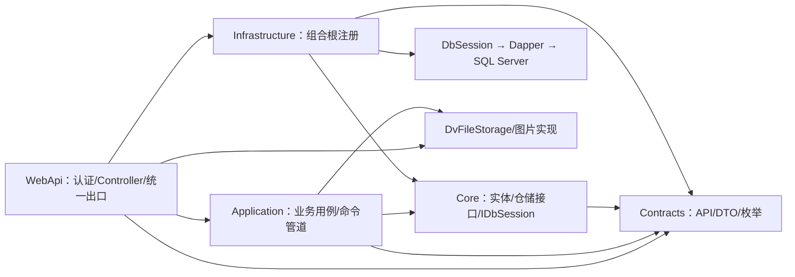

# 后端整体架构与数据库解耦审查

> 核对日期：2026-10-03。当前阶段仍使用 SQL Server + Dapper，未切换数据库、未重命名物理对象、未改 API/DTO，未部署。
> 完成了代码扫描、映射与依赖解耦及离线验证；**实际数据库约束逐项对照和数据库并发验收未完成**。不能将本报告或生成脚本视为生产数据库一致性证明。

## 1. 范围、基线与证据边界

覆盖 WebApi、Application、Core、Infrastructure、Contracts 后端依赖、DvFileStorage、图片处理、数据库生成器/脚本、部署工具及后端测试。WPF/VSTO 实现不修改。初始分支 main、工作区干净；本次不提交、推送、合并或部署。

规则入口为 [AGENTS](../AGENTS.md)、[工程架构总纲](../.agents/references/工程架构总纲.md)及相关后端 Skill。源码确认当前实现，业务总纲/能力地图仍决定已确认目标；不因现状而废除未实现的业务约定。

### 数据库只读结果

| 连接 | 工具可见范围 | 已核实事实 | 用途和限制 |
|---|---|---|---|
| SQL Server，192.168.3.12:1433，连接显示名 master | 仅 dv_next | 15.0.2000.5，Enterprise；Chinese_PRC_CI_AS；dbo 下 52 张表 | 当前 SQL Server 核对对象；不能因连接名 master 误认为可访问系统库；生产/开发用途未单独确认 |
| PostgreSQL，192.168.3.12:5432 | 仅 dv_next | PostgreSQL 18.6，x86_64-windows；未发现用户表 | 用户确认是未来接替目标；本次零写入 |

用户已说明完成备份。读取 msdb 备份目录被 MCP 的 DATABASE_OUT_OF_SCOPE 拒绝，未绕过；备份时间、链完整性和可恢复性未独立验证。随后 MCP 元数据查询及连接列表持续返回 HTTP 502，未能完成列明细、索引、CHECK、默认值、触发器、序列及例程核对。没有指定已确认的隔离 SQL Server 测试库，数据库写入测试未运行。

代码生成基线为 **50 张表、58 个唯一索引、110 个 CHECK、1 个序列、10 个触发器**（生成 SQL 静态计数）。实际表清单比基线多 `ExcelFieldMapping` 和 `ProcurementCommandReceipt`，证明实际库与新库基线不能直接等同；不据此删表，历史数据/消费者仍须核验。其余表名均在基线中，不代表列和约束一致。

## 2. 依赖与运行链路

- 修改前 Application 项目引用 Infrastructure，11 处会话声明/参数直接使用 DbSession，7 个文件直接使用 SqlException。修改后项目引用移除，改依赖 Core IDbSession/异常分类契约；日志包显式声明，不再借 Infrastructure 传递。
- WebApi 引用 Infrastructure 用于组合根是合法边界。Controller 扫描未发现 SqlClient/Dapper/DbSession 访问。Core、Infrastructure 没有反向引用 Application，项目引用未发现环；这不等于已证明所有运行时业务依赖无环。
- ServiceBaseContext → IDbSession 和 RepositoryBaseContext → DbSession 指向同一 scoped 对象，Connection/Transaction 相同；工厂只负责创建未打开连接，Session 负责打开/释放。连接建立仍发生在会话构造时，不改变延迟或隔离级别。
- Application 仍用 ADO.NET IDbConnection/IDbTransaction 编排原有事务。这是有限解耦，不宣称纯领域层、异步事务全面改造或已有 PostgreSQL 提供者。
- 现有五层项目、按业务用例组织的服务/仓储、独立文件存储继续保留。不新增万能 CommonServices、DocumentService、UnitOfWork、消息总线或数据库方言大框架。

## 3. 已确认缺陷与兼容风险

| 编号 | 证据与影响链 | 本次处理/边界 | 验证方法与缺口 |
|---|---|---|---|
| D01 | [PurchaseOrderLine](../SwiftExport.Core/Entities/Procurement/PurchaseOrderLine.cs) Quantity→QTY；原 EntityMetadataCache/DapperRepository 按属性名写列并 SELECT *，与建表器不一致 | 已修：共享表/schema、属性/列/参数映射，查询显式别名；QTY 物理名称不变，DTO 不变 | 两个回归先失败后通过；真实 Dapper + 无网络 ADO.NET 替身验证增读改删；生成基线逐字不变；实际库列级核验待恢复 |
| D02 | [DbSession](../SwiftExport.Infrastructure/Data/DbSession.cs) 原直接 new SqlConnection，既有工厂没有接线；打开失败未释放，事务 Dispose 抛错时跳过连接释放 | 已接入原工厂；打开失败保留原异常并清理，Dispose 幂等/finally 释放连接；接口与实现共享实例 | DI 同一实例、打开失败、事务释放失败及重复 Dispose 测试通过 |
| D03 | [ExcelReadProfileService](../SwiftExport.Application/Services/Systems/ExcelReadProfiles/ExcelReadProfileService.cs) 唯一冲突返回 EXCEL_READ_DUPLICATE_NAME；[HTTP 映射](../SwiftExport.WebApi/ErrorHandling/ServiceErrorHttpMapper.cs) 未登记，最终 500 | 保留现有行为并登记缺陷；改为 400/409 属公共错误契约变化，须先确认 | 后续增加唯一冲突→ServiceResult→HTTP 全链测试，不仅验证异常分类 |
| D04 | [WarehouseManagementRepository](../SwiftExport.Infrastructure/Repositories/Inventory/Warehouses/WarehouseManagementRepository.cs) 唯一冲突转换为零行，与版本不匹配共享返回路径 | 未改业务契约；迁移时要保持差异信息，不能用“并发”统称稳定编码/活动仓唯一冲突 | 隔离库分别制造唯一冲突与旧版本，再核对服务错误；未运行 |
| D05 | [DocumentSequenceRepository](../SwiftExport.Infrastructure/Repositories/Systems/Numbering/DocumentSequenceRepository.cs) UPDATE→条件 INSERT 依赖外层事务，独立取号服务未开启事务；首次并发取号可能触发唯一约束失败，未专门重试 | 保留既有取号契约/SQL；不在仓储偷偷新增业务事务、不以替身声称竞争已通过 | 核实实际 UX_DocumentSequence_Type_Period；并发首号/跨月/回滚/重试验收待隔离库；已有唯一索引为代码预期，不等于实际部署 |
| D06 | [PurchaseDraftAppendSqlTests](../SwiftExport.Application.Tests/Procurement/PurchaseDraftAppendSqlTests.cs) 不经显式开关创建/删除 LocalDB；其他夹具也含 CREATE/DROP DATABASE | 本次未运行此类测试；不要直接 dotnet test 全量后端而不知道数据库目标 | 写库测试需确认实例/库与初始化清理授权；本次过滤掉数据库测试，源码 SQL 契约测试单独纳入 |
| D07 | 泛型 Update 在执行前增加传入实体 Version，失败后未恢复；软删除不递增 Version；部分旧服务直接 Rollback/Dispose 可掩盖原异常 | 属既有行为，未借解耦改写；不能把所有版本异常当提供者错误 | 明确契约后补失败对象状态与清理异常测试；本次只证明原行为保留 |

## 4. PostgreSQL 替换障碍与建议边界

统计范围为五层后端和 DvFileStorage 的 C# 文件，不含生成 SQL、测试及工具；文件命中数不是缺陷数。

| 能力 | 代码证据/命中 | 影响与后续实施边界 |
|---|---|---|
| 锁与隔离 | NOLOCK 21 文件，UPDLOCK/HOLDLOCK/ROWLOCK 40，sp_getapplock 3 | PostgreSQL 不能直译 SQL Server 脏读、范围锁和应用锁；在具体仓储保持命令锁、容量、库存键的语义，实测锁顺序与死锁恢复 |
| 方言 | OUTPUT 8，TOP 19，ISNULL 37，STRING_AGG 3，OPENJSON/FOR JSON 1，NEXT VALUE 1 | 逐仓储适配返回行、分页稳定性、聚合/JSON、序列；不全局字符串替换 SQL |
| 模式与类型 | dbo、方括号、uniqueidentifier/bit/nvarchar/datetime2/decimal、Column.TypeName 和 DbColumn.StoreType/DefaultExpression | 当前物理名称保留；PostgreSQL 类型/大小写/quoted identifiers 与后续 snake_case 方案待决，公共 DTO 不随库命名变化 |
| 约束与触发器 | EntitySchemaMetadata、SqlServerSchemaGenerator；只追加、身份不可变、单位引用冻结等规则 | SQL Server 生成器仍是具体实现；未来 PostgreSQL 实现需验证等价防线，不用删除触发器换取可迁移 |
| 默认值与时间 | 时间相关 47 文件，DateTime.Now、UtcNow、SYSUTCDATETIME 并存 | 审计、业务日期、命令 RecordedAtUtc 分别确认语义；Linux 时区变化不能悄悄改变日期或取号年月，禁止本阶段批量 UTC 化 |
| 文本比较 | 实库 Chinese_PRC_CI_AS；COLLATE 2 文件，另有 CLR 大小写比较 | 测试用户名/编码的大小写、尾空格、中文、唯一性和 LIKE 排序；不要假设 PostgreSQL 默认比较等价 |
| 存储过程与批量 | 未命中 CommandType.StoredProcedure、SqlBulkCopy/TVP；存在 sys.sp_getapplock、sp_addextendedproperty 和 Dapper 批次执行 | 无需替换 Dapper；无“没有存储过程”的数据库结论，实际例程仍待核验；工具脚本也需独立适配 |
| 运维工具 | DbSeed、PermissionCatalogSync、AdminPasswordRecovery 直接使用 SqlClient；跨库复制脚本依赖 SQL Server 元数据 | 工具的直连不属于 Controller 越层，但属于迁移范围；明确目标库后才运行，不把业务应用接口用于危险初始化 |

专用查询（采购详情/追溯/反向）已有 QTY AS Quantity，保持原业务投影；不以通用实体映射取代 DTO 的多表聚合别名。当前采购数量以外未扫描到显式 Column 名称例外；TypeName 注解只表达类型。映射覆盖继承属性和 NotMapped，拒绝重复属性/列；未来复杂继承或 schema 改名必须另补测试。

## 5. 异常识别、业务转换与 API 出口

分类器只识别原因，既不包装掉原 SqlException，也不自动重试；保持已有 catch 顺序和原错误码。不能依据错误消息文本做分支。

| 类/用例边界 | 当前识别与转换 | 最终出口 |
|---|---|---|
| BaseService 与部分旧主数据批量保存 | 校验/RepositoryWriteResult；未知异常记录日志→UNEXPECTED | 500；版本写入结果可能在 SaveItemResult 内，须按具体接口消费 |
| BusinessCommandExecutor | CommandId/指纹冲突、成功重放；锁负值 COMMAND_BUSY；提交异常 OUTCOME_UNKNOWN；失败回滚，finally 清空事务 | 各用例保留 code，通常冲突 409、结果未知 503；重放提交分支与首次提交异常边界不完全相同，后续补测 |
| 销售/售后命令 | CommandValidationException、BusinessCommandException、各领域 Exception；取消透传；其他 UNEXPECTED | VALIDATION 400、权限 401/403、状态/版本 409、业务阻断 422、未知 500 |
| ProcurementOrderCommandSupport/ReadSupport | 领域异常保留 code；InvalidOperationException→BUSINESS_BLOCKED；命令未知 OUTCOME_UNKNOWN，读取未知 UNEXPECTED | 422/503/500；保留差异，不统一全部重试 |
| RbacManagementService | 唯一冲突→VALIDATION(Code)；旧版本→VERSION_CONFLICT；取消回滚透传，未知→UNEXPECTED | 400/409/499/500，不能改成一律 409 |
| ExcelReadProfileService | 请求已取消优先；唯一冲突→EXCEL_READ_DUPLICATE_NAME；其他→UNEXPECTED | 唯一冲突当前也落到 500（D03），本次不改协议 |
| InboundServiceSupport | DBConcurrencyException→VERSION_CONFLICT；207/208 结构问题及51001历史门禁分别保留不同消息，均 BUSINESS_BLOCKED；未知 OUTCOME_UNKNOWN | 409/422/503；两种422不能混淆业务含义 |
| OutboundServiceSupport | 版本冲突；207/208结构阻断；未知 OUTCOME_UNKNOWN | 409/422/503 |
| GrossDemandQueryService/MaterialDemandQueryService | 51001单独提示正式收货量未知；其他查询失败 | 单参数 Fail 默认 BUSINESS_BLOCKED→422，因此技术查询失败也可能表现为422；本次保留并登记为错误语义缺口 |
| PurchaseOrderTraceService | 51001→带 InnerException 的 InvalidOperationException→读取支持 BUSINES_BLOCKED | 422，保留历史数量未知，不返回零 |
| WarehouseManagementRepository/AuthRepository | 2601/2627 分别→零行/UserNameInUse | 仓库需区分版本/唯一语义（D04）；账号经业务层处理，不直接暴露 SQL 错误 |
| DocumentSequenceRepository | 逐 SqlError 输出控制台后原样抛出，未重试 | 无专用转换时全局 UNEXPECTED 500；日志统一属于后续可选整理 |
| 全局异常中间件 | RequestAborted + OCE→499；验证400；请求体超限413；其他UNEXPECTED | 500，隐藏技术细节；响应已开始则继续抛出 |

内部分类区分 UniqueConflict、Timeout、Deadlock、ConnectionFailure、SchemaMismatch、UnverifiedReceiptHistory、Canceled、Unknown。乐观并发仍由受影响行数/DBConcurrencyException 和业务 ExpectedVersion 判断，不能由 SQL 错误号代替。未识别的触发器错误保持 Unknown，不猜成唯一冲突。

重试策略未改：客户端正式命令仍使用原 CommandId；不新增死锁自动重试，不重试取消/业务校验，不把提交结果未知当作确定回滚。全链 CancellationToken 尚非全覆盖（泛型 CRUD 和部分旧接口没有 token），后续接口演进单独评估。后附逐文件捕获清单用于可追踪复核，不把正则扫描等同于每个异常路径已运行。

## 6. 关键业务事务链

| 链路 | 当前边界/防线 | 本次结论 |
|---|---|---|
| 销售确认→来源需求 | 命令执行器外层事务，来源接收复用同一会话；权限先于重放，Version/来源身份另校验 | 不改业务状态和协议；已有编排/失败/重放测试继续通过 |
| 采购草稿/确认/反向 | 业务用例→执行器/仓储；链接释放、确认资格、收货追溯分别处理；采购反向仓储显式 QTY 别名 | 不能借替换改变“取消确认不释放 Link”等规则；实际唯一约束、交错锁待实库验证 |
| 入出库→库存 | 外层命令事务→PostingPort→InventoryPostingService；按仓库/产品排序锁定余额，写不可变流水并更新 Version | Inventory 内核失败会回滚外层但不释放/清空，这是既有行为；不引入子事务；替身验证不是实际锁验证 |
| PackingList | 正式过账/反向通过执行器及自动单据端口共享事务；业务、执行事实、库存、日志与回执原子组合 | 保留既有库存与客供件业务限制；目标地图中未完成能力不借本次解耦自动补齐 |
| 权限管理 | Serializable，锁定管理员集合重验操作者及最后管理员，版本更新与授权关系同事务 | DI共享与现有授权编排测试通过；实际数据库撤权/并发仍待隔离库 |
| 取号与幂等 | 单号表唯一期望、库存流水序列；CommandReceipt全局CommandId唯一、sp_getapplock 事务锁 | 不把序列当连续无空洞业务号；序列与事务号回滚语义迁移时分别验证；D05待解决 |

## 7. Linux 部署单列

- WebApi 当前依赖 SkiaSharp.NativeAssets.Win32，Linux 需要适配原生资产、依赖库、字体及图片输出回归；本次不改图片运行环境。
- `_tools/Deployment` 当前针对 Windows Server/IIS、证书存储和 PowerShell 安装。Linux 的反向代理、服务账户、证书、环境变量与健康检查另建部署方案，不能只改数据库连接。
- DvFileStorage 已按 OS 使用路径比较，保留 Windows 保留名称等跨平台可迁移约束；仍需 Linux 文件系统真实验证大小写、符号链接、路径穿越、并发替换与权限。
- Program 的相对 Logs 路径和配置工作目录依赖、文件容器根路径、时区、日志轮转/写权限需按宿主验证。当前代码未发现 BackgroundService/IHostedService/Hangfire/Quartz/Timer 接线；运维外部调度未审计，不声明服务器上没有计划任务。
- 配置文件存在 ConnectionStrings 节，本报告不输出值；后续迁移配置应走部署密钥注入，不复制敏感配置到报告/测试。当前文件/图片库的调用和 API 不修改。

## 8. 已实施批次、验证与尚未完成事项

1. 映射统一：EntityMetadata/Cache、SqlServerSchemaGenerator、DapperRepository；保留生成SQL、现有物理名称与业务写入语义。12项定向测试通过。
2. 会话/提供者边界：Core IDbSession/异常分类契约、Infrastructure工厂/会话/DI/SqlServer分类器、Application依赖与catch筛选。去掉Application→Infrastructure引用，显式日志依赖。49项会话/命令/权限/自动过账定向测试通过。
3. 文档原位清理与历史归档；没有实施 PostgreSQL SQL、迁移脚本、snake_case、业务错误协议改变或 Linux 运行环境。

| 验证 | 结果 |
|---|---|
| 修改前后端 build --no-restore | 通过；初始8警告（NU1900及原有MSTest分析器） |
| 修改前不连库后端测试 | 709通过、4失败、2跳过；715项 |
| 映射批次相同离线筛选 | 715通过、同4失败、2跳过；721项 |
| 解耦后离线测试 + SqlContract源码契约 | 759通过、同4失败、2跳过；765项 |
| DvFileStorage 基线 | 8通过 |
| Schema生成基线逐字比较 | 通过，Generated文件未改 |
| 数据库原子性/唯一冲突/取号竞争/死锁/真实回滚 | 未运行：隔离目标未确认，MCP后续502；不能以编译/替身代替 |
| PostgreSQL/Linux | 未实施、未运行 |

四个原有失败：ManagerContractsUseOnePublicTypePerFile、SourceBoundary_MustNotExposeMaterialCommandsOrReadMaterialRepository、DictCodes_ExposeSupportedGenericSystemDictionaries、NetDemandSpecialty_MustNotReferenceLegacyDemandChain。未删除断言或放宽业务规则。扩展的SqlContract检查是源码检查，不连接数据库。NuGet源不可达后使用现有缓存恢复，并在该次restore关闭在线审计；这不代表漏洞审查通过。

后续依赖顺序：恢复只读元数据与备份可见性→确认隔离SQL Server目标并验证当前解耦→针对D03/D04/D05提交业务/错误协议决策→逐仓储实现PostgreSQL及同场景双库契约测试→确认命名/比较/时间方案→迁移演练、数据对账、可恢复切换方案→单独Linux部署验证。正式切库仍需明确授权。

## 9. 文档整理决策

| 文档组 | 用途与适用范围 | 本次处置 |
|---|---|---|
| AGENTS、Router、Agent、Workflow | 授权/路由/执行门禁 | 保留路由；根规则区分事实与目标，增加本阶段边界，未删除门禁 |
| 工程/业务/数据模型/测试总纲及模块能力地图 | 已确认目标、当前偏差与验收标准 | 工程总纲同步依赖和VSTO事实；其他业务目标保留，不借技术解耦改变 |
| 后端Skill及连接/上下文/仓储/DI参考 | 实施技术规范 | 原位同步接口/工厂/映射，旧“直接依赖DbSession实现”和“泛型SELECT *例外”退出 |
| 本文 | 后端职责、审查事实、批次结果及迁移缺口 | 原位整理既有架构建议，避免新增第二份冲突架构规范 |
| 数据库README | 生成基线与安全验证入口 | 区分代码预期/实际部署，明确隔离目标；保留禁止手改生成SQL、禁止外键等有效约束 |
| 公共能力地图、复杂单据链路 | 通用职责和示例 | 保留有用内容，修正“没有业务库”的过期环境断言 |
| Commands设计与实施计划 | 当前执行协议/历史批次 | 修正不存在的独立建表入口与部署断言，保留指纹/回执/事务约束 |
| 采购反向验收、采购DTO清理记录 | 2026-09-15/09-30历史验证证据 | 移至docs/历史记录并标注历史状态；内容不作为当前规范 |
| 权限旧库迁移执行说明、售后迁移段落 | 旧批次迁移设计，关联脚本已不存在 | 权限说明归档；售后原位标注历史路径与未验证能力；旧清库授权不能沿用 |
| 各模块待办、前端/VSTO/演示说明 | 特定模块计划或非本次实现范围 | 只登记用途，不批量宣布完成/废除；规划与代码不同不自动判为过时 |

无确认可直接销毁且无追溯价值的文档，未做内容永久删除。三个原路径因归档移除，入站链接已同步修复；本文提供新入口：[采购反向记录](历史记录/采购反向操作验收记录.md)、[采购DTO记录](历史记录/采购DTO旧链路清理记录.md)、[权限旧库迁移记录](历史记录/权限收敛旧库迁移执行记录.md)。未为满足“清理数量”删除有效设计或历史证据。

有争议的规则继续保留：工程/测试总纲的旧采购确认快照措辞与2026-09-16修订存在冲突；业务修订明确不再要求首次采购确认快照，但PackingList目标仍有历史快照描述。这属于领域目标澄清，未擅自将全部目标改成当前实现。

## 10. Application 逐文件异常覆盖清单

以下按当前源码逐文件列出类型、catch 和可见转换标记（partial 按文件列示）。无本地 catch 的类由调用服务/命令支持器/全局出口处理；空项不表示不会失败。局部函数、动态返回码及共享支持器的完整含义须结合第5节；这是静态追踪索引，不是已运行的全路径异常测试。

| 文件/类型 | 捕获类型 | 本文件转换线索 |
|---|---|---|
| [BcryptPasswordHasher.cs](../SwiftExport.Application/Services/Auth/Passwords/BcryptPasswordHasher.cs) | ArgumentException、BCrypt.Net.SaltParseException | 调用方处理/委托共享边界 |
| [PasswordPolicy.cs](../SwiftExport.Application/Services/Auth/Passwords/PasswordPolicy.cs) | 无本地捕获 | 调用方处理/委托共享边界 |
| [PermissionEvaluationService.cs](../SwiftExport.Application/Services/Auth/Permissions/Evaluation/PermissionEvaluationService.cs) | 无本地捕获 | 调用方处理/委托共享边界 |
| [RbacManagementService.cs](../SwiftExport.Application/Services/Auth/Permissions/RbacManagementService.cs) | Exception、OperationCanceledException、原样捕获/清理 | DatabaseFailureKind.UniqueConflict、ServiceErrorCodes.BusinessBlocked、ServiceErrorCodes.Forbidden、ServiceErrorCodes.Unauthenticated、ServiceErrorCodes.Unexpected、ServiceErrorCodes.Validation、ServiceErrorCodes.VersionConflict |
| [AuthSessionService.cs](../SwiftExport.Application/Services/Auth/Session/AuthSessionService.cs) | 无本地捕获 | ServiceErrorCodes.Unauthenticated、ServiceErrorCodes.Validation |
| [UserAccountService.cs](../SwiftExport.Application/Services/Auth/Users/UserAccountService.cs) | 无本地捕获 | ServiceErrorCodes.BusinessBlocked、ServiceErrorCodes.Forbidden、ServiceErrorCodes.Unauthenticated、ServiceErrorCodes.Validation、ServiceErrorCodes.VersionConflict |
| [BaseService.cs](../SwiftExport.Application/Services/Base/BaseService.cs) | Exception | ServiceErrorCodes.NotFound、ServiceErrorCodes.Unexpected |
| [CustomerProductMaintenanceService.cs](../SwiftExport.Application/Services/Customers/CustomerProducts/Maintenance/CustomerProductMaintenanceService.cs) | Exception | Fail/领域拒绝；查看调用边界 |
| [CustomerProductQueryService.cs](../SwiftExport.Application/Services/Customers/CustomerProducts/Query/CustomerProductQueryService.cs) | Exception | ServiceErrorCodes.Unexpected |
| [CustomerService.cs](../SwiftExport.Application/Services/Customers/Management/CustomerService.cs) | Exception | ServiceErrorCodes.Unexpected |
| [CustomerPoConfigService.cs](../SwiftExport.Application/Services/Customers/PoConfigs/CustomerPoConfigService.cs) | Exception、OperationCanceledException | ServiceErrorCodes.Unexpected |
| [EstablishMaterialDemandsCommandValidator.cs](../SwiftExport.Application/Services/DemandPlanning/Materials/Establishment/EstablishMaterialDemandsCommandValidator.cs) | 无本地捕获 | 调用方处理/委托共享边界 |
| [GrossDemandDecompositionPlanner.cs](../SwiftExport.Application/Services/DemandPlanning/Materials/Establishment/GrossDemandDecompositionPlanner.cs) | 无本地捕获 | Fail/领域拒绝；查看调用边界 |
| [MaterialDemandEstablishmentService.cs](../SwiftExport.Application/Services/DemandPlanning/Materials/Establishment/MaterialDemandEstablishmentService.cs) | BusinessCommandException、CommandValidationException、Exception、MaterialDemandException、OperationCanceledException | ServiceErrorCodes.Forbidden、ServiceErrorCodes.Unauthenticated、ServiceErrorCodes.Unexpected、ServiceErrorCodes.Validation |
| [MaterialDemandSuggestedSupplierInitializer.cs](../SwiftExport.Application/Services/DemandPlanning/Materials/Establishment/MaterialDemandSuggestedSupplierInitializer.cs) | 无本地捕获 | 调用方处理/委托共享边界 |
| [GrossDemandDecompositionPlan.cs](../SwiftExport.Application/Services/DemandPlanning/Materials/Establishment/Models/GrossDemandDecompositionPlan.cs) | 无本地捕获 | 调用方处理/委托共享边界 |
| [MaterialDemandException.cs](../SwiftExport.Application/Services/DemandPlanning/Materials/MaterialDemandException.cs) | 无本地捕获 | 调用方处理/委托共享边界 |
| [MaterialDemandQueryService.cs](../SwiftExport.Application/Services/DemandPlanning/Materials/Query/MaterialDemandQueryService.cs) | Exception、OperationCanceledException | DatabaseFailureKind.UnverifiedReceiptHistory |
| [MaterialDemandReversalService.cs](../SwiftExport.Application/Services/DemandPlanning/Materials/Reversal/MaterialDemandReversalService.cs) | BusinessCommandException、CommandValidationException、Exception、MaterialDemandException、OperationCanceledException | ServiceErrorCodes.Forbidden、ServiceErrorCodes.Unauthenticated、ServiceErrorCodes.Unexpected、ServiceErrorCodes.Validation |
| [RollbackMaterialDemandsCommandValidator.cs](../SwiftExport.Application/Services/DemandPlanning/Materials/Reversal/RollbackMaterialDemandsCommandValidator.cs) | 无本地捕获 | 调用方处理/委托共享边界 |
| [MaterialDemandSourceExitService.cs](../SwiftExport.Application/Services/DemandPlanning/Materials/SourceExit/MaterialDemandSourceExitService.cs) | 无本地捕获 | 调用方处理/委托共享边界 |
| [MaterialDemandSourceQueryService.cs](../SwiftExport.Application/Services/DemandPlanning/Materials/Sources/MaterialDemandSourceQueryService.cs) | Exception、OperationCanceledException | Fail/领域拒绝；查看调用边界 |
| [MaterialDemandSupplierSuggestionService.cs](../SwiftExport.Application/Services/DemandPlanning/Materials/SupplierSuggestion/MaterialDemandSupplierSuggestionService.cs) | BusinessCommandException、CommandValidationException、Exception、OperationCanceledException、SuggestedSupplierException | ServiceErrorCodes.Forbidden、ServiceErrorCodes.Unauthenticated、ServiceErrorCodes.Unexpected、ServiceErrorCodes.Validation |
| [UpdateSuggestedPurchaseSupplierCommandValidator.cs](../SwiftExport.Application/Services/DemandPlanning/Materials/SupplierSuggestion/UpdateSuggestedPurchaseSupplierCommandValidator.cs) | 无本地捕获 | 调用方处理/委托共享边界 |
| [CustomerSuppliedMaterialPolicy.cs](../SwiftExport.Application/Services/DemandPlanning/Policies/CustomerSuppliedMaterialPolicy.cs) | 无本地捕获 | 调用方处理/委托共享边界 |
| [SourceDemandDeliveryService.cs](../SwiftExport.Application/Services/DemandPlanning/Sources/Delivery/SourceDemandDeliveryService.cs) | 无本地捕获 | Fail/领域拒绝；查看调用边界 |
| [ManualGrossDemandCommandValidators.cs](../SwiftExport.Application/Services/DemandPlanning/Sources/Manual/ManualGrossDemandCommandValidators.cs) | 无本地捕获 | 调用方处理/委托共享边界 |
| [ManualGrossDemandService.cs](../SwiftExport.Application/Services/DemandPlanning/Sources/Manual/ManualGrossDemandService.cs) | BusinessCommandException、CommandValidationException、Exception、GrossDemandValidationException、OperationCanceledException | ServiceErrorCodes.BusinessBlocked、ServiceErrorCodes.Forbidden、ServiceErrorCodes.Unauthenticated、ServiceErrorCodes.Unexpected、ServiceErrorCodes.Validation、ServiceErrorCodes.VersionConflict |
| [SourceDemandBasisFingerprintFactory.cs](../SwiftExport.Application/Services/DemandPlanning/Sources/Policies/SourceDemandBasisFingerprintFactory.cs) | 无本地捕获 | 调用方处理/委托共享边界 |
| [SourceDemandCancellationPolicy.cs](../SwiftExport.Application/Services/DemandPlanning/Sources/Policies/SourceDemandCancellationPolicy.cs) | 无本地捕获 | 调用方处理/委托共享边界 |
| [GrossDemandQueryService.cs](../SwiftExport.Application/Services/DemandPlanning/Sources/Query/GrossDemandQueryService.cs) | Exception、OperationCanceledException | DatabaseFailureKind.UnverifiedReceiptHistory |
| [SourceDemandReceptionService.cs](../SwiftExport.Application/Services/DemandPlanning/Sources/Reception/SourceDemandReceptionService.cs) | InvalidOperationException、SourceDeliveryException、SourceDemandReceptionException | 调用方处理/委托共享边界 |
| [FileAccessPolicy.cs](../SwiftExport.Application/Services/Files/FileAccessPolicy.cs) | 无本地捕获 | ServiceErrorCodes.Forbidden、ServiceErrorCodes.Unauthenticated |
| [FileTransferService.cs](../SwiftExport.Application/Services/Files/FileTransferService.cs) | ArgumentException、FileAlreadyExistsException、FileNotFoundException、FileUploadLimitExceededException | FileErrorCodes.Conflict、FileErrorCodes.UploadTooLarge、ServiceErrorCodes.NotFound、ServiceErrorCodes.Unexpected、ServiceErrorCodes.Validation |
| [FileUploadLimitExceededException.cs](../SwiftExport.Application/Services/Files/FileUploadLimitExceededException.cs) | 无本地捕获 | 调用方处理/委托共享边界 |
| [ProductImageTargetLockManager.cs](../SwiftExport.Application/Services/Files/ProductImages/ProductImageTargetLockManager.cs) | 原样捕获/清理 | 调用方处理/委托共享边界 |
| [ProductImageUploadService.cs](../SwiftExport.Application/Services/Files/ProductImages/ProductImageUploadService.cs) | Exception、OperationCanceledException、ProductImageProcessingException | ProductImageErrorCodes.DuplicateTargetInBatch、ProductImageErrorCodes.InvalidFileName、ProductImageErrorCodes.ProcessingFailed、ProductImageErrorCodes.PublishFailed、ProductImageErrorCodes.UnsupportedType、ServiceErrorCodes.ServiceUnavailable、ServiceErrorCodes.Unexpected |
| [UploadLimitStream.cs](../SwiftExport.Application/Services/Files/UploadLimitStream.cs) | 无本地捕获 | 调用方处理/委托共享边界 |
| [ForExcelPackingListService.cs](../SwiftExport.Application/Services/ForExcel/ForExcelPackingListService.cs) | 无本地捕获 | ServiceErrorCodes.Forbidden、ServiceErrorCodes.Unauthenticated、ServiceErrorCodes.Validation |
| [ForExcelPurchaseOrderService.cs](../SwiftExport.Application/Services/ForExcel/ForExcelPurchaseOrderService.cs) | ProcurementOperationException | ServiceErrorCodes.Forbidden、ServiceErrorCodes.Unauthenticated、ServiceErrorCodes.Validation |
| [ForExcelSalesOrderService.cs](../SwiftExport.Application/Services/ForExcel/ForExcelSalesOrderService.cs) | OverflowException | ServiceErrorCodes.Forbidden、ServiceErrorCodes.Unauthenticated、ServiceErrorCodes.Validation |
| [AutomaticPostingPorts.cs](../SwiftExport.Application/Services/Inventory/AutomaticDocuments/AutomaticPostingPorts.cs) | Exception | Fail/领域拒绝；查看调用边界 |
| [AutomaticPostingPorts.Reversal.cs](../SwiftExport.Application/Services/Inventory/AutomaticDocuments/AutomaticPostingPorts.Reversal.cs) | Exception | 调用方处理/委托共享边界 |
| [AutomaticPostingScope.cs](../SwiftExport.Application/Services/Inventory/AutomaticDocuments/AutomaticPostingScope.cs) | 原样捕获/清理 | 调用方处理/委托共享边界 |
| [InboundDraftException.cs](../SwiftExport.Application/Services/Inventory/InboundDraftException.cs) | 无本地捕获 | ServiceErrorCodes.BusinessBlocked |
| [InboundPurchasePostingValidator.cs](../SwiftExport.Application/Services/Inventory/InboundPurchasePostingValidator.cs) | 无本地捕获 | ServiceErrorCodes.BusinessBlocked |
| [InboundDraftService.cs](../SwiftExport.Application/Services/Inventory/Inbounds/InboundDraftService.cs) | 无本地捕获 | ServiceErrorCodes.Validation、ServiceErrorCodes.VersionConflict |
| [InboundPostingService.cs](../SwiftExport.Application/Services/Inventory/Inbounds/InboundPostingService.cs) | InventoryPostingException | ServiceErrorCodes.BusinessBlocked、ServiceErrorCodes.Forbidden、ServiceErrorCodes.Validation、ServiceErrorCodes.VersionConflict |
| [InboundQueryService.cs](../SwiftExport.Application/Services/Inventory/Inbounds/InboundQueryService.cs) | 无本地捕获 | ServiceErrorCodes.Validation |
| [InboundReversalService.cs](../SwiftExport.Application/Services/Inventory/Inbounds/InboundReversalService.cs) | InventoryPostingException | ServiceErrorCodes.BusinessBlocked、ServiceErrorCodes.Forbidden、ServiceErrorCodes.Validation、ServiceErrorCodes.VersionConflict |
| [InboundServiceSupport.cs](../SwiftExport.Application/Services/Inventory/Inbounds/InboundServiceSupport.cs) | BusinessCommandException、DBConcurrencyException、DraftException、Exception、OperationCanceledException | DatabaseFailureKind.SchemaMismatch、DatabaseFailureKind.UnverifiedReceiptHistory、ServiceErrorCodes.BusinessBlocked、ServiceErrorCodes.Forbidden、ServiceErrorCodes.OutcomeUnknown、ServiceErrorCodes.Unauthenticated、ServiceErrorCodes.VersionConflict |
| [InboundSourceQueryService.cs](../SwiftExport.Application/Services/Inventory/Inbounds/InboundSourceQueryService.cs) | 无本地捕获 | 调用方处理/委托共享边界 |
| [InboundDraftCommandValidators.cs](../SwiftExport.Application/Services/Inventory/Inbounds/Validation/InboundDraftCommandValidators.cs) | 无本地捕获 | 调用方处理/委托共享边界 |
| [PostInboundCommandValidator.cs](../SwiftExport.Application/Services/Inventory/Inbounds/Validation/PostInboundCommandValidator.cs) | 无本地捕获 | 调用方处理/委托共享边界 |
| [ReverseInboundCommandValidator.cs](../SwiftExport.Application/Services/Inventory/Inbounds/Validation/ReverseInboundCommandValidator.cs) | 无本地捕获 | 调用方处理/委托共享边界 |
| [OutboundDraftService.cs](../SwiftExport.Application/Services/Inventory/Outbounds/OutboundDraftService.cs) | 无本地捕获 | ServiceErrorCodes.Validation、ServiceErrorCodes.VersionConflict |
| [OutboundPostingService.cs](../SwiftExport.Application/Services/Inventory/Outbounds/OutboundPostingService.cs) | InventoryPostingException | ServiceErrorCodes.BusinessBlocked、ServiceErrorCodes.Forbidden、ServiceErrorCodes.Validation、ServiceErrorCodes.VersionConflict |
| [OutboundQueryService.cs](../SwiftExport.Application/Services/Inventory/Outbounds/OutboundQueryService.cs) | 无本地捕获 | ServiceErrorCodes.Validation |
| [OutboundReversalService.cs](../SwiftExport.Application/Services/Inventory/Outbounds/OutboundReversalService.cs) | InventoryPostingException | ServiceErrorCodes.Forbidden、ServiceErrorCodes.Validation、ServiceErrorCodes.VersionConflict |
| [OutboundServiceSupport.cs](../SwiftExport.Application/Services/Inventory/Outbounds/OutboundServiceSupport.cs) | BusinessCommandException、DBConcurrencyException、Exception、OperationCanceledException、OutboundDraftException | DatabaseFailureKind.SchemaMismatch、OutboundErrorCodes.OutcomeUnknown、ServiceErrorCodes.BusinessBlocked、ServiceErrorCodes.Forbidden、ServiceErrorCodes.Unauthenticated、ServiceErrorCodes.VersionConflict |
| [OutboundDraftCommandValidators.cs](../SwiftExport.Application/Services/Inventory/Outbounds/Validation/OutboundDraftCommandValidators.cs) | 无本地捕获 | 调用方处理/委托共享边界 |
| [PostOutboundCommandValidator.cs](../SwiftExport.Application/Services/Inventory/Outbounds/Validation/PostOutboundCommandValidator.cs) | 无本地捕获 | 调用方处理/委托共享边界 |
| [ReverseOutboundCommandValidator.cs](../SwiftExport.Application/Services/Inventory/Outbounds/Validation/ReverseOutboundCommandValidator.cs) | 无本地捕获 | 调用方处理/委托共享边界 |
| [InventoryPostingException.cs](../SwiftExport.Application/Services/Inventory/Posting/InventoryPostingException.cs) | 无本地捕获 | ServiceErrorCodes.BusinessBlocked |
| [InventoryPostingService.cs](../SwiftExport.Application/Services/Inventory/Posting/InventoryPostingService.cs) | 原样捕获/清理 | ServiceErrorCodes.CommandConflict |
| [PostingFact.cs](../SwiftExport.Application/Services/Inventory/Posting/Models/PostingFact.cs) | 无本地捕获 | 调用方处理/委托共享边界 |
| [InventoryQueryService.cs](../SwiftExport.Application/Services/Inventory/Query/InventoryQueryService.cs) | Exception、InventoryPostingException、OperationCanceledException | ServiceErrorCodes.Forbidden、ServiceErrorCodes.Unexpected |
| [WarehouseManagementCommandValidators.cs](../SwiftExport.Application/Services/Inventory/Warehouses/Validation/WarehouseManagementCommandValidators.cs) | 无本地捕获 | 调用方处理/委托共享边界 |
| [WarehouseCandidateQueryService.cs](../SwiftExport.Application/Services/Inventory/Warehouses/WarehouseCandidateQueryService.cs) | 无本地捕获 | 调用方处理/委托共享边界 |
| [WarehouseManagementService.cs](../SwiftExport.Application/Services/Inventory/Warehouses/WarehouseManagementService.cs) | BusinessCommandException、CommandValidationException、Exception、InventoryPostingException、OperationCanceledException | ServiceErrorCodes.Forbidden、ServiceErrorCodes.Unexpected、ServiceErrorCodes.Validation |
| [WarehouseQueryService.cs](../SwiftExport.Application/Services/Inventory/Warehouses/WarehouseQueryService.cs) | Exception、InventoryPostingException、OperationCanceledException | ServiceErrorCodes.Forbidden、ServiceErrorCodes.Unexpected |
| [ExecutionEligibilityService.cs](../SwiftExport.Application/Services/MasterData/ExecutionEligibilityService.cs) | 原样捕获/清理 | ServiceErrorCodes.Forbidden、ServiceErrorCodes.NotFound、ServiceErrorCodes.StateBlocked、ServiceErrorCodes.Unauthenticated、ServiceErrorCodes.Validation、ServiceErrorCodes.VersionConflict |
| [ProcurementMasterDataQueryService.cs](../SwiftExport.Application/Services/MasterData/ProcurementMasterDataQueryService.cs) | 无本地捕获 | 调用方处理/委托共享边界 |
| [ProcurementDemandAssociationPolicy.cs](../SwiftExport.Application/Services/Procurement/PurchaseOrders/Association/ProcurementDemandAssociationPolicy.cs) | 无本地捕获 | ServiceErrorCodes.BusinessBlocked、ServiceErrorCodes.NotFound、ServiceErrorCodes.VersionConflict |
| [ProcurementDemandAssociationService.cs](../SwiftExport.Application/Services/Procurement/PurchaseOrders/Association/ProcurementDemandAssociationService.cs) | 无本地捕获 | ServiceErrorCodes.CommandConflict、ServiceErrorCodes.VersionConflict |
| [AssociateProcurementDemandsCommandValidator.cs](../SwiftExport.Application/Services/Procurement/PurchaseOrders/Association/Validation/AssociateProcurementDemandsCommandValidator.cs) | 无本地捕获 | 调用方处理/委托共享边界 |
| [ProcurementConfirmationBuilder.cs](../SwiftExport.Application/Services/Procurement/PurchaseOrders/Confirmation/ProcurementConfirmationBuilder.cs) | 无本地捕获 | 调用方处理/委托共享边界 |
| [ProcurementOrderConfirmationService.cs](../SwiftExport.Application/Services/Procurement/PurchaseOrders/Confirmation/ProcurementOrderConfirmationService.cs) | 无本地捕获 | ProcurementErrorCodes.BomBasisChanged |
| [PurchaseDraftCreationService.cs](../SwiftExport.Application/Services/Procurement/PurchaseOrders/Draft/FromDemand/PurchaseDraftCreationService.cs) | Exception、OperationCanceledException、PurchaseDraftException | Fail/领域拒绝；查看调用边界 |
| [PurchaseDraftException.cs](../SwiftExport.Application/Services/Procurement/PurchaseOrders/Draft/FromDemand/PurchaseDraftException.cs) | 无本地捕获 | 调用方处理/委托共享边界 |
| [PurchaseDraftPreviewBuilder.cs](../SwiftExport.Application/Services/Procurement/PurchaseOrders/Draft/FromDemand/PurchaseDraftPreviewBuilder.cs) | 无本地捕获 | 调用方处理/委托共享边界 |
| [PurchaseDraftPreviewService.cs](../SwiftExport.Application/Services/Procurement/PurchaseOrders/Draft/FromDemand/PurchaseDraftPreviewService.cs) | Exception、OperationCanceledException、PurchaseDraftException | Fail/领域拒绝；查看调用边界 |
| [PurchaseDraftWriteModelBuilder.cs](../SwiftExport.Application/Services/Procurement/PurchaseOrders/Draft/FromDemand/PurchaseDraftWriteModelBuilder.cs) | 无本地捕获 | 调用方处理/委托共享边界 |
| [IndependentPurchaseOrderInputPolicy.cs](../SwiftExport.Application/Services/Procurement/PurchaseOrders/Draft/IndependentPurchaseOrderInputPolicy.cs) | 无本地捕获 | 调用方处理/委托共享边界 |
| [ProcurementOrderDraftService.cs](../SwiftExport.Application/Services/Procurement/PurchaseOrders/Draft/ProcurementOrderDraftService.cs) | 无本地捕获 | 调用方处理/委托共享边界 |
| [ProcurementOrderPolicy.cs](../SwiftExport.Application/Services/Procurement/PurchaseOrders/Draft/ProcurementOrderPolicy.cs) | OverflowException | ServiceErrorCodes.VersionConflict |
| [ProcurementOrderCommandValidators.cs](../SwiftExport.Application/Services/Procurement/PurchaseOrders/Draft/Validation/ProcurementOrderCommandValidators.cs) | 无本地捕获 | 调用方处理/委托共享边界 |
| [ProcurementNamespaceImports.cs](../SwiftExport.Application/Services/Procurement/PurchaseOrders/ProcurementNamespaceImports.cs) | 无本地捕获 | 调用方处理/委托共享边界 |
| [PurchaseOrderProgressQueryService.cs](../SwiftExport.Application/Services/Procurement/PurchaseOrders/Progress/PurchaseOrderProgressQueryService.cs) | 无本地捕获 | 调用方处理/委托共享边界 |
| [PurchaseOrderProgressReportService.cs](../SwiftExport.Application/Services/Procurement/PurchaseOrders/Progress/PurchaseOrderProgressReportService.cs) | 无本地捕获 | ServiceErrorCodes.VersionConflict |
| [ReportPurchaseOrderProgressCommandValidator.cs](../SwiftExport.Application/Services/Procurement/PurchaseOrders/Progress/Validation/ReportPurchaseOrderProgressCommandValidator.cs) | 无本地捕获 | 调用方处理/委托共享边界 |
| [ProcurementOrderQueryService.cs](../SwiftExport.Application/Services/Procurement/PurchaseOrders/Query/ProcurementOrderQueryService.cs) | 无本地捕获 | 调用方处理/委托共享边界 |
| [PurchaseOrderManagerQueryService.cs](../SwiftExport.Application/Services/Procurement/PurchaseOrders/Query/PurchaseOrderManagerQueryService.cs) | 无本地捕获 | 调用方处理/委托共享边界 |
| [ProcurementOrderReversalService.cs](../SwiftExport.Application/Services/Procurement/PurchaseOrders/Reversal/ProcurementOrderReversalService.cs) | 无本地捕获 | 调用方处理/委托共享边界 |
| [ProcurementReversalPolicy.cs](../SwiftExport.Application/Services/Procurement/PurchaseOrders/Reversal/ProcurementReversalPolicy.cs) | 无本地捕获 | ServiceErrorCodes.VersionConflict |
| [ProcurementOrderReversalCommandValidators.cs](../SwiftExport.Application/Services/Procurement/PurchaseOrders/Reversal/Validation/ProcurementOrderReversalCommandValidators.cs) | 无本地捕获 | 调用方处理/委托共享边界 |
| [PurchaseDraftCandidateService.cs](../SwiftExport.Application/Services/Procurement/PurchaseOrders/Sources/PurchaseDraftCandidateService.cs) | Exception、OperationCanceledException | Fail/领域拒绝；查看调用边界 |
| [ProcurementOperationException.cs](../SwiftExport.Application/Services/Procurement/PurchaseOrders/Support/ProcurementOperationException.cs) | 无本地捕获 | ServiceErrorCodes.BusinessBlocked、ServiceErrorCodes.Validation |
| [ProcurementOrderCommandSupport.cs](../SwiftExport.Application/Services/Procurement/PurchaseOrders/Support/ProcurementOrderCommandSupport.cs) | BusinessCommandException、Exception、InvalidOperationException、OperationCanceledException、ProcurementOperationException | ServiceErrorCodes.BusinessBlocked、ServiceErrorCodes.Forbidden、ServiceErrorCodes.NotFound、ServiceErrorCodes.OutcomeUnknown、ServiceErrorCodes.Unauthenticated、ServiceErrorCodes.Validation、ServiceErrorCodes.VersionConflict |
| [ProcurementOrderReadSupport.cs](../SwiftExport.Application/Services/Procurement/PurchaseOrders/Support/ProcurementOrderReadSupport.cs) | Exception、InvalidOperationException、OperationCanceledException、ProcurementOperationException | ServiceErrorCodes.BusinessBlocked、ServiceErrorCodes.Forbidden、ServiceErrorCodes.Unauthenticated、ServiceErrorCodes.Unexpected |
| [PurchaseOrderTraceService.cs](../SwiftExport.Application/Services/Procurement/PurchaseOrders/Trace/PurchaseOrderTraceService.cs) | Exception | DatabaseFailureKind.UnverifiedReceiptHistory |
| [BomService.cs](../SwiftExport.Application/Services/Products/BomService.cs) | BomBatchWriteException、Exception | ServiceErrorCodes.Unexpected |
| [BomStructureValidator.cs](../SwiftExport.Application/Services/Products/BomStructureValidator.cs) | 无本地捕获 | 调用方处理/委托共享边界 |
| [ProductDefaultSupplierPolicy.cs](../SwiftExport.Application/Services/Products/Catalog/DefaultSupplier/ProductDefaultSupplierPolicy.cs) | 无本地捕获 | 调用方处理/委托共享边界 |
| [ProductDefaultSupplierService.cs](../SwiftExport.Application/Services/Products/Catalog/DefaultSupplier/ProductDefaultSupplierService.cs) | Exception | ServiceErrorCodes.Unexpected |
| [ProductMaintenanceService.cs](../SwiftExport.Application/Services/Products/Catalog/Maintenance/ProductMaintenanceService.cs) | Exception、ProductBatchWriteException | ServiceErrorCodes.Unexpected |
| [ProductUnitPolicy.cs](../SwiftExport.Application/Services/Products/Catalog/Maintenance/ProductUnitPolicy.cs) | 无本地捕获 | 调用方处理/委托共享边界 |
| [ProductQueryService.cs](../SwiftExport.Application/Services/Products/Catalog/Query/ProductQueryService.cs) | Exception、OperationCanceledException | ServiceErrorCodes.Forbidden、ServiceErrorCodes.NotFound、ServiceErrorCodes.Unexpected、ServiceErrorCodes.Validation |
| [ProductCategoryService.cs](../SwiftExport.Application/Services/Products/Categories/ProductCategoryService.cs) | Exception、ProductCategoryBatchWriteException | ServiceErrorCodes.Unexpected |
| [ProductColorService.cs](../SwiftExport.Application/Services/Products/Colors/ProductColorService.cs) | Exception、ProductColorBatchWriteException | ServiceErrorCodes.Unexpected |
| [BomExecutionReader.cs](../SwiftExport.Application/Services/Products/Execution/BomExecutionReader.cs) | 无本地捕获 | 调用方处理/委托共享边界 |
| [BomExecutionSnapshotBuilder.cs](../SwiftExport.Application/Services/Products/Execution/BomExecutionSnapshotBuilder.cs) | 无本地捕获 | 调用方处理/委托共享边界 |
| [ProductMasterMainImagePolicy.cs](../SwiftExport.Application/Services/Products/ProductMasters/Maintenance/ProductMasterMainImagePolicy.cs) | 无本地捕获 | 调用方处理/委托共享边界 |
| [ProductMasterMaintenanceService.cs](../SwiftExport.Application/Services/Products/ProductMasters/Maintenance/ProductMasterMaintenanceService.cs) | Exception、OperationCanceledException、ProductMasterWriteException | ServiceErrorCodes.BusinessBlocked、ServiceErrorCodes.Unexpected、ServiceErrorCodes.Validation、ServiceErrorCodes.VersionConflict |
| [ProductMasterQueryService.cs](../SwiftExport.Application/Services/Products/ProductMasters/Query/ProductMasterQueryService.cs) | 无本地捕获 | ServiceErrorCodes.BusinessBlocked、ServiceErrorCodes.Validation |
| [ProductMasterMaintenanceService.Neutrals.cs](../SwiftExport.Application/Services/Products/ProductNeutrals/Maintenance/ProductMasterMaintenanceService.Neutrals.cs) | 无本地捕获 | ServiceErrorCodes.BusinessBlocked、ServiceErrorCodes.Unexpected、ServiceErrorCodes.Validation |
| [ProductNeutralBatchMaintenanceService.cs](../SwiftExport.Application/Services/Products/ProductNeutrals/Maintenance/ProductNeutralBatchMaintenanceService.cs) | Exception、OperationCanceledException、ProductNeutralBatchWriteException | ServiceErrorCodes.BusinessBlocked、ServiceErrorCodes.Unexpected、ServiceErrorCodes.Validation、ServiceErrorCodes.VersionConflict |
| [ProductNeutralQueryService.cs](../SwiftExport.Application/Services/Products/ProductNeutrals/Query/ProductNeutralQueryService.cs) | 无本地捕获 | 调用方处理/委托共享边界 |
| [AfterSalesCancellationService.cs](../SwiftExport.Application/Services/QualityControl/AfterSales/Confirmation/AfterSalesCancellationService.cs) | AfterSalesException、BusinessCommandException、CommandValidationException、Exception、OperationCanceledException、SourceDemandReceptionException | ServiceErrorCodes.Forbidden、ServiceErrorCodes.Unauthenticated、ServiceErrorCodes.Unexpected、ServiceErrorCodes.Validation |
| [AfterSalesConfirmationService.cs](../SwiftExport.Application/Services/QualityControl/AfterSales/Confirmation/AfterSalesConfirmationService.cs) | AfterSalesException、BusinessCommandException、CommandValidationException、Exception、OperationCanceledException、SourceDemandReceptionException | ServiceErrorCodes.Forbidden、ServiceErrorCodes.Unauthenticated、ServiceErrorCodes.Unexpected、ServiceErrorCodes.Validation |
| [CancelAfterSalesDemandConfirmationCommandValidator.cs](../SwiftExport.Application/Services/QualityControl/AfterSales/Confirmation/CancelAfterSalesDemandConfirmationCommandValidator.cs) | 无本地捕获 | 调用方处理/委托共享边界 |
| [ConfirmAfterSalesDemandCommandValidator.cs](../SwiftExport.Application/Services/QualityControl/AfterSales/Confirmation/ConfirmAfterSalesDemandCommandValidator.cs) | 无本地捕获 | 调用方处理/委托共享边界 |
| [AfterSalesException.cs](../SwiftExport.Application/Services/QualityControl/AfterSales/Exceptions/AfterSalesException.cs) | 无本地捕获 | 调用方处理/委托共享边界 |
| [AfterSalesCommandAudit.cs](../SwiftExport.Application/Services/QualityControl/AfterSales/Internal/AfterSalesCommandAudit.cs) | 无本地捕获 | 调用方处理/委托共享边界 |
| [AfterSalesRules.cs](../SwiftExport.Application/Services/QualityControl/AfterSales/Internal/AfterSalesRules.cs) | 无本地捕获 | 调用方处理/委托共享边界 |
| [AfterSalesLifecycleCommandValidators.cs](../SwiftExport.Application/Services/QualityControl/AfterSales/Lifecycle/AfterSalesLifecycleCommandValidators.cs) | 无本地捕获 | 调用方处理/委托共享边界 |
| [AfterSalesLifecycleService.cs](../SwiftExport.Application/Services/QualityControl/AfterSales/Lifecycle/AfterSalesLifecycleService.cs) | AfterSalesException、BusinessCommandException、CommandValidationException、Exception、OperationCanceledException、SourceDemandReceptionException | ServiceErrorCodes.Forbidden、ServiceErrorCodes.Unauthenticated、ServiceErrorCodes.Unexpected、ServiceErrorCodes.Validation |
| [AfterSalesMaintenanceService.cs](../SwiftExport.Application/Services/QualityControl/AfterSales/Maintenance/AfterSalesMaintenanceService.cs) | AfterSalesException、BusinessCommandException、CommandValidationException、Exception、OperationCanceledException、SourceDemandReceptionException | ServiceErrorCodes.Forbidden、ServiceErrorCodes.Unauthenticated、ServiceErrorCodes.Unexpected、ServiceErrorCodes.Validation |
| [SaveAfterSalesCommandValidator.cs](../SwiftExport.Application/Services/QualityControl/AfterSales/Maintenance/SaveAfterSalesCommandValidator.cs) | 无本地捕获 | 调用方处理/委托共享边界 |
| [AfterSalesPolicy.cs](../SwiftExport.Application/Services/QualityControl/AfterSales/Policies/AfterSalesPolicy.cs) | 无本地捕获 | 调用方处理/委托共享边界 |
| [AfterSalesQueryService.cs](../SwiftExport.Application/Services/QualityControl/AfterSales/Query/AfterSalesQueryService.cs) | AfterSalesException、ArgumentException | Fail/领域拒绝；查看调用边界 |
| [CancelSalesOrderConfirmationCommandValidator.cs](../SwiftExport.Application/Services/SalesOrders/Confirmation/CancelSalesOrderConfirmationCommandValidator.cs) | 无本地捕获 | 调用方处理/委托共享边界 |
| [ConfirmSalesOrderCommandValidator.cs](../SwiftExport.Application/Services/SalesOrders/Confirmation/ConfirmSalesOrderCommandValidator.cs) | 无本地捕获 | 调用方处理/委托共享边界 |
| [SalesOrderCancellationService.cs](../SwiftExport.Application/Services/SalesOrders/Confirmation/SalesOrderCancellationService.cs) | BusinessCommandException、CommandValidationException、Exception、OperationCanceledException、SalesOrderValidationException、SourceDemandReceptionException | ServiceErrorCodes.BusinessBlocked、ServiceErrorCodes.Forbidden、ServiceErrorCodes.NotFound、ServiceErrorCodes.Unauthenticated、ServiceErrorCodes.Unexpected、ServiceErrorCodes.Validation、ServiceErrorCodes.VersionConflict |
| [SalesOrderConfirmationService.cs](../SwiftExport.Application/Services/SalesOrders/Confirmation/SalesOrderConfirmationService.cs) | BusinessCommandException、CommandValidationException、Exception、OperationCanceledException、SalesConfirmationException、SourceDemandReceptionException | ServiceErrorCodes.BusinessBlocked、ServiceErrorCodes.Forbidden、ServiceErrorCodes.Unauthenticated、ServiceErrorCodes.Unexpected、ServiceErrorCodes.Validation |
| [SalesOrderDraftCommandValidators.cs](../SwiftExport.Application/Services/SalesOrders/Draft/SalesOrderDraftCommandValidators.cs) | 无本地捕获 | 调用方处理/委托共享边界 |
| [SalesOrderDraftService.cs](../SwiftExport.Application/Services/SalesOrders/Draft/SalesOrderDraftService.cs) | BusinessCommandException、CommandValidationException、Exception、OperationCanceledException、SalesOrderValidationException | ServiceErrorCodes.BusinessBlocked、ServiceErrorCodes.Forbidden、ServiceErrorCodes.NotFound、ServiceErrorCodes.Unauthenticated、ServiceErrorCodes.Unexpected、ServiceErrorCodes.Validation、ServiceErrorCodes.VersionConflict |
| [SalesOrderRules.cs](../SwiftExport.Application/Services/SalesOrders/Internal/SalesOrderRules.cs) | 无本地捕获 | ServiceErrorCodes.BusinessBlocked、ServiceErrorCodes.NotFound、ServiceErrorCodes.Validation、ServiceErrorCodes.VersionConflict |
| [CloseSalesOrderRequestValidator.cs](../SwiftExport.Application/Services/SalesOrders/Lifecycle/CloseSalesOrderRequestValidator.cs) | 无本地捕获 | 调用方处理/委托共享边界 |
| [SalesOrderLifecycleService.cs](../SwiftExport.Application/Services/SalesOrders/Lifecycle/SalesOrderLifecycleService.cs) | BusinessCommandException、CommandValidationException、Exception、OperationCanceledException、SalesOrderValidationException、SourceDemandReceptionException | ServiceErrorCodes.BusinessBlocked、ServiceErrorCodes.Forbidden、ServiceErrorCodes.NotFound、ServiceErrorCodes.Unauthenticated、ServiceErrorCodes.Unexpected、ServiceErrorCodes.Validation、ServiceErrorCodes.VersionConflict |
| [SalesFulfillmentQueryService.cs](../SwiftExport.Application/Services/SalesOrders/Query/SalesFulfillmentQueryService.cs) | Exception、OperationCanceledException | Fail/领域拒绝；查看调用边界 |
| [SalesOrderQueryService.cs](../SwiftExport.Application/Services/SalesOrders/Query/SalesOrderQueryService.cs) | Exception、OperationCanceledException、SalesOrderValidationException | Fail/领域拒绝；查看调用边界 |
| [PackingListAutomaticCommandBuilder.cs](../SwiftExport.Application/Services/Shipping/PackingLists/PackingListAutomaticCommandBuilder.cs) | 无本地捕获 | 调用方处理/委托共享边界 |
| [PackingListCapacityAllocator.cs](../SwiftExport.Application/Services/Shipping/PackingLists/PackingListCapacityAllocator.cs) | 无本地捕获 | 调用方处理/委托共享边界 |
| [PackingListDraftService.Association.cs](../SwiftExport.Application/Services/Shipping/PackingLists/PackingListDraftService.Association.cs) | 无本地捕获 | PackingListErrorCodes.InvalidDraft、PackingListErrorCodes.SourceChanged、PackingListErrorCodes.StateBlocked、PackingListErrorCodes.VersionConflict |
| [PackingListDraftService.cs](../SwiftExport.Application/Services/Shipping/PackingLists/PackingListDraftService.cs) | BusinessCommandException、CommandValidationException、DBConcurrencyException、Exception、OperationCanceledException、OverflowException、PackingListException、SourceDeliveryException | PackingListErrorCodes.CommandConflict、PackingListErrorCodes.CustomerMismatch、PackingListErrorCodes.DeliveryUnavailable、PackingListErrorCodes.InvalidDraft、PackingListErrorCodes.LineSetMismatch、PackingListErrorCodes.NotFound、PackingListErrorCodes.OutcomeUnknown、PackingListErrorCodes.SourceChanged、PackingListErrorCodes.StateBlocked、PackingListErrorCodes.VersionConflict、ServiceErrorCodes.Forbidden、ServiceErrorCodes.Unexpected |
| [PackingListDraftValidators.cs](../SwiftExport.Application/Services/Shipping/PackingLists/PackingListDraftValidators.cs) | 无本地捕获 | 调用方处理/委托共享边界 |
| [PackingListException.cs](../SwiftExport.Application/Services/Shipping/PackingLists/PackingListException.cs) | 无本地捕获 | 调用方处理/委托共享边界 |
| [PackingListExecutionQuantities.cs](../SwiftExport.Application/Services/Shipping/PackingLists/PackingListExecutionQuantities.cs) | 无本地捕获 | 调用方处理/委托共享边界 |
| [PackingListImportChecker.cs](../SwiftExport.Application/Services/Shipping/PackingLists/PackingListImportChecker.cs) | 无本地捕获 | 调用方处理/委托共享边界 |
| [PackingListPostingFactsResolver.cs](../SwiftExport.Application/Services/Shipping/PackingLists/PackingListPostingFactsResolver.cs) | 无本地捕获 | 调用方处理/委托共享边界 |
| [PackingListPostingPreviewBuilder.cs](../SwiftExport.Application/Services/Shipping/PackingLists/PackingListPostingPreviewBuilder.cs) | 无本地捕获 | 调用方处理/委托共享边界 |
| [PackingListPostingService.cs](../SwiftExport.Application/Services/Shipping/PackingLists/PackingListPostingService.cs) | AutomaticPostingException、CommandValidationException、PackingListPostingFailure | ServiceErrorCodes.Forbidden、ServiceErrorCodes.Unexpected |
| [PackingListPostingService.Execution.cs](../SwiftExport.Application/Services/Shipping/PackingLists/PackingListPostingService.Execution.cs) | BusinessCommandException | 调用方处理/委托共享边界 |
| [PackingListPostingValidators.cs](../SwiftExport.Application/Services/Shipping/PackingLists/PackingListPostingValidators.cs) | 无本地捕获 | 调用方处理/委托共享边界 |
| [PackingListQueryService.cs](../SwiftExport.Application/Services/Shipping/PackingLists/PackingListQueryService.cs) | DBConcurrencyException、Exception、OperationCanceledException、PackingListException | PackingListErrorCodes.DeliveryUnavailable、PackingListErrorCodes.InvalidDraft、PackingListErrorCodes.NotFound、PackingListErrorCodes.SourceChanged、PackingListErrorCodes.VersionConflict、ServiceErrorCodes.Forbidden、ServiceErrorCodes.Unexpected |
| [PackingListReversalService.cs](../SwiftExport.Application/Services/Shipping/PackingLists/PackingListReversalService.cs) | AutomaticPostingException、BusinessCommandException、CommandValidationException、PackingListPostingFailure | ServiceErrorCodes.Forbidden |
| [PackingListReversePreviewBuilder.cs](../SwiftExport.Application/Services/Shipping/PackingLists/PackingListReversePreviewBuilder.cs) | 无本地捕获 | 调用方处理/委托共享边界 |
| [PackingListTraceService.cs](../SwiftExport.Application/Services/Shipping/PackingLists/PackingListTraceService.cs) | 无本地捕获 | Fail/领域拒绝；查看调用边界 |
| [SourceDeliveryService.cs](../SwiftExport.Application/Services/Shipping/SourceDeliveryService.cs) | Exception、OperationCanceledException、SourceDeliveryException | SourceDeliveryErrorCodes.ClaimInvalid、SourceDeliveryErrorCodes.Exceeded、SourceDeliveryErrorCodes.Inactive、SourceDeliveryErrorCodes.NotFound、SourceDeliveryErrorCodes.QueryUnavailable、SourceDeliveryErrorCodes.VersionConflict |
| [SupplierService.cs](../SwiftExport.Application/Services/Suppliers/Management/SupplierService.cs) | Exception | ServiceErrorCodes.Unexpected |
| [SupplierProductMaintenanceService.cs](../SwiftExport.Application/Services/Suppliers/SupplierProducts/Maintenance/SupplierProductMaintenanceService.cs) | Exception | ServiceErrorCodes.Unexpected |
| [SupplierProductQueryService.cs](../SwiftExport.Application/Services/Suppliers/SupplierProducts/Query/SupplierProductQueryService.cs) | Exception | ServiceErrorCodes.Unexpected |
| [SysDicCurrencyService.cs](../SwiftExport.Application/Services/Systems/Currencies/SysDicCurrencyService.cs) | Exception、SystemBatchWriteException | ServiceErrorCodes.Unexpected |
| [SysDictDataService.cs](../SwiftExport.Application/Services/Systems/Dictionaries/Data/SysDictDataService.cs) | Exception、SystemBatchWriteException | ServiceErrorCodes.Unexpected |
| [SysDictTypeService.cs](../SwiftExport.Application/Services/Systems/Dictionaries/Types/SysDictTypeService.cs) | Exception、SystemBatchWriteException | ServiceErrorCodes.Unexpected |
| [ExcelReadProfileMapping.cs](../SwiftExport.Application/Services/Systems/ExcelReadProfiles/ExcelReadProfileMapping.cs) | 无本地捕获 | 调用方处理/委托共享边界 |
| [ExcelReadProfilePolicy.cs](../SwiftExport.Application/Services/Systems/ExcelReadProfiles/ExcelReadProfilePolicy.cs) | 无本地捕获 | ServiceErrorCodes.Validation |
| [ExcelReadProfileService.cs](../SwiftExport.Application/Services/Systems/ExcelReadProfiles/ExcelReadProfileService.cs) | Exception、OperationCanceledException | DatabaseFailureKind.UniqueConflict、ServiceErrorCodes.NotFound、ServiceErrorCodes.Unexpected、ServiceErrorCodes.Validation、ServiceErrorCodes.VersionConflict |
| [SysDicCurrencyExchangeService.cs](../SwiftExport.Application/Services/Systems/ExchangeRates/SysDicCurrencyExchangeService.cs) | Exception、SystemBatchWriteException | ServiceErrorCodes.Unexpected |
| [SystemBatchSaveSupport.cs](../SwiftExport.Application/Services/Systems/Internal/SystemBatchSaveSupport.cs) | Exception | 调用方处理/委托共享边界 |
| [DocumentNoService.cs](../SwiftExport.Application/Services/Systems/Numbering/DocumentNoService.cs) | 无本地捕获 | Fail/领域拒绝；查看调用边界 |

## 11. 文档目录用途盘点

下表登记后端与全局治理相关文档的用途和范围。历史记录只作追溯；计划不视为已实施。前端、VSTO、Grid 与演示的专用说明不在本次实现中改写；仓库当前没有根 README，AGENTS 是执行入口。

| 文档 | 用途/适用范围 |
|---|---|
| [_tools/AdminPasswordRecovery/使用说明.md](../_tools/AdminPasswordRecovery/使用说明.md) | 对应目录/能力的使用、职责或契约说明 |
| [_tools/Deployment/首次部署与升级说明.md](../_tools/Deployment/首次部署与升级说明.md) | 对应业务或工具说明，限文档主题范围 |
| [_tools/Deployment/现有服务器后端更新操作手册.md](../_tools/Deployment/现有服务器后端更新操作手册.md) | 对应业务或工具说明，限文档主题范围 |
| [.agents/references/测试与验收总纲.md](../.agents/references/测试与验收总纲.md) | 治理或业务目标；现状偏差须按源码核实 |
| [.agents/references/工程架构总纲.md](../.agents/references/工程架构总纲.md) | 治理或业务目标；现状偏差须按源码核实 |
| [.agents/references/架构治理与路由判定规则.md](../.agents/references/架构治理与路由判定规则.md) | 治理或业务目标；现状偏差须按源码核实 |
| [.agents/references/领域治理/00-全链路治理总计划.md](../.agents/references/领域治理/00-全链路治理总计划.md) | 治理或业务目标；现状偏差须按源码核实 |
| [.agents/references/领域治理/00A-来源需求汇聚与交付治理.md](../.agents/references/领域治理/00A-来源需求汇聚与交付治理.md) | 治理或业务目标；现状偏差须按源码核实 |
| [.agents/references/领域治理/01-销售领域治理.md](../.agents/references/领域治理/01-销售领域治理.md) | 治理或业务目标；现状偏差须按源码核实 |
| [.agents/references/领域治理/02-采购与BOM执行依据治理.md](../.agents/references/领域治理/02-采购与BOM执行依据治理.md) | 治理或业务目标；现状偏差须按源码核实 |
| [.agents/references/领域治理/03-入库与订单池治理.md](../.agents/references/领域治理/03-入库与订单池治理.md) | 治理或业务目标；现状偏差须按源码核实 |
| [.agents/references/领域治理/04-PackingList与出库治理.md](../.agents/references/领域治理/04-PackingList与出库治理.md) | 治理或业务目标；现状偏差须按源码核实 |
| [.agents/references/领域治理/05-需求计划治理.md](../.agents/references/领域治理/05-需求计划治理.md) | 治理或业务目标；现状偏差须按源码核实 |
| [.agents/references/领域治理/06-全链路验收与切换.md](../.agents/references/领域治理/06-全链路验收与切换.md) | 治理或业务目标；现状偏差须按源码核实 |
| [.agents/references/领域治理/采购创建预览优化治理计划.md](../.agents/references/领域治理/采购创建预览优化治理计划.md) | 治理或业务目标；现状偏差须按源码核实 |
| [.agents/references/领域治理/来源需求收窄-01-本体与查询.md](../.agents/references/领域治理/来源需求收窄-01-本体与查询.md) | 治理或业务目标；现状偏差须按源码核实 |
| [.agents/references/领域治理/来源需求收窄-02-物料建立交接.md](../.agents/references/领域治理/来源需求收窄-02-物料建立交接.md) | 治理或业务目标；现状偏差须按源码核实 |
| [.agents/references/领域治理/来源需求收窄-03-交付与生命周期收口.md](../.agents/references/领域治理/来源需求收窄-03-交付与生命周期收口.md) | 治理或业务目标；现状偏差须按源码核实 |
| [.agents/references/领域治理/来源需求职责与依赖核对-2026-09-08.md](../.agents/references/领域治理/来源需求职责与依赖核对-2026-09-08.md) | 治理或业务目标；现状偏差须按源码核实 |
| [.agents/references/模块能力地图/采购模块能力地图.md](../.agents/references/模块能力地图/采购模块能力地图.md) | 治理或业务目标；现状偏差须按源码核实 |
| [.agents/references/模块能力地图/出库模块能力地图.md](../.agents/references/模块能力地图/出库模块能力地图.md) | 治理或业务目标；现状偏差须按源码核实 |
| [.agents/references/模块能力地图/库存模块能力地图.md](../.agents/references/模块能力地图/库存模块能力地图.md) | 治理或业务目标；现状偏差须按源码核实 |
| [.agents/references/模块能力地图/入库模块能力地图.md](../.agents/references/模块能力地图/入库模块能力地图.md) | 治理或业务目标；现状偏差须按源码核实 |
| [.agents/references/模块能力地图/售后模块能力地图.md](../.agents/references/模块能力地图/售后模块能力地图.md) | 治理或业务目标；现状偏差须按源码核实 |
| [.agents/references/模块能力地图/销售模块能力地图.md](../.agents/references/模块能力地图/销售模块能力地图.md) | 治理或业务目标；现状偏差须按源码核实 |
| [.agents/references/模块能力地图/需求计划模块能力地图.md](../.agents/references/模块能力地图/需求计划模块能力地图.md) | 治理或业务目标；现状偏差须按源码核实 |
| [.agents/references/模块能力地图/主数据模块能力地图.md](../.agents/references/模块能力地图/主数据模块能力地图.md) | 治理或业务目标；现状偏差须按源码核实 |
| [.agents/references/模块能力地图/BOM模块能力地图.md](../.agents/references/模块能力地图/BOM模块能力地图.md) | 治理或业务目标；现状偏差须按源码核实 |
| [.agents/references/模块能力地图/PackingList模块能力地图.md](../.agents/references/模块能力地图/PackingList模块能力地图.md) | 治理或业务目标；现状偏差须按源码核实 |
| [.agents/references/数据模型与状态规则.md](../.agents/references/数据模型与状态规则.md) | 治理或业务目标；现状偏差须按源码核实 |
| [.agents/references/业务架构总纲.md](../.agents/references/业务架构总纲.md) | 治理或业务目标；现状偏差须按源码核实 |
| [.agents/references/业务模块能力与页面契约治理规则.md](../.agents/references/业务模块能力与页面契约治理规则.md) | 治理或业务目标；现状偏差须按源码核实 |
| [.agents/references/ERP业务流程导航图.md](../.agents/references/ERP业务流程导航图.md) | 治理或业务目标；现状偏差须按源码核实 |
| [.agents/references/WPF ERP页面纵向切片开发教程.md](../.agents/references/WPF ERP页面纵向切片开发教程.md) | 治理或业务目标；现状偏差须按源码核实 |
| [.agents/workflows/代码审查工作流.md](../.agents/workflows/代码审查工作流.md) | 治理或业务目标；现状偏差须按源码核实 |
| [.agents/workflows/后端API工作流.md](../.agents/workflows/后端API工作流.md) | 治理或业务目标；现状偏差须按源码核实 |
| [.agents/workflows/架构治理工作流.md](../.agents/workflows/架构治理工作流.md) | 治理或业务目标；现状偏差须按源码核实 |
| [.agents/workflows/前端NET10工作流.md](../.agents/workflows/前端NET10工作流.md) | 治理或业务目标；现状偏差须按源码核实 |
| [.agents/workflows/数据模型治理工作流.md](../.agents/workflows/数据模型治理工作流.md) | 治理或业务目标；现状偏差须按源码核实 |
| [.agents/workflows/业务规划工作流.md](../.agents/workflows/业务规划工作流.md) | 治理或业务目标；现状偏差须按源码核实 |
| [.agents/workflows/业务模块设计治理工作流.md](../.agents/workflows/业务模块设计治理工作流.md) | 治理或业务目标；现状偏差须按源码核实 |
| [.agents/workflows/WPF企业级DataGrid工作流.md](../.agents/workflows/WPF企业级DataGrid工作流.md) | 治理或业务目标；现状偏差须按源码核实 |
| [.codex/skills/aspdotnet10/api-application-service/SKILL.md](../.codex/skills/aspdotnet10/api-application-service/SKILL.md) | 技术技能，按索引按需加载 |
| [.codex/skills/aspdotnet10/application-base-service/references/服务基类规则.md](../.codex/skills/aspdotnet10/application-base-service/references/服务基类规则.md) | 技术技能，按索引按需加载 |
| [.codex/skills/aspdotnet10/application-base-service/SKILL.md](../.codex/skills/aspdotnet10/application-base-service/SKILL.md) | 技术技能，按索引按需加载 |
| [.codex/skills/aspdotnet10/application-document-command/references/事务锁与预览规则.md](../.codex/skills/aspdotnet10/application-document-command/references/事务锁与预览规则.md) | 技术技能，按索引按需加载 |
| [.codex/skills/aspdotnet10/application-document-command/references/业务命令执行协议.md](../.codex/skills/aspdotnet10/application-document-command/references/业务命令执行协议.md) | 技术技能，按索引按需加载 |
| [.codex/skills/aspdotnet10/application-document-command/SKILL.md](../.codex/skills/aspdotnet10/application-document-command/SKILL.md) | 技术技能，按索引按需加载 |
| [.codex/skills/aspdotnet10/application-mapster-mapping/references/Mapster映射规则.md](../.codex/skills/aspdotnet10/application-mapster-mapping/references/Mapster映射规则.md) | 技术技能，按索引按需加载 |
| [.codex/skills/aspdotnet10/application-mapster-mapping/SKILL.md](../.codex/skills/aspdotnet10/application-mapster-mapping/SKILL.md) | 技术技能，按索引按需加载 |
| [.codex/skills/aspdotnet10/application-service-context/references/服务上下文规则.md](../.codex/skills/aspdotnet10/application-service-context/references/服务上下文规则.md) | 技术技能，按索引按需加载 |
| [.codex/skills/aspdotnet10/application-service-context/SKILL.md](../.codex/skills/aspdotnet10/application-service-context/SKILL.md) | 技术技能，按索引按需加载 |
| [.codex/skills/aspdotnet10/application-transfer-dtos/references/传输DTO基类.md](../.codex/skills/aspdotnet10/application-transfer-dtos/references/传输DTO基类.md) | 技术技能，按索引按需加载 |
| [.codex/skills/aspdotnet10/application-transfer-dtos/SKILL.md](../.codex/skills/aspdotnet10/application-transfer-dtos/SKILL.md) | 技术技能，按索引按需加载 |
| [.codex/skills/aspdotnet10/backend-file-organization/references/复杂单据文件切片.md](../.codex/skills/aspdotnet10/backend-file-organization/references/复杂单据文件切片.md) | 技术技能，按索引按需加载 |
| [.codex/skills/aspdotnet10/backend-file-organization/SKILL.md](../.codex/skills/aspdotnet10/backend-file-organization/SKILL.md) | 技术技能，按索引按需加载 |
| [.codex/skills/aspdotnet10/backend-quality-gates/references/后端风险测试矩阵.md](../.codex/skills/aspdotnet10/backend-quality-gates/references/后端风险测试矩阵.md) | 技术技能，按索引按需加载 |
| [.codex/skills/aspdotnet10/backend-quality-gates/SKILL.md](../.codex/skills/aspdotnet10/backend-quality-gates/SKILL.md) | 技术技能，按索引按需加载 |
| [.codex/skills/aspdotnet10/contracts-common-helpers/references/Common工具规则.md](../.codex/skills/aspdotnet10/contracts-common-helpers/references/Common工具规则.md) | 技术技能，按索引按需加载 |
| [.codex/skills/aspdotnet10/contracts-common-helpers/SKILL.md](../.codex/skills/aspdotnet10/contracts-common-helpers/SKILL.md) | 技术技能，按索引按需加载 |
| [.codex/skills/aspdotnet10/contracts-dto-models/references/DTO复用与文件组织门禁.md](../.codex/skills/aspdotnet10/contracts-dto-models/references/DTO复用与文件组织门禁.md) | 技术技能，按索引按需加载 |
| [.codex/skills/aspdotnet10/contracts-dto-models/references/DTO模型规则.md](../.codex/skills/aspdotnet10/contracts-dto-models/references/DTO模型规则.md) | 技术技能，按索引按需加载 |
| [.codex/skills/aspdotnet10/contracts-dto-models/SKILL.md](../.codex/skills/aspdotnet10/contracts-dto-models/SKILL.md) | 技术技能，按索引按需加载 |
| [.codex/skills/aspdotnet10/contracts-netstandard20/references/Contracts兼容性规则.md](../.codex/skills/aspdotnet10/contracts-netstandard20/references/Contracts兼容性规则.md) | 技术技能，按索引按需加载 |
| [.codex/skills/aspdotnet10/contracts-netstandard20/SKILL.md](../.codex/skills/aspdotnet10/contracts-netstandard20/SKILL.md) | 技术技能，按索引按需加载 |
| [.codex/skills/aspdotnet10/contracts-refit-api/references/Refit接口规则.md](../.codex/skills/aspdotnet10/contracts-refit-api/references/Refit接口规则.md) | 技术技能，按索引按需加载 |
| [.codex/skills/aspdotnet10/contracts-refit-api/SKILL.md](../.codex/skills/aspdotnet10/contracts-refit-api/SKILL.md) | 技术技能，按索引按需加载 |
| [.codex/skills/aspdotnet10/contracts-refit-dto/SKILL.md](../.codex/skills/aspdotnet10/contracts-refit-dto/SKILL.md) | 技术技能，按索引按需加载 |
| [.codex/skills/aspdotnet10/contracts-shared-enums/references/共享枚举规则.md](../.codex/skills/aspdotnet10/contracts-shared-enums/references/共享枚举规则.md) | 技术技能，按索引按需加载 |
| [.codex/skills/aspdotnet10/contracts-shared-enums/SKILL.md](../.codex/skills/aspdotnet10/contracts-shared-enums/SKILL.md) | 技术技能，按索引按需加载 |
| [.codex/skills/aspdotnet10/contracts-wrappers/references/Wrappers规则.md](../.codex/skills/aspdotnet10/contracts-wrappers/references/Wrappers规则.md) | 技术技能，按索引按需加载 |
| [.codex/skills/aspdotnet10/contracts-wrappers/SKILL.md](../.codex/skills/aspdotnet10/contracts-wrappers/SKILL.md) | 技术技能，按索引按需加载 |
| [.codex/skills/aspdotnet10/dapper-repository/SKILL.md](../.codex/skills/aspdotnet10/dapper-repository/SKILL.md) | 技术技能，按索引按需加载 |
| [.codex/skills/aspdotnet10/data-model-governance/references/实体变更影响分析.md](../.codex/skills/aspdotnet10/data-model-governance/references/实体变更影响分析.md) | 技术技能，按索引按需加载 |
| [.codex/skills/aspdotnet10/data-model-governance/references/数据库设计检查清单.md](../.codex/skills/aspdotnet10/data-model-governance/references/数据库设计检查清单.md) | 技术技能，按索引按需加载 |
| [.codex/skills/aspdotnet10/data-model-governance/references/Core实体与关系治理.md](../.codex/skills/aspdotnet10/data-model-governance/references/Core实体与关系治理.md) | 技术技能，按索引按需加载 |
| [.codex/skills/aspdotnet10/data-model-governance/references/DTO分类与字段来源.md](../.codex/skills/aspdotnet10/data-model-governance/references/DTO分类与字段来源.md) | 技术技能，按索引按需加载 |
| [.codex/skills/aspdotnet10/data-model-governance/references/Infrastructure实现路线.md](../.codex/skills/aspdotnet10/data-model-governance/references/Infrastructure实现路线.md) | 技术技能，按索引按需加载 |
| [.codex/skills/aspdotnet10/data-model-governance/SKILL.md](../.codex/skills/aspdotnet10/data-model-governance/SKILL.md) | 技术技能，按索引按需加载 |
| [.codex/skills/aspdotnet10/index/SKILL.md](../.codex/skills/aspdotnet10/index/SKILL.md) | 技术技能，按索引按需加载 |
| [.codex/skills/aspdotnet10/infrastructure-audit-stamp/references/审计打戳规则.md](../.codex/skills/aspdotnet10/infrastructure-audit-stamp/references/审计打戳规则.md) | 技术技能，按索引按需加载 |
| [.codex/skills/aspdotnet10/infrastructure-audit-stamp/SKILL.md](../.codex/skills/aspdotnet10/infrastructure-audit-stamp/SKILL.md) | 技术技能，按索引按需加载 |
| [.codex/skills/aspdotnet10/infrastructure-db-session/references/DbSession与连接事务规则.md](../.codex/skills/aspdotnet10/infrastructure-db-session/references/DbSession与连接事务规则.md) | 技术技能，按索引按需加载 |
| [.codex/skills/aspdotnet10/infrastructure-db-session/SKILL.md](../.codex/skills/aspdotnet10/infrastructure-db-session/SKILL.md) | 技术技能，按索引按需加载 |
| [.codex/skills/aspdotnet10/infrastructure-di-registration/references/基础设施DI注册规则.md](../.codex/skills/aspdotnet10/infrastructure-di-registration/references/基础设施DI注册规则.md) | 技术技能，按索引按需加载 |
| [.codex/skills/aspdotnet10/infrastructure-di-registration/SKILL.md](../.codex/skills/aspdotnet10/infrastructure-di-registration/SKILL.md) | 技术技能，按索引按需加载 |
| [.codex/skills/aspdotnet10/infrastructure-repository-base/references/仓储基类与Dapper规则.md](../.codex/skills/aspdotnet10/infrastructure-repository-base/references/仓储基类与Dapper规则.md) | 技术技能，按索引按需加载 |
| [.codex/skills/aspdotnet10/infrastructure-repository-base/SKILL.md](../.codex/skills/aspdotnet10/infrastructure-repository-base/SKILL.md) | 技术技能，按索引按需加载 |
| [.codex/skills/aspdotnet10/webapi-auth-current-user/references/认证与当前用户规则.md](../.codex/skills/aspdotnet10/webapi-auth-current-user/references/认证与当前用户规则.md) | 技术技能，按索引按需加载 |
| [.codex/skills/aspdotnet10/webapi-auth-current-user/SKILL.md](../.codex/skills/aspdotnet10/webapi-auth-current-user/SKILL.md) | 技术技能，按索引按需加载 |
| [.codex/skills/aspdotnet10/webapi-controller-boundary/references/Controller边界规则.md](../.codex/skills/aspdotnet10/webapi-controller-boundary/references/Controller边界规则.md) | 技术技能，按索引按需加载 |
| [.codex/skills/aspdotnet10/webapi-controller-boundary/SKILL.md](../.codex/skills/aspdotnet10/webapi-controller-boundary/SKILL.md) | 技术技能，按索引按需加载 |
| [.codex/skills/aspdotnet10/webapi-pipeline-filters/references/WebApi管道与Filter规则.md](../.codex/skills/aspdotnet10/webapi-pipeline-filters/references/WebApi管道与Filter规则.md) | 技术技能，按索引按需加载 |
| [.codex/skills/aspdotnet10/webapi-pipeline-filters/SKILL.md](../.codex/skills/aspdotnet10/webapi-pipeline-filters/SKILL.md) | 技术技能，按索引按需加载 |
| [.codex/skills/vsto-client/SKILL.md](../.codex/skills/vsto-client/SKILL.md) | 技术技能，按索引按需加载 |
| [.codex/skills/wpf-dotnet10-design/communitytoolkit-mvvm/references/官方MVVMToolkit示例.md](../.codex/skills/wpf-dotnet10-design/communitytoolkit-mvvm/references/官方MVVMToolkit示例.md) | 技术技能，按索引按需加载 |
| [.codex/skills/wpf-dotnet10-design/communitytoolkit-mvvm/SKILL.md](../.codex/skills/wpf-dotnet10-design/communitytoolkit-mvvm/SKILL.md) | 技术技能，按索引按需加载 |
| [.codex/skills/wpf-dotnet10-design/custom-controls/SKILL.md](../.codex/skills/wpf-dotnet10-design/custom-controls/SKILL.md) | 技术技能，按索引按需加载 |
| [.codex/skills/wpf-dotnet10-design/feature-page/SKILL.md](../.codex/skills/wpf-dotnet10-design/feature-page/SKILL.md) | 技术技能，按索引按需加载 |
| [.codex/skills/wpf-dotnet10-design/file-organization/references/WPF客户端文件与职责拆分.md](../.codex/skills/wpf-dotnet10-design/file-organization/references/WPF客户端文件与职责拆分.md) | 技术技能，按索引按需加载 |
| [.codex/skills/wpf-dotnet10-design/file-organization/SKILL.md](../.codex/skills/wpf-dotnet10-design/file-organization/SKILL.md) | 技术技能，按索引按需加载 |
| [.codex/skills/wpf-dotnet10-design/fluent-layout/SKILL.md](../.codex/skills/wpf-dotnet10-design/fluent-layout/SKILL.md) | 技术技能，按索引按需加载 |
| [.codex/skills/wpf-dotnet10-design/index/SKILL.md](../.codex/skills/wpf-dotnet10-design/index/SKILL.md) | 技术技能，按索引按需加载 |
| [.codex/skills/wpf-dotnet10-design/official-theme/SKILL.md](../.codex/skills/wpf-dotnet10-design/official-theme/SKILL.md) | 技术技能，按索引按需加载 |
| [.codex/skills/wpf-dotnet10-design/page-architecture/references/页面架构边界决策表.md](../.codex/skills/wpf-dotnet10-design/page-architecture/references/页面架构边界决策表.md) | 技术技能，按索引按需加载 |
| [.codex/skills/wpf-dotnet10-design/page-architecture/SKILL.md](../.codex/skills/wpf-dotnet10-design/page-architecture/SKILL.md) | 技术技能，按索引按需加载 |
| [.codex/skills/wpf-dotnet10-design/quality-gates/references/检查清单与代表性验收.md](../.codex/skills/wpf-dotnet10-design/quality-gates/references/检查清单与代表性验收.md) | 技术技能，按索引按需加载 |
| [.codex/skills/wpf-dotnet10-design/quality-gates/references/前端质量门禁矩阵.md](../.codex/skills/wpf-dotnet10-design/quality-gates/references/前端质量门禁矩阵.md) | 技术技能，按索引按需加载 |
| [.codex/skills/wpf-dotnet10-design/quality-gates/SKILL.md](../.codex/skills/wpf-dotnet10-design/quality-gates/SKILL.md) | 技术技能，按索引按需加载 |
| [.codex/skills/wpf-dotnet10-design/runtime-safety/references/运行时安全门禁.md](../.codex/skills/wpf-dotnet10-design/runtime-safety/references/运行时安全门禁.md) | 技术技能，按索引按需加载 |
| [.codex/skills/wpf-dotnet10-design/runtime-safety/SKILL.md](../.codex/skills/wpf-dotnet10-design/runtime-safety/SKILL.md) | 技术技能，按索引按需加载 |
| [.codex/skills/wpf-dotnet10-design/searchtextbox/SKILL.md](../.codex/skills/wpf-dotnet10-design/searchtextbox/SKILL.md) | 技术技能，按索引按需加载 |
| [.codex/skills/wpf-dotnet10-design/wpf-enterprise-grid/references/总体架构.md](../.codex/skills/wpf-dotnet10-design/wpf-enterprise-grid/references/总体架构.md) | 技术技能，按索引按需加载 |
| [.codex/skills/wpf-dotnet10-design/wpf-enterprise-grid/SKILL.md](../.codex/skills/wpf-dotnet10-design/wpf-enterprise-grid/SKILL.md) | 技术技能，按索引按需加载 |
| [.codex/skills/wpf-dotnet10-design/wpf-grid-column/SKILL.md](../.codex/skills/wpf-dotnet10-design/wpf-grid-column/SKILL.md) | 技术技能，按索引按需加载 |
| [.codex/skills/wpf-dotnet10-design/wpf-grid-core/SKILL.md](../.codex/skills/wpf-dotnet10-design/wpf-grid-core/SKILL.md) | 技术技能，按索引按需加载 |
| [.codex/skills/wpf-dotnet10-design/wpf-grid-editing/SKILL.md](../.codex/skills/wpf-dotnet10-design/wpf-grid-editing/SKILL.md) | 技术技能，按索引按需加载 |
| [.codex/skills/wpf-dotnet10-design/wpf-grid-export/SKILL.md](../.codex/skills/wpf-dotnet10-design/wpf-grid-export/SKILL.md) | 技术技能，按索引按需加载 |
| [.codex/skills/wpf-dotnet10-design/wpf-grid-filter/SKILL.md](../.codex/skills/wpf-dotnet10-design/wpf-grid-filter/SKILL.md) | 技术技能，按索引按需加载 |
| [.codex/skills/wpf-dotnet10-design/wpf-grid-selection/SKILL.md](../.codex/skills/wpf-dotnet10-design/wpf-grid-selection/SKILL.md) | 技术技能，按索引按需加载 |
| [.codex/skills/wpf-dotnet10-design/wpf-grid-state/SKILL.md](../.codex/skills/wpf-dotnet10-design/wpf-grid-state/SKILL.md) | 技术技能，按索引按需加载 |
| [.codex/skills/wpf-dotnet10-design/wpf-grid-validation/SKILL.md](../.codex/skills/wpf-dotnet10-design/wpf-grid-validation/SKILL.md) | 技术技能，按索引按需加载 |
| [.codex/skills/wpf-dotnet10-design/wpfui-controls/references/WPFUI控件规则.md](../.codex/skills/wpf-dotnet10-design/wpfui-controls/references/WPFUI控件规则.md) | 技术技能，按索引按需加载 |
| [.codex/skills/wpf-dotnet10-design/wpfui-controls/SKILL.md](../.codex/skills/wpf-dotnet10-design/wpfui-controls/SKILL.md) | 技术技能，按索引按需加载 |
| [用户与权限及设置中心实施计划.md](../用户与权限及设置中心实施计划.md) | 特定能力规划/分批任务，不表示已全部实施 |
| [AGENTS.md](../AGENTS.md) | 对应业务或工具说明，限文档主题范围 |
| [docs/采购工作台与详情原位重构实施与验收.md](../docs/采购工作台与详情原位重构实施与验收.md) | 特定批次的实现和验证证据，不作全局部署证明 |
| [docs/采购前置_仓库候选实施与验收.md](../docs/采购前置_仓库候选实施与验收.md) | 特定批次的实现和验证证据，不作全局部署证明 |
| [docs/采购前置_能力与错误契约实施与验收.md](../docs/采购前置_能力与错误契约实施与验收.md) | 特定批次的实现和验证证据，不作全局部署证明 |
| [docs/采购物料需求关联后端实施与验收.md](../docs/采购物料需求关联后端实施与验收.md) | 特定批次的实现和验证证据，不作全局部署证明 |
| [docs/代码审查报告_销售到客供流程_2026-审阅版.md](../docs/代码审查报告_销售到客供流程_2026-审阅版.md) | 对应业务或工具说明，限文档主题范围 |
| [docs/历史记录/采购反向操作验收记录.md](../docs/历史记录/采购反向操作验收记录.md) | 历史验收，不作当前规范 |
| [docs/历史记录/采购DTO旧链路清理记录.md](../docs/历史记录/采购DTO旧链路清理记录.md) | 历史验收，不作当前规范 |
| [docs/前后端分离架构的后端公共能力与中间件地图.md](../docs/前后端分离架构的后端公共能力与中间件地图.md) | 对应目录/能力的使用、职责或契约说明 |
| [docs/权限管理收敛实施/00-实施总览.md](../docs/权限管理收敛实施/00-实施总览.md) | 对应业务或工具说明，限文档主题范围 |
| [docs/权限管理收敛实施/01-目标模型与权限目录.md](../docs/权限管理收敛实施/01-目标模型与权限目录.md) | 对应业务或工具说明，限文档主题范围 |
| [docs/权限管理收敛实施/02-字典动态路由清理.md](../docs/权限管理收敛实施/02-字典动态路由清理.md) | 对应业务或工具说明，限文档主题范围 |
| [docs/权限管理收敛实施/03-后端授权与管理接口.md](../docs/权限管理收敛实施/03-后端授权与管理接口.md) | 对应业务或工具说明，限文档主题范围 |
| [docs/权限管理收敛实施/04-WPF管理与权限接入.md](../docs/权限管理收敛实施/04-WPF管理与权限接入.md) | 对应业务或工具说明，限文档主题范围 |
| [docs/权限管理收敛实施/05-旧链清理与验收.md](../docs/权限管理收敛实施/05-旧链清理与验收.md) | 特定批次的实现和验证证据，不作全局部署证明 |
| [docs/权限管理收敛实施/06-实施交接与Review记录.md](../docs/权限管理收敛实施/06-实施交接与Review记录.md) | 特定批次的实现和验证证据，不作全局部署证明 |
| [docs/历史记录/权限收敛旧库迁移执行记录.md](../docs/历史记录/权限收敛旧库迁移执行记录.md) | 对应业务或工具说明，限文档主题范围 |
| [docs/权限管理收敛实施/权限目录与接口页面矩阵.md](../docs/权限管理收敛实施/权限目录与接口页面矩阵.md) | 对应业务或工具说明，限文档主题范围 |
| [docs/售后模块后端实施计划.md](../docs/售后模块后端实施计划.md) | 特定能力规划/分批任务，不表示已全部实施 |
| [docs/售后模块后端实施与前端交接.md](../docs/售后模块后端实施与前端交接.md) | 特定批次的实现和验证证据，不作全局部署证明 |
| [docs/售后模块前端实施计划.md](../docs/售后模块前端实施计划.md) | 特定能力规划/分批任务，不表示已全部实施 |
| [docs/售后模块设计方案.md](../docs/售后模块设计方案.md) | 特定能力规划/分批任务，不表示已全部实施 |
| [docs/统一错误与HTTP响应契约.md](../docs/统一错误与HTTP响应契约.md) | 对应目录/能力的使用、职责或契约说明 |
| [docs/文件存储与图片缓存设计共识.md](../docs/文件存储与图片缓存设计共识.md) | 对应目录/能力的使用、职责或契约说明 |
| [docs/系统设置独立窗口实施/00-实施方案.md](../docs/系统设置独立窗口实施/00-实施方案.md) | 特定能力规划/分批任务，不表示已全部实施 |
| [docs/系统设置独立窗口实施/01-实施交接与Review记录.md](../docs/系统设置独立窗口实施/01-实施交接与Review记录.md) | 特定批次的实现和验证证据，不作全局部署证明 |
| [docs/销售订单查询与履约实施待办.md](../docs/销售订单查询与履约实施待办.md) | 特定能力规划/分批任务，不表示已全部实施 |
| [docs/销售订单单位快照实施交接.md](../docs/销售订单单位快照实施交接.md) | 特定批次的实现和验证证据，不作全局部署证明 |
| [docs/需求单位链修复说明.md](../docs/需求单位链修复说明.md) | 特定批次的实现和验证证据，不作全局部署证明 |
| [docs/一次复杂单据命令的完整链路.md](../docs/一次复杂单据命令的完整链路.md) | 对应目录/能力的使用、职责或契约说明 |
| [docs/BS前端React技术方案与后续计划.md](../docs/BS前端React技术方案与后续计划.md) | 特定能力规划/分批任务，不表示已全部实施 |
| [docs/ERP流程与ER图审阅稿.md](../docs/ERP流程与ER图审阅稿.md) | 对应业务或工具说明，限文档主题范围 |
| [docs/Excel单据地址读取配置后端说明.md](../docs/Excel单据地址读取配置后端说明.md) | 对应业务或工具说明，限文档主题范围 |
| [docs/ForExcel采购订单导入后端说明.md](../docs/ForExcel采购订单导入后端说明.md) | 对应业务或工具说明，限文档主题范围 |
| [docs/ForExcel销售订单导入检查接口.md](../docs/ForExcel销售订单导入检查接口.md) | 对应业务或工具说明，限文档主题范围 |
| [docs/PackingList导入与来源关联实施说明.md](../docs/PackingList导入与来源关联实施说明.md) | 对应业务或工具说明，限文档主题范围 |
| [docs/PackingList第二阶段实施进度.md](../docs/PackingList第二阶段实施进度.md) | 对应业务或工具说明，限文档主题范围 |
| [docs/PackingList过账设计讨论记录.md](../docs/PackingList过账设计讨论记录.md) | 特定能力规划/分批任务，不表示已全部实施 |
| [docs/PackingList前端契约与后端交接.md](../docs/PackingList前端契约与后端交接.md) | 特定批次的实现和验证证据，不作全局部署证明 |
| [docs/PackingList实施文件清单.md](../docs/PackingList实施文件清单.md) | 对应业务或工具说明，限文档主题范围 |
| [docs/PackingList实体与关联交付设计.md](../docs/PackingList实体与关联交付设计.md) | 对应目录/能力的使用、职责或契约说明 |
| [docs/PackingList自动入出库内部接口交接.md](../docs/PackingList自动入出库内部接口交接.md) | 特定批次的实现和验证证据，不作全局部署证明 |
| [docs/WPF网络图片与产品主图地址实施计划及提示词.md](../docs/WPF网络图片与产品主图地址实施计划及提示词.md) | 特定能力规划/分批任务，不表示已全部实施 |
| [DvFileStorage/本地文件存储首期实施计划与提示词.md](../DvFileStorage/本地文件存储首期实施计划与提示词.md) | 特定能力规划/分批任务，不表示已全部实施 |
| [DvFileStorage/使用说明.md](../DvFileStorage/使用说明.md) | 对应目录/能力的使用、职责或契约说明 |
| [DvFileStorage/项目说明.md](../DvFileStorage/项目说明.md) | 对应业务或工具说明，限文档主题范围 |
| [SwiftExport.Application/Commands/命令验证与耗时日志实施方案.md](../SwiftExport.Application/Commands/命令验证与耗时日志实施方案.md) | 特定能力规划/分批任务，不表示已全部实施 |
| [SwiftExport.Application/Commands/统一命令回执与执行器设计.md](../SwiftExport.Application/Commands/统一命令回执与执行器设计.md) | 对应目录/能力的使用、职责或契约说明 |
| [SwiftExport.Application/Commands/统一命令能力实施计划.md](../SwiftExport.Application/Commands/统一命令能力实施计划.md) | 特定能力规划/分批任务，不表示已全部实施 |
| [SwiftExport.Application/Services/DemandPlanning/来源需求与物料需求后续分批执行提示词.md](../SwiftExport.Application/Services/DemandPlanning/来源需求与物料需求后续分批执行提示词.md) | 特定能力规划/分批任务，不表示已全部实施 |
| [SwiftExport.Application/Services/DemandPlanning/来源需求与物料需求盘点整理实施计划.md](../SwiftExport.Application/Services/DemandPlanning/来源需求与物料需求盘点整理实施计划.md) | 特定能力规划/分批任务，不表示已全部实施 |
| [SwiftExport.Application/Services/DemandPlanning/四个维护命令统一回执收尾计划与提示词.md](../SwiftExport.Application/Services/DemandPlanning/四个维护命令统一回执收尾计划与提示词.md) | 特定能力规划/分批任务，不表示已全部实施 |
| [SwiftExport.Application/Services/DemandPlanning/Sources/Reception/第七步确认切片与来源回执实施提示词.md](../SwiftExport.Application/Services/DemandPlanning/Sources/Reception/第七步确认切片与来源回执实施提示词.md) | 特定能力规划/分批任务，不表示已全部实施 |
| [SwiftExport.Application/Services/DemandPlanning/Sources/Reception/来源接收事务内回执设计.md](../SwiftExport.Application/Services/DemandPlanning/Sources/Reception/来源接收事务内回执设计.md) | 对应目录/能力的使用、职责或契约说明 |
| [SwiftExport.Application/Services/Inventory/仓库与库存公共能力盘点整理计划.md](../SwiftExport.Application/Services/Inventory/仓库与库存公共能力盘点整理计划.md) | 特定能力规划/分批任务，不表示已全部实施 |
| [SwiftExport.Application/Services/Inventory/仓库与库存整理第二至第五批执行提示词.md](../SwiftExport.Application/Services/Inventory/仓库与库存整理第二至第五批执行提示词.md) | 特定能力规划/分批任务，不表示已全部实施 |
| [SwiftExport.Application/Services/Inventory/仓库与库存整理第一批执行提示词.md](../SwiftExport.Application/Services/Inventory/仓库与库存整理第一批执行提示词.md) | 特定能力规划/分批任务，不表示已全部实施 |
| [SwiftExport.Application/Services/Inventory/Inbounds/入库仓储职责拆分实施计划.md](../SwiftExport.Application/Services/Inventory/Inbounds/入库仓储职责拆分实施计划.md) | 特定能力规划/分批任务，不表示已全部实施 |
| [SwiftExport.Application/Services/Inventory/Inbounds/入库反向拆分第三阶段实施计划.md](../SwiftExport.Application/Services/Inventory/Inbounds/入库反向拆分第三阶段实施计划.md) | 特定能力规划/分批任务，不表示已全部实施 |
| [SwiftExport.Application/Services/Inventory/Inbounds/入库过账拆分第二阶段实施计划.md](../SwiftExport.Application/Services/Inventory/Inbounds/入库过账拆分第二阶段实施计划.md) | 特定能力规划/分批任务，不表示已全部实施 |
| [SwiftExport.Application/Services/Inventory/Inbounds/入库接口与契约目录整理第四阶段实施计划.md](../SwiftExport.Application/Services/Inventory/Inbounds/入库接口与契约目录整理第四阶段实施计划.md) | 特定能力规划/分批任务，不表示已全部实施 |
| [SwiftExport.Application/Services/Inventory/Inbounds/入库用例服务拆分首批实施计划.md](../SwiftExport.Application/Services/Inventory/Inbounds/入库用例服务拆分首批实施计划.md) | 特定能力规划/分批任务，不表示已全部实施 |
| [SwiftExport.Application/Services/Inventory/Inbounds/入库用例职责说明.md](../SwiftExport.Application/Services/Inventory/Inbounds/入库用例职责说明.md) | 对应目录/能力的使用、职责或契约说明 |
| [SwiftExport.Application/Services/Inventory/Outbounds/出库后端小批次重构实施计划.md](../SwiftExport.Application/Services/Inventory/Outbounds/出库后端小批次重构实施计划.md) | 特定能力规划/分批任务，不表示已全部实施 |
| [SwiftExport.Application/Services/Procurement/采购后端盘点与分批整理实施计划.md](../SwiftExport.Application/Services/Procurement/采购后端盘点与分批整理实施计划.md) | 特定能力规划/分批任务，不表示已全部实施 |
| [SwiftExport.Application/Services/Products/基础资料职责整理与可空关联实施计划与提示词.md](../SwiftExport.Application/Services/Products/基础资料职责整理与可空关联实施计划与提示词.md) | 特定能力规划/分批任务，不表示已全部实施 |
| [SwiftExport.Application/Services/Products/Catalog/产品兼容字段清理与非标编号实施方案及提示词.md](../SwiftExport.Application/Services/Products/Catalog/产品兼容字段清理与非标编号实施方案及提示词.md) | 特定能力规划/分批任务，不表示已全部实施 |
| [SwiftExport.Application/Services/Products/Catalog/产品默认仓库与制造商实施方案及提示词.md](../SwiftExport.Application/Services/Products/Catalog/产品默认仓库与制造商实施方案及提示词.md) | 特定能力规划/分批任务，不表示已全部实施 |
| [SwiftExport.Application/Services/SalesOrders/销售与售后公共命令回执收尾计划与提示词.md](../SwiftExport.Application/Services/SalesOrders/销售与售后公共命令回执收尾计划与提示词.md) | 特定能力规划/分批任务，不表示已全部实施 |
| [SwiftExport.Application/Services/SalesOrders/销售与售后职责切片实施计划与提示词.md](../SwiftExport.Application/Services/SalesOrders/销售与售后职责切片实施计划与提示词.md) | 特定能力规划/分批任务，不表示已全部实施 |
| [SwiftExport.Application/Services/Shipping/PackingLists/装箱单后端小批次重构实施计划.md](../SwiftExport.Application/Services/Shipping/PackingLists/装箱单后端小批次重构实施计划.md) | 特定能力规划/分批任务，不表示已全部实施 |
| [SwiftExport.Application/Services/Systems/系统设置与身份权限职责整理实施计划与提示词.md](../SwiftExport.Application/Services/Systems/系统设置与身份权限职责整理实施计划与提示词.md) | 特定能力规划/分批任务，不表示已全部实施 |
| [SwiftExport.Infrastructure/Database/README.md](../SwiftExport.Infrastructure/Database/README.md) | 对应目录/能力的使用、职责或契约说明 |
| [SwiftExport.WebApi/目录职责说明.md](../SwiftExport.WebApi/目录职责说明.md) | 对应目录/能力的使用、职责或契约说明 |
| [SwiftExport.WebApi/Files/产品图片批量上传与缩略图实施计划及提示词.md](../SwiftExport.WebApi/Files/产品图片批量上传与缩略图实施计划及提示词.md) | 特定能力规划/分批任务，不表示已全部实施 |
| [SwiftExport.WebApi/Files/产品图片批量上传与缩略图使用说明.md](../SwiftExport.WebApi/Files/产品图片批量上传与缩略图使用说明.md) | 对应目录/能力的使用、职责或契约说明 |
| [SwiftExport.WebApi/Files/容器配置与文件上传读取API实施计划及提示词.md](../SwiftExport.WebApi/Files/容器配置与文件上传读取API实施计划及提示词.md) | 特定能力规划/分批任务，不表示已全部实施 |
| [SwiftExport.WebApi/Files/容器文件API使用说明.md](../SwiftExport.WebApi/Files/容器文件API使用说明.md) | 对应目录/能力的使用、职责或契约说明 |
| [SwiftExport.WebApi/Files/缩略图内嵌来源指纹实施方案与提示词.md](../SwiftExport.WebApi/Files/缩略图内嵌来源指纹实施方案与提示词.md) | 特定能力规划/分批任务，不表示已全部实施 |

## 12. 最终验证补充与修改清单

最终 `SwiftExport-WebAPI.slnx --no-restore` 构建通过（本次增量构建0警告）；文件存储8项通过；生成器 `--verify` 通过，未改生成SQL。后端765项中759通过、4个基线失败、2跳过，TRX保存在本地 `.artifacts/postgresql-review/final/`。未执行数据库写入测试。

扩展工具：DbSeed、SchemaGenerator、DemandUnitBackendTests构建通过；AdminPasswordRecovery缺少当前IPasswordHasher命名空间，ProcurementReversalTests缺少ProcurementReversalPolicy命名空间接线，构建失败。这两个项目及相关源码未修改，属于扩大检查后首次发现的问题，未以本次基线已复现冒充验证。Skill自带校验器因Python缺少yaml未成功运行，改用人工检查前言与引用；不宣称自动Skill校验通过。

更新与新增文件如下；旧文件路径删除仅因第9节归档，无永久销毁的文档。代码修改限于映射、基础设施资源与依赖边界及相应测试；服务业务错误码与客户端Contracts保持原状。

| 文件 | 动作与原因 |
|---|---|
| `"docs/\345\216\206\345\217\262\350\256\260\345\275\225/\346\235\203\351\231\220\346\224\266\346\225\233\346\227\247\345\272\223\350\277\201\347\247\273\346\211\247\350\241\214\350\256\260\345\275\225.md"` | 移出旧路径，归档至docs/历史记录，保留追溯 |
| `"docs/\345\216\206\345\217\262\350\256\260\345\275\225/\351\207\207\350\264\255DTO\346\227\247\351\223\276\350\267\257\346\270\205\347\220\206\350\256\260\345\275\225.md"` | 移出旧路径，归档至docs/历史记录，保留追溯 |
| `"docs/\345\216\206\345\217\262\350\256\260\345\275\225/\351\207\207\350\264\255\345\217\215\345\220\221\346\223\215\344\275\234\351\252\214\346\224\266\350\256\260\345\275\225.md"` | 移出旧路径，归档至docs/历史记录，保留追溯 |
| `.agents/references/工程架构总纲.md` | 原位更新职责、现行约束或失效引用 |
| `.codex/skills/aspdotnet10/application-service-context/SKILL.md` | 原位更新职责、现行约束或失效引用 |
| `.codex/skills/aspdotnet10/application-service-context/references/服务上下文规则.md` | 原位更新职责、现行约束或失效引用 |
| `.codex/skills/aspdotnet10/index/SKILL.md` | 原位更新职责、现行约束或失效引用 |
| `.codex/skills/aspdotnet10/infrastructure-db-session/references/DbSession与连接事务规则.md` | 原位更新职责、现行约束或失效引用 |
| `.codex/skills/aspdotnet10/infrastructure-di-registration/references/基础设施DI注册规则.md` | 原位更新职责、现行约束或失效引用 |
| `.codex/skills/aspdotnet10/infrastructure-repository-base/references/仓储基类与Dapper规则.md` | 原位更新职责、现行约束或失效引用 |
| `AGENTS.md` | 原位更新职责、现行约束或失效引用 |
| `SwiftExport.Application.Tests/Database/DatabaseBoundaryTests.cs` | 验证映射、资源边界与错误语义，适配内部构造参数 |
| `SwiftExport.Application.Tests/Database/EntityMappingTests.cs` | 验证映射、资源边界与错误语义，适配内部构造参数 |
| `SwiftExport.Application.Tests/Database/GenericRepositoryMappingTests.cs` | 验证映射、资源边界与错误语义，适配内部构造参数 |
| `SwiftExport.Application.Tests/Inventory/InboundManagerServiceTests.cs` | 验证映射、资源边界与错误语义，适配内部构造参数 |
| `SwiftExport.Application/Commands/统一命令回执与执行器设计.md` | 原位更新职责、现行约束或失效引用 |
| `SwiftExport.Application/Commands/统一命令能力实施计划.md` | 原位更新职责、现行约束或失效引用 |
| `SwiftExport.Application/Contexts/ServiceBaseContext.cs` | 去除具体Infrastructure/SqlClient依赖，保留业务与API行为 |
| `SwiftExport.Application/Interfaces/SalesOrders/Confirmation/ISalesOrderCancellationService.cs` | 去除具体Infrastructure/SqlClient依赖，保留业务与API行为 |
| `SwiftExport.Application/Interfaces/SalesOrders/Draft/ISalesOrderDraftService.cs` | 去除具体Infrastructure/SqlClient依赖，保留业务与API行为 |
| `SwiftExport.Application/Interfaces/SalesOrders/Lifecycle/ISalesOrderLifecycleService.cs` | 去除具体Infrastructure/SqlClient依赖，保留业务与API行为 |
| `SwiftExport.Application/Interfaces/SalesOrders/Query/ISalesOrderQueryService.cs` | 去除具体Infrastructure/SqlClient依赖，保留业务与API行为 |
| `SwiftExport.Application/Services/Auth/Permissions/RbacManagementService.cs` | 去除具体Infrastructure/SqlClient依赖，保留业务与API行为 |
| `SwiftExport.Application/Services/Base/BaseService.cs` | 去除具体Infrastructure/SqlClient依赖，保留业务与API行为 |
| `SwiftExport.Application/Services/DemandPlanning/Materials/Query/MaterialDemandQueryService.cs` | 去除具体Infrastructure/SqlClient依赖，保留业务与API行为 |
| `SwiftExport.Application/Services/DemandPlanning/Materials/SourceExit/MaterialDemandSourceExitService.cs` | 去除具体Infrastructure/SqlClient依赖，保留业务与API行为 |
| `SwiftExport.Application/Services/DemandPlanning/Sources/Query/GrossDemandQueryService.cs` | 去除具体Infrastructure/SqlClient依赖，保留业务与API行为 |
| `SwiftExport.Application/Services/DemandPlanning/Sources/Reception/SourceDemandReceptionService.cs` | 去除具体Infrastructure/SqlClient依赖，保留业务与API行为 |
| `SwiftExport.Application/Services/Inventory/Inbounds/InboundServiceSupport.cs` | 去除具体Infrastructure/SqlClient依赖，保留业务与API行为 |
| `SwiftExport.Application/Services/Inventory/Outbounds/OutboundServiceSupport.cs` | 去除具体Infrastructure/SqlClient依赖，保留业务与API行为 |
| `SwiftExport.Application/Services/Inventory/Posting/InventoryPostingService.cs` | 去除具体Infrastructure/SqlClient依赖，保留业务与API行为 |
| `SwiftExport.Application/Services/Procurement/PurchaseOrders/Draft/FromDemand/PurchaseDraftCreationService.cs` | 去除具体Infrastructure/SqlClient依赖，保留业务与API行为 |
| `SwiftExport.Application/Services/Procurement/PurchaseOrders/Draft/FromDemand/PurchaseDraftPreviewService.cs` | 去除具体Infrastructure/SqlClient依赖，保留业务与API行为 |
| `SwiftExport.Application/Services/Procurement/PurchaseOrders/Trace/PurchaseOrderTraceService.cs` | 去除具体Infrastructure/SqlClient依赖，保留业务与API行为 |
| `SwiftExport.Application/Services/Products/Catalog/DefaultSupplier/ProductDefaultSupplierService.cs` | 去除具体Infrastructure/SqlClient依赖，保留业务与API行为 |
| `SwiftExport.Application/Services/Products/ProductMasters/Maintenance/ProductMasterMaintenanceService.cs` | 去除具体Infrastructure/SqlClient依赖，保留业务与API行为 |
| `SwiftExport.Application/Services/Products/ProductNeutrals/Maintenance/ProductNeutralBatchMaintenanceService.cs` | 去除具体Infrastructure/SqlClient依赖，保留业务与API行为 |
| `SwiftExport.Application/Services/SalesOrders/Confirmation/SalesOrderCancellationService.cs` | 去除具体Infrastructure/SqlClient依赖，保留业务与API行为 |
| `SwiftExport.Application/Services/SalesOrders/Draft/SalesOrderDraftService.cs` | 去除具体Infrastructure/SqlClient依赖，保留业务与API行为 |
| `SwiftExport.Application/Services/SalesOrders/Lifecycle/SalesOrderLifecycleService.cs` | 去除具体Infrastructure/SqlClient依赖，保留业务与API行为 |
| `SwiftExport.Application/Services/SalesOrders/Query/SalesOrderQueryService.cs` | 去除具体Infrastructure/SqlClient依赖，保留业务与API行为 |
| `SwiftExport.Application/Services/Shipping/SourceDeliveryService.cs` | 去除具体Infrastructure/SqlClient依赖，保留业务与API行为 |
| `SwiftExport.Application/Services/Systems/ExcelReadProfiles/ExcelReadProfileService.cs` | 去除具体Infrastructure/SqlClient依赖，保留业务与API行为 |
| `SwiftExport.Application/Services/Systems/Internal/SystemBatchSaveSupport.cs` | 去除具体Infrastructure/SqlClient依赖，保留业务与API行为 |
| `SwiftExport.Application/Services/Systems/Numbering/DocumentNoService.cs` | 去除具体Infrastructure/SqlClient依赖，保留业务与API行为 |
| `SwiftExport.Application/SwiftExport.Application.csproj` | 去除具体Infrastructure/SqlClient依赖，保留业务与API行为 |
| `SwiftExport.Core/Interfaces/Data/IDbSession.cs` | 新增最小会话与异常分类契约 |
| `SwiftExport.Infrastructure/Data/DbConnectionFactory.cs` | 统一映射元数据、SQL Server实现及会话DI/资源释放 |
| `SwiftExport.Infrastructure/Data/DbSession.cs` | 统一映射元数据、SQL Server实现及会话DI/资源释放 |
| `SwiftExport.Infrastructure/Data/SqlServerExceptionClassifier.cs` | 统一映射元数据、SQL Server实现及会话DI/资源释放 |
| `SwiftExport.Infrastructure/Database/README.md` | 原位更新职责、现行约束或失效引用 |
| `SwiftExport.Infrastructure/DatabaseSchema/SqlServerSchemaGenerator.cs` | 统一映射元数据、SQL Server实现及会话DI/资源释放 |
| `SwiftExport.Infrastructure/DependencyInjection.cs` | 统一映射元数据、SQL Server实现及会话DI/资源释放 |
| `SwiftExport.Infrastructure/Repositories/Base/DapperRepository.cs` | 统一映射元数据、SQL Server实现及会话DI/资源释放 |
| `SwiftExport.Infrastructure/Repositories/Base/EntityMetadata.cs` | 统一映射元数据、SQL Server实现及会话DI/资源释放 |
| `SwiftExport.Infrastructure/Repositories/Base/EntityMetadataCache.cs` | 统一映射元数据、SQL Server实现及会话DI/资源释放 |
| `docs/前后端分离架构的后端公共能力与中间件地图.md` | 原位更新职责、现行约束或失效引用 |
| `docs/后端整体架构与文件夹职责建议.md` | 原位更新职责、现行约束或失效引用 |
| `docs/售后模块设计方案.md` | 原位更新职责、现行约束或失效引用 |
| `docs/权限管理收敛实施/07-旧库迁移执行说明.md` | 移出旧路径，归档至docs/历史记录，保留追溯 |
| `docs/采购DTO旧链路清理记录.md` | 移出旧路径，归档至docs/历史记录，保留追溯 |
| `采购反向操作验收记录.md` | 移出旧路径，归档至docs/历史记录，保留追溯 |
| `docs/权限管理收敛实施/06-实施交接与Review记录.md` | 更新权限迁移记录的归档链接，保留原验收历史 |

文档验证：检查171份范围内Markdown的本地内联链接，归档入站链接修复后无失效目标；Agent TOML解析通过。Git差异空白检查通过。
