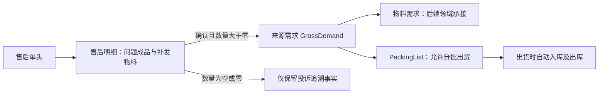

# 售后模块设计方案

> 更新日期：2026-09-08。用户已完成建表，后端第一批已实现并验证；页面、附件和特殊出货链路尚未实施。
> 最新冻结口径见[后端实施计划](售后模块后端实施计划.md)，实际接口与验证见[后端实施与前端交接](售后模块后端实施与前端交接.md)。本次对业务库仅只读核验，无迁移、外键或触发器变更。
## 1. 结论与范围

售后采用 `AfterSalesHeader` 和 `AfterSalesLine` 两张业务事实表。同一客户一张售后单，允许多条明细。每行分别表达问题成品和实际补发物料；不另建问题表、补发表、采购成本表或售后执行流水表。

售后保存投诉及认可的实物要求。保存不接入来源需求；执行“确认实物需求”后，只将正数量行交给 `GrossDemand`。售后不进入采购域，不创建采购订单，不维护普通入库、出库；后续由其他领域从来源需求接管，出货时由 PackingList 编排自动入库和出库。

允许分批补发，出货批次、数量及交付校验属于 PackingList。售后不保存累计已发量、剩余量或出货进度，未来通过来源需求及正式交付事实查询。物料需求和采购未来将继续收窄、解耦，本方案不建立售后到采购的强关系。

物料需求不是上述出货箭头的强制前置条件。自动入出库的供货依据与库存身份由下游设计，不能因为存在来源需求就视为已经实际到货，也不能为适应旧流程伪造采购单。

## 2. 已确认业务规则

| 项目 | 确定规则 |
|---|---|
| 服务单号 | 就是售后单号，只保留一个业务单号 |
| 客户 | 一单一个客户，可包含多个产品型号 |
| 问题与实物 | 同行分两组字段；成品出问题可以只补配件 |
| 一行粒度 | 一行最多一种补发物料；同一成品补多种配件时用多行，保存必要问题快照，不新建第三张表 |
| 客户型号 | 客户自己的产品型号，作为字符串快照 |
| AQ 型号 | ProductNeutral 的 ProductCode；采用 Product.LinkSku 的语义，在售后仅保存字符串快照，不关联 ProductNeutral |
| 物料编号 | Product.Sku；必须与 AQ 型号分开表达 |
| 原订单 | 放明细行，可空；单头仅查询展示摘要 |
| 责任供应商 | 关联 Supplier，表示售后责任方，不是采购执行供应商 |
| 表面处理 | 就是颜色，关联 ColorId；颜色名称快照建议同时保留 |
| 售后数量 | 就是补发数量；NULL 或 0 只保存投诉，不创建 GrossDemand；禁止负数 |
| 单位 | 默认 Pcs，已有明确单位保留；确认前保证非空 |
| 非标 | 沿用既有非标规则及自动 SKU；生成后保存，重试不得重新生成身份 |
| 确认 | 保存不接入；明确确认实物需求才接入 |
| 分批出货 | 允许，由 PackingList 管理，售后不限制批次 |
| 金额 | 每行我方应付人民币总金额，不是单价；不进入采购域，不做汇率换算 |
| 金额空值 | NULL 未确定；0 免费；正数付费；禁止负数 |
| 总金额 | 查询汇总；有空金额时显示费用未全部确定，不将 NULL 当免费 |
| 客户收费 | 归销售单，本期不启用，也不建立可编辑客户收费金额字段 |
| 收到日期 | 客户退回品实际收到日期，可空，放明细；不触发入库 |
| 发回日期 | 不保存，未来查询正式交付事实 |
| 运输方式及运输号 | 不保存，未来关联出货资料 |
| 完成日期 | 不建立独立字段；结案仍由状态表达，操作人和时间通过业务操作日志留痕 |
| 结案 | 已完成，或剩余要求已明确终止／处置后才能结案 |

数量 NULL 与 0 都不创建需求，保留原输入区别；不能为了进入需求而自动改为 1。金额与数量独立，零补发数量不自动强制金额为零。

## 3. 状态、确认与锁定

### 3.1 只保存两个状态维度

| 字段 | 业务语义 | 设计 |
|---|---|---|
| DocumentStatus | 单据生命周期 | 开放、已关闭、已作废；售后把已关闭显示为“已结案” |
| ConfirmationStatus | 当前实物要求是否已经确认 | 复用 ConfirmationStatusEnum：待确认 0、已确认 1 |

不建立模糊的 Status，不再将“草稿、处理中、部分发货”混入同一枚举。全零投诉单可以开放且未确认实物需求，处理完后直接结案。页面必须显示“实物需求确认”，不能让人误认为投诉未受理。

DocumentStatusEnum : byte 已冻结为 Open=0、Closed=8、Voided=9，仅售后采用，不修改既有销售枚举。当前销售 Closed=9，采购 Closed=8/Voided=9，不能直接互换数值。

确认时间和确认人是审计信息，不是另一套确认状态。取消确认成功后清空当前确认信息，历史确认与撤销保存在既有 BusinessOperationLog 中。

### 3.2 确认命令

1. 检查权限、单头与行版本、单据是否开放。
2. 筛选 Quantity>0 的行，校验实际补发资料，补齐默认单位，按既有规则生成并持久化非标 SKU。
3. 在同一业务事务内保存认可事实、调用来源接收并记录确认状态和操作日志。
4. 所有行均为 NULL/0 时不调用来源接收，不标记实物需求已确认；页面提示无需确认实物需求。
5. 以稳定 CommandId 和内容绑定实现幂等；重复操作不新建需求或重新生成非标 SKU。

### 3.3 锁定矩阵

| 内容 | 未确认且开放 | 已确认且开放 |
|---|---|---|
| 客户 | 可编辑 | 锁定 |
| 实际补发物料、型号快照、数量、单位、交期 | 可编辑 | 锁定 |
| 责任供应商、人民币售后金额 | 可编辑 | 锁定 |
| 新增／删除实物行、零数量改正数 | 可编辑 | 先取消确认 |
| 投诉描述、原因分析、处理说明、附件 | 可补充 | 可继续补充，不触发实物要求重新接收 |
| 问题成品身份、原订单、颜色等追溯字段 | 可编辑 | 确认后锁定，先成功取消确认才能修改 |

客户和来源实物字段的变更必须带动单头 Version 增加，不能只更新行 Version 而使 SourceVersion 不变。一般说明修改即使更新并发版本，也不应自动再次发布实物需求；接收版本是当时采用的快照，不要求每次售后更新都与 GrossDemand 相等。

### 3.4 取消确认、结案与反向

已确认要改锁定字段时，先取消确认，由来源需求检查能否安全撤回。只有撤回成功才清除确认状态并解锁；拒绝时整个操作保持原状态。来源领域如何删除未执行记录或作废留痕沿用合法退出协议，售后不得直接删 GrossDemand 或下游数据。

数量由正数改成零／空不能靠下一次提交忽略旧行；先完成安全撤回。已有下游事实无法撤回时，保留事实，由相应领域处置，不在售后自动修改采购或库存。

结案不是取消确认，也不能级联抹除下游。已有实物要求必须完成或明确处置。重开／作废需原因、权限与操作日志；重开不自动撤回确认或重新放出交付额度。Closed/Voided 常规编辑只读。

结案就绪由 SourceDemandClosureService 核验来源与正式交付净额或合法关闭；不能仅凭 NetDemand“已拆解”判定交付完成。

## 4. 两张表的字段字典

用户已完成建表，字段类型、精度和空值已只读核验。Uid 使用应用顺序 Guid；Version 初始 1；审计字段沿用 BaseEntity。日期默认由 Application 明确赋值，不另造与审计服务冲突的数据库时钟。

### 4.1 AfterSalesHeader

| 字段 | SQL 草案类型 | 空值 | 职责 |
|---|---|---|---|
| Uid | uniqueidentifier | 否 | 技术主键，来源头身份 |
| AfterSalesNo | nvarchar(100) | 否 | 售后单号，建议终身唯一，软删除不复用 |
| CustomerId | uniqueidentifier | 否 | 客户逻辑关系 |
| CustomerCodeSnapshot | nvarchar(100) | 否 | 客户编码历史快照 |
| CustomerNameSnapshot | nvarchar(200) | 是 | 客户名称历史快照 |
| AcceptedDate | date | 否 | 受理日期，新建默认当天 |
| OwnerId | uniqueidentifier | 是 | 关联 SysUser.Uid，默认当前用户 |
| DocumentStatus | tinyint | 否 | DocumentStatusEnum：Open=0、Closed=8、Voided=9 |
| ConfirmationStatus | tinyint | 否 | 实物需求确认状态 |
| DemandConfirmedAt | datetime2(7) | 是 | 当前确认时间 |
| DemandConfirmedBy | nvarchar(100) | 是 | 当前确认操作人，沿用项目审计身份表达 |
| ExpectedCompletionDate | date | 是 | 预计完成日期，不是实际完成日期 |
| Conclusion | nvarchar(2000) | 是 | 结案说明，结案时业务校验 |
| Remark | nvarchar(2000) | 是 | 单头备注 |
| Version / IsDeleted | int / bit | 否 | 乐观并发／软删除 |
| CreatedDate / UpdatedDate | datetime2(7) | 是 | 标准审计时间 |
| CreatedBy / UpdatedBy | nvarchar(100) | 是 | 标准审计人员 |

不包含 SupplierId、单一型号、原订单、总金额、发货数量、完成日期、运输资料。单头列表摘要由查询提供。

### 4.2 AfterSalesLine

| 字段 | SQL 草案类型 | 空值 | 职责 |
|---|---|---|---|
| Uid | uniqueidentifier | 否 | 来源行身份，排序变化不换 Uid |
| HeaderId | uniqueidentifier | 否 | 所属售后头 |
| LineNumber | int | 否 | 单内行号，建议不复用历史行号 |
| OriginalSalesOrderLineId | uniqueidentifier | 是 | 原销售行，可不关联 |
| ResponsibleSupplierId | uniqueidentifier | 是 | 责任 Supplier；草稿可待定，正数量确认时必填 |
| IssueProductId | uniqueidentifier | 是 | 问题成品 Product 身份 |
| IssueSkuSnapshot | nvarchar(100) | 是 | 问题成品物料编号 |
| IssueCustomerSkuSnapshot | nvarchar(100) | 是 | 问题成品客户型号 |
| IssueLinkSkuSnapshot | nvarchar(100) | 是 | 问题成品 AQ 型号字符串 |
| IssueColorId | uniqueidentifier | 是 | 问题成品颜色逻辑关系 |
| IssueColorSnapshot | nvarchar(100) | 是 | 问题成品颜色名称快照 |
| IssueProductDescription | nvarchar(500) | 是 | 问题产品描述 |
| IssueDescription | nvarchar(2000) | 否 | 投诉内容，建议至少填写非空文字 |
| QualityCategoryId | uniqueidentifier | 是 | 关联 SysDictData.Uid，字典代码 AfterSalesQualityCategory |
| CauseAnalysis | nvarchar(2000) | 是 | 原因分析，与处理方案分开 |
| ProductId | uniqueidentifier | 是 | 实际补发 Product；非标按既有规则不绑定 |
| IsNonStandard | bit | 否 | 实际补发是否非标，默认否 |
| SkuSnapshot | nvarchar(100) | 是 | 实际补发 SKU；正数量确认前必须具备 |
| CustomerSkuSnapshot | nvarchar(100) | 是 | 实际补发客户型号，不机械复制问题成品 |
| LinkSkuSnapshot | nvarchar(100) | 是 | 实际补发 AQ 型号，不关联 ProductNeutral |
| DescriptionSnapshot | nvarchar(500) | 是 | 实际补发描述 |
| ColorId / ColorSnapshot | uniqueidentifier / nvarchar(100) | 是 | 实际补发颜色身份／名称快照 |
| SpecificationSnapshot | nvarchar(500) | 是 | 实际补发规格快照 |
| Quantity | decimal(18,4) | 是 | 补发数量，NULL/0 不接收，禁止负数 |
| UnitSnapshot | nvarchar(100) | 否 | 默认 Pcs；空白输入由服务规范化 |
| RequiredDate | date | 是 | 本行实物要求交期 |
| ServiceAmountCny | decimal(18,2) | 是 | 整行人民币金额；NULL 未定、0 免费、正数付费 |
| ReturnedReceivedDate | date | 是 | 客户退回品实际收到日期，不改变库存 |
| TreatmentDescription | nvarchar(2000) | 是 | 处理方案与补充说明 |
| Remark | nvarchar(2000) | 是 | 行备注 |
| Version / IsDeleted | int / bit | 否 | 标准并发／软删除 |
| CreatedDate / UpdatedDate | datetime2(7) | 是 | 标准审计时间 |
| CreatedBy / UpdatedBy | nvarchar(100) | 是 | 标准审计人员 |

零／空数量行可没有补发物料资料，但问题追溯内容仍应可辨识。正数量草稿可待完善；确认校验比草稿保存严格。问题产品与补发产品不能共用一组字段：例如问题为 10 套成品、实际补 20 个螺丝，Quantity 只保存 20，不保存第二个问题数量字段。

当前只有一个退回收到日期，表示该行记录的收到日期，不建设多次退回数量／批次流水；确需此类精细追溯时另行讨论，不据此自动扩表。

### 4.3 关系、快照和索引

- HeaderId 表达不可脱离单头的逻辑父子关系，不建立数据库外键；父记录存在性、头行一致性及软删除由 Application 在事务内校验和处理。
- CustomerId、Supplier、Product、Color、原销售行均采用逻辑关联。两张表不建立任何外键或触发器，由 Application 校验关系和维护审计。
- 型号、名称、规格等快照保存当时事实，不因主数据更名自动刷新。
- 原订单、责任供应商等可空关联查询使用 LEFT JOIN；历史售后不能因关联对象停用而消失。
- 售后单号唯一；单内行号唯一；HeaderId 支撑详情加载；客户/状态/日期索引支撑 Manager；原订单和责任方索引支撑追溯。
- 费用先按行汇总，再与其他一对多事实联接，避免交付和附件造成金额倍增。
- 不在售后行保存第二套可编辑 GrossDemandId 映射；通过 SourceType+SourceUid+SourceLineId 查询。若后续为性能增加关联缓存，需单独说明权威来源。

## 5. 来源需求映射与边界

| 来源字段 | 售后来源 |
|---|---|
| SourceType | 售后，建议复用当前 ComplaintReplenishment=CR，不在本次改码 |
| SourceUid | Header.Uid |
| SourceNo | Header.AfterSalesNo |
| SourceLineId | Line.Uid |
| SourceLineNumber | Line.LineNumber |
| SourceVersion | 接收时单头 Version |
| CustomerId | Header.CustomerId |
| ProductId / IsNonStandard | Line 对应补发字段 |
| SkuSnapshot | Line.SkuSnapshot |
| LinkSkuSnapshot | Line.LinkSkuSnapshot，即补发 AQ 型号 |
| CustomerSkuSnapshot | Line.CustomerSkuSnapshot |
| DescriptionSnapshot / ColorSnapshot / SpecificationSnapshot | Line 对应补发快照 |
| UnitSnapshot | Line.UnitSnapshot，默认 Pcs |
| DemandQty | Line.Quantity，仅大于零 |
| RequiredDate / Remark | Line 对应实物要求 |

现有接收契约不要求 ColorId，传颜色名称快照即可；问题成品、责任供应商、售后金额不扩进来源需求，来源身份足以回查。

GrossDemand 是实物要求的接收对象，不替代售后投诉表。全零单不调用接收；混合单只发送正数量行。未提交行不能被当作自动撤销：调整曾接收行须先安全取消确认。

来源需求是后续交接和查询锚点；物料需求拆解状态、正式交付进度属于不同事实。查询出货以正式交付及反向净额为依据，不将物料需求已拆解、计划量或 PL 草稿视为已发货。

## 6. Manager 与 Detail

### 6.1 Manager

一行一张售后单。筛选：关键词（单号、客户型号、AQ 型号、物料编号）、客户、责任供应商、单据状态、实物确认状态、受理日期。查询任一明细匹配时返回单头，不因多行匹配产生重复单据。

建议列：售后单号、客户、受理日期、负责人、问题型号摘要、责任方摘要、单据状态、实物确认状态、人民币金额及未定费用提示。未来按真实需要追加派生进度，初期不承诺已接线。

入口：新建、打开、刷新；确认、取消确认、结案等权威操作集中 Detail。复用既有分页模型，不建设万能操作工作台。

### 6.2 Detail

顶部为保存、确认实物需求、取消确认、结案和更多操作；分别展示单据状态、实物需求确认状态。

主体：客户与受理资料表单＋售后明细表。明细表区分问题成品和补发物料，长投诉、原因分析、处理说明通过当前行下方编辑区展示。金额按行录入；退回收到日期可空。

附件组件可以显示整单或当前行资料，不增加售后第三张事实表。未来物料需求／交付查询作为只读区域或跳转，不复制下游业务命令。

已确认字段只读，原因明确；取消确认失败保留编辑前状态。页签身份建议 after-sales:{Uid}，重复打开激活现有页签，不覆盖未保存输入。前端模型遵循 CommunityToolkit MVVM；具体布局、权限键、API 命名属于后续实施设计。

### 6.3 用例及契约建议

| 用例 | 候选契约 | 消费者／边界 |
|---|---|---|
| 分页查询 | AfterSalesSearchRequest / AfterSalesListItemDto | Manager；单头及行摘要 |
| 详情查询 | AfterSalesDetailDto | Detail；两张表的主要资料 |
| 保存 | SaveAfterSalesCommand / Result | 只保存事实，校验锁定字段及版本 |
| 确认／取消确认 | 独立 Command / Result | 调用来源服务，不从 WPF 多次调用拼事务 |
| 结案／重开／作废 | 独立 Command / Result | 原因、状态及下游条件检查 |
| 进度查询 | 专用只读 Query DTO，按实际需要定义 | 通过来源身份聚合，禁止回写进度 |

售后 DTO 按售后用例新建，不复用销售或采购的宽编辑 DTO。分页、确认枚举和公共返回包装优先复用。Busy、选中、脏状态、金额未定提示属于客户端 Model 或查询结果，不进入 Entity。

## 7. 附件方案的讨论结论与限制

初期建议使用现有 WebApi 内的公共附件模块及专用存储，不立即拆独立部署微服务。文件模块保存文件元数据和业务关联，售后只使用附件能力。此为先前讨论建议，公共模块的表结构、存储介质、大小限制、类型清单尚未冻结，本 SQL 不包含附件表或虚构已存在的文件接口。

附件上传、下载必须校验售后访问权限；已确认仍可补充附件。草稿先保存获得身份再关联文件；临时文件、失败重试、孤立文件清理和移除留痕在公共模块处理。不能用一个资料链接字段假装已经实现多附件管理。

## 8. 当前源码事实与实施缺口

2026-09-08 后端已构建及隔离数据库验证；以下区分已实现与后续范围。

| 来源 | 当前事实 | 与目标关系 |
|---|---|---|
| AfterSalesDetailView.xaml | 本轮此前读取到空页面；QualityControl 目录有用户未提交内容 | 本文不修改或覆盖页面，实施前重读 |
| Product / ProductNeutral | Product 保存 LinkSku；用户确认其业务语义为 AQ 型号 | 本设计采用字符串快照，不增加 Neutral 关系 |
| SourceDemandReceptionService | 已支持 SO/CR；要求正数量、非空 SKU；标准要求 ProductId 与单位，非标不能绑定 ProductId | 售后显式确认已接线，零/空行不接收；默认 Pcs、沿用非标 |
| ISourceDemandReceptionService | 支持调用方事务、幂等接收及安全退出 | 复用，不由售后直接操作需求表 |
| SysEnums | 生命周期名称／数值存在差异；ConfirmationStatusEnum 已共用 | 新增 DocumentStatusEnum 0/8/9 仅供售后使用；不迁移旧模块 |
| BaseEntity | Uid 应用生成、Version=1、软删除及可空审计 | SQL 草案沿用 |
| 下游执行 | 尚未通过本次工作验证售后无采购自动入出库的完整链路 | 必须建立合法售后供货依据，不伪造采购或放宽库存校验 |

早期讨论中的三张核心表、分批禁止、从采购汇总售后成本、独立 Status、CompletedAt/CompletedBy、单独发回及物流字段均已撤销，不得从前文恢复到实施方案。

工程架构旧文档描述普通来源需求／采购／出货链路，不应被解释为本次售后必须建采购单。本轮已将售后事实与来源交接规则同步到业务总纲及售后模块能力地图。

## 9. 数据库实施状态

用户已完成 SQL Server 两表建表和状态列 tinyint 调整；本次不恢复已清空的 SQL 草案、不重新建表。只读核对两表共 57 列、默认值、CHECK 和索引；外键 0、触发器 0。OwnerId 关联 SysUser.Uid，QualityCategoryId 关联 SysDictData.Uid，分类代码 AfterSalesQualityCategory，均可空。DocumentStatus 0/8/9 已冻结。

数量 decimal(18,4)、人民币行金额 decimal(18,2)。标准/非标确认必填、当前客户关系、来源接收、锁定与结案由 Application 事务校验。空白单位由服务补 Pcs。

## 10. 已核对与后续事项

后端状态、负责人和字典身份、正数量责任方及金额必填、事实锁定、非标生成入口、编号与数据库结构均已核对并实施。原订单为本客户销售行，可空。取消拒绝后在下游处理，售后不提供终止剩余要求命令。

后续另行实施：WPF Manager/Detail、公共附件、完整进度查询，以及售后无采购出货所需的合法供货依据、库存身份、单位和特殊物料消耗规则。本次来源接线不能代替这些下游能力。
## 11. 后续实施切片与验收

### 11.1 实施顺序（前两项已完成）

1. 冻结第 10 节涉及建表与状态的项目，按授权同步业务总纲及模块索引，避免只有新文档知道特殊边界。
2. Contracts 和后端：两表、查询／保存、状态和锁定、来源确认／取消确认、审计；Repository 只读写，Application 编排事务，Controller 保持 HTTP 边界。
3. WPF：Manager 和 Detail、两组产品字段、金额提示、确认锁定和取消失败反馈。
4. 公共附件能力按独立授权实施；进度与 PackingList 售后执行由对应领域接线，不附带实现采购关系。
5. Reviewer 按以下场景验收，不用删除断言或绕过下游校验换取通过。

### 11.2 代表性验收场景

- 多型号同客户保存；原订单为空可正常保存。
- 成品投诉只补配件，GrossDemand 使用配件身份和补发数量。
- NULL、0、正数混合行只接收正数；全零不调用接收且可正常结案。
- 默认 Pcs 正确补齐；非标自动 SKU 持久化，重试身份不变。
- 确认失败不留半份来源需求或已确认状态；同命令重试不重复创建。
- 责任方、金额、客户及实物要求确认后锁定；来源拒绝取消时仍保持锁定。
- 取消成功后修改并重新确认，没有第二份有效交付额度。
- 金额未定、免费、付费可区分；多次交付联表不重复累计行金额。
- 退回收到日期为空合法，填写日期不产生库存流水。
- 分批补发由 PackingList 执行，售后查询正式交付，不维护重复进度。
- 主数据更名不刷新历史 AQ、客户型号和 SKU 快照。
- 全零投诉无实物确认也能结案；未处置实物要求不能误结案。
- 生命周期与确认分开显示，不新增售后过账或采购状态。

## 12. 来源与本轮验证记录

主要源码依据（相对于本文目录）：

- [BaseEntity](../SwiftExport.Core/Common/BaseEntity.cs)
- [Product](../SwiftExport.Core/Entities/MasterData/Product.cs)
- [ProductNeutral](../SwiftExport.Core/Entities/MasterData/ProductNeutral.cs)
- [CustomerProduct](../SwiftExport.Core/Entities/Relations/CustomerProduct.cs)
- [GrossDemand](../SwiftExport.Core/Entities/DemandPlanning/GrossDemand.cs)
- [来源接收接口](../SwiftExport.Application/Interfaces/DemandPlanning/ISourceDemandReceptionService.cs)
- [来源接收服务](../SwiftExport.Application/Services/DemandPlanning/SourceDemandReceptionService.cs)
- [确认枚举](../SwiftExport.Contracts/SysEnums/Common/SystemEnums.cs)
- [销售枚举](../SwiftExport.Contracts/SysEnums/Sales/SalesOrderEnums.cs)
- [采购枚举](../SwiftExport.Contracts/SysEnums/Procurement/ProcurementEnums.cs)

本轮已实施后端及共享契约，后端解决方案构建通过、33 项针对性测试通过（含 4 项隔离 LocalDB）。业务库仅只读核验，无迁移；WPF/VSTO 原有改动均保留。详细范围与测试证据见[后端实施与前端交接](售后模块后端实施与前端交接.md)。