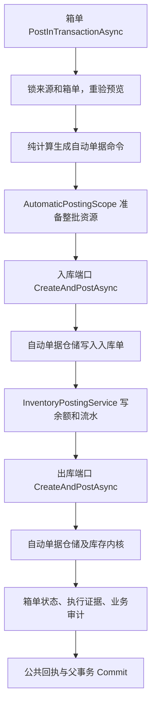

# 应用服务层调用链阅读指南

核对日期：2026-10-07。本文帮助读者从一个业务动作找到执行主线、实际仓储和提交位置。逐个服务的入口与改善建议见 [逐项盘点](D:/Documents/source/CSharp/SwiftExport/docs/应用服务层逐项盘点与可读性建议.md)。这里描述当前源码，不要求按目录顺序执行，也不提出新的业务规则。

## 先找到业务主体

一个用例应当能回答：校验什么、读取什么、改变什么、哪些改变一起提交。当前代码通常把这条主线放在私有的 `…InTransactionAsync` 方法中；公开入口前面还有授权、输入验证、回执和错误包装。

| 要读的业务动作 | 优先打开的主体方法 |
| --- | --- |
| 销售确认 | [SalesOrderConfirmationService.ConfirmInTransactionAsync](D:/Documents/source/CSharp/SwiftExport/SwiftExport.Application/Services/SalesOrders/Confirmation/SalesOrderConfirmationService.cs) |
| 销售取消确认 | [SalesOrderCancellationService.CancelInTransactionAsync](D:/Documents/source/CSharp/SwiftExport/SwiftExport.Application/Services/SalesOrders/Confirmation/SalesOrderCancellationService.cs) |
| 建立物料需求 | [MaterialDemandEstablishmentService.EstablishInTransactionAsync](D:/Documents/source/CSharp/SwiftExport/SwiftExport.Application/Services/DemandPlanning/Materials/Establishment/MaterialDemandEstablishmentService.cs) |
| 回退物料需求 | [MaterialDemandReversalService.ReverseInTransactionAsync](D:/Documents/source/CSharp/SwiftExport/SwiftExport.Application/Services/DemandPlanning/Materials/Reversal/MaterialDemandReversalService.cs) |
| 需求转采购草稿 | [PurchaseDraftCreationService.CreateSourceAsync](D:/Documents/source/CSharp/SwiftExport/SwiftExport.Application/Services/Procurement/PurchaseOrders/Draft/FromDemand/PurchaseDraftCreationService.cs) |
| 采购确认 | [ProcurementOrderConfirmationService.ConfirmInTransactionAsync](D:/Documents/source/CSharp/SwiftExport/SwiftExport.Application/Services/Procurement/PurchaseOrders/Confirmation/ProcurementOrderConfirmationService.cs) |
| 人工入库过账 | [InboundPostingService.PostInTransactionAsync](D:/Documents/source/CSharp/SwiftExport/SwiftExport.Application/Services/Inventory/Inbounds/InboundPostingService.cs) |
| 人工出库过账 | [OutboundPostingService.PostInTransactionAsync](D:/Documents/source/CSharp/SwiftExport/SwiftExport.Application/Services/Inventory/Outbounds/OutboundPostingService.cs) |
| 箱单过账 | [PackingListPostingService.PostInTransactionAsync，位于 Execution 文件](D:/Documents/source/CSharp/SwiftExport/SwiftExport.Application/Services/Shipping/PackingLists/PackingListPostingService.Execution.cs) |
| 箱单整单反向 | [PackingListReversalService.ReverseInTransactionAsync](D:/Documents/source/CSharp/SwiftExport/SwiftExport.Application/Services/Shipping/PackingLists/PackingListReversalService.cs) |

先读主体的顺序，再追它直接调用的业务协作方法。最后看仓储 SQL 和公共命令设施。这样能先理解业务，再理解执行机制。

## 用例与协作服务及仓储

名字中的 `Service` 不能说明它是否拥有事务；`Builder` 也不能证明它不访问数据库。

| 角色 | 当前例子 | 读者应关注 |
| --- | --- | --- |
| 独立用例入口 | 销售确认、物料建立、采购确认 | 当前动作的业务顺序、事务范围、正式写入 |
| 参加父事务的业务协作 | SourceDemandReceptionService、InventoryPostingService、自动入出库端口 | 保护哪些跨调用方规则、访问哪些数据、失败是否传播 |
| 纯计算或组装 | GrossDemandDecompositionPlanner、供应商初始化器、PurchaseDraftWriteModelBuilder | 输入和输出；这些类自身不查库、不提交 |
| 读取并验证事实的辅助 | ProcurementConfirmationBuilder | 虽叫 Builder，仍通过仓储读取客户、供应商、产品和单位 |
| 仓储 | Core 接口对应的 PostgreSQL 实现 | SQL、锁定数据、共享 Transaction；不拥有整个业务提交 |
| 技术执行边界 | CommandPipeline、BusinessCommandExecutor、各域 Support | 授权、验证、结果转换、回执或事务；不能当作下一个单据 |

## 同一个事务怎样覆盖多个仓储

当前基本链路是：

```text
Controller → 用例服务 → CommandPipeline → BusinessCommandExecutor
  → 开启事务并写入共享 Session.Transaction
  → 调用当前用例的业务主体
    → 仓储 A / 仓储 B / 参加父事务的业务协作
  → 写公共 CommandReceipt → Commit
```

[CommandPipeline](D:/Documents/source/CSharp/SwiftExport/SwiftExport.Application/Commands/CommandPipeline.cs) 调用授权委托，并通过 [CommandRequestValidator](D:/Documents/source/CSharp/SwiftExport/SwiftExport.Application/Commands/Validation/CommandRequestValidator.cs) 查找注册的命令验证器。验证器不是建立服务手动调用的步骤。

[BusinessCommandExecutor](D:/Documents/source/CSharp/SwiftExport/SwiftExport.Application/Commands/BusinessCommandExecutor.cs) 先做命令及可选资源准备，再开事务、核对已有回执。已有相同命令结果时跳过业务主体；首次执行成功才保存回执并提交。异常路径执行回滚和清理。最外层用例决定哪些业务动作必须原子完成，执行器承担实际事务操作。

[Infrastructure DI](D:/Documents/source/CSharp/SwiftExport/SwiftExport.Infrastructure/DependencyInjection.cs) 将 Core `IDbSession` 和 Infrastructure `DbSession` 解析为同一个 scoped 对象。`ServiceBaseContext` 与 `RepositoryBaseContext` 通过这两个入口共享该对象；Application 不直接引用 PostgreSQL 仓储类。

| Application 使用的 Core 接口 | DI 对应的具体仓储 |
| --- | --- |
| ISalesOrderHeadRepository | [PostgreSqlSalesOrderHeadRepository](D:/Documents/source/CSharp/SwiftExport/SwiftExport.Infrastructure/Repositories/SalesOrders/Document/PostgreSqlSalesOrderHeadRepository.cs) |
| IGrossDemandDocumentRepository | [PostgreSqlGrossDemandDocumentRepository](D:/Documents/source/CSharp/SwiftExport/SwiftExport.Infrastructure/Repositories/DemandPlanning/Sources/Document/PostgreSqlGrossDemandDocumentRepository.cs) |
| IMaterialDemandDocumentRepository | [PostgreSqlMaterialDemandDocumentRepository](D:/Documents/source/CSharp/SwiftExport/SwiftExport.Infrastructure/Repositories/DemandPlanning/Materials/Document/PostgreSqlMaterialDemandDocumentRepository.cs) |
| INetDemandExecutionLinkRepository | [PostgreSqlNetDemandExecutionLinkRepository](D:/Documents/source/CSharp/SwiftExport/SwiftExport.Infrastructure/Repositories/DemandPlanning/Materials/Execution/PostgreSqlNetDemandExecutionLinkRepository.cs) |

仓储写入使用当前 Connection 和 Transaction。例如物料仓储的 `AddDecompositionAsync` 插入 NetDemand，内部 `Command` 将共享事务传给 Dapper。仓储写入完成表示 SQL 执行完成，尚不表示整个用例已经提交。

这个模型适用于同一次命令，不能扩大成销售、采购、入库、箱单全生命周期共用一个事务。

## 销售确认和取消确认

### 正常首次确认

```text
SalesOrderConfirmationController.ConfirmAsync
  → SalesOrderConfirmationService.ConfirmAsync
    → Pipeline → Executor
      → ConfirmInTransactionAsync
        1. 锁订单头和行，核对状态、版本及明细
        2. 销售仓储更新确认状态
        3. SourceDemandReceptionService.ReceiveAsync
           → 来源仓储读取已有来源
           → 新来源写 GrossDemand；已有来源按版本与内容判断更新或保持
           → 写来源接收审计
        4. 写销售确认审计
      → 执行器写回执并 Commit
```

[来源接收](D:/Documents/source/CSharp/SwiftExport/SwiftExport.Application/Services/DemandPlanning/Sources/Reception/SourceDemandReceptionService.cs) 要求已有事务，不独立 Commit。它服务于销售和售后，处理来源行唯一性、版本一致性、内容变化和安全退出，具有真实共享业务职责。正常首次确认产生 GrossDemand，不顺带产生 NetDemand、采购单或库存。

### 取消确认

```text
SalesOrderCancellationService.CancelInTransactionAsync
  → 锁销售头行、核对取消资格
  → SourceDemandReceptionService.CancelConfirmationAsync
    → 来源仓储锁 GrossDemand
    → MaterialDemandSourceExitService.AssessSourceExitAsync
       → 物料仓储读取并锁定历史，证明无活动修订且历史完整
    → Shipping.SourceDeliveryService.VerifySourceExitAsync
       → 箱单仓储核验草稿、正式交付等退出阻断
    → SourceDemandCancellationPolicy 生成删除/作废计划
    → 来源仓储执行硬删除或作废保留
  → 销售仓储恢复待确认 → 审计 → 公共回执 → Commit
```

这里访问物料基础设施主要为退出证明，不是在取消销售时顺手回退物料。活动物料或其他下游事实会阻断取消；需要执行的反向动作由对应独立命令完成。

售后确认/取消使用同一个来源协作服务，来源类型为 CR；售后确认只有正数量实物行进入成品需求。不能据销售的正常首次确认推断所有售后行都生成来源。

## 建立物料需求和截图目录

```text
MaterialDemandEstablishmentController.EstablishFromSourcesAsync
  → EstablishAsync → Pipeline → Executor（Serializable）
    → EstablishInTransactionAsync
      1. 来源仓储按稳定顺序锁 GrossDemand
      2. 校验活动状态、成品需求版本和来源单版本
      3. 物料仓储检查已有活动修订、依据指纹及下一修订号
      4. BuildPlanAsync 读取产品与当前共享 BOM
      5. GrossDemandDecompositionPlanner.BuildPlan 生成内存中的 NetDemand
      6. 填来源快照，读取供应商，Apply 填建议供应商
      7. 物料仓储 AddDecompositionAsync 写全部物料行
      8. 写业务审计
    → 公共回执 → Commit
```

同一建立命令的来源批次在同一事务内处理；某项业务失败会向执行器传播。当前计算建立根物料及直接客供件，不应按名字理解为任意层级、扣库存或在途的完整 MRP。

| 截图文件/目录 | 被谁调用、负责什么 | 是否独立用例 |
| --- | --- | --- |
| Establishment/MaterialDemandEstablishmentService | Controller 调用；编排上述建立主线 | 是 |
| EstablishMaterialDemandsCommandValidator | 公共验证设施调用；校验命令结构 | 否 |
| GrossDemandDecompositionPlanner | 建立服务调用；内存计算物料行 | 否 |
| Models/GrossDemandDecompositionPlan | Planner 的计算结果、错误及物料行容器 | 否，无执行流程 |
| MaterialDemandSuggestedSupplierInitializer | 建立服务调用；对内存物料行填写建议 | 否，无数据库访问 |
| Sources/MaterialDemandSourceQueryService | 查询可供建立的来源分组和候选行 | 独立查询 |
| Query/MaterialDemandQueryService | 查询已建立的物料、来源分组及 Trace | 独立查询 |
| Reversal/MaterialDemandReversalService | RollbackAsync 核对修订和下游执行，再标记回退 | 独立命令 |
| RollbackMaterialDemandsCommandValidator | 公共验证设施调用 | 否 |
| SourceExit/MaterialDemandSourceExitService | 来源接收及手工来源用例调用；在父事务中提供物料证明 | 内部协作，无提交权 |
| SupplierSuggestion/MaterialDemandSupplierSuggestionService | 修改已有物料行的供应商建议 | 独立命令 |
| UpdateSuggestedPurchaseSupplierCommandValidator | 公共验证设施调用 | 否 |
| MaterialDemandException | 表达物料业务拒绝；不是执行步骤 | 否 |

这些目录不组成一个从上往下执行的管线。建立服务的直接计算协作者都在 Establishment；Query、Reversal、SupplierSuggestion 是其他动作的入口。

## 物料需求进入采购时的 Link 写入

实际创建 Link 的代表性入口是需求转采购草稿，不是采购确认。

```text
PurchaseDraftCreationController.CreateAsync
  → PurchaseDraftCreationService.CreateAsync
    → 逐个来源执行 CreateSourceAsync
      → 为当前来源开启事务
      → 锁 GrossDemand → NetDemand → 已有 Link/CommandItem
      → 检查已有命令项是否构成完整重放
      → BuildLockedPreviewRequestAsync 补齐锁定事实
      → PurchaseDraftPreviewBuilder 重新计算并校验来源预览令牌
      → 按供应商决定新建或追加采购草稿
      → PurchaseDraftWriteModelBuilder 生成 Head / Lines / Links
      → 采购仓储 InsertPurchaseDraftAsync / InsertPurchaseDraftLinesAsync
      → Link 仓储 InsertPurchaseLinksAsync
      → 必要时推进追加草稿版本
      → 当前来源 Commit，发布该来源成功结果
    → 汇总各来源结果
```

这正是“同一用例调用多个仓储一起提交”的例子。写模型 Builder 不查库；创建服务明确依次写采购头行和 Link。

特殊点在于事务范围：同一来源内多个供应商草稿一起成功或失败，不同来源允许部分成功。它使用 `ExecutionRequestId + CommandItemId` 和已有 Link 核验重放，未直接套公共 BusinessCommandExecutor。不能为了形式统一，改成整个请求一个事务或替换既有幂等协议。

目前最费解的一跳是：创建服务注入具体 `PurchaseDraftPreviewService`，调用其 internal `BuildLockedPreviewRequestAsync`。这不是再次执行用户的 PreviewAsync，也不是使用以前预览的结果直接写库；它是正式命令事务内重新准备事实。名字和所属类没有充分表达这个角色。

### 后续采购确认

```text
ProcurementOrderConfirmationService.ConfirmInTransactionAsync
  → IProcurementOrderFactLockRepository.LockAsync 取得锁定事实
  → 验证活动来源与 Link 贡献、草稿状态和版本
  → ProcurementConfirmationBuilder.BuildAsync 读取并验证引用资料
  → 比较确认依据指纹
  → 采购文档仓储 ConfirmAsync
  → 审计 → 公共回执 → Commit
```

采购确认不新建 Link、不读取当前 BOM、不写库存。它验证创建或补关联时已经形成的 Link。`IProcurementOrderFactLockRepository` 当前解析到采购反向仓储接口对应的 PG 实现；因此局部变量名 `reversalFacts` 容易让人误以为确认在执行反向，实际调用的是共享锁定读取。

取消采购确认保留 Link；删行或作废按采购反向规则释放贡献。不能把“取消确认”统一理解为删除下一单据关系。

## 入出库和箱单的协作层

人工入库/出库过账的主线仍然是单据服务：锁定单据与必要来源，重新计算预览及校验令牌，组装库存明细，调用 InventoryPostingService，更新单据状态，写审计及公共回执，统一提交。入库另外核对采购净可收容量；普通人工出库不代表客户正式交付。

InventoryPostingService 要求已有事务，在内部维护不可变 InventoryLedgerEntry 和 InventoryBalance；它是多个单据真正共享的业务内核，不能简单改成每个调用方各写一套余额和流水。

箱单涉及的协作者更多，但提交仍是同一个父命令：



图中入出库动作按实际计划选择，并非每张箱单都发生。非标来源或 CR 当前走仅交付路径，不产生这些库存动作。

[Application DI](D:/Documents/source/CSharp/SwiftExport/SwiftExport.Application/DependencyInjection.cs) 将 `IInboundPostingPort` 和 `IOutboundPostingPort` 指向同一 scoped `AutomaticPostingPorts`，它用显式接口实现分别转入内部 CreateAsync/ReverseAsync。这些是应用层内部端口，不是 Infrastructure 仓储，也不经过人工入出库 Controller。

箱单反向读取原执行证据，通过端口反向原自动单据和库存，再更新箱单及证据；不会按今天的 BOM 重新生成历史执行方案。

### 提交权和失败处理不是同一件事

正常提交由最外层执行器负责，但当前内部层也有失败保护：InventoryPostingService.ProtectAsync 会尝试回滚父事务；AutomaticPostingScope.Abort 还会回滚并清空共享 Session.Transaction。箱单主体最后检查事务是否被内部终止，异常向外传播；外层执行器持有局部 transaction 对象做最终清理。

因此“内部不会提交”是当前事实，“只有外层会回滚或改变事务引用”不是当前事实。内部清空父事务引用与项目 Skill 所要求的所有权规则存在偏差，见逐项盘点中的 R06。当前失败保护不能在只做可读性调整时随手删除。

## 简单服务怎样读

- Query/Trace：公开方法 → 权限或 ReadSupport → 对应只读仓储；没有下一单据写入。采购确认上下文/反向预览等一致性读取可能开启只读事务，不等于正式命令。
- 普通主数据：BatchSaveAsync → 当前类的校验方法 → 仓储增改删 → 当前类事务提交。继承 BaseService 的类型还可能使用基类 CRUD hook。
- 产品与 BOM：单条写入部分转入批量保存内核；产品还会保护共享 BOM 绑定，不能只读 BaseService 就判断全部行为。
- ForExcel：CheckAsync 是导入检查，不能当作保存；真正保存要再进入对应业务用例。
- 文件上传：访问文件存储和图片处理，不在数据库事务中。数据库 Commit 不提供文件系统回滚。
- DocumentNoService：取号会写号段，通过仓储使用现有事务；无事务调用时 PG 单语句自动提交。它不是纯字符串格式化。

## 当前验证范围

本次核对入口、服务引用、DI、关键仓储和相关测试入口，并重新执行 Application 构建，结果为 0 警告、0 错误。未修改业务代码、未运行数据库或业务测试。上述调用链是源码事实说明，不代表所有分支或并发场景已在运行数据库验收。
